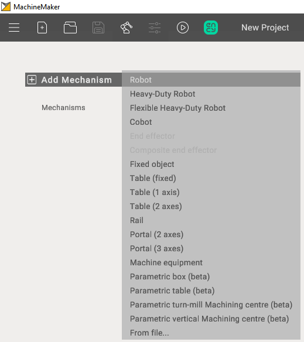
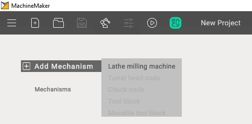

---
title: "Adding a mechanism"
---

# Adding a mechanism

First of all it is necessary to add the desired mechanism to your project using **Add Mechanism** button

# [Milling Machines](#tab/machines)

# [Robots](#tab/robots)

# [Turn-Milling Machines](#tab/turnmill)

---

When adding additional mechanisms, you can double-click on the desired option in the mechanism tree to open a selection of files or use "Add mechanism"

## Supported mechanism types

The list of mechanism types depends on the application context. For a milling machine, add its 3D model; the machine template is selected when [grouping elements into nodes](129940248.md).

### Robot cells

- **Robot** - common industrial 6-axes robotic arm.
- **Heavy-Duty Robot** - high payload robot with additional joints.
- **Cobot** - collaborative 6-axes robotic arm.
- **End effector** - device at the extremity of the robotic arm, designed to interact with the environment. Spindles, Laser Heads, Wire Cutters and etc. Robot can contain any number of end effectors. End effector can be added only after the robot is selected.
- **Composite End effector** - complex devices, contain movable parts. For example gripper with fingers.
- **Fixed object** - any fixed object (controller, enclosure, etc).
- **Table (fixed)** - static table
- **Table (1 axis)** - rotary table (positioner) with 1 axis
- **Table (2 axes)** - rotary table (positioner) with 2 axes
- **Rail** - rail or any another linear axis. Usually allows you to move the robot along the X axis.
- **Portal (2 axes)** - mechanism with 2 linear axes. Usually allows you to move the robot along X-Y axes.
- **Portal (3 axes)** - portal, mechanism with 3 linear axes. Usually allows you to move the robot along X-Y-Z axes.
- **Machine equipment -** Universal equipment with the possibility of configuration.
- **Parametric box -** Cube, with the possibility of changing its length, width, height.
- **Parametric table -** Table, with the possibility of changing its length, width, height, thickness and height of legs.
- **Parametric turn-mill Machining centre -** Parametric machine (Turn).
- **Parametric vertical Machining centre -** Parametric machine (Mill).
- **From file** - allows you to add a mechanism exported to .mmm file. Check [Mechanisms Library](129932035.md) for more information about .mmm files

Robots, Heavy-Duty Robots and Cobots have different kinematic schemes:

### Turn-milling machines

- **Turret Head Node** - a component enabling tool rotation and positioning during operation, often facilitating tool fixation, tool change, and positional data processing.
- **Chuck Node** - a component for securing workpieces or tools during machining, typically incorporating clamping mechanisms such as collet chucks or hydraulic clamps, with control and adjustment features.
- **Tool Block** - a component for mounting and supporting cutting tools during material processing, designed for various tool types like drills, mills, and inserts, usually equipped with quick-change and adjustment mechanisms.
- **Movable Tool Block** - a device capable of spatial movement to precisely position tools or workpieces during machining operations, often movable along different axes and controlled by mechanical, hydraulic, or electrical systems.
