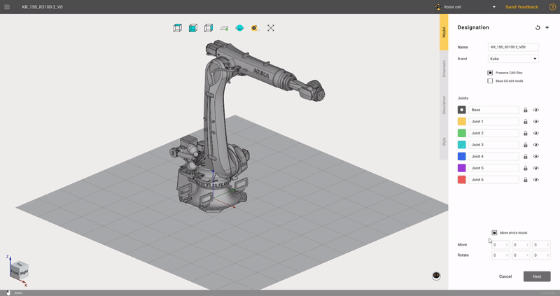
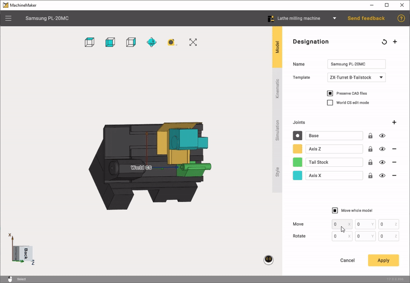
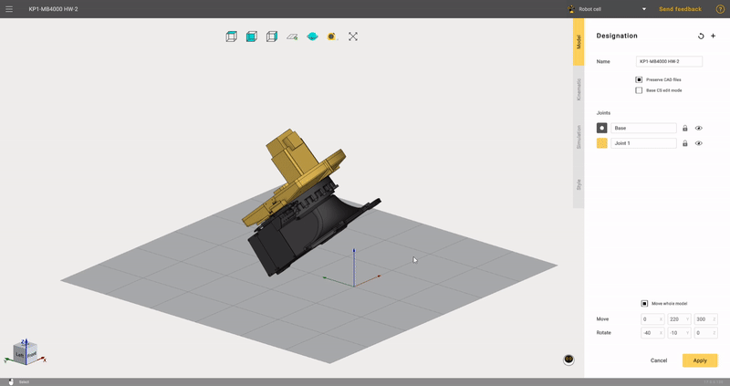

---
title: "3D 객체 준비 및 가져오기"
---

# 3D 객체 준비 및 가져오기

## 지원되는 3D 모델 형식

- **3dm:** Rhinoceros 3D
- **sldprt, sldasm:** SolidWorks
- **par, psm, pwr, asm:** Solid Edge
- **stp, step**
- **x\_t, x\_b** : Parasolid
- **igs, iges**
- **jt**
- **OSD**
- **STL**

여러 파일을 한 번에 선택할 수도 있습니다. 메커니즘을 분할하여 각 노드를 별도의 파일로 저장한 경우에 유용합니다.

## 모델 준비

많은 로봇 제조업체(KUKA, ABB, Fanuc 등)는 별도의 수정 없이 MachineMaker에서 사용할 수 있는 로봇 3D 모델을 제공합니다.

MachineMaker에서는 가져온 3D 모델을 이동하거나 회전하는 등 몇 가지 기본 작업을 수행할 수 있습니다. 3D 모델을 변환하려면 오른쪽 아래 모서리에 있는 변환 패널을 사용합니다.

# [밀링 기계](#tab/machines)

# [로봇](#tab/robots)

# [선삭-밀링 복합 기계](#tab/turnmill)

---

3D 모델 전체만 이동 및 회전할 수 있습니다. 3D 모델에 대해 더 복잡한 작업을 수행하려면 외부 CAD 시스템을 사용해야 합니다.

메커니즘 3D 모델은 HOME(영점) 위치에서 저장하는 것을 권장합니다.

## 기준 좌표계 변환

마우스를 사용하여 메커니즘의 기준 좌표계를 지정할 수 있습니다. **Base CS editing mode**(기준 좌표계 편집 모드)를 켠 다음 **왼쪽 Ctrl** 키를 누른 상태에서 기준 좌표계를 올바른 위치로 끕니다.

## 3D 모델 단순화 도구

MachineMaker는 가져온 파일을 자동으로 단순화합니다. 불필요한 내부 면과 작은 객체는 모두 삭제됩니다.

애플리케이션 설정에서 단순화 도구를 비활성화할 수 있습니다. 또는 내장된 [Simplifier(단순화 도구)](128546984.md)를 수동으로 사용할 수 있습니다.

