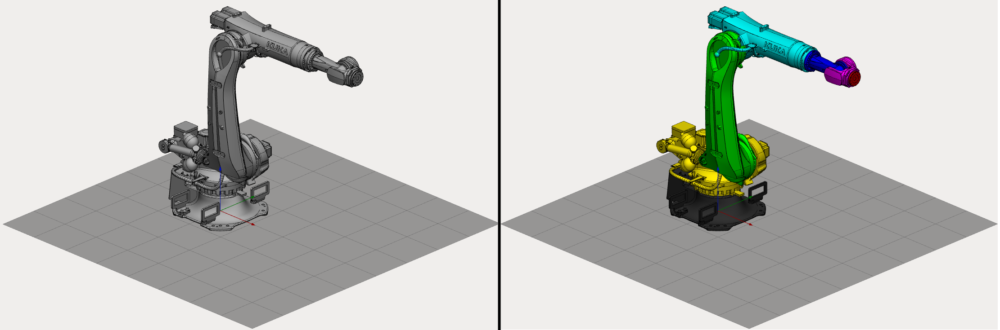
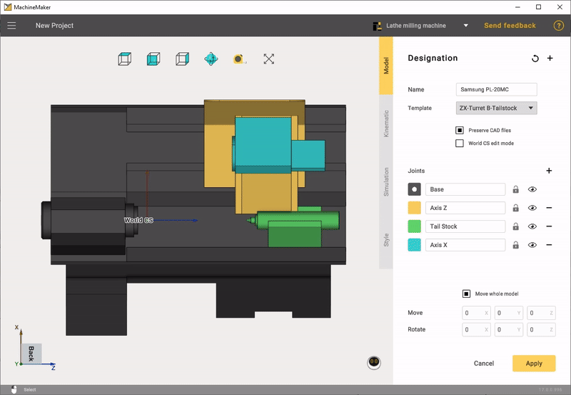
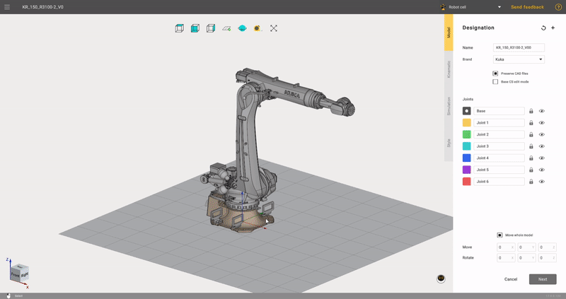
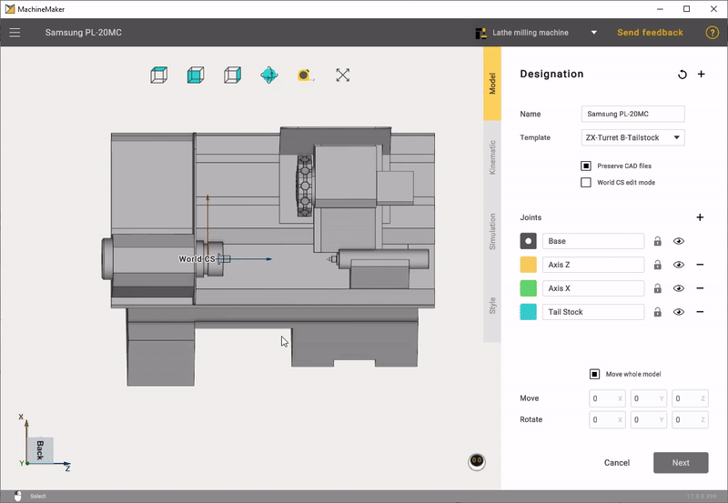
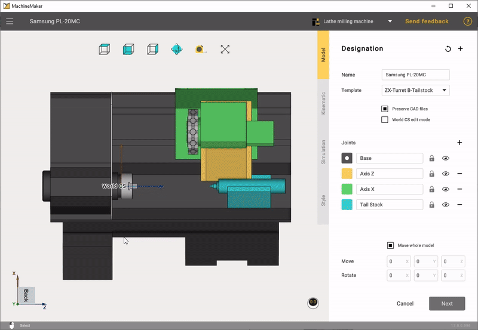
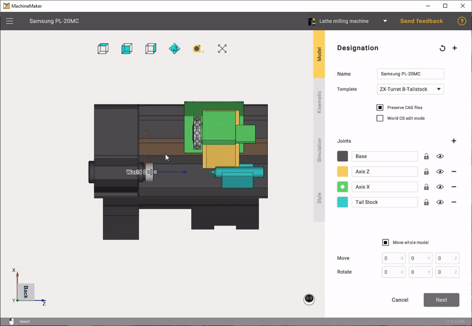

---
title: "요소를 노드로 그룹화"
---

# 요소를 노드로 그룹화

## 요소 그룹화

장비 요소는 노드로 그룹화해야 합니다. 3D 모델 요소를 특정 색상으로 표시하여 그룹화합니다.

기계의 경우 기계에 맞는 템플릿을 선택할 수 있습니다.

# [밀링 기계](#tab/machines)

# [로봇](#tab/robots)

# [선삭-밀링 복합 기계](#tab/turnmill)

---

오른쪽 패널에서 노드 색상을 선택하고 3D 모델에서 원하는 요소를 표시합니다. 같은 색상으로 표시한 요소는 모두 같은 그룹에 추가됩니다.

**Tab**, **↑**, **↓** 키를 사용하여 현재 색상을 전환합니다.

# [밀링 기계](#tab/machines)

# [로봇](#tab/robots)

# [선삭-밀링 복합 기계](#tab/turnmill)

---

모든 요소를 표시할 필요는 없습니다. 불필요한 요소는 표시하지 않은 채로 두면 메커니즘에서 제외됩니다. 또한 MachineMaker는 원본 CAD 파일을 저장하므로 언제든지 요소 그룹을 변경할 수 있습니다.

표시한 요소를 다시 클릭하여 색상을 지우거나 마우스 오른쪽 버튼을 사용하여 3D 모델 요소의 표시를 해제합니다. 표시를 해제할 수 있는 것은 현재 선택한 노드의 요소뿐입니다. **"Ctrl + z"** 바로 가기 키를 사용하여 변경 내용을 되돌릴 수도 있습니다.

**밀링 기계:**

**선삭-밀링 복합 기계:**

**Del** 키를 사용하여 3D 모델에서 불필요한 요소를 삭제할 수 있습니다. 요소 삭제를 실행 취소하려면 **Ctrl+Z**를 사용합니다.

MachineMaker는 가져온 모든 3D 모델을 **CAD Files** 폴더에 저장합니다. **Reimport**(다시 가져오기) 버튼을 사용하면 언제든지 3D 모델을 다시 가져올 수 있습니다. 원본 CAD 모델을 저장하지 않으려면 **Copy imported CAD files**(가져온 CAD 파일 복사) 확인란을 해제합니다.

**Add file**(파일 추가) - 추가 파일을 덧붙이는 기능입니다.

고정 테이블, 고정 객체, 엔드 이펙터와 같이 조인트가 없는 메커니즘에서는 MachineMaker가 모든 요소를 Base 노드로 자동 그룹화합니다.

MachineMaker가 요소를 올바르게 그룹화하지 못하는 경우 [CAD 모델을 수정하는 방법](https://docs.encycam.com/ENCY/3/en/src/content/10401.html)을 확인합니다.

## 메커니즘 이름 및 유형

메커니즘 이름을 입력해야 합니다. MachineMaker는 3D 모델 파일 이름을 기본 이름으로 사용합니다. 로봇의 경우 메커니즘 유형도 선택합니다. MachineMaker는 로봇의 브랜드를 자동으로 선택하지만, 브랜드를 바꿔야 하는 경우 드롭다운 목록에서 쉽게 변경할 수 있습니다.

# [밀링 기계](#tab/machines)

# [로봇](#tab/robots)

# [선삭-밀링 복합 기계](#tab/turnmill)

---

MachineMaker는 기본적으로 메커니즘 이름을 프로젝트 이름으로 사용합니다.

## 표준 좌표계 위치

기계의 경우 기계 좌표계의 위치를 지정해야 합니다. **Machine CS editing mode**(기계 좌표계 편집 모드)를 켠 다음 **왼쪽 Ctrl** 키를 누른 상태에서 기계 좌표계를 올바른 위치로 끌어 놓습니다. 로봇의 경우 기준 좌표계는 [기준 좌표계 변환](129940210.md#기준-좌표계-변환)에 설명된 대로 설정합니다.

**밀링 기계:**

**선삭-밀링 복합 기계:**

## 공구 및 공작물 위치

밀링 기계의 경우 **Kinematic**(운동학) 탭을 엽니다. **왼쪽 Ctrl** 키를 누른 상태에서 **Tool**(공구)과 **Workpiece**(공작물)를 원하는 위치로 끌어 놓습니다.

