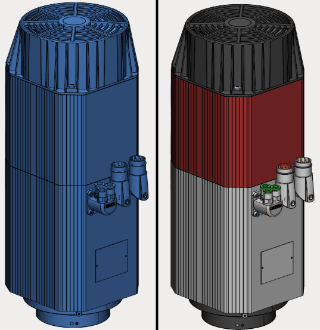
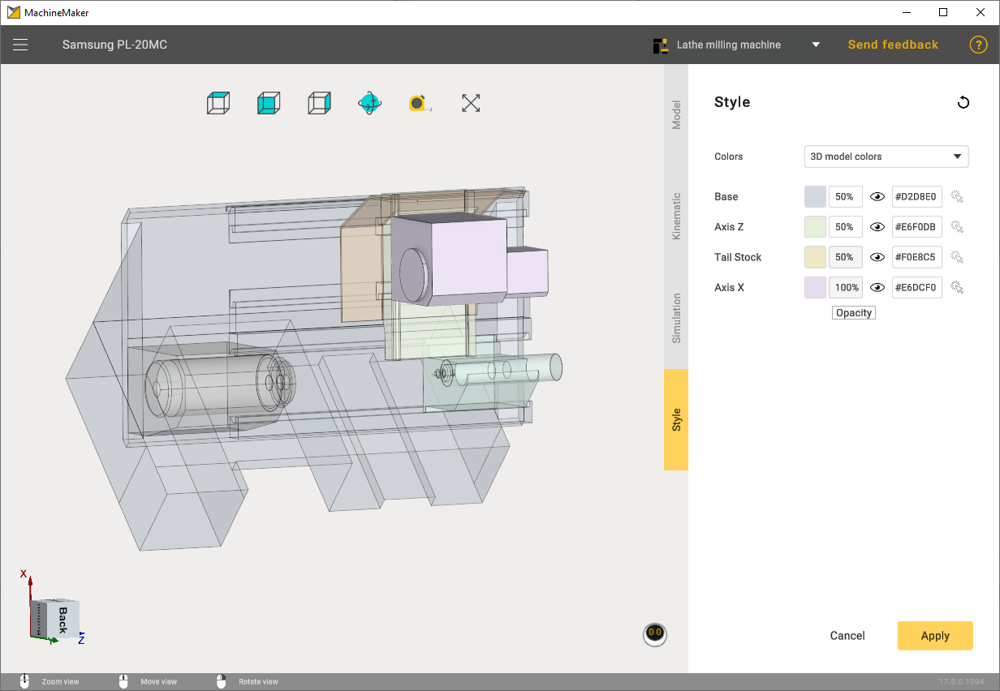

---
title: "색상 지정"
---

# 색상 지정

MachineMaker는 기본적으로 3D 모델의 색상을 사용합니다. 3D 모델의 색상을 사용하면 세부적인 표현이 가능합니다. 노드(기계 요소)의 색상을 수동으로 정의할 수도 있습니다.

**Style**(스타일) 탭을 사용하여 색상 파라미터를 엽니다. 미리 정의된 색상 세트를 선택하거나 노드 색상을 수동으로 지정할 수 있습니다.

기본 색상 외에도 기계 채색에 사용할 수 있는 3가지 색상 세트 중에서 선택할 수 있습니다.

1. Classic(클래식)
2. Restrained(차분한 색상)
3. Gunmetal(금속)

# [밀링 기계](#tab/machines)

# [로봇](#tab/robots)

# [선삭-밀링 복합 기계](#tab/turnmill)

---

마우스 커서를 콤보 상자 위에 놓고 **마우스 휠 스크롤**을 사용하여 스타일을 전환합니다.

모든 노드의 색상을 3D 모델의 값으로 재설정하려면 **3D Models colors**(3D 모델 색상) 스타일을 선택합니다. 모든 노드의 색상을 저장된 값으로 재설정하려면 **Current**(현재) 스타일을 선택합니다.

오른쪽의 색상 16진수 코드 입력 필드를 클릭하면 색상 선택기가 열립니다. 16진수 코드를 직접 복사하여 붙여 넣을 수도 있습니다.

노드의 투명도를 변경할 수도 있습니다.

**로봇:**

**선삭-밀링 복합 기계:**

