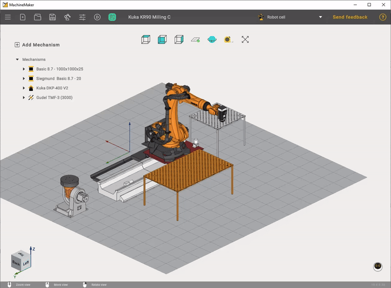
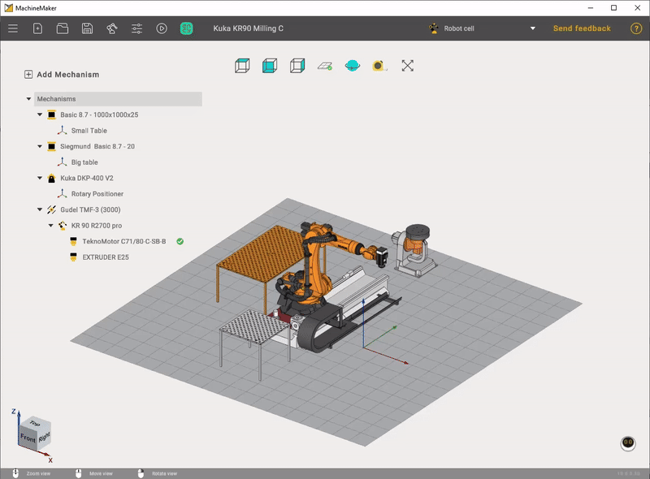
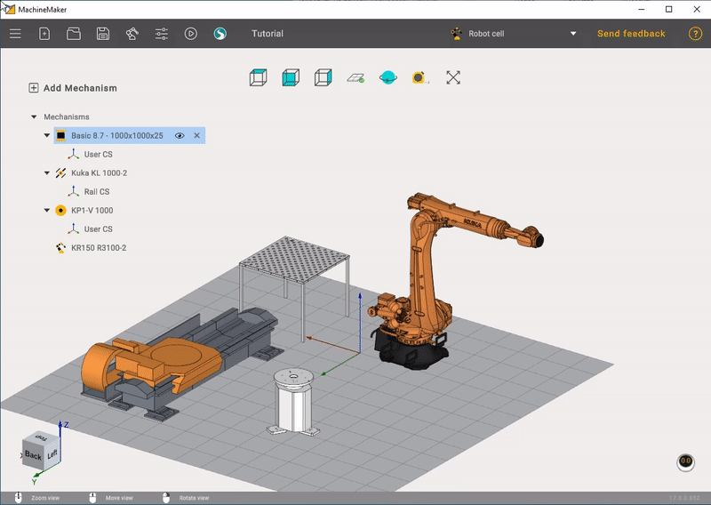
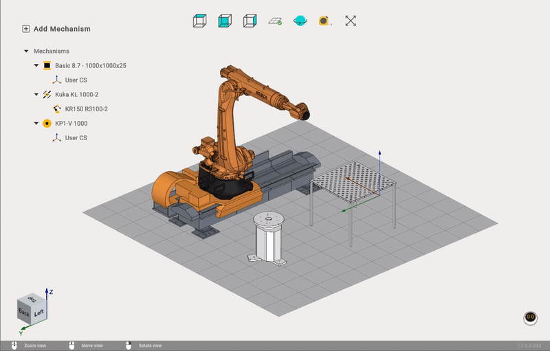

---
title: "어셈블리"
---

# 어셈블리

## 커넥터

각 메커니즘 또는 객체에는 커넥터가 하나 이상 있습니다. 두 메커니즘은 각자의 커넥터를 사용하여 서로 연결할 수 있습니다.

로봇에는 항상 커넥터가 2개 있습니다. 첫 번째 커넥터는 기준 좌표계(3)에, 두 번째 커넥터는 플랜지(4)에 있습니다.

테이블에는 커넥터가 2개 이상 있습니다. 베이스(1)와 테이블 상판(2)에 있습니다.

엔드 이펙터에는 베이스에 커넥터가 1개(5) 있습니다.

로봇 커넥터(3)를 테이블 커넥터(2)에 연결하여 로봇을 테이블 위에 배치할 수 있습니다. 또한 엔드 이펙터 커넥터를 로봇 플랜지 커넥터에 연결하여 엔드 이펙터를 로봇 플랜지에 장착할 수도 있습니다.

테이블에는 여러 메커니즘을 올려놓을 수 있습니다. 이 경우 테이블에 커넥터가 여러 개 있어야 합니다.

비어 있는 커넥터는 모두 CAM 시스템에서 공작물 커넥터로 사용됩니다.

## 테이블 커넥터 관리

커넥터는 여러 개 추가할 수 있습니다. 새 테이블을 만들거나 기존 테이블을 편집하고 [운동학 패널](../robots/131903495.md)을 엽니다. 커넥터는 **User coordinate systems**(사용자 좌표계) 패널에서 관리할 수 있습니다.

버튼을 사용하여 새 커넥터를 추가합니다.

커넥터를 클릭하면 선택됩니다. 3D 뷰에서도 커넥터를 선택할 수 있습니다. 커넥터 이름을 변경하려면 이름을 두 번 클릭합니다. **Enter** 키를 누르면 새 이름이 확정되고 **Esc** 키를 누르면 취소됩니다.

버튼을 사용하여 커넥터를 삭제합니다.

테이블에는 커넥터(사용자 좌표계)가 하나 이상 있어야 하므로 마지막 커넥터는 삭제할 수 없습니다.

[변환 패널, 치수 또는 끌어서 놓기](../robots/131903495.md)를 사용하여 커넥터 위치를 변경할 수 있습니다.

## 메커니즘을 어셈블리에 연결

어셈블리 뷰에서 **왼쪽 Ctrl** 키를 누르고 있으면 모든 커넥터가 표시됩니다. 비어 있는 커넥터는 빨간색 점으로, 사용 중인 커넥터는 녹색 점으로 표시됩니다.

사용 중인 커넥터(녹색 점)를 클릭하면 메커니즘 간의 연결이 해제됩니다.

**왼쪽 Ctrl** 키를 누른 상태에서 메커니즘을 끌어 다른 메커니즘 위에 놓습니다. MachineMaker는 연결할 커넥터 사이에 달라붙는 화살표를 표시합니다.

메커니즘끼리 스냅되지 않도록 하면서 끌어서 놓기 기능을 사용하려면 **왼쪽 Alt** 키를 사용합니다.

## 어셈블리 트리 사용

어셈블리 트리에는 모든 메커니즘과 커넥터가 표시됩니다.

어셈블리 트리에서도 끌어서 놓기를 사용할 수 있습니다. Kuka Robot을 끌어 **Mechanisms**(메커니즘) 노드에 놓으면 Rail과의 연결이 해제됩니다.

Kuka Robot을 끌어 Rail 노드에 놓으면 메커니즘이 다시 연결됩니다.

버튼을 사용하여 메커니즘 가시성을 전환합니다.

버튼을 사용하여 메커니즘을 삭제합니다.

메커니즘을 삭제할 때는 주의해야 합니다. 연결된 모든 메커니즘도 함께 삭제됩니다. 메커니즘 하나만 삭제하려면 모든 하위 메커니즘의 연결을 해제합니다.

엔드 이펙터를 여러 개 추가하고 
버튼을 사용하여 활성 엔드 이펙터를 선택할 수 있습니다.
