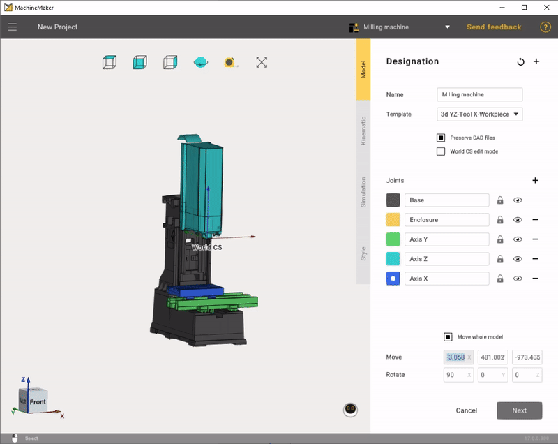
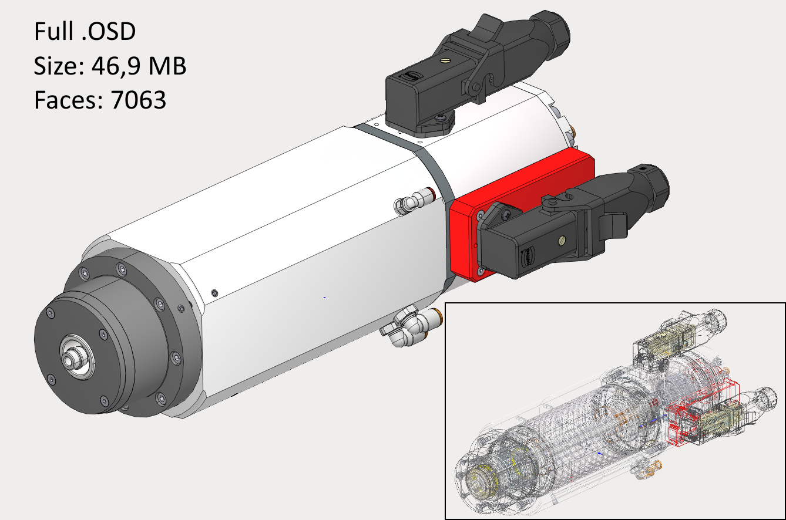
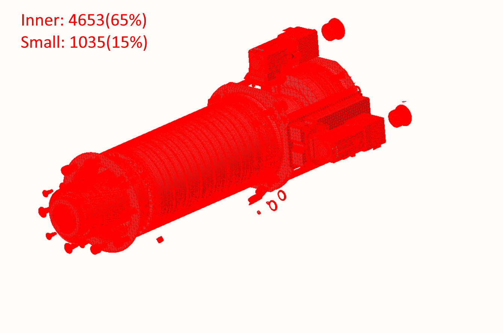
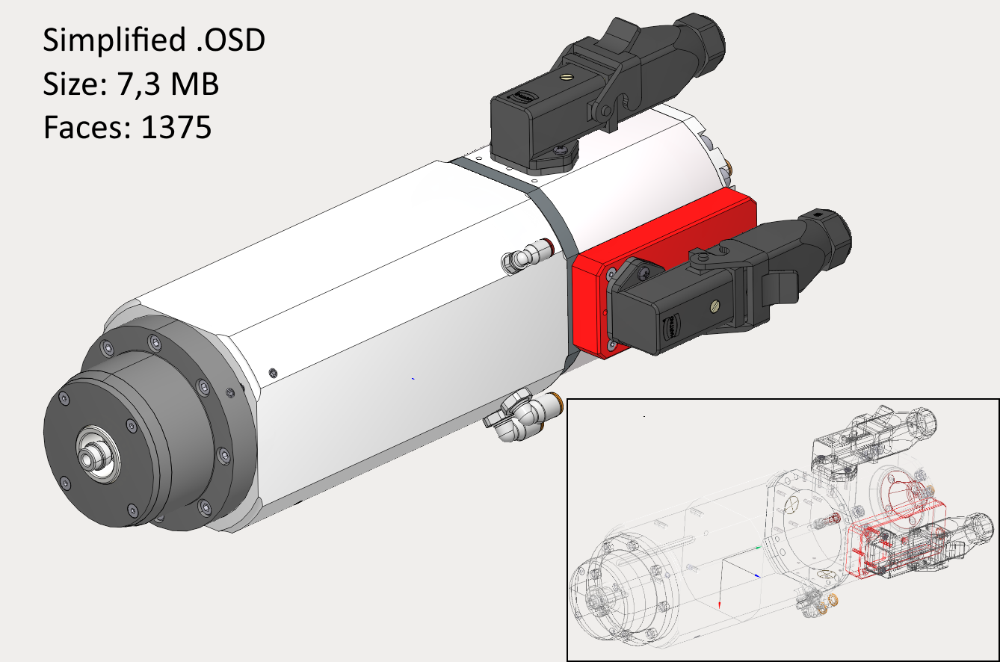

---
title: "Supported 3D model formats"
---

# Supported 3D model formats

- **3dm:** Rhinoceros 3D
- **sldprt, sldasm:** SоlidWorks
- **par, psm, pwr, asm:** Solid Edge
- **stp, step**
- **x\_t, x\_b** : Parasolid
- **igs, iges**
- **jt**
- **OSD**
- **STL**

It is also possible to select several files at once. This may be useful if you had split your mechanism and saved each node in a separate file.

## Preparing models

MachineMaker allows you to make some basic operations with imported 3D models like moving and rotating. Use transformation panel in the lower right corner to transform your 3D models.

It is possible to move and rotate only the entire 3D model. Please use an external CAD system to make more complex operations with the 3D model.

We recommend saving mechanism 3D model at HOME (zero) positions.

## 3D models simplifier

MachineMaker automatically simplifies imported files. All unnecessary inner faces and small objects will be deleted.

You can disable the simplifier in the application settings. Or use the integrated [simplifier](128546984.md) manually.

