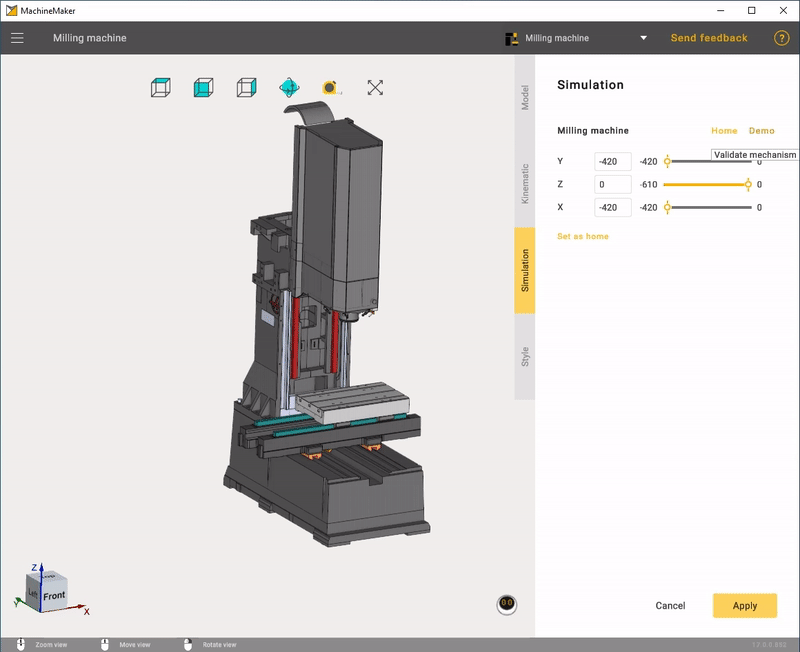

---
title: "Mechanism Simulation and Validation"
---

# Mechanism Simulation and Validation

Select *Simulation* tab to validate the mechanism's kinematics. Use the trackbar to change the axis coordinates or enter values in the input box manually.

Click **Demo** button to check all nodes.

Click **Home** button to return mechanism to Home position. Use **Set As Home** button to save current mechanism position as Home position.

****

If something looks wrong in the simulation, please check the "Building a kinematic scheme".

If you see nodes collisions, please check the "Grouping elements into nodes".

Use 
button on the "Toolbar" to validate whole assembly.
