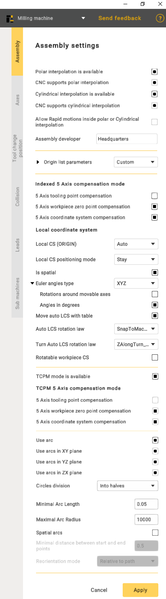

---
title: "Assembly options"
---

# Assembly options

Click 
button to open Assembly settings panel. Check CAM system documentation and SmartHints for parameters information.

- **Polar interpolation** changes a linear axis to the rotary one in the simple 3-axes milling process.
- If the machine variable Machine –> Control parameters –> Rotary transformations –> **CNC support polar interpolation** is set then CNC interpolation tick is available. If this parameter is on then the G-code generated with the commands to switch on/off the polar interpolation. Else the G-code is generated in the [X,C,Z] coordinates.
- **The cylindrical interpolation** gives the possibility to mill the side surface of cylinder by programming the unrolled curves. The unrolled curves are programmed in the [X,Y,Z] coordinates, but the cylinder milling is performed in [X,C,Z] coordinates. So the cylindrical interpolation makes the transformation [X,Y,Z] => [X,C,Z].
- If the machine variable Machine –> Control parameters –> Rotary transformations –> **CNC support cylindrical interpolation** is set then CNC interpolation tick is available. If this parameter is on then the G-code generated with the commands to switch on/off the cylindrical interpolation. Else the G-code is generated in the [X,C,Z] coordinates.
- **Allow rapid motions inside polar or Cylindrical interpolation**. This capability is crucial for improving efficiency in machining operations, as rapid motions reduce the time required to traverse from one point to another, enhancing overall machining productivity.
- **Assembly developer**: Company name.
- **Indexed 5-Axis compensation mode** represents a configuration in which compensation is systematically applied to a machining process involving five axes.
- **The 5-Axis tooling point compensation** 
  feature implies the CNC controller's capability to dynamically adjust the tool's position or orientation throughout machining, accommodating variations in the tool itself. This ensures precise adherence of the machined part to the intended design.
- **5-Axis workpiece zero point compensation** 
  guarantees the correct alignment of machining operations with the workpiece's coordinate system, enhancing precision and accuracy in the manufacturing process.
- **The 5-Axis coordinate system compensation** 
  ensures that the CNC machine accurately interprets and executes toolpaths, considering the specific orientation and location of the workpiece in the machining space. This feature is pivotal for achieving precision and accuracy, especially when dealing with intricate geometries, and allows for versatile machining operations.
- **TCPM mode availability** 
  refers to the availability of a concept in CNC machining where the tool's center point is efficiently managed, ensuring precise and accurate machining.
- **TCPM in the 5-Axis compensation mode**, refers to a feature in CNC machining where adjustments are made to account for variations in the tool's center point. In a 5-axis setup, which allows movement in five different directions, this compensation mode ensures precise and accurate machining by dynamically managing the tool's center point.
- **The 5-Axis tooling point compensation** within the context of TCPM refers to a feature in CNC machining where adjustments are made to the tool's position or orientation dynamically.
- **The 5-Axis workpiece zero point compensation**, in conjunction with TCPM, is a feature in CNC machining that involves dynamic adjustments to align machining operations accurately with the zero point or origin of the workpiece coordinate system. In a 5-axis machining system, capable of movement along five directions, this compensation mechanism ensures precision and accuracy during the manufacturing process.
- **The 5-Axis coordinate system compensation**, when integrated with TCPM in CNC machining, is a functionality designed to ensure precise toolpath execution by dynamically adjusting for the specific orientation and location of the workpiece within the machining space.
- **Use arc** 
  function provides users with the capability to specify or enable the use of arc commands in the CNC program. It involves defining parameters such as the arc's start and end points, radius, and direction.
- **Circles division**: Used to divide arcs into halves or quarters.
- **Minimal Arc Length:** Prevents the output of arcs shorter than a specified length; a segment will be displayed instead.
- **Maximal Arc Radius:** Prevents the output of arcs with a radius larger than specified; segments will be displayed.
- **Spatial arcs:** Arbitrary spatial arcs. A function necessary for robots to work.
- **Minimal distance between btart and end points:** A restriction that allows the display of segments with a small distance between points.
- **Spatial arcs**. A function necessary for robots to work.
- **Reorientation mode:** The method of calculating the midpoint. The functionality may vary depending on the manufacturer.

## Local coordinate system(Local CS):

- **Auto**. Function for indexed 5-axis machining. It is needed so the CAM system can automatically calculate the Local CS;
- **Off**. Disables this function;
- **Unavailable**. Makes this function unavailable for your machine.

**Local CS positioning mode**. This function defines how the rotation of the local coordinate system is output to the NC-code.

**Is spatial**. A modifier that complements the Local CS positioning mode function. It defines how commands are output to the NC-code of your CAM system.

**Euler angles type**. A parameter that defines the type of Euler angles.

- Rotations around movable axes;
- Angles in degrees.

These two parameters determine how the spatial angles will be output in the (ORIGIN) command in the NC code.

**Move auto LCS with table**. This function determines whether the origin point of the coordinate system should rotate together with the workpiece in the CAM system.

**Auto LCS rotation law**. Additional parameter for Local CS (ORIGIN).

- **Snap to Tool CS**. Allows you to snap, for example, the X-axis of the rotated coordinate system to the coordinate system associated with the tool;
- **Snap to Machine CS**. Attaches the **CS** to the machine’s Base Coordinate System that you specifie;
- **Snap to Workpiece CS**. In this mode, the coordinate system will be linked to the geometric coordinate system of your workpiece.
- **Exclude spatial angle A,B,C**. These values determine which axis the rotation should be performed around. If you select **"Exclude spatial angle A",** it means that rotation will occur around axes B and C, while rotation around axis A will always be 0.

**Rotatable workpiece CS.** A parameter that applies specifically to the workpiece. This parameter indicates whether the coordinate system rotates when setting up the workpiece.
