---
title: "적용 분야"
---

# 적용 분야

## 적용 분야

**ENCY Hyper**는 산업용 로봇 프로그래밍을 위한 하이브리드 플랫폼입니다. 디지털 트윈에서 오프라인으로 프로그램을 개발하고 테스트하는 기능과 온라인 로봇 제어를 결합합니다.

**오프라인 모드**에서는 실제 로봇에서 실행하기 전에 프로그램을 검증할 수 있어 현장에서의 시행착오를 줄일 수 있습니다. **온라인 모드**는 디버깅과 조정을 위한 실시간 피드백을 제공하고, 실행을 모니터링하며, 이상이 감지되면 로봇을 정지할 수 있도록 지원합니다.

**픽 앤 플레이스**에 최적화된 ENCY Hyper는 유휴 시간과 수작업 개입을 줄이고 생산 효율과 일관성을 높이는 데 도움이 됩니다. 그 밖에 조립, 팔레타이징, 분류, 품질 검사, 밀링, 연삭, 연마, 도장, 용접에도 활용할 수 있습니다.

이 설명서에서는 플랫폼의 기능과 작업 흐름을 소개합니다. 도입하기 전에 지원되는 하드웨어, 사용 가능한 기능, 프로그래밍 개념을 검토합니다.

### 작업 흐름

1. **셀 준비.** MachineMaker에서 **.mma** 셀 파일을 만들거나 대리점에서 받은 다음 [홈 페이지](150697466.md)에서 불러옵니다.
2. **프로젝트 열기.** 홈 페이지에서 프로젝트 카드를 두 번 클릭합니다.
3. **셀 구성.** [셀 모드](150697487.md)에서 트레이와 부품 부착 포인트를 정의합니다.
4. **부품 정의.** [부품 모드](150697513.md)에서 모델을 가져오거나 기본 요소를 만들고 픽 포인트를 지정합니다.
5. **프로그램 작성.** [프로그래밍 모드](150697525.md)에서 명령 블록을 추가하고 궤적을 계산합니다.
6. **실행 및 모니터링.** [실행 모드](150697599.md)에서 프로그램을 시뮬레이션하고, 로봇이 연결되어 있으면 실제 작동을 모니터링합니다.

## 픽 앤 플레이스(테이블 간 이송)

이 예에서는 한 테이블에서 다른 테이블로 부품을 간단히 이송하는 방법을 보여 줍니다.

### 1. 프로젝트 만들기 및 셀 조립

**ENCY Hyper** 홈 페이지에서 **New project > Create in MachineMaker**(새 프로젝트 > MachineMaker에서 만들기)를 선택하여 자체 로봇 셀을 만듭니다.

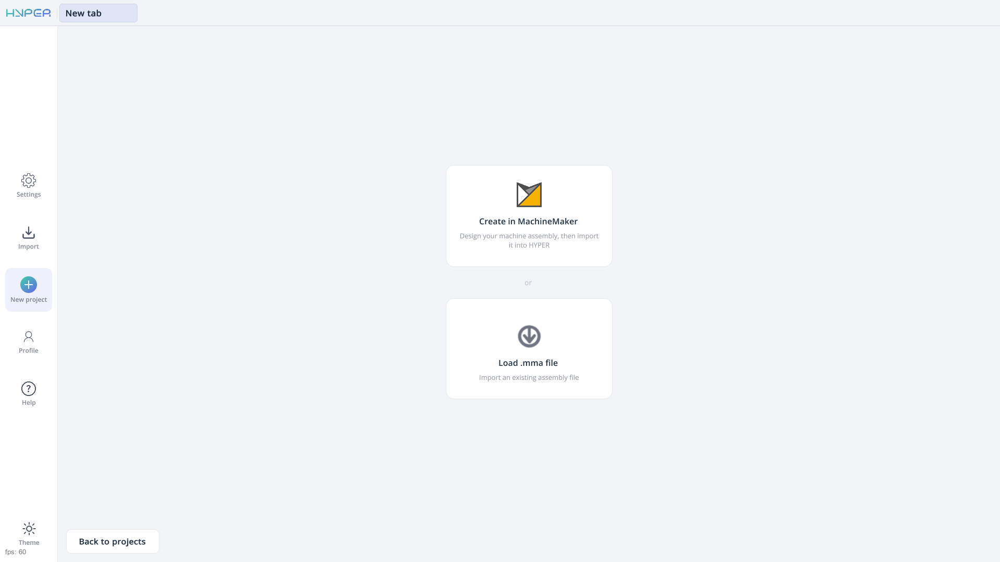

**MachineMaker**에서 작업에 필요한 메커니즘으로 셀을 조립합니다. 이 예에서는 로봇, 그리퍼, 테이블을 사용합니다. 완성된 셀을 **ENCY Hyper**로 내보냅니다.

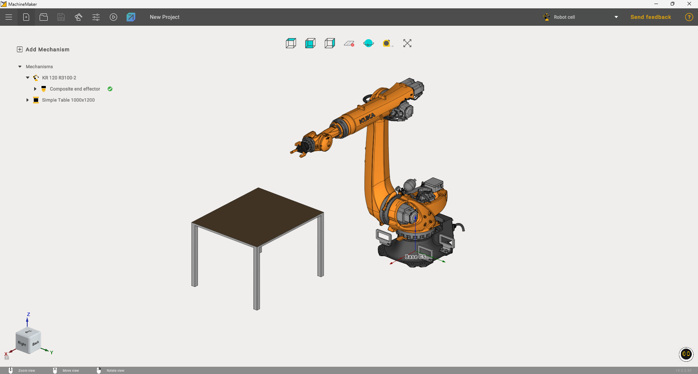

### 2. 셀 모드에서 객체 및 트레이 추가

프로젝트가 **Cell**(셀) 탭에서 열립니다. 여기에서 객체를 추가하고, 테이블 위나 셀의 다른 위치에 부품을 놓을 포인트가 있는 트레이를 정의할 수 있습니다. MachineMaker에서 가져온 테이블에 **3행 3열** 트레이를 추가합니다. 그런 다음 **ENCY Hyper**에서 직접 두 번째 테이블을 추가하고 여기에도 9포인트 트레이를 추가합니다. 한 트레이에는 픽할 부품이 놓이고, 다른 트레이는 부품을 받습니다. 자세한 내용은 [셀 모드](150697487.md)에서 확인할 수 있습니다.

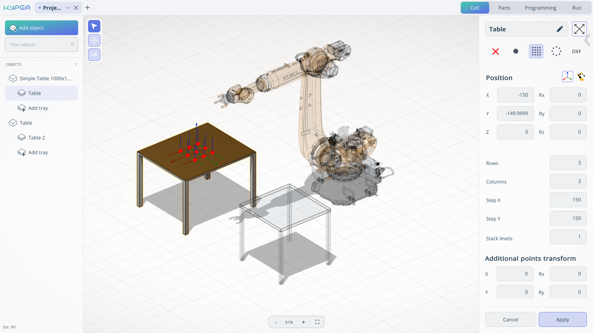

### 3. 부품 정의 및 배치

**Parts**(부품) 탭에서 **Add part**(부품 추가)를 사용하여 박스나 원기둥을 만들거나, **Import**(가져오기)를 사용하여 직접 준비한 3D 모델을 불러옵니다. 각 부품의 파지 설정을 구성합니다. **Pick point**(픽 포인트)는 공구가 부품을 잡는 방식을 정의하고, **Base point**(베이스 포인트)는 트레이에 부품을 배치할 때 사용하는 기준점을 정의합니다. 이 예에서는 원기둥을 사용합니다.

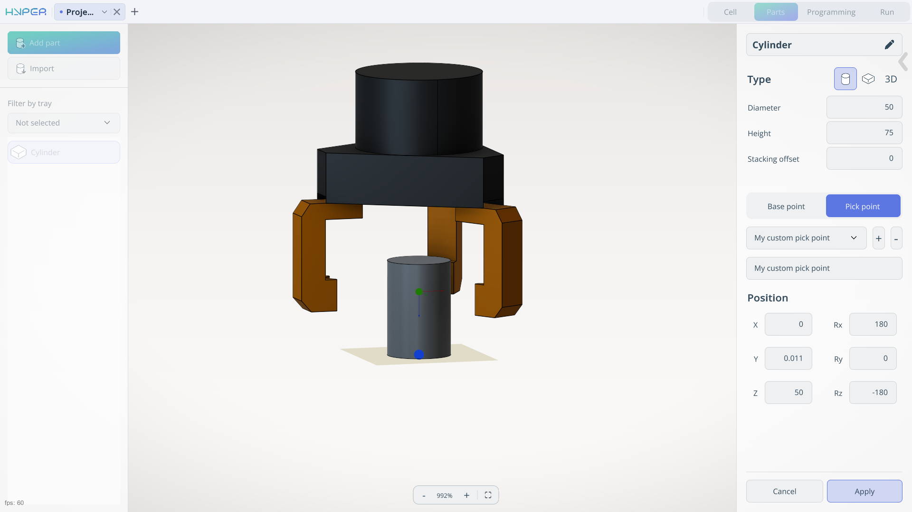

부품을 만든 후 **마우스 왼쪽 버튼**으로 트레이 포인트에 배치합니다. 트레이 전체를 채우려면 해당 트레이의 포인트에서 마우스 왼쪽 버튼을 길게 누른 다음 확인 대화 상자에서 **Yes**(예)를 선택합니다. 원본 트레이는 채우고 대상 트레이는 비워 둡니다.

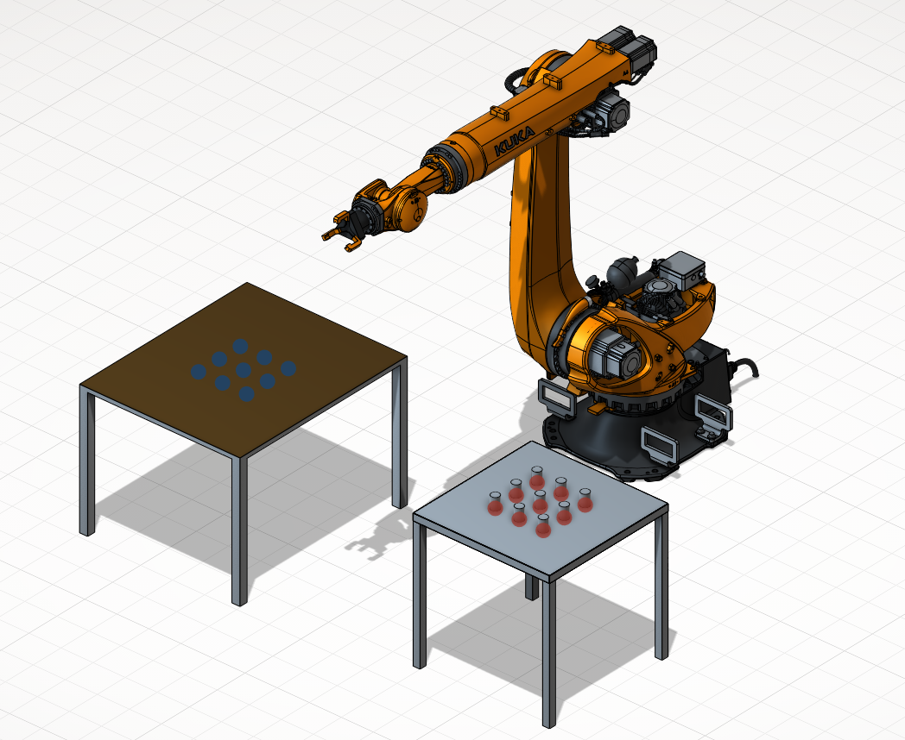

### 4. 프로그램 작성

로봇 프로그램을 정의하고 검사하는 주요 작업 공간인 **Programming**(프로그래밍)으로 전환합니다. **+** 버튼을 클릭하여 명령 목록을 엽니다.

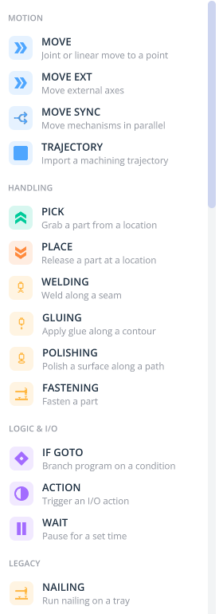

- **MOVE**(이동) — 관절 동작 또는 선형 동작으로 로봇을 포인트로 이동합니다.
- **MOVE EXT**(외부 축 이동) — 외부 축을 이동합니다.
- **MOVE SYNC**(동기 이동) — 메커니즘을 병렬로 이동합니다.
- **TRAJECTORY**(궤적) — CAM 시스템에서 가공 궤적을 가져옵니다.
- **PICK**(픽) — 선택한 위치에서 부품을 집어 올립니다.
- **PLACE**(플레이스) — 선택한 위치에 부품을 내려놓습니다.
- **WELDING**(용접) — 용접 작업을 수행합니다.
- **GLUING**(접착) — 지정한 경로를 따라 접착제를 도포합니다.
- **POLISHING**(연마) — 경로를 따라 표면을 연마합니다.
- **FASTENING**(체결) — 부품을 체결합니다.
- **IF GOTO**(조건 분기) — 조건이 충족되면 프로그램의 다른 단계로 분기합니다.
- **ACTION**(동작) — 입출력 동작을 실행합니다.
- **WAIT**(대기) — 지정한 시간 동안 실행을 일시 중지합니다.
- **NAILING**(못 박기) — 못 박기 작업을 수행합니다. Legacy(레거시) 항목에 있습니다.

#### 로봇의 초기 위치와 최종 위치 설정

**MOVE**부터 시작합니다. 이 명령은 **START**(시작) 및 **END**(끝) 단계 안에서도 구성할 수 있으며, 이를 통해 로봇의 초기 위치와 최종 위치를 정의합니다. 해당 단계를 선택하고 오른쪽의 로봇 이동 컨트롤을 사용하여 필요한 위치를 설정합니다. 스크린샷에는 **START**, **END**와 로봇 이동 컨트롤이 강조 표시되어 있습니다.

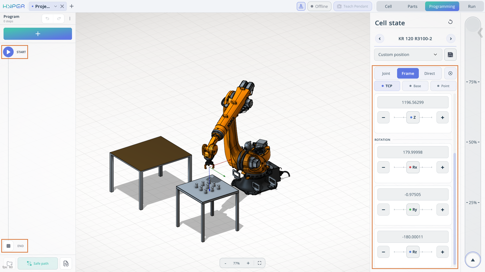

### 5. 픽 작업 구성

**PICK** 작업을 추가하고 원본 트레이를 선택합니다. **Single element**(단일 요소)를 사용하여 작업이 부품 하나를 처리할지 트레이 전체를 처리할지 선택합니다. 선택한 트레이의 모든 부품으로 작업하려면 이 옵션을 **끄고**, 부품 하나만 픽하려면 켭니다. 이 예에서는 꺼 둡니다.

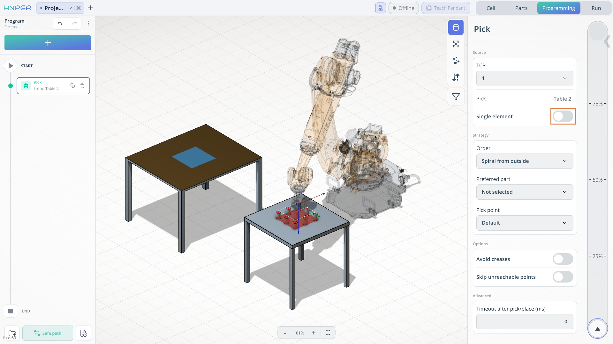

픽 작업은 부품 선택, 파지, 로봇 구성, 접근 및 후퇴 이동에 대한 설정을 제공합니다.

- **픽 기본 설정.** 공구의 **TCP**(공구 중심점)와 원본 트레이를 선택합니다. **Order**(순서)를 설정하여 픽 순서를 선택하고, 필요한 경우 **Preferred part**(우선 부품)로 부품 유형을 선택하며, **Pick point**로 부품에 정의된 파지 포인트를 선택합니다.
- **픽 위치 조정.** Pick position(픽 위치) 컨트롤을 사용하여 로봇 자세를 수동으로 조정하고 공구가 부품에 접근하는 방식을 세밀하게 다듬습니다.
- **Fix**(수정). 로봇 축이 바람직하지 않은 자세로 접히는 경우 로봇 구성 설정에서 이 옵션을 사용하여 부적절한 관절 구성을 바로잡습니다.
- **Avoid collisions**(충돌 방지). 해당 이동 구간에서 이 옵션을 활성화하면 궤적 계산 시 장애물을 우회하는 경로가 계획됩니다. 충돌 회피가 활성화된 이동을 계산하려면 **Safe Path**(안전 경로)를 사용합니다.
- **Safe move distance**(안전 이동 거리). 로봇이 픽 포인트에 접근하고 픽 포인트에서 후퇴할 때의 여유 거리를 설정합니다. 부품과 주변 객체에 맞게 필요에 따라 안전 이동 방향과 속도를 조정합니다.

명령 설정에 대한 자세한 내용은 [프로그래밍 모드](150697525.md)에서 확인할 수 있습니다.

**Place** 명령에서는 부품을 놓을 대상 셀을 마우스 왼쪽 버튼으로 선택하기만 하면 됩니다.

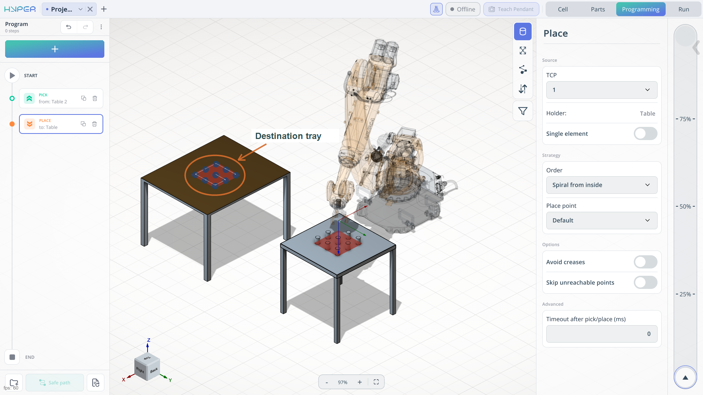

**IF**(조건문) 명령을 사용하면 프로그램이 앞의 명령을 반복 실행하고 올바르게 종료할 수 있습니다. 이 예에서는 테이블에서 모든 부품이 제거되면 로봇이 홈 위치로 돌아가도록 지정합니다.

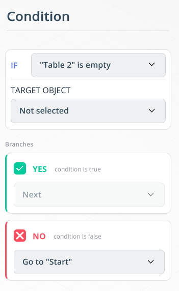

프로그램이 준비되면 시뮬레이션을 시작하기 전에 프로그램을 계산해야 합니다. 이를 위해 Recalculate(재계산) 버튼을 사용합니다. 로봇이 부품을 이동할 궤적을 시각적으로 확인할 수 있습니다.

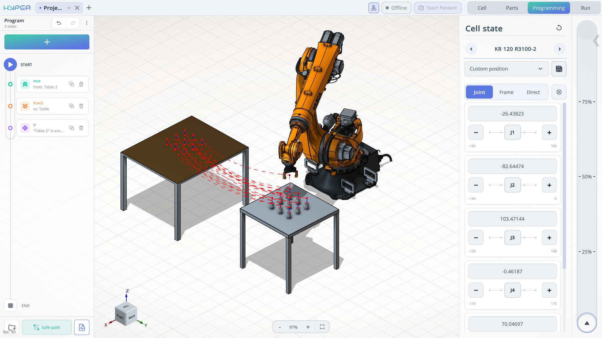

### 6. 프로그램 시뮬레이션 및 그리퍼 확인

**화면 오른쪽의 시뮬레이션 슬라이더**를 사용하여 시뮬레이션을 시작하고 속도를 조정합니다. 백분율 눈금은 시뮬레이션 속도를 나타냅니다.

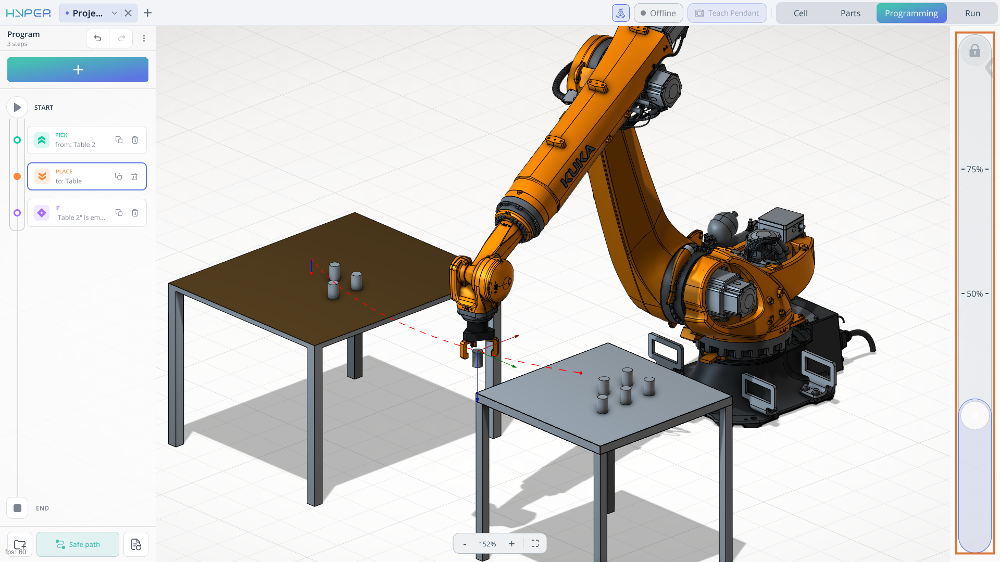

시뮬레이션 중에 그리퍼 죠가 부품을 감싸며 닫히지 않는 것을 볼 수 있습니다. 이를 바로잡으려면 **Project settings**(프로젝트 설정)에서 그리퍼의 열기 및 닫기 동작을 구성합니다.

#### 열기 및 닫기 동작 지정

**Project settings > End effector parameters**(프로젝트 설정 > 엔드 이펙터 파라미터)를 열고 공구를 선택한 다음 그리퍼 설정을 엽니다. 이 예에서 경로는 **Composite end effector > Grippers > My TCP**(복합 엔드 이펙터 > 그리퍼 > My TCP)입니다. **Open IO**(열기 IO)에 **TCP - Open**을, **Close IO**(닫기 IO)에 **TCP - Close**를 지정합니다.

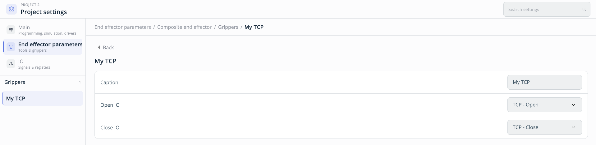

#### IO 신호 및 연결된 그리퍼 축 구성

**Project settings > IO**로 이동하여 **TCP - Open**을 선택합니다. **Input**(입력) 및 **Output**(출력) 섹션을 열고 **Add**(추가)를 사용하여 각 섹션에 항목을 만듭니다. 신호와 연결된 그리퍼 축을 다음과 같이 구성합니다.

- **Input number / Output number**(입력 번호 / 출력 번호) — 동작에서 사용하는 입력 또는 출력 신호 번호입니다.
- **Value**(값) — 예상 입력 값 또는 출력으로 보내는 값입니다.
- **Linked axis**(연결된 축) — 신호와 연결된 공구 축입니다.
- **Linked axis value**(연결된 축 값) — 필요한 그리퍼 위치에 해당하는 축 값입니다.

합친 그림에서 위쪽은 **Input** 설정이고 아래쪽은 **Output** 설정입니다. 이 예에서는 둘 다 열림 위치에 대해 신호 번호 **0**, 신호 값 **1**, 연결된 축 값 **50**을 사용합니다. **여기에 표시된 IO 신호 및 연결된 축 값은 예시일 뿐입니다.** 실제 생산 장비에서는 다른 값이 필요할 수 있습니다. 사용하는 로봇과 공구의 신호 및 그리퍼 위치에 맞게 값을 구성합니다.

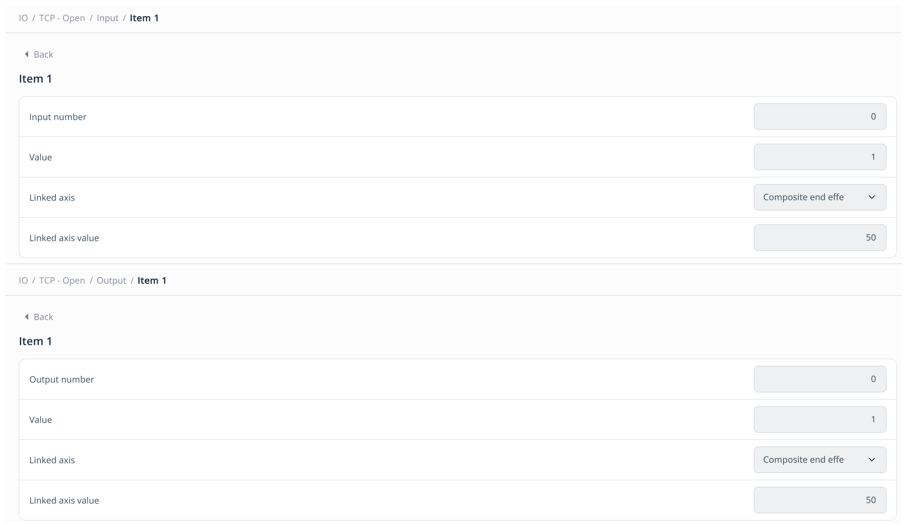

**TCP - Close**에 대해서도 같은 절차를 반복합니다. Input 및 Output 항목을 추가하고 구성하여 닫힌 파지 위치에 대한 신호 파라미터와 연결된 축 값을 지정합니다. **Apply**(적용)를 클릭하여 설정을 저장합니다.

시뮬레이션을 다시 실행합니다. 이제 그리퍼가 열기 및 닫기 신호에 반응하여, 픽 앤 플레이스 시퀀스 동안 핑거를 움직여 부품을 잡고 놓습니다.

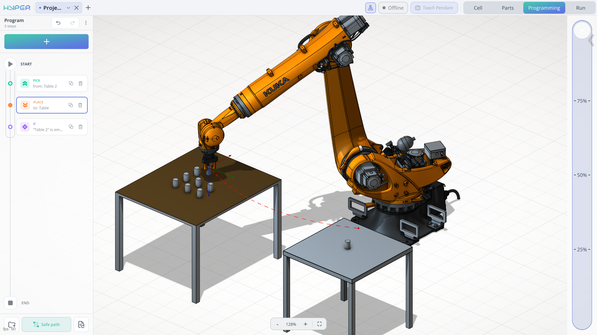

### 7. 실행 모드에서 로봇에 연결

실제 로봇에 연결하려면 **Run**(실행) 탭으로 전환합니다. 연결하기 전에 **Project settings > Main > Robot driver settings**(프로젝트 설정 > 메인 > 로봇 드라이버 설정)를 열고 로봇 컨트롤러에 맞게 로봇의 **IP address**(IP 주소)를 설정합니다.

**Run**으로 돌아가 화면 상단의 **Offline**(오프라인)을 클릭하여 연결합니다. 로봇이 연결되면 버튼이 **Online**(온라인)으로 바뀝니다.

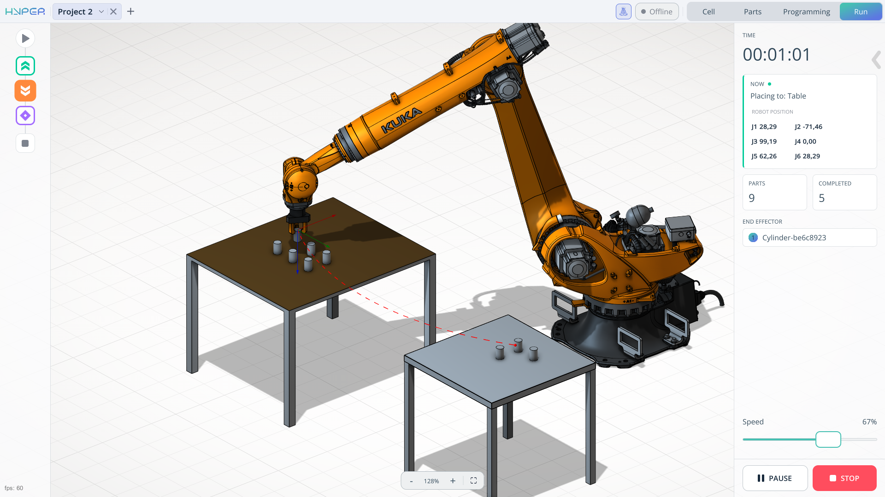

## 픽 앤 플레이스(작업대에서 기계로 부품을 이송했다가 다시 되돌리기)

기계에 부품을 로딩/언로딩하는 예입니다.

먼저 시작 페이지에서 [프로젝트](../assets/e0439c776c7ef7336efa287f44b8ff6eef294802ab36e62e3ff6d62503d68db0.zip)를 가져옵니다. [자세히 보기](150697466.md)

프로젝트를 불러온 후 프로젝트를 열고 CNC 기계를 나타내는 객체를 추가합니다.

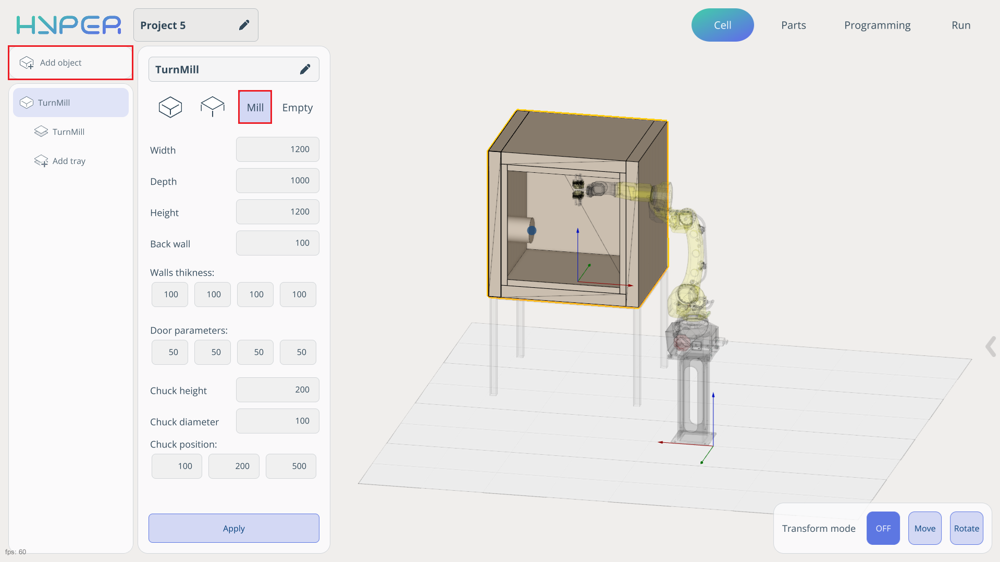

기계 표면에 부품 가공용 셀을 추가합니다.

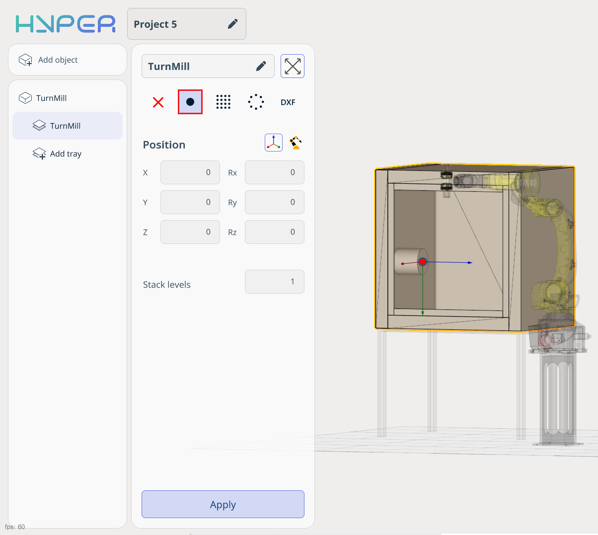

부품을 보관할 테이블을 추가합니다. 테이블의 셀 파라미터를 추가하고 구성합니다.

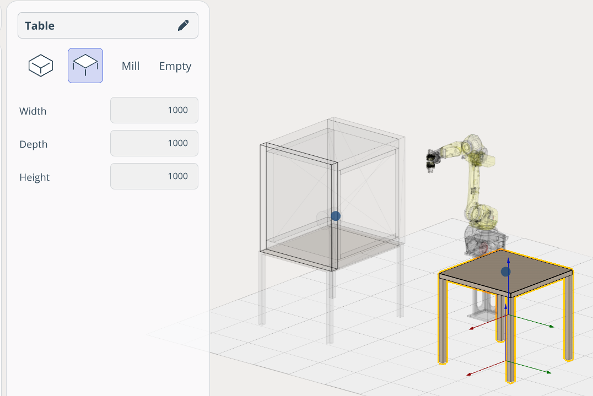

부품을 보관할 테이블을 추가합니다. 테이블의 셀 파라미터를 추가하고 구성합니다.

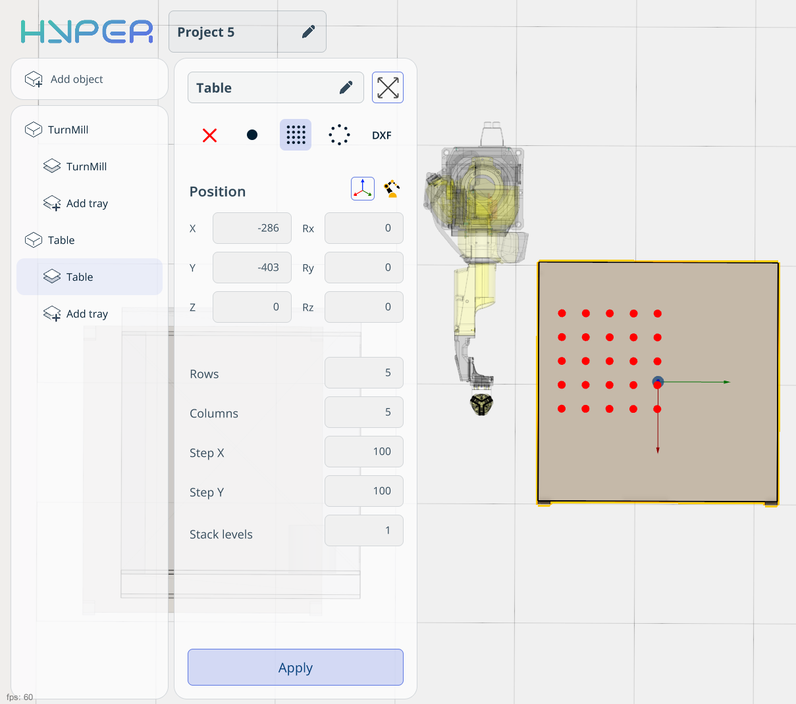

Parts 탭에서 원기둥을 만들고 **Pick Point**를 정의합니다. **Base Point**는 기본값으로 둡니다.

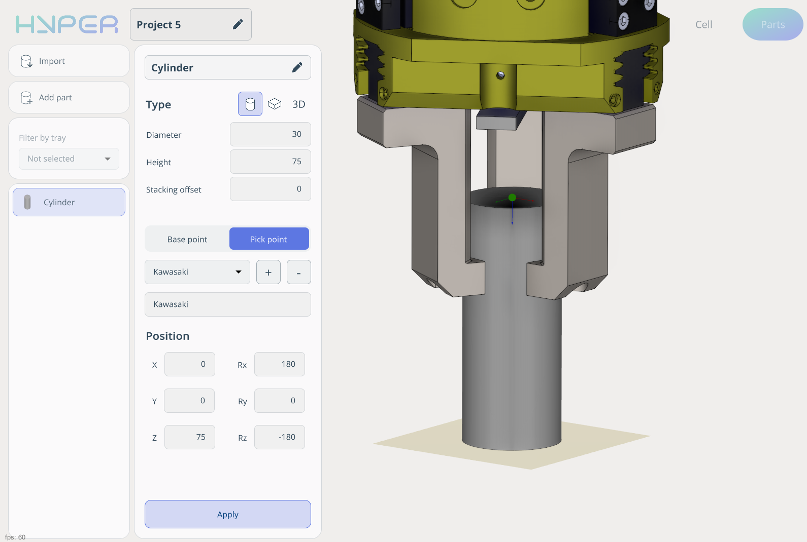

마우스 왼쪽 버튼을 누른 채로 원기둥을 셀 전체에 배치합니다.

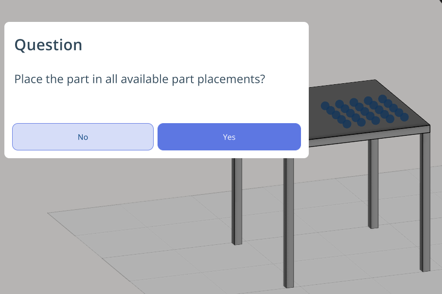

다음 단계는 로봇이 가공을 위해 부품을 기계로 이송할 수 있도록 올바른 프로그램을 작성하는 것입니다.

이 로봇에는 그리퍼가 두 개인 공구가 장착되어 있습니다. 이 프로그램의 로직은 부품을 집어 기계에 로딩하여 가공한 다음, 가공된 부품을 다시 테이블에 놓는 것입니다.  
테이블의 모든 부품이 사용되도록 **Single element** 슬라이더를 비활성화합니다. 또한 기계 셀에 부품 하나를 배치합니다.

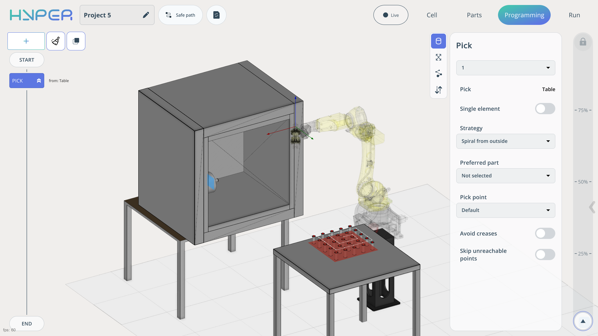

그 결과 로봇은 테이블에서 가공되지 않은 부품을 집은 다음, 기계에서 가공된 부품을 꺼내고 가공되지 않은 부품으로 교체합니다.

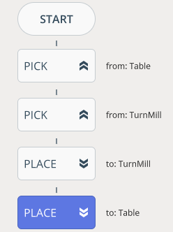

테이블의 여러 부품을 사용하므로 프로그램을 반복하도록 구성해야 합니다. 이를 위해 **IF** 명령을 추가하고 부품 이송 및 가공 작업 흐름을 반복하는 데 필요한 파라미터를 설정합니다.

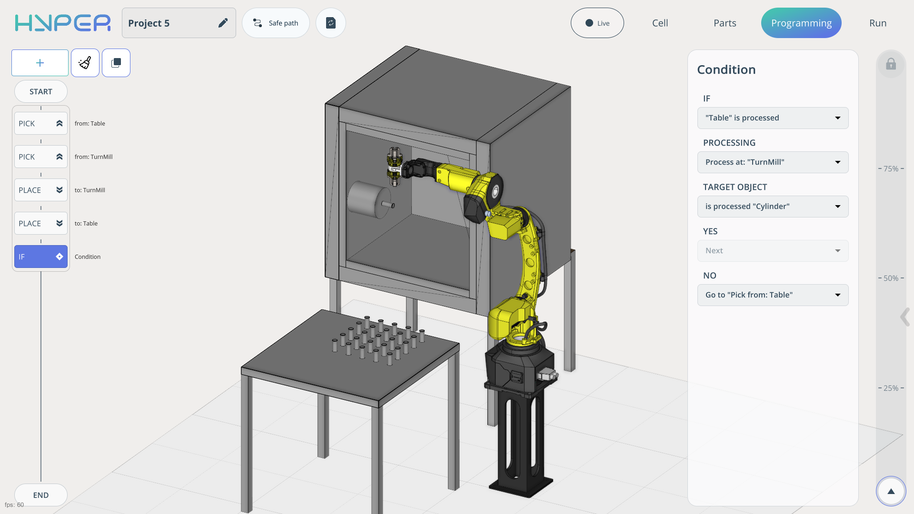

모든 명령을 다시 계산하면 궤적이 나타납니다. 오른쪽의 속도 슬라이더를 사용하여 프로그램 실행을 관찰할 수 있습니다. 로봇은 모든 부품을 기계로 이송한 후 다시 테이블로 되돌려 놓아야 합니다.

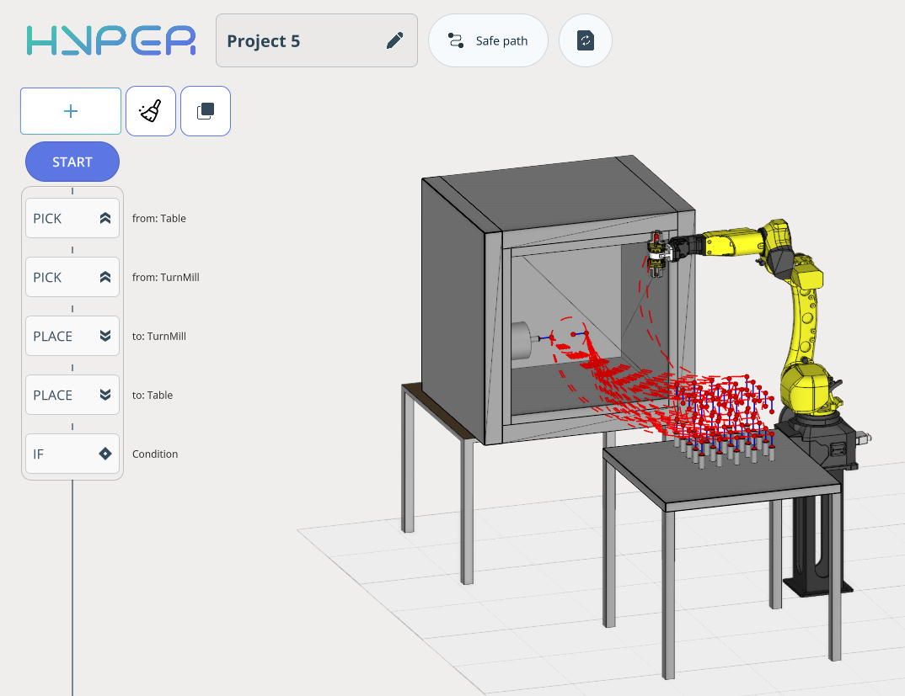
