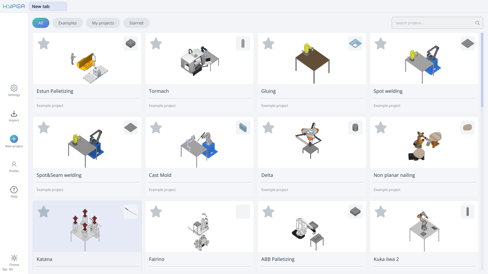
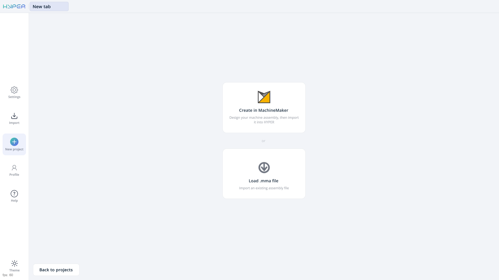
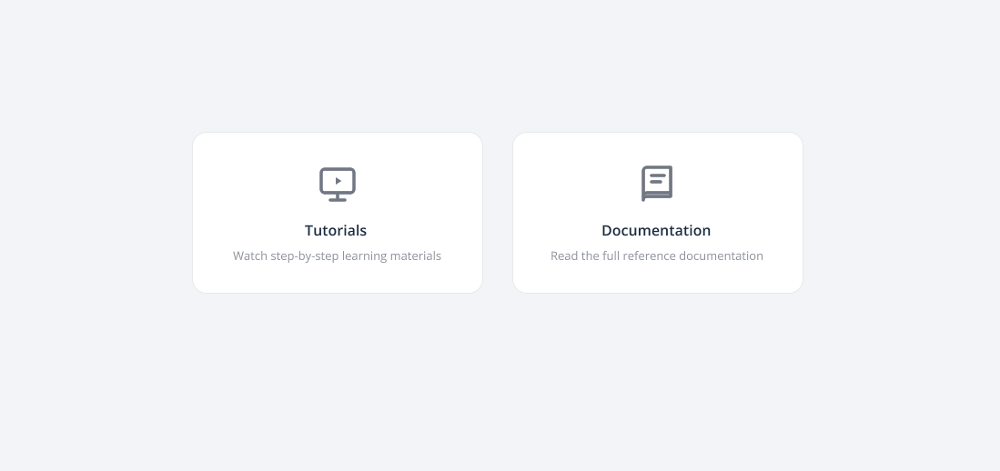
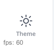

---
title: "홈 페이지"
---

# 홈 페이지

## 적용 분야

홈 페이지는 다음 기능을 제공합니다.

- 프로젝트 라이브러리 관리
- 표준 예제 프로젝트에 대한 액세스
- 새 프로젝트 생성
- 기존 프로젝트 가져오기
- 시스템 기본 설정 및 사용자 프로필에 대한 액세스
- 튜토리얼 및 문서에 대한 액세스
- 라이트 테마와 다크 테마 간 전환

프로젝트 라이브러리는 홈 페이지의 주 영역을 차지합니다. 프로젝트 카드 위에는 **All**(전체), **Examples**(샘플), **My projects**(내 프로젝트), **Starred**(즐겨찾기) 필터가 있습니다. 오른쪽 위 모서리에는 **Search projects...**(프로젝트 검색...) 필드가 있습니다. 라이브러리에 대한 자세한 내용은 [프로젝트 라이브러리](150697469.md)에 나와 있습니다.

**왼쪽 탐색 패널의 버튼**

주요 버튼은 화면 왼쪽에 위에서 아래로 다음 순서로 세로로 배치되어 있습니다.

**Settings**(설정). 시스템의 기본 설정에 액세스할 수 있습니다.

**Import**(가져오기). 기존 프로젝트를 열 수 있습니다.

**New project**(새 프로젝트). 프로젝트를 만드는 두 가지 옵션이 있는 페이지를 엽니다.

- **Create in MachineMaker**(MachineMaker에서 만들기). MachineMaker를 실행합니다. MachineMaker에서 기계 어셈블리를 준비한 다음 ENCY Hyper로 가져올 수 있습니다.
- **Load .mma file**(.mma 파일 불러오기). **.mma** 형식의 기존 어셈블리 파일을 선택할 수 있습니다. 이 파일은 공급업체가 준비하거나 MachineMaker에서 만들 수 있습니다. [자세히 보기](https://docs.encycam.com/MachineMaker/1/robots/en/1.html)

**MachineMaker에서 어셈블리를 저장하려면 «Save assembly to file»(어셈블리를 파일로 저장)을 사용합니다.**

주 영역 왼쪽 아래 모서리의 **Back to projects**(프로젝트로 돌아가기) 버튼을 클릭하면 프로젝트 라이브러리로 돌아갑니다.

**Profile**(프로필). 사용자 프로필을 엽니다. 시스템 구성에 따라 일부 기능은 특정 사용자 역할에서 사용할 수 없습니다. 기능이 회색으로 표시되거나 보이지 않으면 사용자 역할에 필요한 권한이 없을 수 있습니다.

**Help**(도움말). 두 가지 옵션이 있는 페이지를 엽니다.

- **Tutorials**(튜토리얼). ENCY Hyper 교육 동영상 페이지를 엽니다.
- **Documentation**(문서). 참조 문서를 엽니다.

**왼쪽 탐색 패널 하단의 버튼**

**Theme**(테마). 인터페이스를 라이트 테마와 다크 테마 간에 전환합니다.

**라이선스 및 버전 정보**

**License information**(라이선스 정보). 라이선스의 남은 일수를 표시합니다.

**Version info**(버전 정보). 이 정보는 다른 사람에게 앱의 기능을 시연하거나 기술 지원팀에 문의할 때 유용할 수 있습니다.
