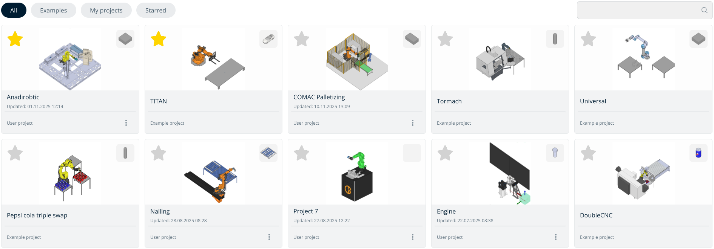
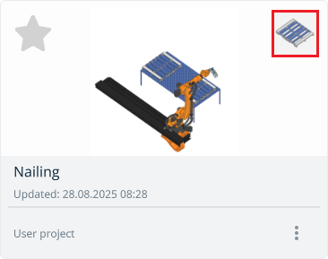
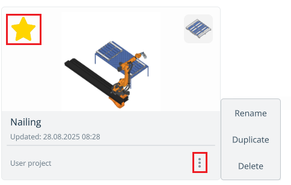

---
title: "Project library"
---

# Project library

## Application Area:

Project library for storing and accessing projects.

**Buttons located at the top of the screen:**

**All.** Displays all projects combined.  
**Examples.** Contains all default projects preinstalled with the application.  
**My Projects.** Includes all user-created or imported projects.  
**Starred.** Shows favorite projects marked with a star.

**Navigating the Project Library.**

The image located at the top-right corner of the project window displays the workpiece being processed.

**User projects have a three-dot menu for:**

- Edit the project name;
- Duplicate the project;
- Delete the project.

