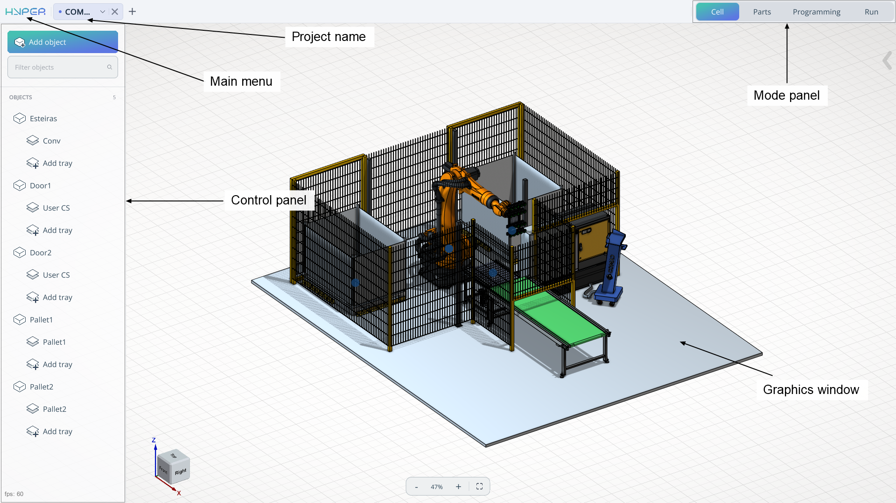

---
title: "시스템 기본 창"
---

# 시스템 기본 창

## 시스템 기본 창의 구성

**모드 패널.** 모드 패널은 장비 구성 불러오기부터 로봇 셀에서의 작업 실행까지 여러 작업 단계 사이를 차례로 전환하는 데 필요합니다. 모드: **Cell, Parts, Programming, Run**(셀, 부품, 프로그래밍, 실행). [자세히 보기](150697483.md)

**제어 패널.** 제어 패널은 작동 모드에 따라 달라집니다. 메커니즘 트리, 모델 목록 또는 로봇 이동 목록 형태로 표시될 수 있습니다.

**메인 메뉴.** 메인 메뉴에서는 프로젝트 열기, 프로젝트 전송, 라이선스 메뉴 등의 옵션이 포함된 목록을 열 수 있습니다. [자세히 보기](150697606.md)

**프로젝트 이름.** 프로젝트 이름 필드에서는 제공되는 키보드를 사용하여 프로젝트 이름을 입력할 수 있습니다.

**그래픽 창.** 그래픽 창에는 셀, 부품, 궤적 등 주요 구성 요소가 표시됩니다.
