---
title: "Cell Mode"
---

# Cell Mode

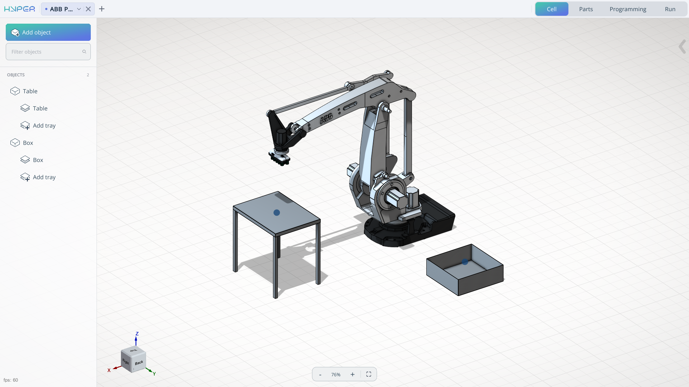

## Application Area:

This module enables editing of the digital twin of the robotic cell, including the addition and spatial arrangement of mechanisms in a 3D environment.

### Add object.

At the top‑left position of the interface, you will locate the **Add Object** button. This functionality serves as the primary creation tool, enabling the user to incorporate various mechanisms into the workspace. These may include, but are not limited to: tables, boxes, machines, or any other entities with which the robot is designed to interact.

**Work with mechanisms:**

**Name.** Mechanism name.

**Width.** Allows you to change the width of the mechanism.

**Depth.** Allows you to change the depth of the mechanism.

**Height.** Allows you to change the height of the mechanism.

**The component creation window will change depending on what you are trying to create.**

**Type of mechanism.** Types of mechanisms for product placement.

**Box.** The mechanism is presented in the form of a box/tray.

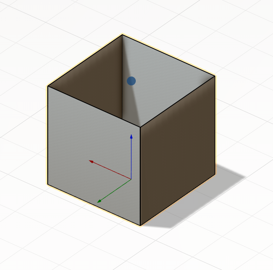

**Table.** The mechanism is presented in the form of a table for placing products.

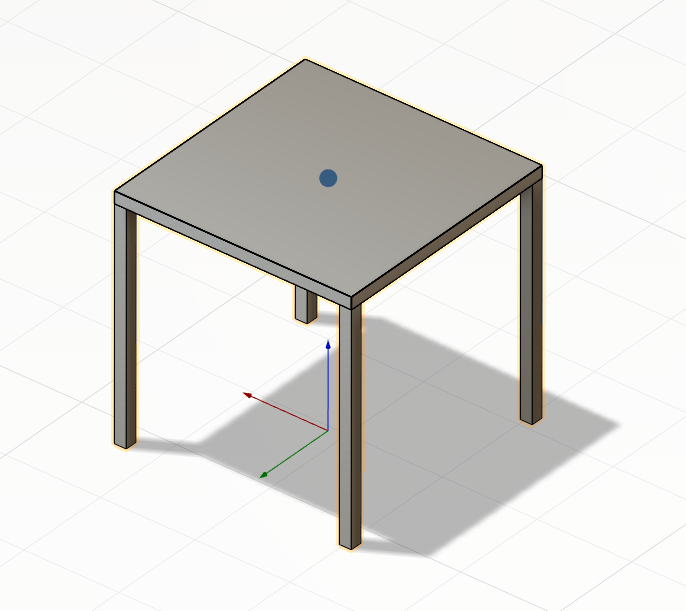

**Mill.** The mechanism is presented in the form of a simplified model of a machine for placing products.

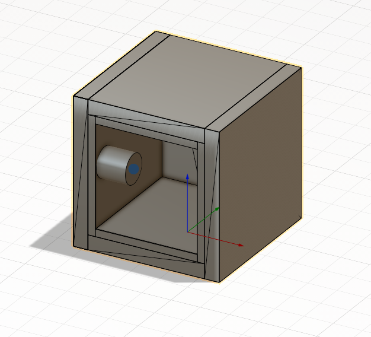

**Back wall.** Rear structural panel.

**Wall thikness.** Thickness of enclosure walls.

**Door parameters.** Specifications of access door.

**Chuck height.** Vertical dimension of the chuck.

**Chuck diameter.** Outer diameter of the chuck.

**Chuck positions.** Available mounting/operating positions of the chuck.

**Empty.** The mechanism does not have a 3D component

When the **Apply** button is clicked, the mechanism is added to the component tree, and a second menu opens to edit its position in space. In the component tree, placement positions (**tray**) also appear.

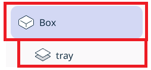

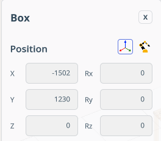

The menu includes the following items:

**Name**. Mechanism name.

**Position.** Modify the component’s position with respect to either the **world coordinate system** or the **robot’s BaseCS**.

**X,Y,Z,Rx,Ry,Rz,A,B,C** - Fields for spatial orientation of the mechanism.

In the lower‑right part of the screen, the component navigation mechanism appears. Allows interactive spatial manipulation of the mechanism.

In this window, you can also **delete** the mechanism or **close** the window to continue working on the project.

**Work with Tray.**

Item location. Each mechanism has at least one drawer.

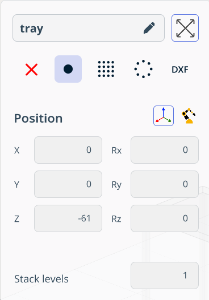

**Name.** Tray name.

**Zoom extents.** It scales the view so that all objects (**Tray**) fit entirely within the viewing window.

**Pick or Place point.** Allows setting attachment points for the product.

**None.** In No‑Point mode, no point needs to be set. Useful for creating collision‑control mechanisms (e.g., fences, barriers).

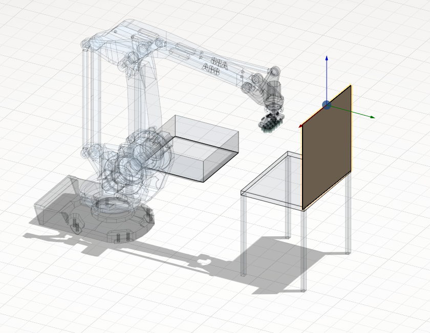

**Single Point.** It allows you to specify one mounting point.

**Position.** Modify the component’s position with respect to either the world coordinate system or the robot’s BaseCS. **This position is typically calibrated on a physical robot**, and the point(s) are then transferred via coordinates into the system while the **Position** - **Robot’s BaseCS** is enabled.

**Transform parent.** This function works only in **Position** — **Robot’s BaseCS** mode. When enabled, changing the **Tray** position also adjusts the mechanism’s position. When disabled, only the **Tray** position changes.

**X,Y,Z,Rx,Ry,Rz,A,B,C** - Fields for spatial orientation of the tray.

**Stack levels.** It allows you to create an array of points along the height axis.

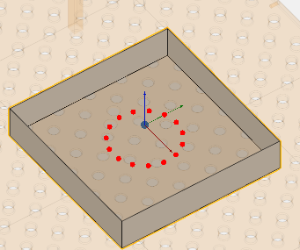

 

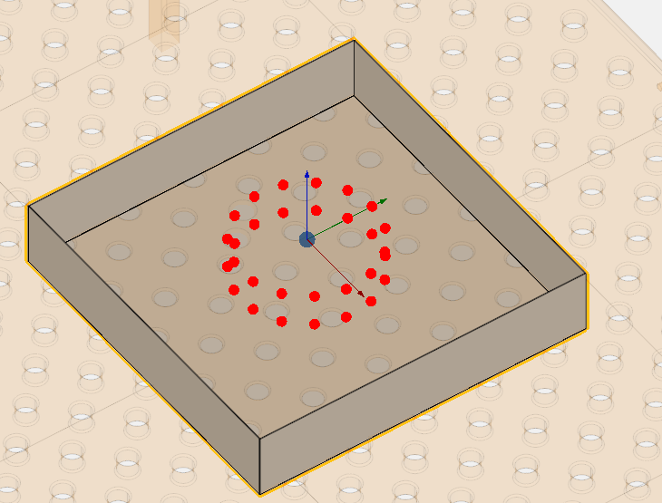

In the lower‑right part of the screen, the component navigation mechanism appears. Allows interactive spatial manipulation of the mechanism.

**Two dimensional array.** It allows you to create a two‑dimensional array. In this template, some parameters are identical to those in **Single Point**.

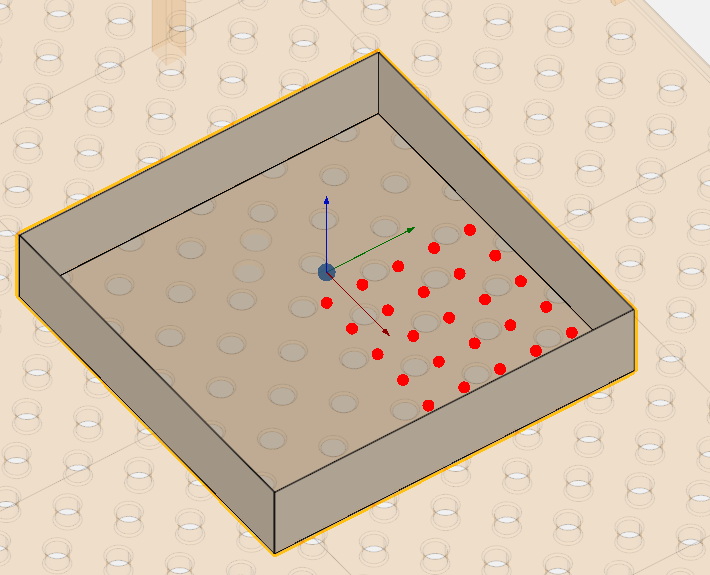

**Rows.** Number of horizontal rows in the array

**Columns.** Number of vertical columns in the array

**Step X.** Horizontal spacing (distance between column centers).

**Step Y.** Vertical spacing (distance between row centers).

**Round array.** It allows you to create a circular array. In this template, some parameters are identical to those in **Single Point**.

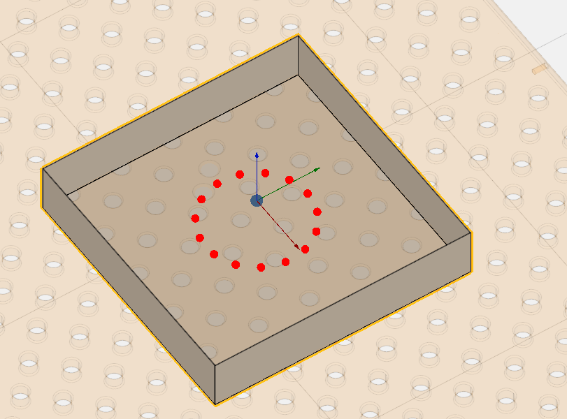

**Points.** Number of points around the circle.

**Radius.** Distance from center to each point.

**DXF.** It allows you to import DXF‑format drawings. The point can be placed within a **closed contour**, which will serve as a workpiece holder.

In this template, some parameters are identical to those in **Single Point**.

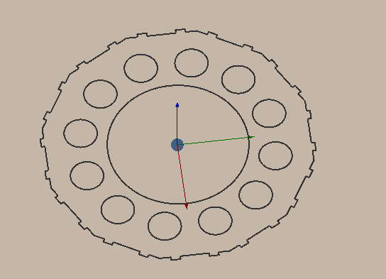

 

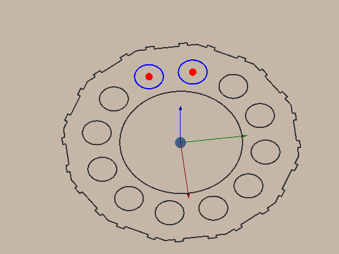

**Custom file**. It allows you to reselect the model.

### Tree of Mechanisms.

Structured list of all elements in your cell.

1. Each mechanism is assigned a unique name, which may be renamed unless the mechanism is locked.
2. All mechanisms include tray by default; these may be disregarded if not required for the current task.
3. Mechanisms and tray originate from one of two sources:

- predefined entries in the .mma cell file (supplied by the vendor);
- user‑generated entries created manually.
