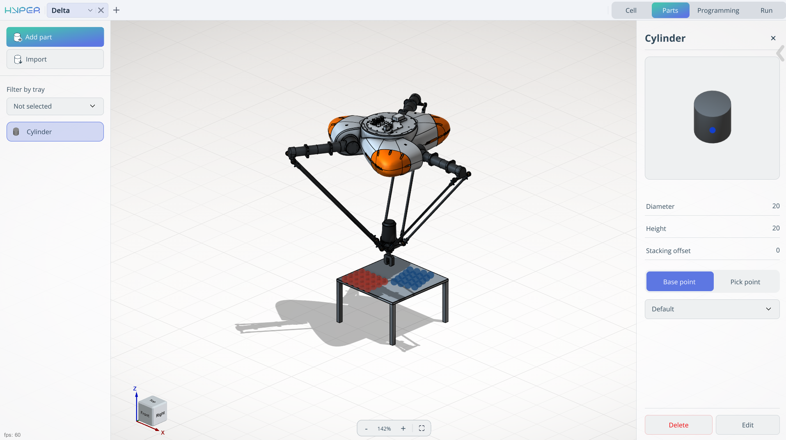
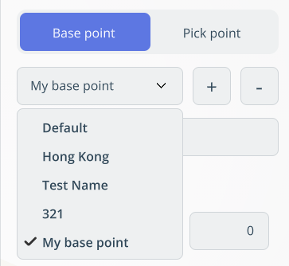
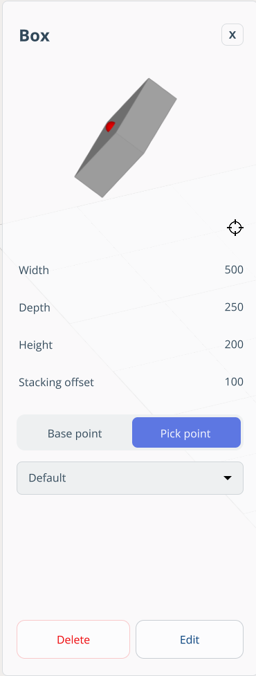
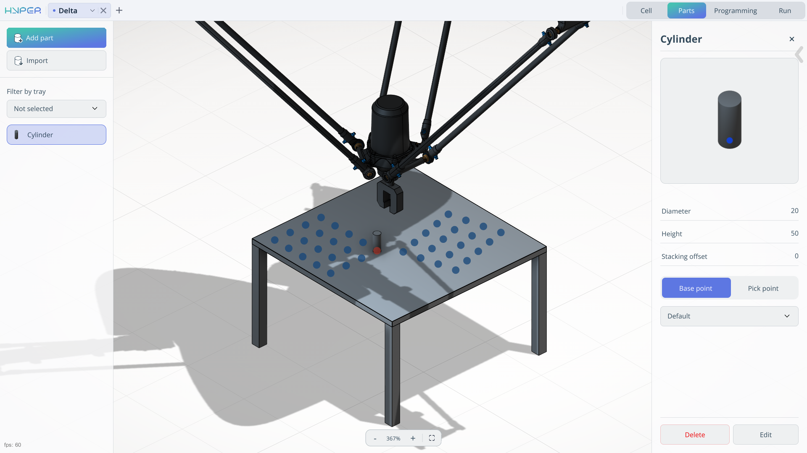
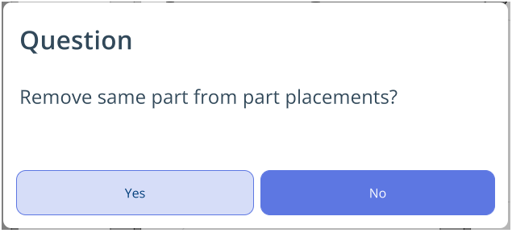
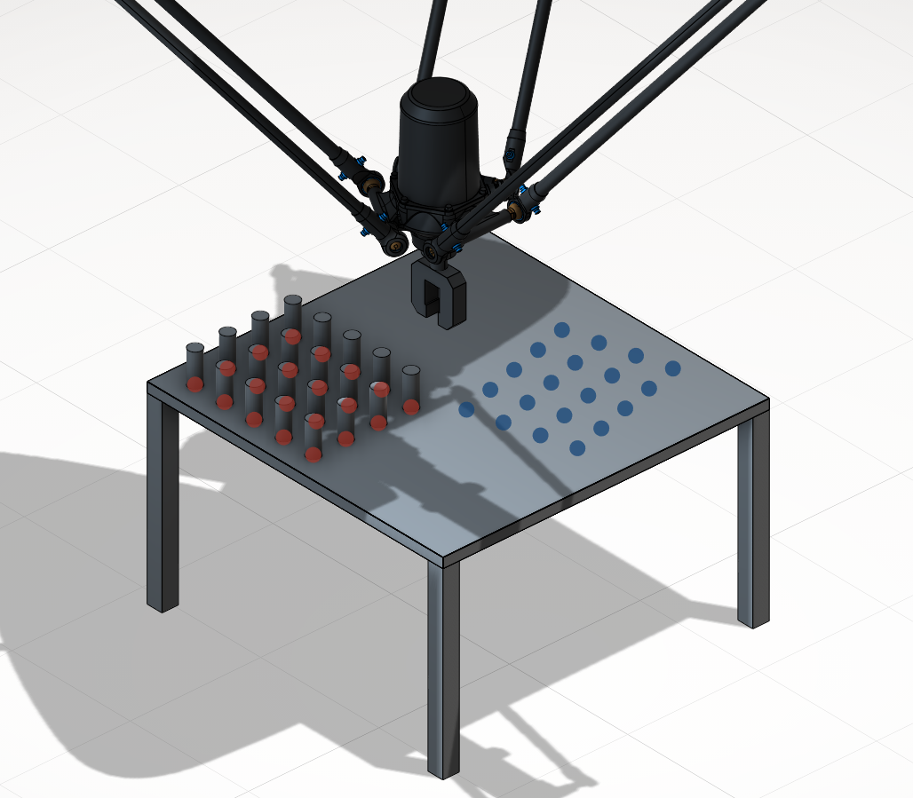

---
title: "Parts Mode"
---

# Parts Mode

## Application Area:

The Part mode allows you to add a model or create it from primitives, as well as place them in the **tray**.

### Import.

It allows you to load a 3D model of the product.

**Type.** Сylinder, Box, or 3D model.

**ustom file.** It allows you to reselect the model.

**Stacking offset.** The parameter determines the vertical alignment relationship between stacked components.

Value = 0: parts are positioned directly atop one another without overlap.

Value > 0: defines the insertion depth for mating parts (e.g., in LEGO‑like interlocking mechanisms, this would equal the height of the connecting cylinder).

**Base point/ Pick point.** The reference point for placement / The gripping point on the part.

- Unlimited pick and base points can be created.
- Each point supports editing, deletion, and renaming.
- Coordinates can be input manually or selected via model interaction.
- A gripper visualization aids pick point definition, showing the robot’s actual gripping posture.

**Name pont.** Assigns a name to an existing point

**Add/Delete a point.**   Allows you to create/delete a point that is added to the **list of points.**

**List of points.** View point names

**X,Y,Z,Rx,Ry,Rz,A,B,C** - Fields for spatial orientation of the point.

### Add part.

It allows you to create a model from primitives. In this template, some parameters are identical to those in **Import - 3D model.**

**Сylinder.**

**Diameter.** Distance across the circular base, through the center

**Height.** Distance between the two bases along the axis

**Box.**

**Width.**  Defines the width

**Depth.**   Defines the depth

**Height.**   Defines the height

### Filter by tray.

It allows you to select a specific tray for work.

### List of parts

It displays a list of parts for moving and allows you to edit them.

Clicking the part opens a window where you can:

1. View model name
2. Edit model
3. Delete model
4. Show base and pick points
5. Rotate model (preview)

### Work specifics

In this mode, place the parts in their initial positions.

To position the parts in the tray:

- Select the required part in the parts tree.
- In the graphics window, choose the attachment point.
- The selected part will appear in this position.

The position where a part is already installed (attachment point) changes its color to indicate that the slot is occupied.

To **remove** a part from its position, simply click on the attachment point where the part is located.

To add **multiple parts** at once, **press and hold the left mouse button**. A dialog box will then appear, prompting you to add this part to the entire tray.

The same mechanism applies to removing parts from the tray.
