---
title: "프로그래밍 모드"
---

# 프로그래밍 모드

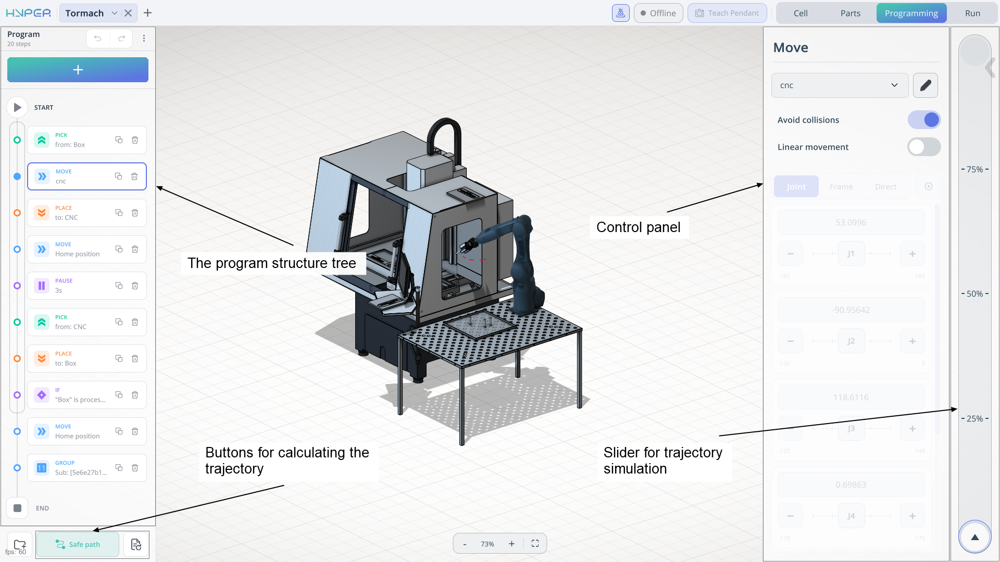

## 적용 분야

프로그래밍 모드는 이론적인 계획이 실제로 실행되고 로봇 시스템이 가동되는 핵심 작업 환경입니다. 자동화 관리와 시스템 구성을 위한 전용 작업 공간으로서 다목적 제어 센터 역할을 합니다.

프로그래밍 모드에서는 **Control Panel**(제어 패널)이 화면 오른쪽으로 이동하고 **Program Structure Tree**(프로그램 구조 트리)가 추가됩니다.

### 궤적 계산 버튼

**Quick calculation**(빠른 계산) 버튼. 명령의 **충돌 회피** 확인란을 고려하지 않고 궤적을 계산합니다.

**Safe Path**(안전 경로) 버튼. 충돌 회피를 적용하여 궤적을 계산합니다. 단, 해당 플래그가 활성화된 명령에만 적용됩니다.

### 시뮬레이션 슬라이더

궤적을 시뮬레이션합니다(속도는 슬라이더로 조절합니다).

### 충돌 감지

**Collision detection**(충돌 감지) 기능은 프로젝트의 메커니즘과 객체 간 충돌을 찾는 데 도움이 됩니다. 이 기능을 활성화하려면 **Project settings > Main > Simulation**(프로젝트 설정 > 메인 > 시뮬레이션)을 열고 **Collision detection** 토글을 켭니다.

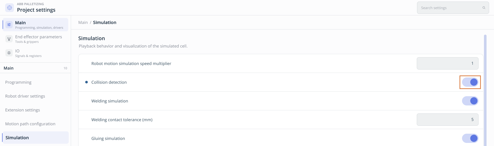

이 옵션을 활성화하면 ENCY Hyper가 프로젝트의 충돌 모델을 생성합니다. 화면 상단에 진행률 표시기가 나타납니다. 충돌을 검사하기 전에 모델 생성이 완료될 때까지 기다립니다.

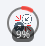

모델이 준비되면 로봇 동작을 시뮬레이션하여 메커니즘과 객체 간에 충돌이 발생할 수 있는 위치를 확인합니다. 아래와 같이 충돌하는 구성 요소는 그래픽 창에서 빨간색으로 강조 표시됩니다.

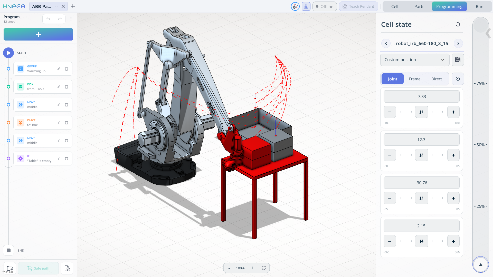

### 프로그램 구조 트리의 구성

**버튼:**

**Add a command**(명령 추가). 기본 명령을 추가할 수 있습니다.

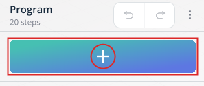

**Clear**(모두 제거). 모든 명령을 지우고 초기 상태부터 다시 시작합니다.

**Creates a Group**(그룹 만들기). 명령을 그룹으로 묶을 수 있습니다. 그룹을 만든 후에는 그룹을 복사할 수 있으며, 그룹에 속한 모든 명령의 트레이 할당을 한꺼번에 변경할 수 있습니다. 여러 트레이에 걸친 반복 작업을 효율적으로 처리할 수 있습니다. 

**명령:**

**Start**(시작). 로봇의 초기 위치를 설정합니다. 제어 패널에서 로봇의 공간 이동을 위한 내비게이션을 사용할 수 있습니다. [자세히 보기](150697591.md)

**End**(끝). 로봇의 최종 위치를 설정합니다. 제어 패널에서 로봇의 공간 이동을 위한 내비게이션을 사용할 수 있습니다. [자세히 보기](150697591.md)

**MOVE**(이동). 로봇을 목표 위치에 배치합니다.

*구성:*

**List of Robot Positions**(로봇 위치 목록). 로봇의 위치를 기억합니다. 이 위치에 이름을 지정하여 다시 사용할 수 있습니다. 지정한 이름은 로봇의 프로그래밍 트리 구조에 표시됩니다.

새 위치를 추가하려면 **Custom Positions**(사용자 정의 위치)를 선택하고 로봇을 이동한 다음 설정을 저장합니다.

**Avoid collisions**(충돌 방지). 이 이동에 대해 안전한 궤적을 계산할 수 있습니다.

**quick calculation** 버튼으로 프로젝트를 실행하면 이 확인란은 무시됩니다.

**Safe Path** 버튼을 사용하면, 해당 이동에 이 옵션이 활성화된 경우 충돌을 회피하는 궤적이 자동으로 계산됩니다. **궤적 계산 시간이 더 오래 걸립니다.**

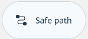

**Linear movement**(선형 이동). 로봇을 직선으로 이동할 수 있습니다.

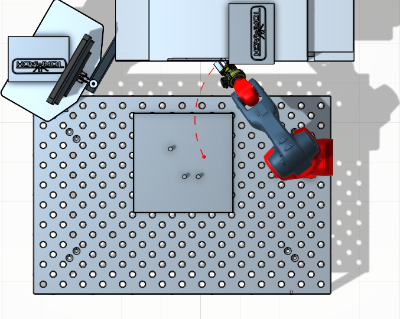

 

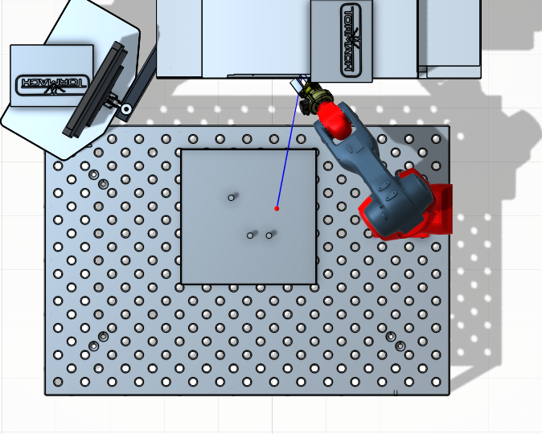

**Navigation for robot movement in space**(공간에서의 로봇 이동 내비게이션). 다양한 방법으로 로봇을 공간에서 이동할 수 있습니다. [자세히 보기](150697591.md)

**PICK/PLACE**(픽/플레이스). 로봇이 부품을 집거나 내려놓을 수 있게 합니다.

*작동 원리:*

부품을 **픽**하려면 해당 부품을 눌러야 합니다. 그리퍼가 부품의 픽 포인트로 이동합니다. 이 포인트는 앞서 **Part mode**(부품 모드)에서 정의한 것입니다.

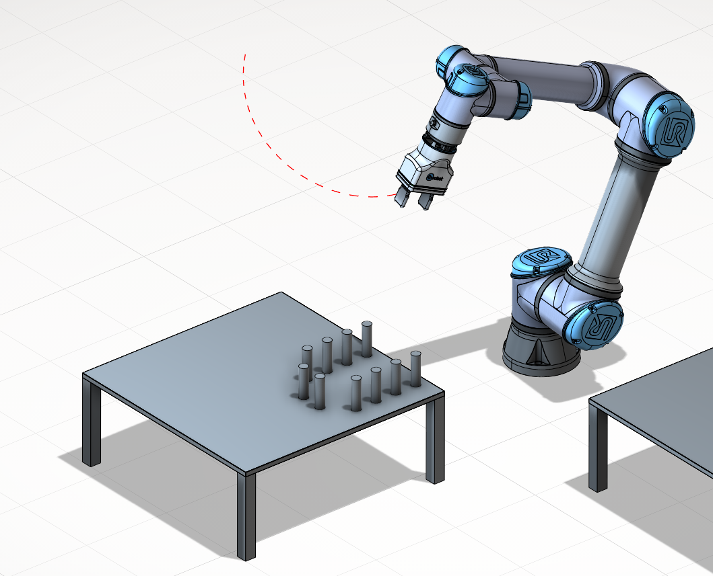

 

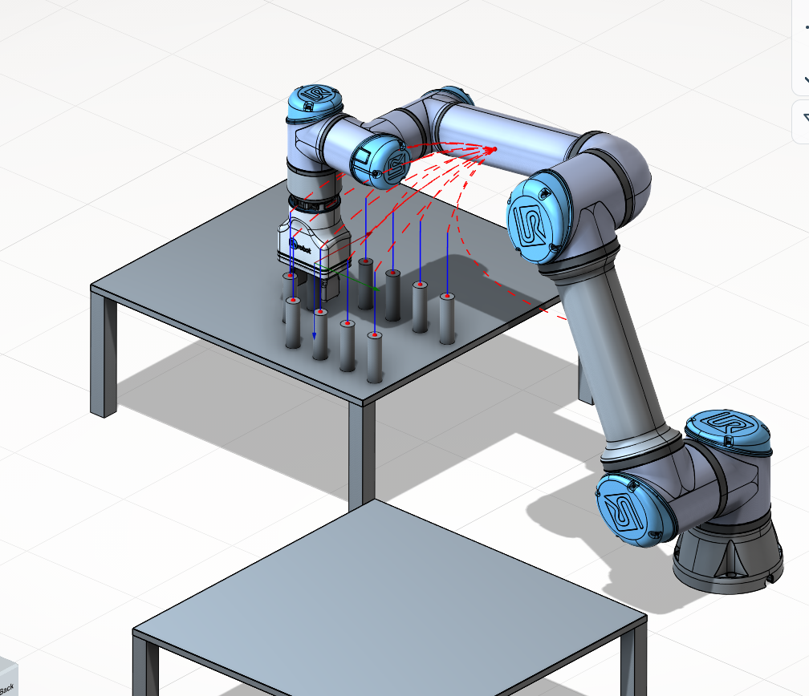

부품을 **플레이스**하려면 트레이의 부착 포인트를 클릭해야 합니다.

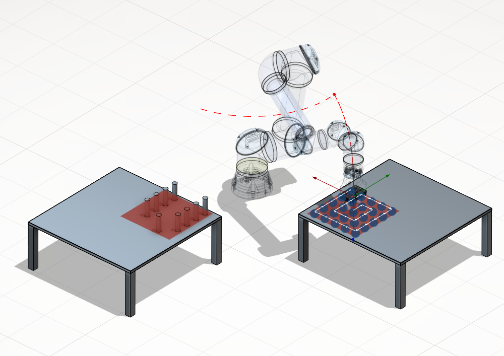

*구성:*

**선택한 모드에 따라 제어 패널이 변경됩니다.**

** 1. Pick options**(픽 옵션). 이 탭에는 파지에 대한 주요 설정이 있습니다.

**List of points for end effectors**(엔드 이펙터 포인트 목록). 엔드 이펙터의 파지 포인트를 선택할 수 있습니다.

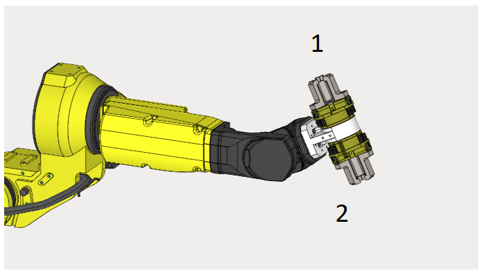

**Pick/Holder**(픽/홀더). 파지 시 로봇의 위치 / 부품 배치 시 로봇의 위치입니다.

**Single element**(단일 요소). **트레이**에서 부품 하나 또는 모든 부품을 가져올 수 있습니다.

트레이 전체를 선택하면 이 트레이에서 부품을 이송하는 순서의 템플릿을 미리 확인할 수 있습니다.

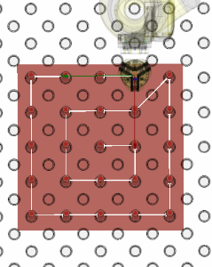

**Strategy**(전략). 트레이에서 부품을 이송하는 순서의 템플릿을 선택할 수 있습니다.

**Spiral from outside**(바깥쪽부터 나선형).

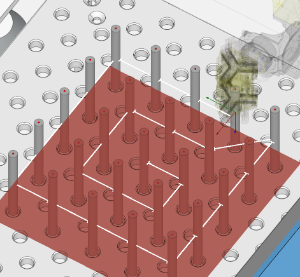

**Spiral from inside**(안쪽부터 나선형).

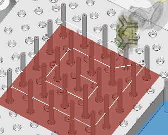

**Row**(행).

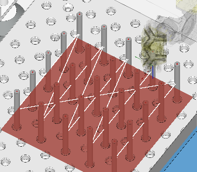

**Column**(열).

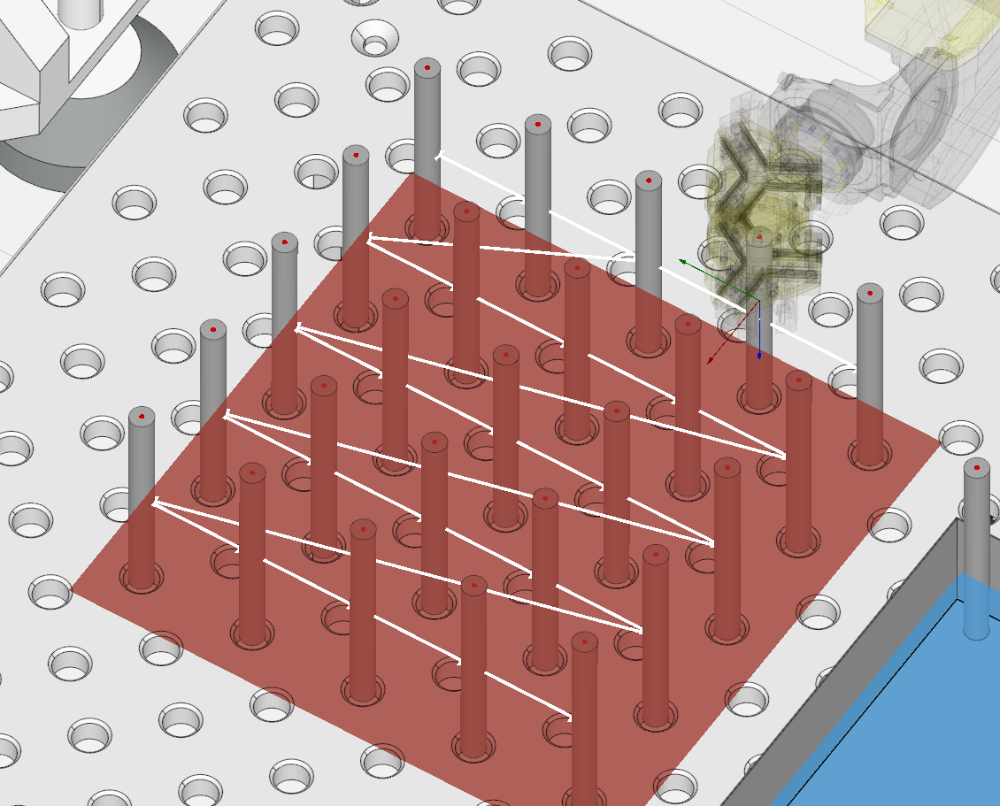

**Optimal**(최적).

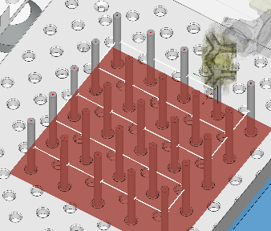

**Custom**(사용자 정의). 부품의 픽업/내려놓기 순서를 설정합니다.

**Preferred part**(우선 부품). 트레이에 여러 종류의 부품(**Part mode**에서 정의한 부품)이 있는 경우 이 옵션으로 가져올 부품을 정확히 지정할 수 있습니다.

**Pick point /Place point**(픽 포인트/플레이스 포인트). 홀드 포인트 목록입니다. 픽 포인트는 부품을 지정할 때 **Parts mode**에서 정의합니다. 픽 포인트는 이 모드나 **Parts mode**에서 언제든지 편집할 수 있습니다.

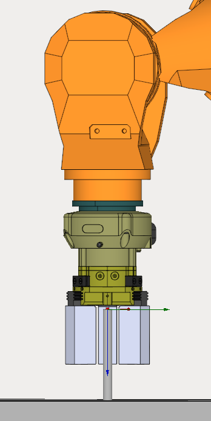

 

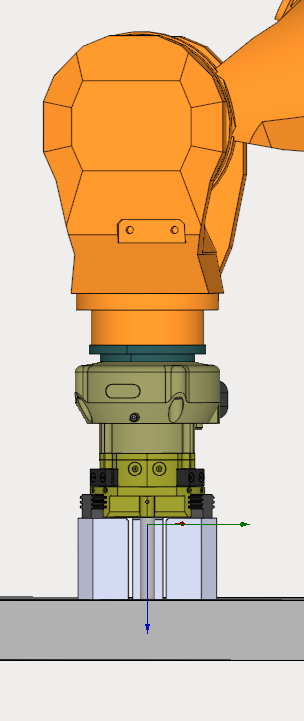

**Avoid creases**(꼬임 방지). 축 꼬임(로봇 관절의 과회전)을 방지합니다.

**Skip unreachable points**(도달 불가 포인트 건너뛰기). 이 옵션을 활성화하면 로봇은 도달할 수 있는 부품만 픽업합니다. 이 옵션이 활성화되지 않은 상태에서 로봇이 부품에 도달할 수 없으면 프로그램이 오류를 표시하고 작업자를 기다립니다.

** 2. Reference Point Editor**(참조점 편집기). 부품의 파지 포인트를 편집할 수 있습니다(간격을 두고 파지해야 하는 경우).

제어 패널에서 로봇의 공간 이동을 위한 내비게이션을 사용할 수 있습니다. [자세히 보기](150697591.md)

** 3. Additional points for collision avoidance**(충돌 회피용 추가 포인트). 픽 포인트, 플레이스 포인트, 안전 간격 포인트 사이에 추가 포인트 또는 충돌 회피 전략을 정의할 수 있습니다.

**Pick**(픽).

**Avoid collisions**. **안전 간격 포인트**까지의 충돌 회피를 처리합니다.

**Checks**(검사). 센서를 확인하려면 검사가 필요합니다. 예를 들어 트레이가 나왔는지 확인하는 경우입니다. 이 경우 프로그램은 센서가 신호를 보낼 때까지 기다립니다.

**Reference point**(참조점)

**Before**(이전). 부품을 픽/플레이스하기 전에 특정 포인트로 이동할 수 있습니다.

**Avoid collisions**. **안전 간격 포인트**에서 **픽/플레이스 포인트**까지의 이동을 처리합니다.

**After**(이후). 부품을 **픽/플레이스**한 후 특정 포인트로 이동할 수 있습니다.

**Avoid collisions**. **픽/플레이스 포인트**에서 **안전 간격 포인트**까지의 이동을 처리합니다.

**Edit**(편집). 새 로봇 위치를 설정하거나 기존 위치를 편집할 수 있습니다.

** 4. Clearance**(안전 간격). 부품을 파지하기 전에 로봇이 이동하는 위치입니다.

**Simple**(기본). 파지 포인트로의 단순 접근을 생성할 수 있습니다.

**Save move distance**(안전 이동 거리). 부품을 파지하기 전에 로봇이 이동하는 위치입니다.

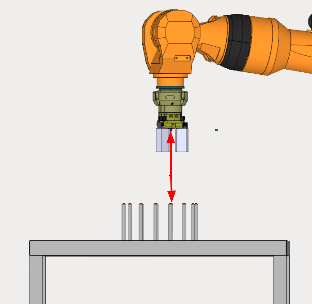

**Safe move direction**(안전 이동 방향). 파지 포인트로 접근할 축을 지정할 수 있습니다(X+, X- 등).

**Safe move speed**(안전 이동 속도). 파지 포인트에 접근할 때 피드를 낮출 수 있습니다.

**Sub program**(서브 프로그램). 파지 포인트로의 복잡한 접근을 생성할 수 있습니다(예: 로봇이 기계에서 부품을 꺼내 칩 에어 블로우 스테이션으로 이동한 다음 부품을 내려놓아야 하는 경우).

이 모드에서는 여러 단계로 구성된 서브루틴을 만들 수 있습니다(프로그램 트리와 유사). 이렇게 하려면 «Add a command» 버튼으로 명령을 만든 다음, 해당 명령을 메인 트리가 아닌 서브루틴으로 끌어 놓습니다.

**MOVE 또는 IO와 같은 명령을 추가할 수 있습니다.**

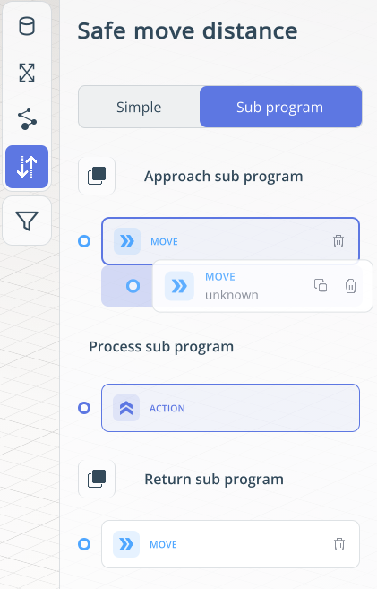

MOVE 명령에서는 로봇을 공간에서 이동하는 옵션을 사용할 수 있습니다. [자세히 보기](150697591.md)

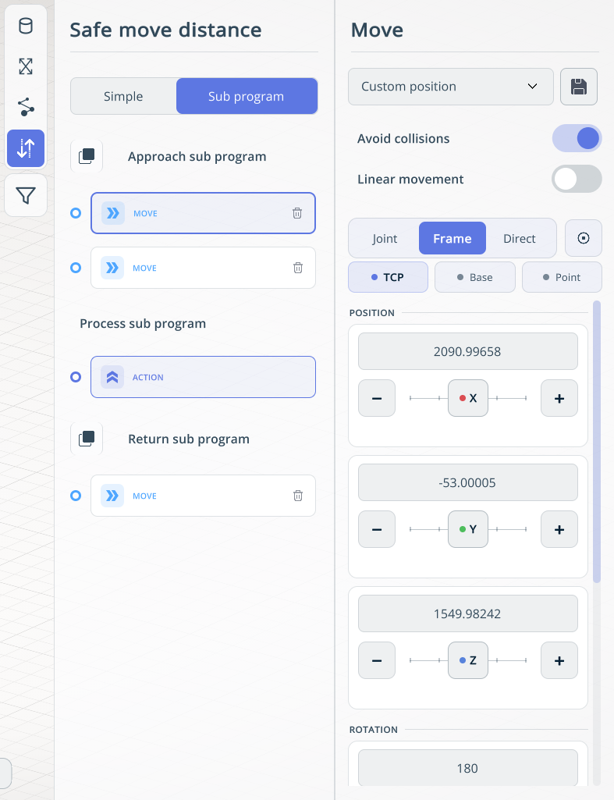

**IF**(조건문). 프로그램을 반복 실행할 수 있습니다.

*작동 원리:*

프로그램에 **IF** 문이 없으면 부품 하나에 대해서만 픽/플레이스가 수행됩니다.

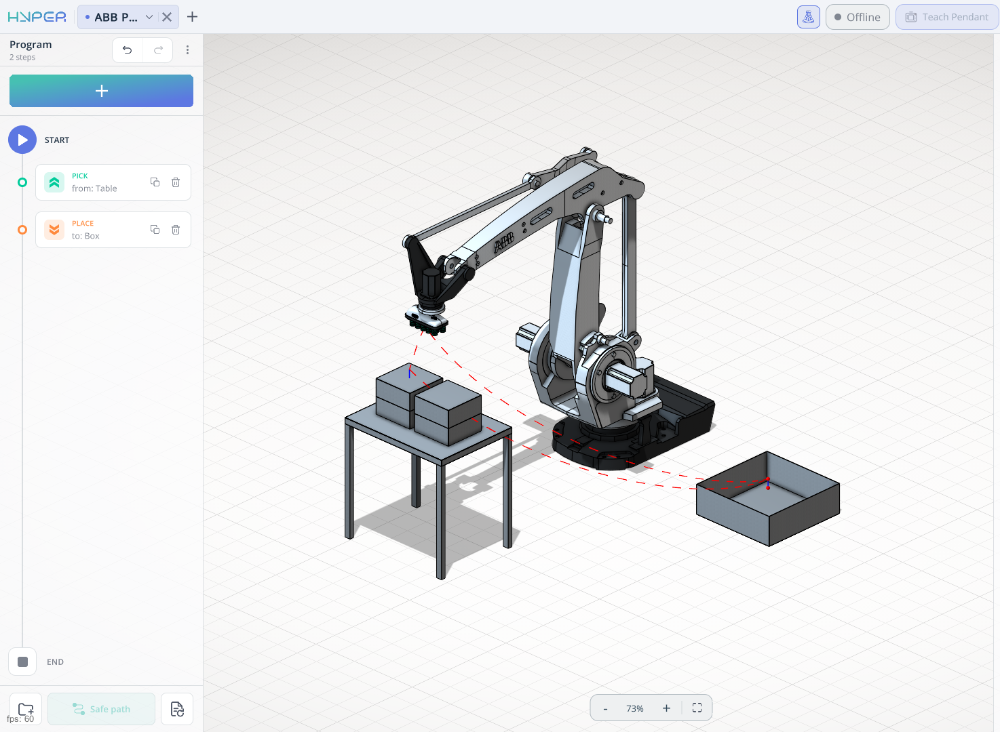

**IF** 문을 사용하면 프로그램이 반복 실행됩니다. 이때 프로그램 트리에는 **IF** 명령이 어떤 블록을 대상으로 작동하는지 표시됩니다(모든 명령이 하나의 블록에 포함됩니다).

프로그램은 블록 단위로 작동합니다. 이 예에는 3개의 블록이 있습니다.

**블록 1 - PICK:** 이 경우 트레이를 살펴보고 안에 부품이 있는지 확인합니다. 그런 다음 부품을 픽업합니다.

**블록 2 - PLACE:** 두 번째 트레이를 살펴보고 부품을 놓을 위치를 찾습니다.

**블록 3 - IF:** 테이블이 비어 있는지 확인하고, 그 결과에 따라 YES 또는 NO에 해당하는 동작을 수행합니다.

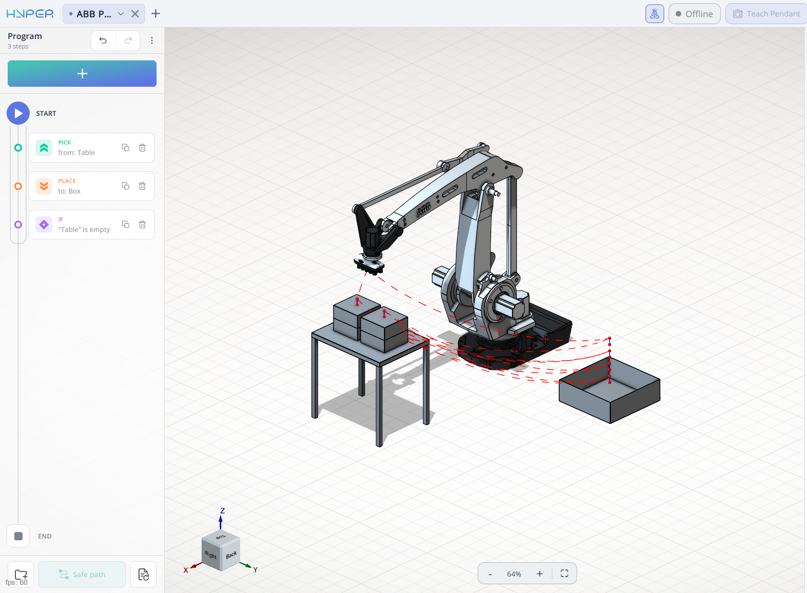

 

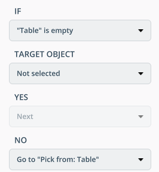

*구성:*

**IF**. 루프가 실행되는 주 조건입니다. **Table empty**(테이블 비어 있음) 또는 **Table is processed**(테이블 처리됨)와 같은 조건을 사용할 수 있습니다.

**TARGET OBJECT**(대상 객체). 조건이 특정 부품에만 적용됩니다.

**YES**(예). 조건이 참이면 무엇을 수행해야 합니까?

**NO**(아니요). 조건이 거짓이면 무엇을 수행해야 합니까?

**IO**(입출력). 입력/출력(기계 및 로봇의 외부 축 — 기계 도어, 레일 등)을 관리하는 데 필요합니다. **IO**는 **Project Settings**에서 구성합니다. [자세히 보기](150697606.md)

*작동 원리:*

**Project settings**를 열고 왼쪽 패널에서 **IO**를 선택합니다. 설정에는 미리 정의된 IO 항목이 이미 포함되어 있습니다. **Open door**(문 열기)와 같은 항목을 선택하고 장비에 맞게 설정을 편집합니다.

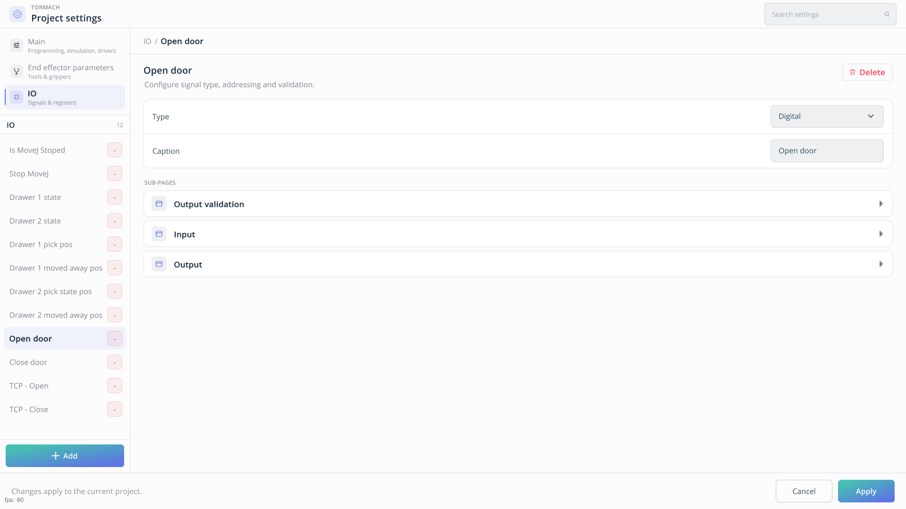

사용자 고유의 IO 항목을 만들 수도 있습니다. 왼쪽 IO 목록 하단의 **Add**(추가)를 클릭한 다음 새 항목을 구성합니다.

예를 들어 설정에서 **Open door cnc** 명령을 만들어 보겠습니다.

모든 입력 및 출력 신호를 구성할 수 있습니다. 예를 들어 출력 250을 값 60으로 설정해 보겠습니다. 또한 목록에서 연결된 축을 선택하고 해당 축에 값을 지정해야 합니다.

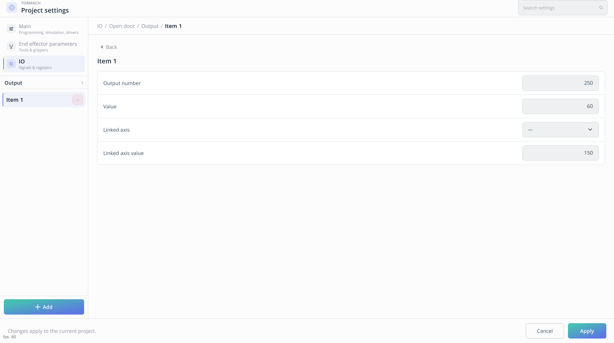

IO 창에서 이 동작을 선택할 수 있습니다.

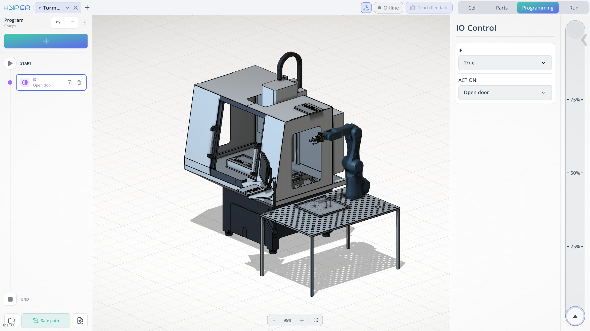

*구성:*

**IF**. IO 동작을 실행하기 전에 센서를 확인할 수도 있습니다(예: 센서가 기계가 작동 중이 아님을 나타내면 기계 도어를 엽니다).

*기본적으로 IO 동작은 조건 없이(True) 실행할 수 있습니다.*

**ACTION**(동작). 프로젝트 설정에서 구성한 매크로 이벤트를 실행할 수 있습니다.

**PAUSE**(일시 중지). 동작 사이에 지연을 설정할 수 있습니다.

*구성:*

**WAIT UNTIL**(다음까지 대기). 특정 이벤트를 기다리는 지연을 설정할 수 있습니다. 대기할 센서가 설정되어 있으면 Time 필드의 값이 해당 센서의 폴링 간격에 맞게 변경됩니다.

*기본적으로 조건 없음(True).*

**TIME(sec)**(시간(초)). 대기할 시간(초)을 지정합니다.

**NAILING**(못 박기). 못 박기 작업을 위한 기능입니다.

*작동 원리:*

로봇이 포인트에 접근하여 엔드 이펙터에 신호를 보내 못을 박게 한 다음 엔드 이펙터를 끕니다.

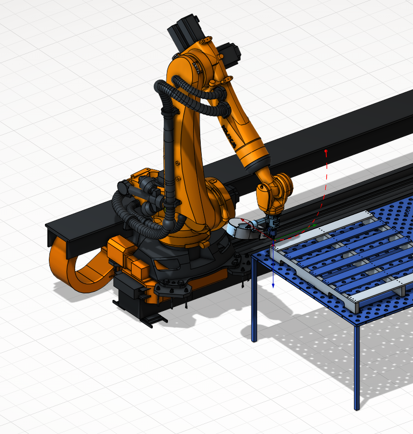

*구성:*

**Processing action**(처리 동작). **IO** 이벤트를 정의할 수 있습니다(못을 박도록 엔드 이펙터에 신호를 보내기 위함).

파라미터는 **PICK** 작업과 동일합니다.

**WELDING**(용접). 스팟 용접 또는 연속 이음선 용접으로 부품을 접합합니다.

*작동 원리:*

스팟 용접에서는 로봇이 지정된 각 포인트에 용접 공구를 위치시키고 용접을 수행합니다. 이음선 용접에서는 로봇이 용접하면서 지정된 이음선을 따라 공구를 연속으로 이동합니다.

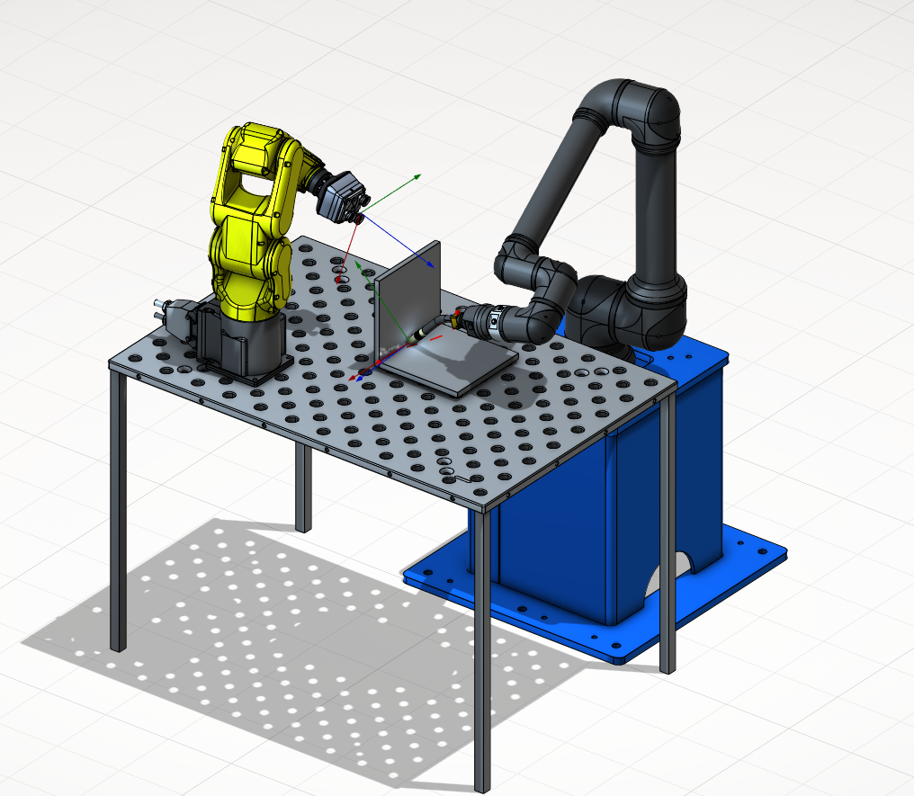

**GLUING**(접착). 접착제를 도포하여 부품을 서로 접합합니다.

*작동 원리:*

이 작업은 용접과 마찬가지로 포인트 기반 또는 연속 경로 방식을 따릅니다. 로봇은 지정된 포인트에 디스펜싱 공구를 위치시키거나, 접착제를 토출하면서 지정된 경로를 따라 공구를 이동합니다. 접착제는 접합면에 도포되어 부품을 결합합니다.

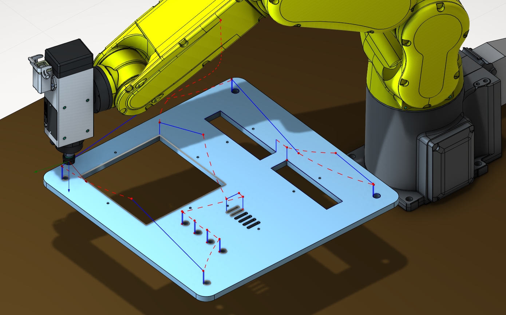

**POLISHING**(연마). 지정된 이음선을 따라 연속 연마 패스를 수행합니다. 로봇이 이음선을 따라 연마 공구를 이동하여 표면을 마무리합니다.

**TRAJECTORY**(궤적). CAM 시스템에서 **ENCY Hyper**로 궤적을 가져옵니다. 간단한 방법은 **MachineMaker**에서 만든 셀부터 시작하여 저장된 CAM 프로젝트를 가져오는 것입니다.

**1. 셀 및 CAM 작업 준비.** **MachineMaker**에서 셀을 만들고 프로젝트를 **.mma** 형식으로 저장한 다음 버튼을 클릭하여 CAM 시스템으로 내보냅니다. CAM 시스템에서 가공 작업을 만듭니다. 이 예에서는 간단한 **2D 윤곽** 작업을 사용합니다.

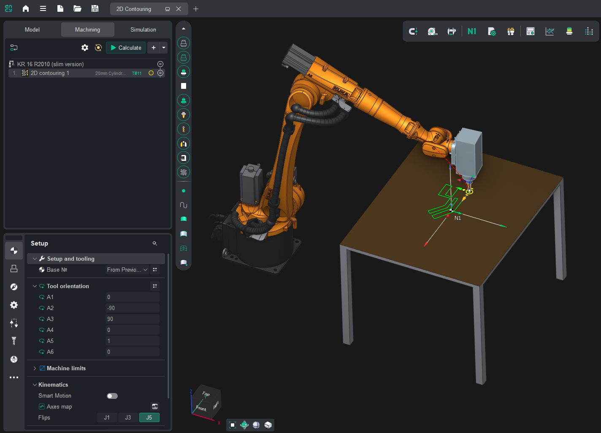

**2. CAM 프로젝트 저장 및 애플리케이션 경로 구성.** CAM 시스템에서 프로젝트를 저장합니다. **ENCY Hyper**에서 **Project settings > Main > CAM integration**(프로젝트 설정 > 메인 > CAM 통합)을 엽니다. **Path to the CAM application**(CAM 애플리케이션 경로)에 CAM 애플리케이션 바로 가기의 경로를 지정하고 **Apply**(적용)를 클릭합니다.

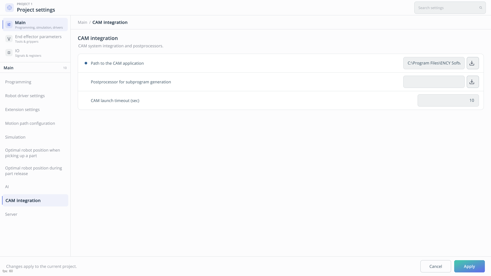

**3. 궤적 가져오기.** **Programming Mode**(프로그래밍 모드)에서 **Trajectory** 작업을 만들고 파일 브라우저에서 저장된 CAM 프로젝트를 선택합니다. **ENCY Hyper**가 CAM 시스템을 실행하고 사용자가 만든 작업에서 궤적을 가져옵니다. 그러면 아래와 같이 가져온 궤적이 **ENCY Hyper**에 표시됩니다.

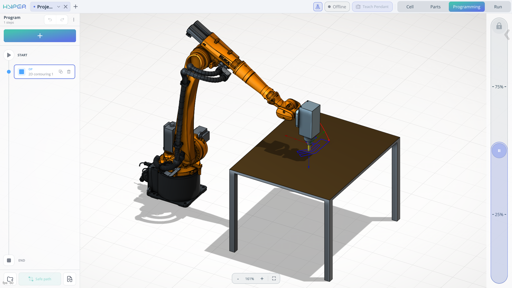
