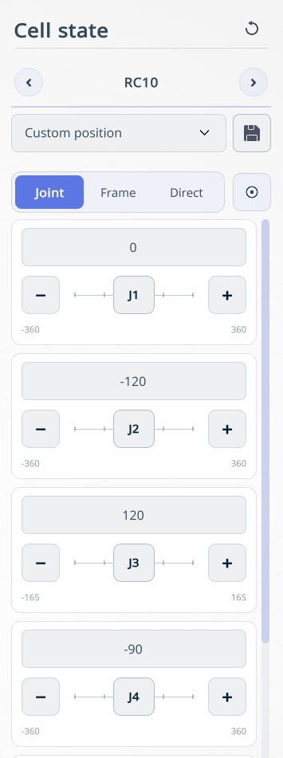
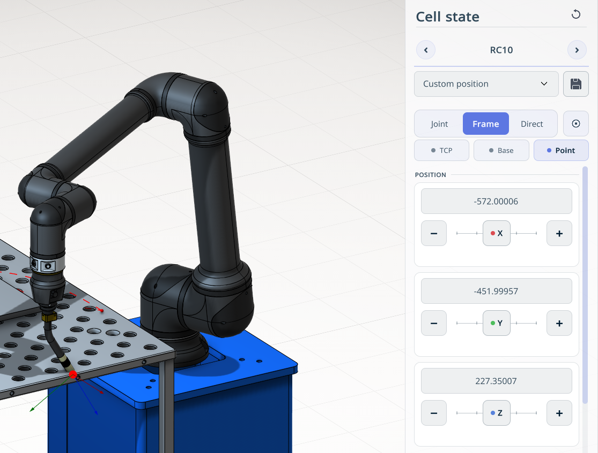

---
title: "공간에서의 로봇 이동 내비게이션"
---

# 공간에서의 로봇 이동 내비게이션

**적용 분야**

다양한 방식으로 로봇을 공간에서 이동할 수 있습니다.

## 관절 모드

**Joint**(관절) 모드에서는 개별 축을 제어하여 로봇을 이동할 수 있습니다.

## 프레임

**Frame**(프레임) 모드에는 로봇 위치를 지정하기 위한 세 가지 하위 모드 **TCP**(공구 중심점), **Base**(베이스), **Point**(포인트)가 있습니다.

**TCP.** TCP(공구 중심점) 좌표계를 기준으로 로봇을 이동합니다.

**Base.** 로봇 베이스 좌표계를 기준으로 로봇을 이동합니다.

**Point.** 그래픽 창에서 선택한 점으로 로봇을 이동합니다. 로봇이 도달할 수 있는 작업 공간 안의 점을 클릭하면 로봇이 그 점으로 이동합니다.

## 직접 모드

**Direct**(직접) 모드는 로봇이 실시간 모드로 연결된 경우에만 작동합니다. 원격 제어 또는 수동으로 로봇을 이동할 수 있습니다.

## 정밀 모드

**Precision mode**(정밀 모드)는 모든 작동 모드에서 활성화할 수 있습니다. 이동 스텝을 줄여 로봇이 장애물과 충돌하지 않도록 합니다. 

**이동 스텝은 하단의 슬라이더로 설정합니다.**
