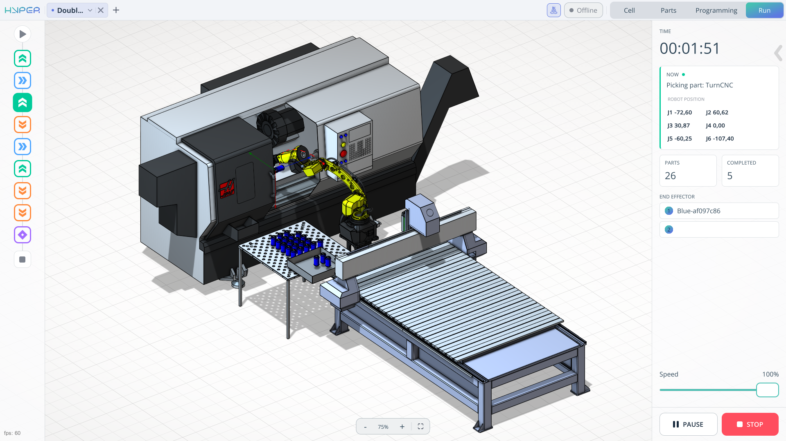
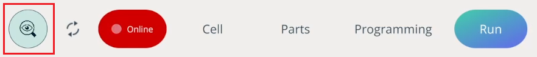

---
title: "Run Mode"
---

# Run Mode

## Application Area:

The **Run** tab is responsible for launching the already generated robot program.

**Time.** Indicates the total execution time of the program.

**Information window.** Displays what is currently being executed in your program.

**Parts information window**. This window displays information about the number of parts and how many of them have been processed.

**Speed slider.** When starting the program using the large Start button, the speed must be adjusted using this slider. It affects the movement speed of the mechanisms.

The **Start**, **End**, and other icons at the bottom indicate which command is currently being executed when the program is running.

### Program control buttons.

**Start.** Launches the program you created on the Programming tab.

**Pause.** Pauses the program.

**Resume.** Resumes the program.

**Stop.** Completely stops the program and resets it to the initial position.

Monitoring mode. This mode hides interface elements and allows you to manually adjust the robot and see the changes on your screen. It is enabled when you are already connected to your robot and online.

