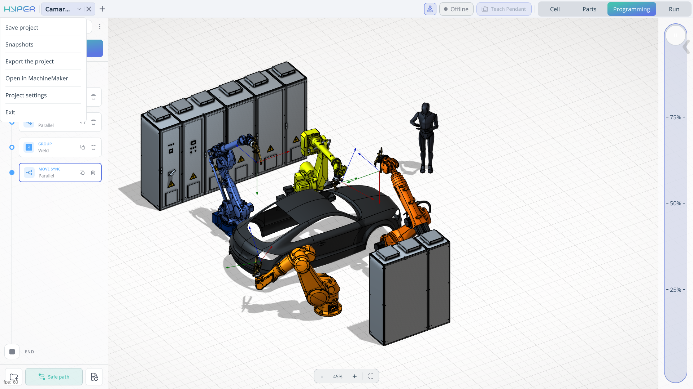

---
title: "메인 메뉴"
---

# 메인 메뉴

## 적용 분야

메인 메뉴에는 현재 프로젝트를 저장 및 복원하고, 다른 컴퓨터로 옮기고, MachineMaker에서 로봇 셀을 편집하고, 프로젝트 설정을 구성하는 명령이 있습니다.

**Save project**(프로젝트 저장). 현재 프로젝트의 변경 내용을 저장합니다. 작업 내용을 보존하고 나중에 저장된 상태에서 작업을 계속할 수 있습니다.

**Snapshots**(스냅샷). 프로젝트를 이전에 캡처한 상태로 복원할 수 있습니다. 문제가 발생한 후 이전 프로젝트 상태를 복구하려면 스냅샷을 사용합니다.

**Export the project**(프로젝트 내보내기). 현재 프로젝트를 **.zip** 아카이브로 내보냅니다. 아카이브를 다른 컴퓨터로 옮긴 다음 ENCY Hyper로 프로젝트를 가져와 작업을 계속할 수 있습니다.

**Open in MachineMaker**(MachineMaker에서 열기). 현재 프로젝트를 MachineMaker에서 엽니다. MachineMaker에서는 객체, 로봇 및 기타 메커니즘을 추가하여 로봇 셀을 확장할 수 있습니다.

**Project settings**(프로젝트 설정). 현재 프로젝트와 관련된 설정을 열어 프로젝트의 파라미터를 구성할 수 있습니다.

**Exit**(종료). 애플리케이션을 닫습니다.

### 프로젝트 설정

#### 메인

이 설정에서는 현재 프로젝트의 프로그래밍, 로봇 연결, 이동, 시뮬레이션, 부품 처리, 통합 서비스를 구성합니다.

##### 프로그래밍

**Project settings > Main > Programming**(프로젝트 설정 > 메인 > 프로그래밍)을 열어 현재 프로젝트의 충돌 회피, 트레이 처리, 계산 제한 시간, 역운동학을 구성합니다.

**Avoid collisions calculation request timeout (ms)**(충돌 회피 계산 요청 제한 시간). 충돌 회피 계산 요청에 대한 응답을 기다리는 제한 시간을 설정합니다. 유효한 요청을 완료하는 데 시간이 더 필요하면 이 제한 시간을 늘립니다. 이 설정은 요청 제한 시간을 제어하며, 계산 자체에는 아래에 설명된 별도의 제한 시간이 있습니다.

**Stack trays strategy**(스택 트레이 전략). 적층된 부품이 들어 있는 트레이를 처리하는 데 사용할 전략을 선택합니다. 선택한 전략에 따라 스택과 각 스택의 층을 처리하는 순서가 결정됩니다. 이 설정을 사용하여 처리 순서를 트레이의 부품 배열에 맞춥니다. 사용 가능한 옵션:

- **Stacks**(스택). 한 스택을 모두 처리한 다음 다음 스택으로 이동합니다.
- **Levels**(층). 모든 스택에서 한 층을 처리한 다음 다음 층으로 이동합니다.

**Place the part in the same location in the process tray mode**(트레이 처리 모드에서 부품을 같은 위치에 놓기). 트레이를 처리할 때 부품을 되돌려 놓는 위치를 제어합니다. 활성화하면 부품을 집었던 위치로 되돌려 놓습니다. 비활성화하면 부품이 트레이의 다른 위치로 되돌아갈 수 있습니다.

**Avoid collisions calculation timeout (ms)**(충돌 회피 계산 제한 시간). 충돌 회피 경로를 계산하는 제한 시간을 설정합니다. 제한 시간이 길수록 장애물 주변의 복잡한 이동을 계산할 시간이 늘어납니다. 제한 시간을 늘려도 충돌 없는 경로가 존재하거나 그 경로를 찾을 수 있다는 보장은 없습니다.

**Avoid collisions safe distance**(충돌 회피 안전 거리). 충돌 회피 경로를 계산할 때 사용하는 여유 간격을 지정합니다. 값이 클수록 움직이는 로봇 또는 공구와 주변 형상 사이에 더 큰 간격을 요구하지만, 좁은 영역에서는 사용 가능한 경로가 제한될 수 있습니다. 이 파라미터는 경로 계산에 영향을 주며, 로봇의 프로그래밍된 이동 속도에는 영향을 주지 않습니다.

**Program interpretation timeout (ms)**(프로그램 해석 제한 시간). 프로그램 준비 과정에서 프로그램 명령을 해석하는 제한 시간을 설정합니다. 유효하지만 복잡한 프로그램을 해석하는 데 시간이 더 필요하면 이 값을 늘립니다. 이 설정은 실제 로봇의 실행 시간이 아니라 해석에 적용됩니다.

**Program calculation timeout (ms)**(프로그램 계산 제한 시간). 명령으로 정의된 로봇 이동의 계산을 포함하여 프로그램 계산의 제한 시간을 설정합니다. 유효한 프로그램의 계산이 현재 제한 시간 안에 끝나지 않으면 이 값을 늘립니다. 이 설정은 로봇이 프로그램을 실행할 수 있는 시간을 지정하지 않습니다.

**Additional verification of the inverse kinematics solution**(역운동학 해의 추가 검증). 계산된 역운동학(IK) 해를 추가로 검사합니다. IK 해는 요청된 공구 위치와 방향에 도달하는 데 필요한 관절 위치를 정의합니다. 추가 검증은 계산된 해를 검사하며, 계산 시간이 늘어날 수 있습니다.

**Robot joints flip mode (A1, A3, A5)**(로봇 관절 플립 모드). 역운동학 계산에서 관절 A1, A3, A5와 관련된 로봇의 대체 구성을 처리하는 방식을 선택합니다. 서로 다른 관절 구성으로도 같은 공구 위치와 방향에 도달할 수 있습니다. 이 설정은 계산 중 구성 선택을 결정합니다. 사용 가능한 옵션: **Explicit**(명시적), **geometrichint**(기하학적 힌트), **proximitysearch**(근접 검색).

**Cache calculated IK solutions to reduce computation time**(계산 시간 단축을 위한 계산된 IK 해 캐시). 같은 계산이 다시 필요할 때 재사용할 수 있도록 계산된 역운동학 해를 저장합니다. 중복되는 IK 계산을 피하므로 반복되는 위치나 이동의 계산 시간을 줄일 수 있습니다.

##### 로봇 드라이버 설정

**Robot driver settings**(로봇 드라이버 설정)에서는 ENCY Hyper와 로봇 컨트롤러 간의 통신을 구성합니다. 프로젝트에서 로봇을 선택하여 해당 로봇의 연결, 제어 드라이버, 네트워크 주소, 드라이버별 파라미터를 구성합니다.

##### 확장 설정

**Extension settings**(확장 설정)에서는 작업 영역을 검사하고 부품을 감지하는 데 사용하는 전용 스캐너를 구성합니다. 이 설정은 작업 영역에 있는 부품 수 확인과 같은 스캐너 기반 기능을 지원합니다.

##### 이동 경로 구성

**Motion path configuration**(이동 경로 구성)에서는 시뮬레이션의 로봇 이동 속도와 직선 및 원호 이동의 표현을 구성합니다.

**Robot general speed multiplier**(로봇 전체 속도 배율). 애플리케이션에서 사용하는 로봇 이동 속도의 배율을 조정합니다. 시뮬레이션 중 로봇이 움직이는 속도를 조정할 때 사용합니다.

**Linear robot motion accuracy (mm)**(로봇 직선 이동 정확도). 로봇의 직선 이동을 표현하는 데 사용하는 정확도를 설정합니다.

**Arc robot motion accuracy (degree)**(로봇 원호 이동 정확도). 로봇의 원호 이동을 표현하는 데 사용하는 각도 정확도를 설정합니다.

**Speed settings during runtime**(실행 중 속도 설정). 애플리케이션의 작업 흐름 전반에서 사용하는 이동 속도 설정을 묶은 그룹입니다.

##### 시뮬레이션

**Simulation**(시뮬레이션)에서는 재생 동작과 시뮬레이션된 셀의 시각화를 제어합니다.

**Robot motion simulation speed multiplier**(로봇 이동 시뮬레이션 속도 배율). 시뮬레이션된 로봇 이동의 재생 속도 배율을 조정합니다. 값이 1이면 공칭 시뮬레이션 속도를 사용하며, 이보다 큰 값은 재생 속도를 높이고 이보다 작은 양수 값은 재생 속도를 낮춥니다.

**Collision detection**(충돌 감지). 프로젝트에 있는 충돌 형상을 사용하여 시뮬레이션 중 충돌 검사를 활성화합니다. 시뮬레이션된 동작을 검토하면서 구성 요소 간의 간섭을 확인할 때 사용합니다.

**Welding simulation**(용접 시뮬레이션). 용접 작업을 재생할 때 용접 공정 시뮬레이션을 활성화합니다.

**Welding contact tolerance (mm)**(용접 접촉 공차). 용접 시뮬레이션 중 용접 공구와 공작물의 접촉 여부를 판단하는 데 사용하는 거리 공차를 설정합니다. 값이 클수록 더 큰 간격도 접촉으로 간주됩니다.

**Gluing simulation**(접착 시뮬레이션). 접착 작업을 재생할 때 접착제 도포 시뮬레이션을 활성화합니다.

**Polishing simulation**(연마 시뮬레이션). 연마 작업을 재생할 때 연마 공정 시뮬레이션을 활성화합니다.

**Fastening simulation**(체결 시뮬레이션). 체결 작업을 재생할 때 체결 공정 시뮬레이션을 활성화합니다.

**Fastening contact tolerance (mm)**(체결 접촉 공차). 체결 시뮬레이션 중 접촉 여부를 판단하는 데 사용하는 거리 공차를 설정합니다. 값이 클수록 공구와 공작물 사이의 더 큰 간격도 접촉으로 간주됩니다.

**Trajectory visualization**(궤적 시각화). 로봇 궤적을 표시하는 세부 수준을 선택합니다. 이 설정을 사용하여 시각적 세부 표현과 렌더링 성능 사이의 균형을 맞춥니다.

**Maximum number of rendered path elements**(렌더링되는 경로 요소의 최대 수). 그래픽 창에 그려지는 궤적 요소의 수를 제한합니다. 제한값이 낮을수록 표시되는 경로 형상이 줄어들고, 높을수록 더 많은 요소를 표시할 수 있습니다.

**Step for drawing the robots work area**(로봇 작업 영역 그리기 간격). 로봇의 작업 영역을 그리는 데 사용하는 간격을 설정합니다. 간격이 작을수록 더 촘촘하게 표현되고, 클수록 더 성기게 표현됩니다.

**Speeds and accelerations by mechanism**(메커니즘별 속도 및 가속도). 메커니즘별로 정리된 시뮬레이션 속도 및 가속도 설정이 있는 하위 페이지를 엽니다.

##### 부품을 집을 때의 최적 로봇 위치

**Optimal robot position when picking up a part**(부품을 집을 때의 최적 로봇 위치)에서는 부품을 집는 데 사용할 로봇 자세의 선택을 구성합니다.

**TCP CS maximum rotation along the Z-axis**(Z축 기준 TCP 좌표계 최대 회전). 집기 자세를 결정할 때 TCP(공구 중심점) 좌표계의 Z축을 중심으로 한 회전을 제한합니다. 이를 통해 해당 축을 중심으로 공구 방향을 얼마나 조정할 수 있는지 제어합니다.

**Avoiding joint creases**(관절 꼬임 방지). 집기 자세를 선택할 때 관절이 과도하게 비틀리지 않도록 하는 설정이 있는 하위 페이지를 엽니다.

##### 부품을 놓을 때의 최적 로봇 위치

**Optimal robot position during part release**(부품을 놓을 때의 최적 로봇 위치)에서는 부품을 배치하고 놓는 데 사용할 로봇 자세의 선택을 구성합니다.

**TCP CS maximum rotation along the Z-axis.** 배치 자세를 결정할 때 TCP 좌표계의 Z축을 중심으로 한 회전을 제한합니다. 이를 통해 해당 축을 중심으로 공구 방향을 얼마나 조정할 수 있는지 제어합니다.

**Avoiding joint creases.** 배치 자세를 선택할 때 관절이 과도하게 비틀리지 않도록 하는 설정이 있는 하위 페이지를 엽니다.

##### AI

웹캠 또는 수동으로 선택한 이미지를 사용하는 부품 감지 및 인식을 구성합니다.

**Part detector enabled**(부품 감지기 활성화). 부품 인식을 활성화하고 **Parts**(부품) 탭에서 **Placed Part Detection**(배치된 부품 감지) 창을 사용할 수 있게 합니다. 작업 영역의 부품을 인식하려면 웹캠을 연결합니다.

**WebCam device index number**(웹캠 장치 인덱스 번호). 장치 인덱스로 이미지 캡처에 사용할 웹캠을 선택합니다. 여러 웹캠이 연결되어 있을 때 이 파라미터로 필요한 카메라를 선택합니다.

**Delay before capturing a photo from a webcam**(웹캠 사진 캡처 전 지연 시간). 웹캠이 인식용 이미지를 캡처하기 전의 대기 시간을 설정합니다.

**Manual selection of images for recognition**(인식용 이미지 수동 선택). 부품 인식에 사용할 기존 이미지를 수동으로 선택할 수 있습니다.

##### CAM 통합

**CAM Integration**(CAM 통합)에서는 CAM 시스템과의 통합에 필요한 파일 경로를 저장합니다. 이 경로는 수동으로 구성할 수 있습니다.

##### 서버

**Server**(서버)에는 로봇 드라이버와 ENCY Hyper 간의 통신에 필요한 IP 주소 및 포트 설정이 들어 있습니다.

#### 엔드 이펙터 파라미터

**End effector parameters**(엔드 이펙터 파라미터)에서는 현재 프로젝트의 로봇에 장착된 공구의 작동 파라미터를 구성합니다. 프로젝트에는 각각 다른 공구를 장착한 여러 로봇이 있을 수 있습니다. 이 섹션에서는 각 공구를 개별적으로 구성할 수 있습니다.

그리퍼의 경우 이 파라미터는 죠가 열리고 닫히는 방식을 정의합니다. 이 파라미터를 사용하여 공구 구성을 설치된 엔드 이펙터와 이 엔드 이펙터가 다루는 부품에 맞춥니다. 사용 가능한 파라미터는 공구에 따라 다릅니다.

#### 입출력

**IO**(입출력)에서는 로봇 셀의 엔드 이펙터와 기타 장비를 제어하는 데 사용하는 입력 및 출력 신호를 구성합니다. 이 설정은 공구 작동뿐 아니라 기계 및 주변 장치와의 통신도 지원합니다.

출력은 그리퍼 죠나 기계 도어를 열거나 닫는 것과 같은 동작을 트리거할 수 있습니다. 입력은 장비 상태에 대한 피드백을 제공하여 프로그램이 로봇 이동을 외부 작업과 조율할 수 있게 합니다.

예를 들어 기계 도어를 자동으로 열거나 닫도록 출력 신호를 구성한 다음, 로봇 프로그램의 **IO** 명령에서 구성한 동작을 사용합니다. 입력 신호를 사용하여 다음 작업 전에 도어 상태를 확인할 수 있습니다. 신호 할당과 값은 연결된 장비와 일치해야 합니다.
