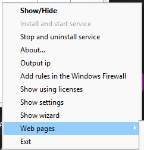
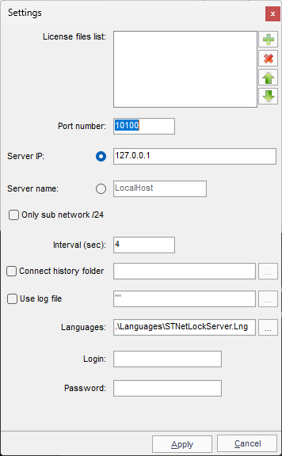
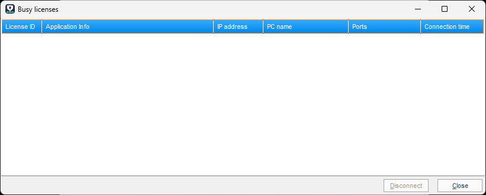

---
title: "Server PC: configuration"
---

# Server PC: configuration

## Monitor

The monitor shows the server state, its licenses and the occupied seats, and the server is
configured through it. The monitor opens after the server is installed, and later with the
**NetLock license Monitor** shortcut in the **License server** folder of the **Start** menu. It
runs in the notification area. The title of the main window shows the server state, and the
table shows the products from the license file with the numbers of occupied and total seats (see
[Server state](installation.md#server-state)).

The monitor commands are collected in the context menu, which opens when you right-click the
monitor icon in the notification area or its main window.



| Menu item | Action |
|---|---|
| **Show/Hide** | Show or hide the monitor's main window |
| **Install and start service** | Install and start the server service; available when the service is not installed |
| **Stop and uninstall service** | Stop and remove the server service |
| **About...** | Server version and operating mode |
| **Output ip** | Save the list of connected clients to a file |
| **Add rules in the Windows Firewall** | Add rules for the server programs to the Windows firewall (see [Windows firewall](#windows-firewall)) |
| **Show using licenses** | Open the **Busy licenses** window (see [Busy licenses](#busy-licenses)) |
| **Show settings** | Open the **Settings** window (see [Settings window](#settings-window)) |
| **Show wizard** | Open the software license activation wizard (see [Software activation](installation.md#software-activation)) |
| **Web pages** | Open a monitoring web page in a browser (see [Monitoring web pages](#monitoring-web-pages)) |
| **Exit** | Close the monitor; the server service keeps running |

## Service and application

The server runs in one of the following modes:

- **Windows service** — the main mode, set up by the installer. The server runs in the
  background, starts with the system and does not require a user to log in.
- **Application** — the server runs as a regular program with an icon in the notification area
  and only until the user logs off. The mode is convenient for checking. Start it with the
  **NetLock license Application** shortcut and close it with the **Exit** item of the icon's
  context menu.

The server runs in only one mode at a time: before running the server in application mode,
remove the service. The service is removed by the **Stop and uninstall service** item of the
monitor context menu and installed again by the **Install and start service** item.

## Settings window

The server settings are set in the **Settings** window: select **Show settings** in the monitor
context menu.



| Field | Description |
|---|---|
| **License files list** | Server license files (see [License files](#license-files)) |
| **Port number** | Main port of the server, 10100 by default (see [Ports and firewall](#ports-and-firewall)) |
| **Server IP**, **Server name** | Address of the license server whose state the monitor shows; changed to watch the server from another PC (see [Monitor on another PC](#monitor-on-another-pc)) |
| **Interval (sec)** | Interval of communication with the service; usually does not need changing |
| **Connect history folder** | Keep the client connection history in the specified folder (see [Connection history](#connection-history)) |
| **Use log file** | Keep the server log in the specified folder (see [Log](#log)) |
| **Languages** | Language file of the server interface |
| **Login**, **Password** | Login and password of the personal account for software activation; the activation wizard fills them in (see [Software activation](installation.md#software-activation)) |

Click **Apply** to save the settings, and restart the server: the new settings take effect after
a restart, as the message "Please, restart application to apply changes." reminds you. To restart
the server service, select the **NetLock Service 4 x64** service in the Windows **Services**
console and click **Restart**.

## Ports and firewall

The server accepts incoming TCP connections on several ports. Default values:

| Port | Purpose |
|---|---|
| 10100 | Main port: workstation connections; set in the **Port number** field |
| from 10101 to 10100 + 3 × N | Ports the server allocates to connected clients; N is the number of products in the license file |
| 10099 | Information port: the monitor and other service applications; does not change |
| 10090 = 10100 − 10 | **License modules** web page — the license module tree |
| 10095 = 10100 − 5 | **Logs page** web page — the list of connected clients |
| 10097 = 10100 − 3 | **Busy ports** web page — the table of occupied ports |

The server calculates the client and web page ports from the main port, while the information
port is always 10099. For example, if the license contains three products, clients are allocated
ports 10101–10109. If the **Port number** is set to 10200, workstations connect to port 10200,
clients are allocated ports 10201–10209, the web pages open on ports 10190, 10195 and 10197, and
the monitor still connects to port 10099.

### Windows firewall

The installer adds rules to the Windows firewall that allow incoming TCP connections to the
server programs for all network profiles:

| Rule | Program | Ports |
|---|---|---|
| GUIRules | `NetLockMonitor.EXE` | 10100–10200 |
| ApplRules | `NetLockApplication.exe` | 10090–11000 |
| ServRules | `NetLockService.exe` | 10090–11000 |
| GuardRules | `GuardSrv.exe` | 10090–11000 |

If the rules have been removed, add them again with the **Add rules in the Windows Firewall**
item of the monitor context menu. The rules are removed when the server is uninstalled.

### Network firewall

If another firewall runs on the server PC, or there is a hardware or corporate firewall
between the server and the workstations, open incoming TCP ports 10090–11000 on it — the same
range as in the Windows firewall rules. It includes the main and information ports, the
monitoring web page ports and the ports the server allocates to clients.

## License files

The main license file is selected when the server is installed. If the license is issued for a
hardware key, additional license files can be attached to it, for example for new products
bought later: this way, there is no need to issue a combined license for the old and new
products. The server issues seats from all attached files.

The files are attached in the **License files list** of the **Settings** window. The buttons on
the right of the list add and remove a file and move the selected file up or down. The order of
files in the list sets the order in which the server searches for and occupies seats at client
requests: files higher in the list are checked first. The changes take effect after the server
restarts.

An additional file is accepted if:

- it is issued for the same protection key as the main one (type, serial number, ID);
- its products do not duplicate the products of the main license: the same application, version
  and configuration;
- the file is not used by another server instance.

### Updating the license

When the dealer sends a new server license file, for example after the license is extended or
seats are bought, replace the old file with it:

1. Copy the new license file to the server working folder
   `C:\ProgramData\ENCY Software\LicenceServer\`. If the file has the same name as the old one,
   replace the old file.
2. If the file name is different, open the **Settings** window, select the old file in the
   **License files list**, remove it, add the new one and click **Apply**.
3. Restart the **NetLock Service 4 x64** service (see [Settings window](#settings-window)).
4. Check that the monitor title shows the **Ok** state and the license term, and that the
   **License modules** web page shows the products and the numbers of seats (see
   [Monitoring web pages](#monitoring-web-pages)).

If the dealer sent new workstation license files together with the server license file, update
them on the workstations (see [Workstation: configuration](clients.md)).

## Seat distribution

The seats in the server license file are organized in a hierarchy:

```text
Product (ENCY, ENCY Tuner, ...)
  └── Version
        └── Configuration
              └── Number of seats: N
```

When an application on a workstation requests a license, the server determines the product,
version and configuration, counts the occupied seats and allocates a free one or, if there are
no free seats, refuses. While the application is running, the server periodically checks that
it is present. When the application is closed, or if it stops responding, the seat is released.

### Several copies on one PC

For ENCY and ENCY Tuner, several copies of the application running on one PC (from one IP
address) occupy one seat. This way, several projects can be opened on one PC without
using additional seats.

### Seat groups

In the license file, the seats of several modules can be combined into a group. Then the
occupied seats are counted for the whole group: no more copies run at the same time than there
are seats in the group, even if the modules included in the group have more seats in total.
Seats of modules outside the group are issued first, group seats when those have run out.

A group is useful, for example, after a version upgrade. The customer has moved to a new
version of the application but wants to keep working in the old one for a while or
permanently. The seats of the new and the old version are combined into a group: the number of
network seats is not doubled, and both versions of the application can be used.

### Time-limited licenses

If the license validity period is limited, the server shows the number of remaining days in
the monitor and on the monitoring web page, and stops issuing licenses when the period ends.

### Server restart

Once a minute, the server saves the list of running clients. After the server restarts, for
example after an update or a crash, the clients are restored from this list, and the seats are
not lost. Clients that have not reconnected to the server within the next presence check cycle
are removed from the list.

## Monitoring

### Busy licenses

The **Busy licenses** window shows the occupied seats: the license ID, application information,
the IP address and name of the client PC, the allocated port and the connection time.



To release the seat of a "stuck" client, select it in the list and click **Disconnect**. A
disconnect command is sent to the client; if it does not respond, the connection is terminated
forcibly.

### Monitoring web pages

The server publishes three web pages that refresh every 5 seconds. They are opened by the items
of the monitor's **Web pages** submenu or in a browser on any PC of the network if the
page ports are open in the firewall. The port numbers are for the default settings (see
[Ports and firewall](#ports-and-firewall)).

| Address | What it shows |
|---|---|
| `http://<server_address>:10090` | The server operating mode and state; products, versions and configurations with the numbers of occupied (**BUSY**) and total (**COUNT**) seats, search by module name |
| `http://<server_address>:10095` | The list of connected clients: IP address, product and connection time |
| `http://<server_address>:10097` | The table of occupied ports: IP address and PC information of the client, allocated port, application, type, status and connection time; sorting by columns |

Client statuses on the **Busy ports** page:

| Status | Description |
|---|---|
| Waiting | The port is allocated, the client has not reconnected to it yet |
| Connected | The client is working, the seat is occupied |
| Disconnected | The client has finished working or lost the connection |

### Monitor on another PC

The license server can be watched from another PC of the network, for example from the
administrator's PC:

1. Install the license server on that PC.
2. Stop the server service there: select **Stop and uninstall service** in the monitor context
   menu. Only the monitor is needed on this PC.
3. In the **Settings** window, select **Server IP** or **Server name**, enter the address of the
   license server PC and click **Apply**.
4. Restart the monitor: close it with the **Exit** item and open it again with the
   **NetLock license Monitor** shortcut.

If the address is correct and the information port 10099 is open on the server PC, the
monitor shows the server licenses and their state.

## Log

To enable the log, select the **Use log file** check box in the **Settings** window and choose
the log folder. The log is written to the `*.log` file. It records:

- server startup and shutdown;
- client connections and disconnections: IP address, port, application type;
- client presence checks and clients that did not respond to them;
- socket errors;
- protection key verification and its result;
- license information: ID, remaining days.

## Connection history

To keep the connection history, select the **Connect history folder** check box in the
**Settings** window and choose a folder. The server writes each client connection and
disconnection to a CSV file with fields separated by semicolons:

| Action | Product | IP | PCName | portNum | Time |
|---|---|---|---|---|---|
| Connect | ENCY | 192.168.1.50 | WORKSTATION01 | 10101 | 2026-06-10 09:15:32 |
| Disconnect | ENCY | 192.168.1.50 | WORKSTATION01 | 10101 | 2026-06-10 17:30:10 |
