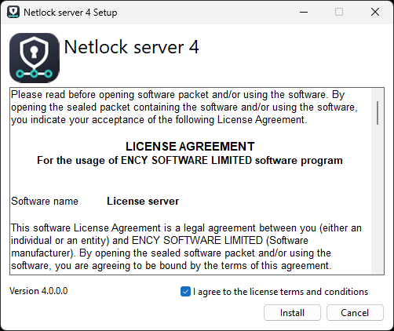
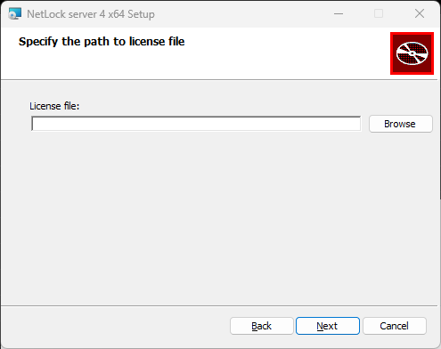
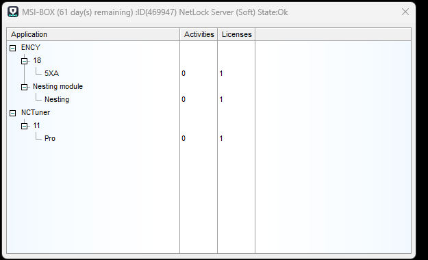
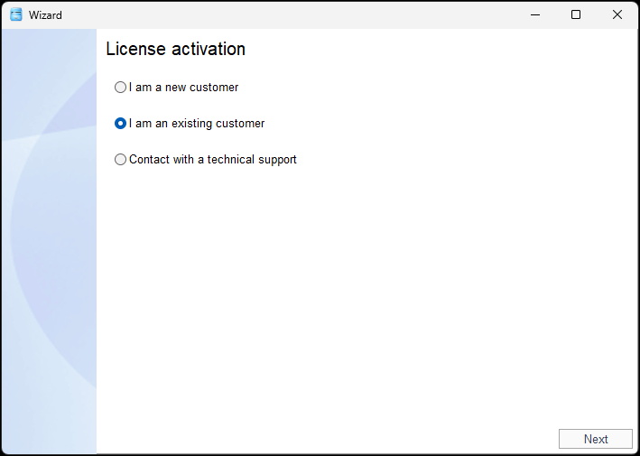
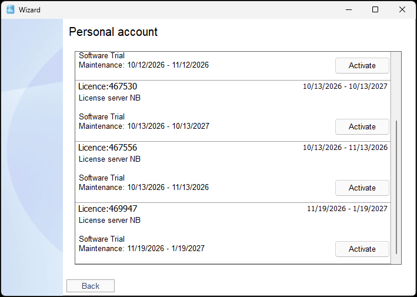

---
title: "Server PC: installation and activation"
---

# Server PC: installation and activation

## Installation

1. If the license is issued for a hardware key, first install the key driver and plug the key
   into a free USB port of the PC. The driver is not included in the server
   installer: Guardant key drivers are available on the
   [Guardant drivers](https://www.guardant.com/support/users/drivers/) page, drivers for other
   keys on their vendors' websites.
2. Run `NetLockServer4_x64.exe`. In the **Netlock server 4 Setup** window, read the license
   agreement, select the **I agree to the license terms and conditions** check box and click
   **Install**. If .NET 8 is not installed on the PC, the installer installs it too.

   

3. The **NetLock server 4 x64 Setup** wizard opens. On the first page, click **Next**.
4. On the **Specify the path to license file** page, click **Browse**, select the server license
   file and click **Next**.

   

5. On the **Ready to install NetLock server 4 x64** page, click **Install**.
6. On the **Completed the NetLock server 4 x64 Setup Wizard** page, click **Finish**, then click
   **Close** in the installer window.

The installer copies the license file to the server working folder, installs and starts the
server service, adds Windows firewall rules and starts the [monitor](configuration.md#monitor).
The service starts automatically, also each time Windows starts. The installation folder is not
selectable.

Next, check the [server state](#server-state) and, if the license is a software one, activate
it.

### What is installed

| What | Where |
|---|---|
| Server programs | `C:\Program Files\ENCY Software\NetLock server 4 x64\` |
| Working folder: the license file and the server settings | `C:\ProgramData\ENCY Software\LicenceServer\` |
| Services with automatic startup | **NetLock Service 4 x64** — the license server; **NetLock Service Guard x64** — monitors the server service |
| Windows firewall rules | Incoming TCP connections to the server programs (see [Ports and firewall](configuration.md#ports-and-firewall)) |
| **Start** menu | **License server** folder |

Shortcuts in the **License server** folder of the **Start** menu:

- **NetLock license Monitor** — the [monitor](configuration.md#monitor);
- **NetLock license Application** — the server in application mode (see
  [Service and application](configuration.md#service-and-application));
- **Utils** folder — Guardant key utilities (see
  [Protection key not found](troubleshooting.md#protection-key-not-found)).

## License protection

The server license file is issued for a hardware protection key or for software activation.

Supported hardware keys:

- Guardant Stealth 2;
- Guardant Stealth 3;
- Guardant Sign;
- Sentinel HASP HL;
- Matrix;
- SmartLock.

HASP4 and SmartKey keys are not supported by the 64-bit server.

A software license needs no key: it is activated after the server is installed (see
[Software activation](#software-activation)).

### Virtual machine

In a virtual machine, the license server works only with a license for a hardware key: a
software license cannot be used with the license server in a virtual machine. A Sentinel HASP HL
key does not work in a virtual machine.

A hardware key is connected to the physical PC and passed through to the guest OS by the
virtualization environment or by USB-over-network software. The procedure for common
environments is described in the Guardant knowledge base article
[Passing Guardant keys to a virtual environment](https://dev.guardant.ru/display/KB/0018)
(in Russian).

## Server state

The server state is shown in the title of the monitor main window.



When the license is loaded, the title contains the name of the server PC, the number of
days until the license expires, the license number, the protection type (**Soft** — software)
and the state, for example:

```text
MSI-BOX (61 day(s) remaining) :ID(469947) NetLock Server (Soft) State:Ok
```

| State | Meaning |
|---|---|
| **Ok** | The license is loaded, the server issues seats |
| **Not checked** | The server has not confirmed the license: the service is not running or the software license is not activated |
| **Need registration** | The software license is not activated (see [Software activation](#software-activation)) |
| **No dongle** | The hardware key is not found (see [Protection key not found](troubleshooting.md#protection-key-not-found)) |
| **licence not found** | The server has not found the license file (see [License files](configuration.md#license-files)) |

The window table lists the products, versions and configurations from the license file. The
**Activities** column shows the number of occupied seats, the **Licenses** column the total
number of seats.

A license issued for a hardware key needs no activation: if the key is connected, the server
goes to the **Ok** state at once.

## Software activation

A software license is activated on the server PC once. The main method is through the
personal account: it requires the login and password of the account and Internet access on the
server PC.

1. Right-click the application icon in the notification area to open its menu. Select
   **Show wizard** in the monitor context menu. If the license is not activated, the monitor
   may open the **Authorization** window on startup — close it, and the wizard opens.
2. Select **I am an existing customer** and click **Next**.

   

3. Select **Get license from the personal account** and click **Next**.
4. Enter the **Login** and **Password** of the personal account and click **Next**.
5. On the **Personal account** page, find the server license and click **Activate**. Each
   license is shown with its number, product, protection type and maintenance period. Licenses
   for a hardware key are not activated: the **Download** button saves their license file.

   

6. To the question "Do you want activate selected software licence to this computer?", answer
   **Yes**.

The wizard closes, and in a few seconds the monitor title shows the **Ok** state. The wizard
saves the login and password to the **Login** and **Password** fields of the **Settings**
window.

### Activation by code

If the server PC has no Internet access or the account login and password are lost,
select **Activation by code** on the second page of the wizard. The wizard shows the request
code: send it to your dealer, enter the activation code you receive from the dealer in the
corresponding field and click **Activate now**.

### Reactivation

A software license is bound to the PC hardware. After moving the server to another
PC or changing the hardware, the license must be activated again. Reactivation is possible
only through your dealer and only with the dealer's consent.

### Restoring a software license

If the software license is damaged, for example after the server PC was shut down
incorrectly, the server restores it by itself:

1. Make sure the server PC has Internet access.
2. In the monitor context menu, select **Stop and uninstall service**, then
   **Install and start service**.

After the service restarts, the registration is restored automatically. A license activated by
code cannot be restored this way.

## Uninstalling the server

Run the installer again and click **Uninstall**, or uninstall **Netlock server 4** in **Apps** in
Windows Settings.

Uninstallation removes the services, server programs, firewall rules and shortcuts. The working
folder `C:\ProgramData\ENCY Software\LicenceServer\` with the license file and settings remains;
delete it manually if it is no longer needed.
