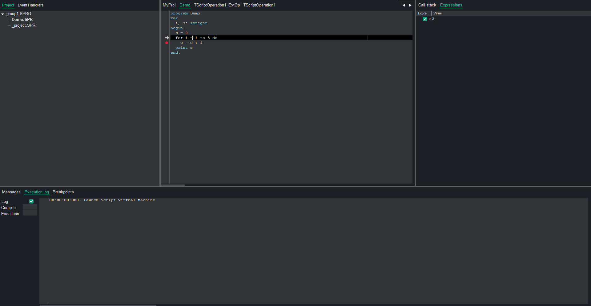
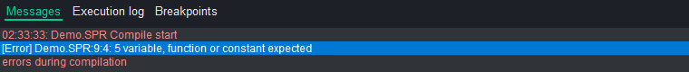
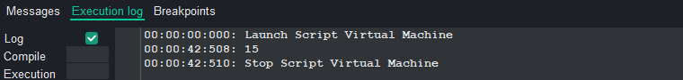

# Development environment

Scripts are written, compiled and debugged in the script development environment of the CAM system.
It opens with the **Scripts IDE** command. The **Create script operation** command opens it with
the template of a new scripted operation. How to assign event handlers and create scripted
operations is described in the CAM system guide, sections
[Scripts IDE](https://docs.encycam.com/ENCY/3/en/10348.html) and
[Scripted operation](https://docs.encycam.com/ENCY/3/en/10350.html).

## Window

- **Project** tab (left) — the project group with its projects. A project is a file `.SPR`: the main
  file of a program or a library. The project `_project.SPR` is created by the CAM system: it is a
  library that uses the script units of the CAM project; do not edit it.
- **Event Handlers** tab (left) — the objects of the CAM system, their events and the subprograms
  assigned to them.
- Editor (center) — each open module has its own tab.
- **Call stack** and **Expressions** tabs (right) — the state of a script stopped by the debugger.
- **Messages**, **Execution log** and **Breakpoints** tabs (bottom) — compiler messages, the
  output of the script and the list of breakpoints.

## Toolbar

From left to right:

| Button | Action |
|---|---|
| **New module** | Creates a module |
| **Load module** | Opens a module file |
| **Save module** | Saves the module of the active tab |
| **Run** (F9) | Runs the program or continues it after a stop |
| **Pause** | Pauses the running program |
| **Program reset** (Ctrl+F2) | Stops the program |
| **Compile all** (Shift+F9) | Compiles all projects of the group |
| **Compile project** (Ctrl+F9) | Compiles the current project |
| **Run to cursor** (F4) | Runs the program up to the line with the cursor |
| **Trace into** (F7) | Executes the next statement, entering the subprograms it calls |
| **Step out** (F8) | Executes the next statement without entering the subprograms it calls |
| **Run until return** (Shift+F8) | Runs the current subprogram to its end and stops after the return |
| **Undo**, **Redo** | Undo and redo edits in the editor |

The context menu of the editor has the commands **Cut**, **Copy**, **Paste**, **Select All**,
**Find** (Ctrl+F) and **Replace** (Ctrl+R).

## Compiling

**Compile project** and **Compile all** check the scripts and report the result on the **Messages**
tab. An error is shown as the file, the line and the position, the error code and its text;
double-clicking the message moves the cursor to that place in the editor.

The compiler reports an error where it found it, sometimes on the line after the actual mistake: in
the example above the expression `print s +` on line 8 is incomplete, and the error is reported on
line 9, where the compiler expected the rest of the expression.

## Running

Compile the project and press **Run**. A program runs from its `begin`; a library cannot be run
directly. The output of `print` appears on the **Execution log** tab together with the time from
the start of the script.

## Debugging

1. Click the field to the left of a line of code to set a breakpoint there. Breakpoints are listed
   on the **Breakpoints** tab.
2. Run the program. It stops before the line with a breakpoint; an arrow marks the next line to
   execute.
3. Execute the program step by step with **Trace into**, **Step out**, **Run until return** and
   **Run to cursor**, or continue with **Run**.
4. To see the value of an expression, press Ctrl+F7: the **Evaluate** window calculates the
   expression entered in **Expression**; **Watch** adds it to the **Expressions** tab, where its value
   is updated after each step. The **Call stack** tab shows the chain of subprogram calls.
5. **Program reset** stops the program.
