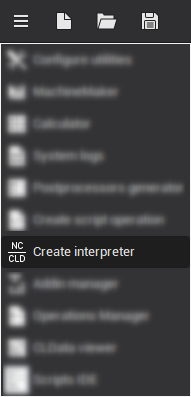
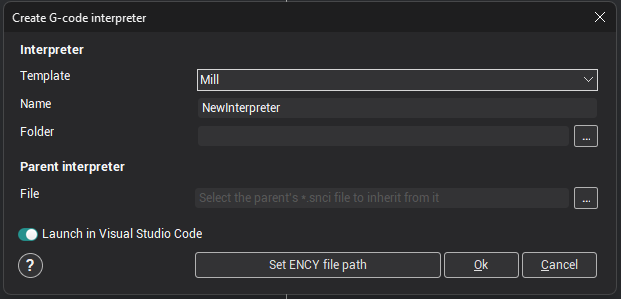

# Developing a custom interpreter in (.NET) C#

To create your own G-code interpreters based on .NET (C#), it is recommended to use a special tool. It is the **Create interpreter** item in the **Utilities** list.

When you select the **Create interpreter** item, the corresponding window appears:

In this window you only need to fill in a few parameters, from which a template for your interpreter will be prepared:

- **Template** — the interpreter template;
- **Name** — the name of the interpreter being developed;

> [!WARNING]
> *A directory with the same name is created from this name; it will contain all the source files of the new interpreter.*

- **Folder** — the directory in which the folder of your interpreter will be placed (you can enter the value manually or use the directory selection dialog by clicking the corresponding button ).
- **File** — the full path to the settings file of the parent interpreter (\*.snci) you want to inherit from (**optional field**).
- **Launch in Visual Studio Code** — a switch: if it is on, the interpreter folder opens in Visual Studio Code right after it is created.

After filling in all the required parameters, click the &lt;**Ok**&gt; button. As a result, a folder named after the interpreter is created in the directory you specified, and this directory immediately opens in Visual Studio Code (if the **Launch in Visual Studio Code** switch was on at that moment).

> [!NOTE]
> [Visual Studio Code](https://code.visualstudio.com/Download) must be installed on the computer beforehand.

## What to fix after creation

The **Create interpreter** item copies the template and may not fill in everything. Before you build the interpreter and start debugging (`F5`), check the fields below and fix those that are filled in incorrectly. If all fields are already correct, skip this step.

- The version of the `EncySoftware.NCInterpreterSDK.Net` package in the `*.csproj` file: if it is a prerelease version (with a suffix such as `-dev` or `-rc`) or a version of an older major version, replace it with the released version for your product version, as described in [Product versions](../ai-assisted-development/dotnet-workflow.md#product-versions); otherwise the project may not build.
- The `ID` field in the `*.snci` file: if it is filled with zeros, enter a new GUID.
- For a descendant interpreter, the reference to the parent: `ParentID` must contain the parent's `ID`, and `ParentFileName` the name of the parent's `*.snci` file; without it the parent is not loaded. If `ParentID` contains the parent's `LibraryID` or `ParentFileName` is empty, fix them.

For details, see [Where to start](../ai-assisted-development/dotnet-workflow.md#where-to-start) in the .NET workflow.
