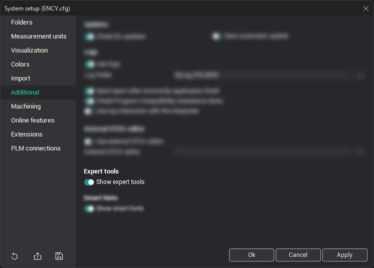
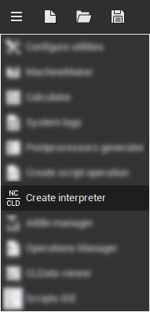
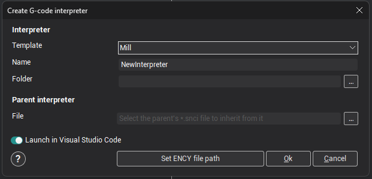

# Developing a custom interpreter in (.NET) C#

To create your own G-code interpreters based on .NET (C#), it is recommended to use a special tool. It is located in the utilities menu and is shown when the **Show expert tools** option is enabled in the system settings.

When you click the **Create Interpreter** menu item, the corresponding window appears:

In this window you only need to fill in a few parameters, from which a template for your interpreter will be prepared:

- **Template** — the interpreter template;
- **Name** — the name of the interpreter being developed;

> [!WARNING]
> *A directory with the same name is created from this name; it will contain all the source files of the new interpreter.*

- **Folder** — the directory in which the folder of your interpreter will be placed (you can enter the value manually or use the directory selection dialog by clicking the corresponding button ).
- **File** — the full path to the settings file of the parent interpreter (\*.snci) you want to inherit from (**optional field**).

After filling in all the required parameters, click the &lt;**Ok**> button. As a result, a folder named after the interpreter is created in the directory you specified, and this directory immediately opens in Visual Studio Code (if the corresponding switch was on at that moment).

> [!NOTE]
> [Visual Studio Code](https://code.visualstudio.com/Download) must be installed on the computer beforehand.
