# Debuggen des Interpreters in Visual Studio Code

Um eigene G-Code-Interpreter auf Basis von .NET (C#) zu debuggen, sind folgende Schritte nötig:

1. Die neueste verfügbare Version von **Visual Studio Code** herunterladen und installieren ([https://code.visualstudio.com/download](https://code.visualstudio.com/download)).

2. Die Erweiterung **C# for Visual Studio Code** aus dem Marketplace von Visual Studio Code installieren ([https://marketplace.visualstudio.com/items?itemName=ms-dotnettools.csharp](https://marketplace.visualstudio.com/items?itemName=ms-dotnettools.csharp)).\
   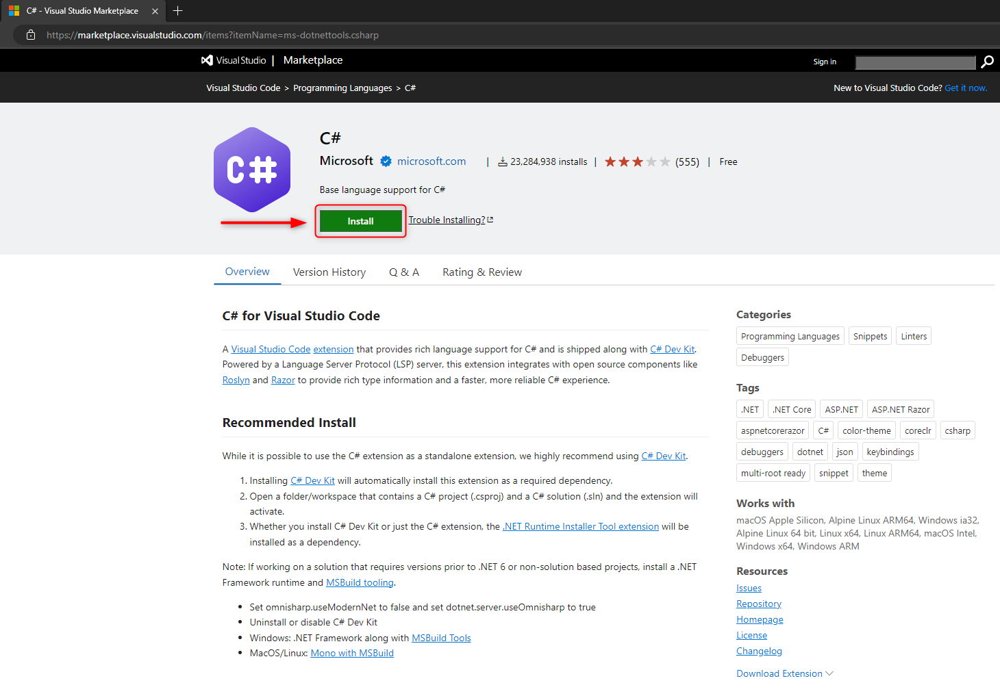

3. Nach dem Klick auf **Install** öffnet sich VS Code (Abkürzung für Visual Studio Code) auf der Registerkarte **Extensions**. Klicken Sie dort einfach neben dem Namen der Erweiterung auf **Install**.\
   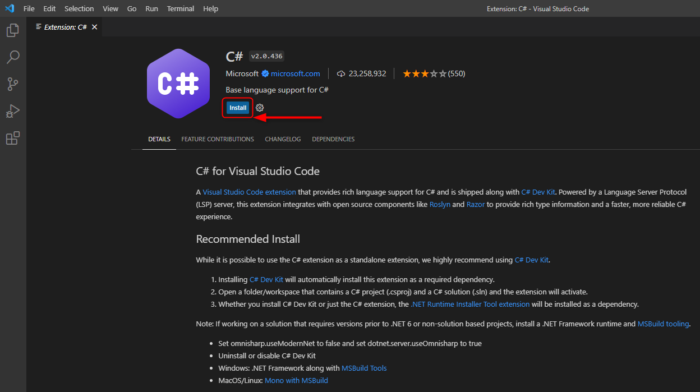

4. Zum bequemeren Bearbeiten von snci-Dateien empfiehlt es sich (ist aber nicht nötig), die Erweiterung **XML Language Support by Red Hat** zu installieren ([https://marketplace.visualstudio.com/items?itemName=redhat.vscode-xml](https://marketplace.visualstudio.com/items?itemName=redhat.vscode-xml)).

5. Falls noch nicht geschehen, die neueste Version von **ENCY** von der offiziellen Website herunterladen und installieren (**Version 3** ist erforderlich) ([https://encycam.com/download/](https://encycam.com/download/)).

6. Anschließend ENCY starten und in der Liste **Zubehör** den Eintrag **Interpreter erstellen** wählen.\
   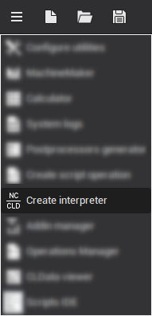

7. Im erscheinenden Fenster auf **Legen Sie den Dateipfad ENCY fest** klicken und den Pfad zur Datei **ency.exe** im Installationsverzeichnis von ENCY angeben (standardmäßig 'C:\\Program Files\\ENCY Software\\ENCY 3\\Bin64\\ency.exe').\
   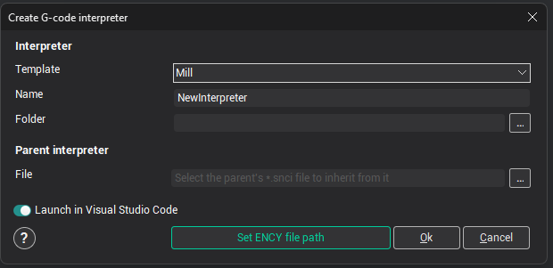\
   Dabei wird die Umgebungsvariable '**NCKernelDir**' zu den Umgebungsvariablen von Windows hinzugefügt. Damit Visual Studio Code aus ENCY gestartet werden kann, muss die Umgebungsvariable 'Path' den Installationsordner von VS Code enthalten. In der Regel trägt ihn das Installationsprogramm von Visual Studio Code automatisch ein.

   Um den Interpreter in ENCY Tuner zu debuggen, wählen Sie in ENCY Tuner den Eintrag **Interpreter-Verwaltung** (er öffnet dasselbe Fenster zum Erstellen des Interpreters), klicken Sie im Fenster auf **Legen Sie den Dateipfad ENCY Tuner 3 fest** und wählen Sie die Datei **ltuner.exe** im Ordner `bin64` des Installationsordners von ENCY Tuner. Damit wird die Umgebungsvariable '**TunerDir**' gesetzt, über die die Debug-Konfiguration '**Launch Tuner**' ENCY Tuner startet.

   > [!NOTE]
   > Damit Änderungen an den Umgebungsvariablen von Windows wirksam werden, melden Sie sich nach dem Festlegen des Pfads zur ausführbaren Datei **ency.exe** (für ENCY Tuner **ltuner.exe**) und nach Abschluss der Installation von VS Code von der Windows-Sitzung ab und wieder an oder starten Sie VS Code zumindest erneut aus dem Startmenü oder dem Explorer, nicht aus einem zuvor geöffneten Terminal.

8. Danach ENCY erneut starten und in der Liste **Zubehör** den Eintrag **Interpreter erstellen** wählen. Jetzt können Sie einen neuen Interpreter erstellen: Geben Sie im Feld **Name** seinen Namen und im Feld **Ordner** das Verzeichnis an, in dem ein Ordner mit dem Namen des Interpreters und allen nötigen Quelldateien angelegt wird.

9. Nach dem Klick auf &lt;**OK**&gt; öffnet sich ein neues Fenster von Visual Studio Code mit der Registerkarte der Hauptquelldatei des Interpreters **Interpreter.Core.cs**.\
   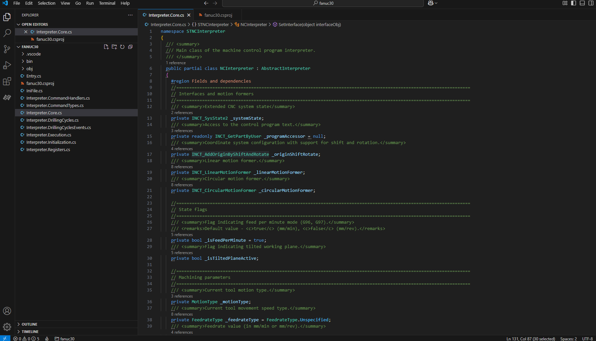

   > [!IMPORTANT]
   > Bevor Sie das Debuggen starten, prüfen Sie, was der Eintrag **Interpreter erstellen** ausgefüllt hat. Ist die Version des SDK-Pakets in der Datei `*.csproj` eine Vorabversion (`-dev`, `-rc`) oder eine Version einer älteren Hauptversion, ist das Feld `ID` in der Datei `*.snci` mit Nullen gefüllt oder steht bei einem abgeleiteten Interpreter in `ParentID` die `LibraryID` des Eltern-Interpreters bzw. ist `ParentFileName` leer, korrigieren Sie diese Felder. Ist alles bereits korrekt, überspringen Sie diesen Schritt. Was und wie zu prüfen ist, steht im Abschnitt [Was nach dem Erstellen zu korrigieren ist](../developing-a-custom-interpreter-in-net-csharp.md#was-nach-dem-erstellen-zu-korrigieren-ist).

10. Danach können Sie **einen Haltepunkt auf eine beliebige Methode setzen** (zum Beispiel auf den Konstruktor der Klasse NCInterpreter), zur Registerkarte „**Run and Debug**“ wechseln und auf „**Launch CAM**“ klicken (Taste **F5**; für ENCY Tuner „**Launch Tuner**“ wählen).\
    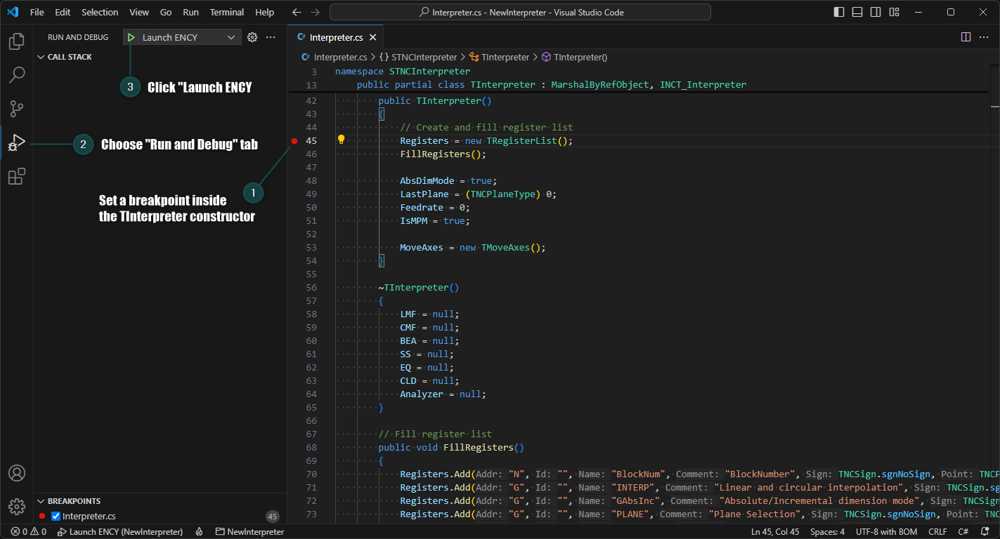

11. Daraufhin wird der Interpreter aus den Quellen gebaut, ENCY (bei **Launch Tuner** ENCY Tuner) gestartet und das Debuggen des Quellcodes beginnt.

12. Um die Arbeit des Interpreters zu prüfen, erstellen Sie im geöffneten Fenster von ENCY eine **G-Code basierte Operation**.\
    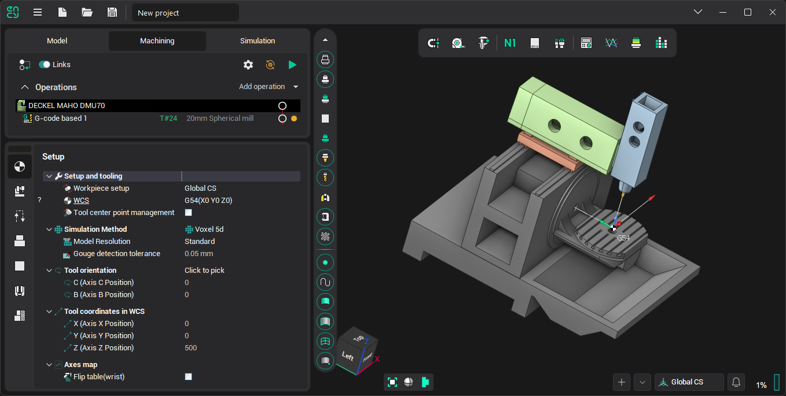

13. Im Parameterbereich &lt;**Arbeitsbereich**&gt; dieser Operation einen beliebigen NC-Text angeben, zum Beispiel:

    ```
    G0 G17 X0 Y0 Z0
    X100
    Y100
    X0
    Y0
    ```

14. Im Parameterbereich &lt;**Strategie**&gt; der Operation den erstellten Interpreter wählen:\
    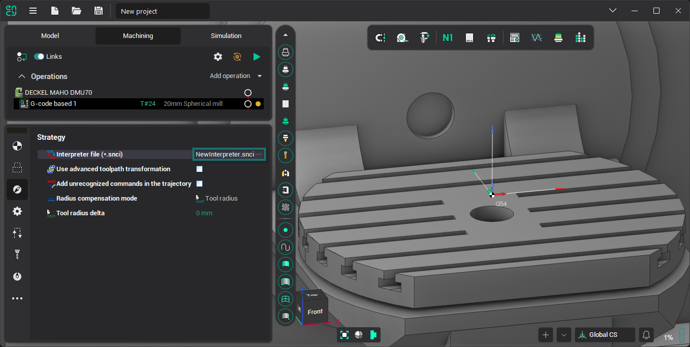

15. Und die Schaltfläche  zur Berechnung der Operation drücken.

16. Die Ausführung muss am gesetzten Haltepunkt anhalten. Jetzt können Sie mit **Step Over (F10)** in der Symbolleiste Zeile für Zeile durch den Code des Interpreters gehen.\
    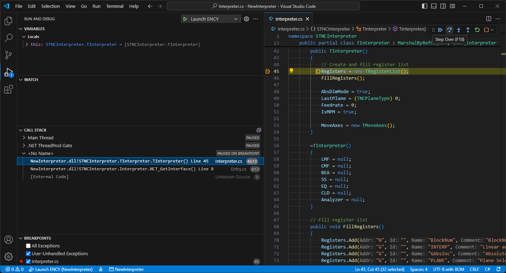

17. Schließlich **können Sie den Code des Interpreters** in den Dateien Interpreter.Core.cs, Interpreter.Registers.cs und NewInterpreter.snci nach Bedarf **ändern** und mit allen Funktionen von Visual Studio Code debuggen. Wenn Sie die Möglichkeiten von VS Code noch nicht kennen, empfehlen wir den Abschnitt „Get Started“ seiner offiziellen Dokumentation ([https://code.visualstudio.com/docs/getstarted/introvideos](https://code.visualstudio.com/docs/getstarted/introvideos)).

18. Wenn Sie den Quellcode des Interpreters geschrieben und debuggt haben, können Sie die Dateien der dynamischen Bibliothek (**\*.dll**) und der Einstellungen des Interpreters (**\*.snci**) beziehen und verwenden. Wählen Sie dazu im Explorer von Visual Studio Code im Kontextmenü der betreffenden Dateien (hier **NewInterpreter.dll** und **NewInterpreter.snci**) „**Reveal in File Explorer**“. Im Windows-Explorer werden dann die Dateien des Interpreters markiert; Sie können sie kopieren und bei Bedarf an den Kunden weitergeben.

    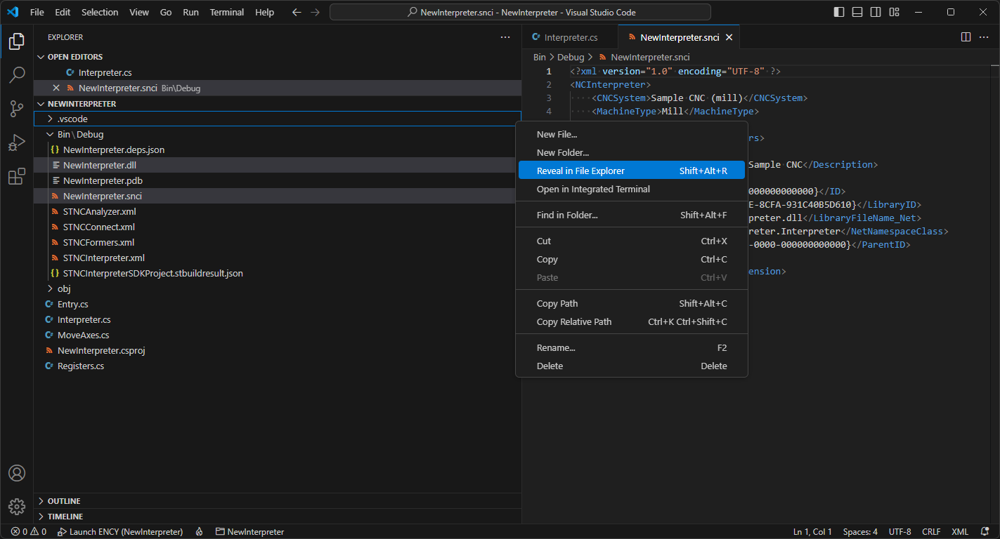\
    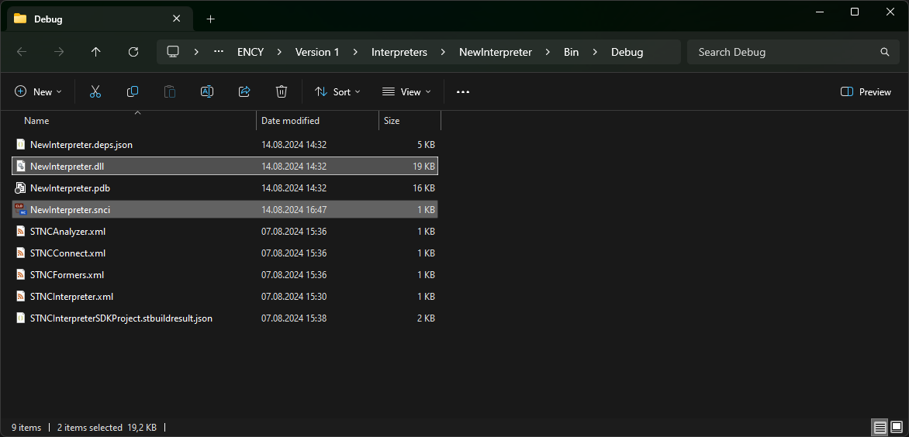
