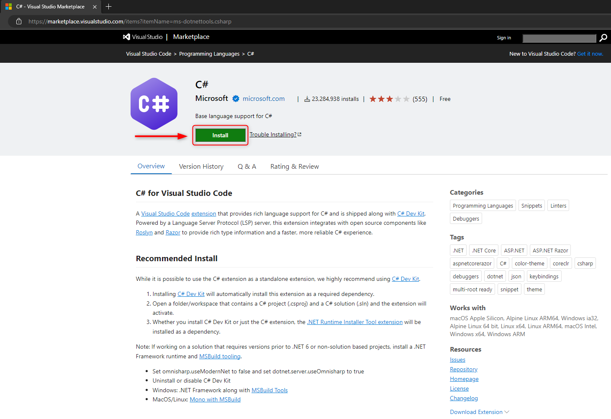
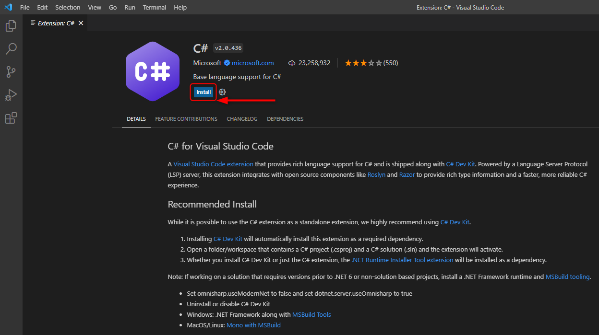
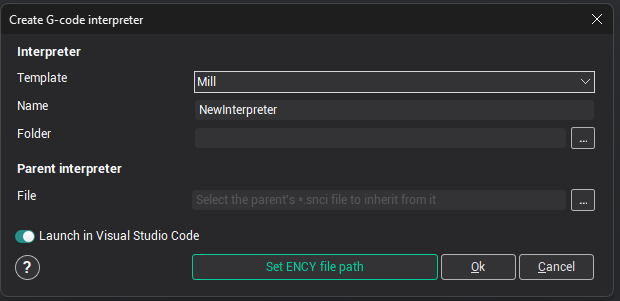
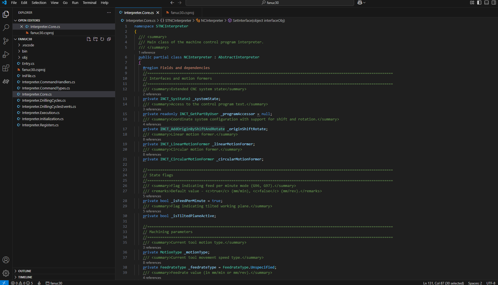
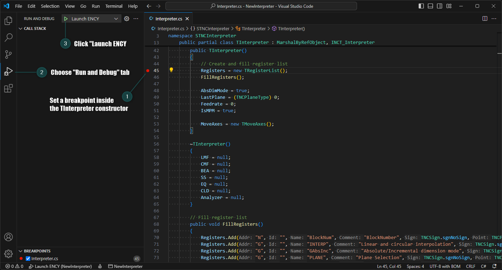
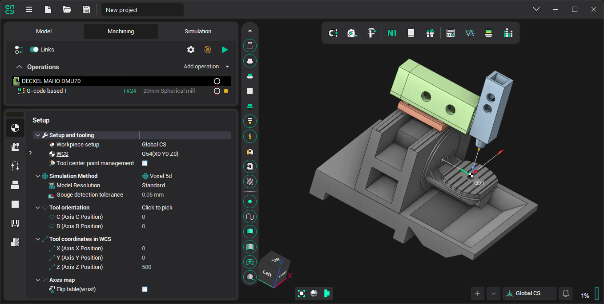
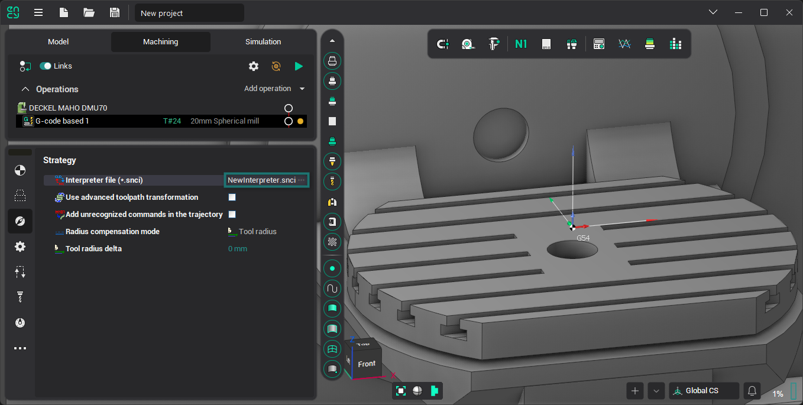
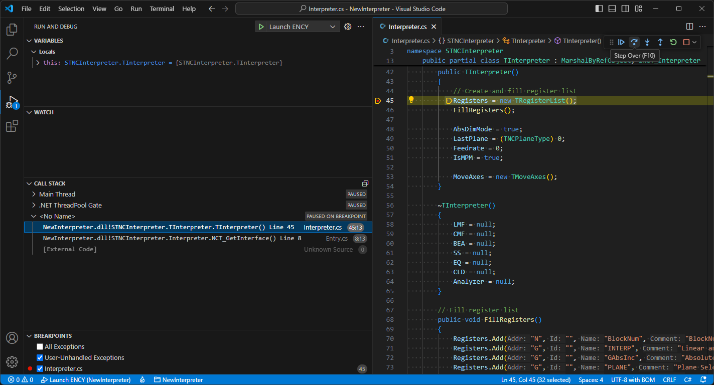
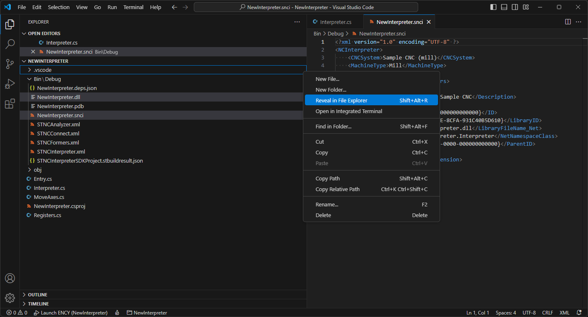
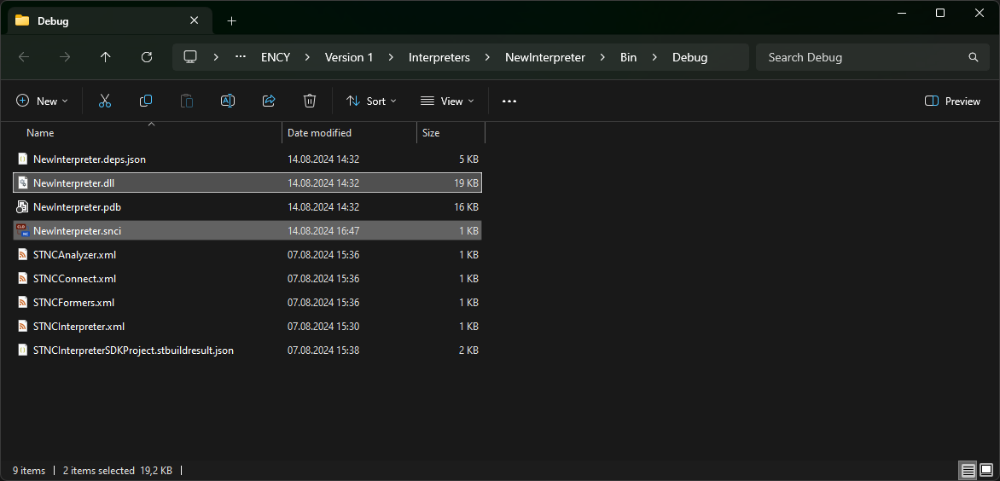

# Interpreter debugging in Visual Studio Code

To debug your own .NET-based (C#) G-code interpreters, do the following:

1. Download and install the latest available version of **Visual Studio Code** ([https://code.visualstudio.com/download](https://code.visualstudio.com/download), size about 101 MB).

2. Install the **C# for Visual Studio Code** extension from the Visual Studio Code extension marketplace ([https://marketplace.visualstudio.com/items?itemName=ms-dotnettools.csharp](https://marketplace.visualstudio.com/items?itemName=ms-dotnettools.csharp)).\
   

3. After you click the **Install** button, VS Code (short for Visual Studio Code) opens on the **Extensions** tab. Just click the **Install** button next to the extension name.\
   

4. For more convenient editing of snci files, it is recommended (but not required) to install the **XML Language Support by Red Hat** extension ([https://marketplace.visualstudio.com/items?itemName=redhat.vscode-xml](https://marketplace.visualstudio.com/items?itemName=redhat.vscode-xml)).

5. If you have not done so yet, download and install the latest version of **ENCY** from the official website ([https://encycam.com/download/](https://encycam.com/download/)).

6. Next, launch ENCY and select **Create interpreter** in the utilities menu.\
   

7. In the window that appears, click the **Set ENCY file path** button and set the path to the **ency.exe** file located in the ENCY installation directory (by default, 'C:\\Program Files\\ENCY Software\\ENCY\\Bin64\\ency.exe').

   \
   This adds the '**NCKernelDir**' environment variable to the Windows environment variables. To be able to launch Visual Studio Code from ENCY, the 'Path' environment variable must include the VS Code installation folder. The Visual Studio Code installer usually adds it by default.

   > [!NOTE]
   > For changes to the Windows environment variables to take effect, it is recommended to restart the computer after setting the path to the **ency.exe** executable file and finishing the VS Code installation.

8. Then launch ENCY again and select **Create interpreter** in the utilities menu. Now you can create a new interpreter by entering its name in the **Name** field and a directory in the **Folder** field; in this directory a folder named after the interpreter will be created with all the necessary source files.

9. After you click the &lt;**Ok**> button, a new Visual Studio Code window opens with the tab of the main source file of the interpreter, **'Interpreter.Core.cs'**.\
   

10. Then you can **set a breakpoint on any method** (for example, the constructor of the TInterpreter class), switch to the '**Run and Debug**' tab and click the '**Launch ENCY**' button (**F5** key).\
    

11. As a result, the interpreter is built from source, ENCY starts, and debugging of the source code begins.

12. To check how the interpreter works, create a G-code based operation in the ENCY window that opens.\
    

13. Enter some NC program text in the &lt;Job Assignment> parameters panel of the G-code based operation, for example:

    ```
    G0 G17 X0 Y0 Z0
    X100
    Y100
    X0
    Y0
    ```

14. Select the created interpreter in the &lt;**Strategy**> operation parameters panel:\
    

15. And click the operation calculation button 

16. Execution should stop at the breakpoint you set. Now you can use **Step Over (F10)** on the toolbar to move through the lines of the interpreter code.\
    

17. Finally, **you can change the interpreter code** in the Interpreter.cs, Registers.cs and NewInterpreter.snci files as needed and debug it using all the features available in Visual Studio Code. If you are not yet familiar with the capabilities of VS Code, we recommend visiting the "Get Started" section of its official documentation ([https://code.visualstudio.com/docs/getstarted/introvideos](https://code.visualstudio.com/docs/getstarted/introvideos)).

18. Once you have written and debugged the source code of the interpreter, you can get and use the dynamic-link library (**\*.dll**) and interpreter settings (**\*.snci**) files. Just select '**Reveal in File Explorer**' in the context menu of the corresponding files (in this case, **NewInterpreter.dll** and **NewInterpreter.snci**) in the Visual Studio Code Explorer. The interpreter files will then be selected in File Explorer, and you can copy them and, if necessary, send them to the customer.

    \
    
