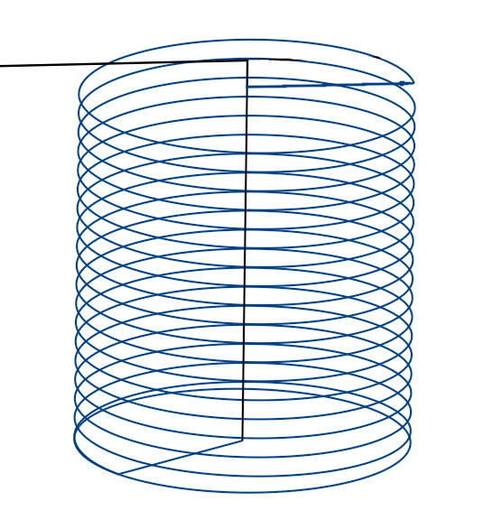
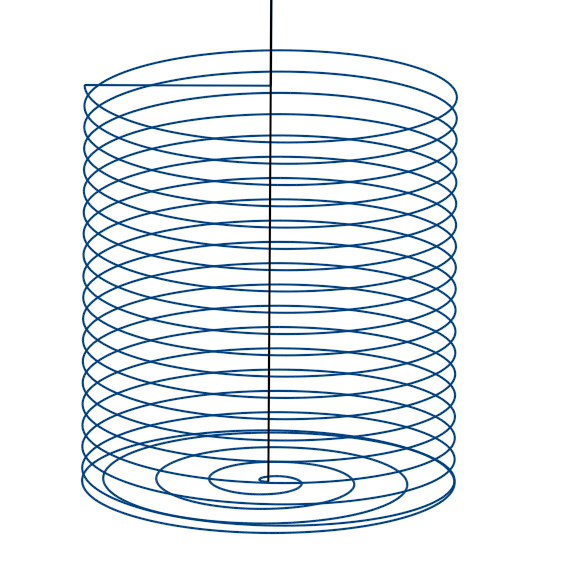
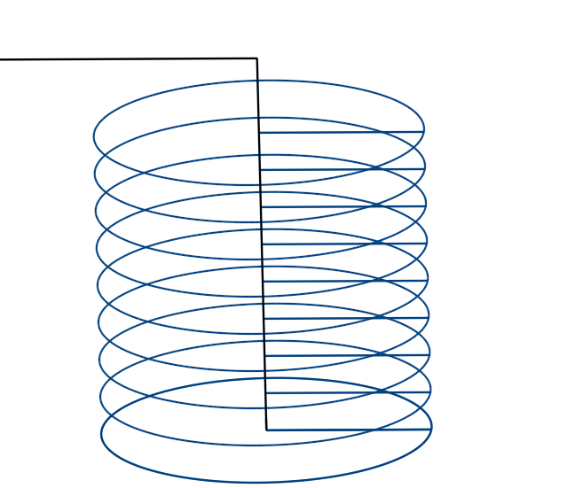
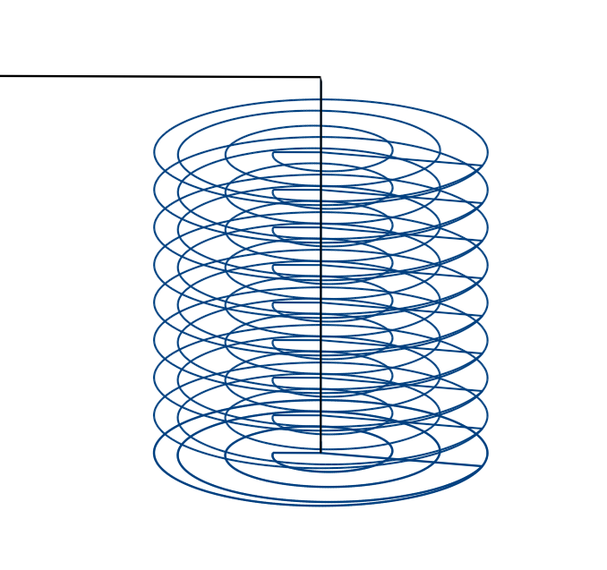
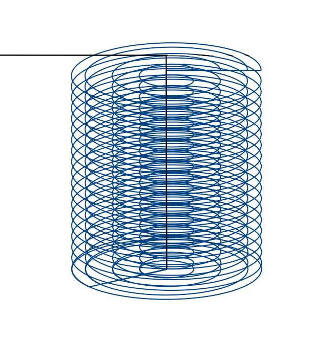
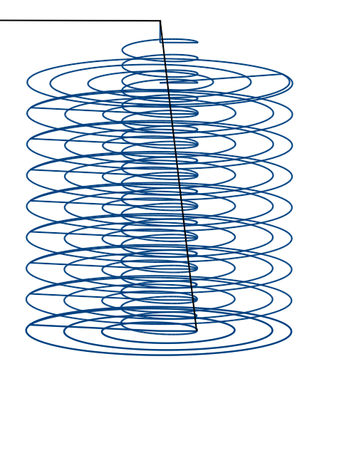

# Zyklus zum Fräsen kreisförmiger Taschen

**INCT_PocketCycleFormer** - Schnittstelle des CAM-Systems, die die Bildung der Bewegungen eines Zyklus zum Fräsen kreisförmiger Taschen vereinfacht. Das Objekt, das diese Schnittstelle implementiert, gibt die Methode **INCT_CLData_PocketCycleFormer.CreatePocketCycleFormer** zurück.

**Zweck:**

Die Bewegungen in den verschiedenen Arten von Zyklen zum Fräsen kreisförmiger Taschen folgen bei den unterschiedlichen Steuerungen im Allgemeinen demselben Ablauf:

1. Anfahren des Mittelpunkts der Tasche auf der Ausgangsebene.
2. Anfahren auf den Sicherheitsabstand.
3. Anfahren des Basispunkts.
4. Eintauchen (helikal oder linear) auf die angegebene Schnitttiefe oder bis zur Endtiefe.
5. Rückzug auf den Sicherheitsabstand und Wiederholung bis zur Tiefe der Tasche; beim Schlichten wird sofort auf die Tiefe der Tasche gefahren.
6. Rückkehr zum Mittelpunkt der Tasche auf die Ebene, auf der die Bearbeitung begonnen hat, hier auf die Ausgangsebene.

Beispiel eines solchen Zyklus für Sinumerik: POCKET4.

Mit dem Generator lässt sich der Werkzeugweg aus vorgegebenen Parametern bilden. Außerdem können auf jedem Abschnitt die für einen bestimmten Zyklus nötigen Besonderheiten ergänzt, Art oder Wert des Vorschubs geändert oder vom Generator vorbereitete Werkzeugbewegungen übersprungen werden.

**Verwendung des Generators:**

Wir empfehlen, für jeden neuen Zyklus in einem Satz des NC-Programms einen neuen Generator zu erstellen. Die Schnittstelle des alten Generators muss daher beim Erstellen eines neuen Generators oder beim Beenden des Interpreters freigegeben werden.

1. Die Schnittstelle des Generators abfragen (**INCT_CLData_PocketCycleFormer.CreatePocketCycleFormer**).
2. Die Indizes der Achsen festlegen, entlang derer die Bewegungen ausgeführt werden (**Set_AxisIndexes**).
3. Die aktuelle Ebene festlegen (**Set_Plane**).
4. Den Mittelpunkt der Tasche festlegen (**Set_HoleCenter**).
5. Den Sicherheitsabstand festlegen (**Set_SafeLevel**).
6. Den Anfang der Tasche festlegen (**Set_BaseLevel**).
7. Die Ebene des Taschengrunds festlegen (**Set_BottomLevel**).
8. Den Durchmesser der Tasche festlegen (**Set_Diameter**).
9. Den Schritt der ebenen Spirale festlegen (**Set_FlatSpiralStep**).
10. Die Art des Schritts der ebenen Spirale festlegen (**Set_FlatSpiralStepType**).
11. Die Richtung der ebenen Spirale festlegen (**Set_FlatSpiralDirection**).
12. Die Richtung der Helix festlegen (**Set_SpiralDirection**).
13. Die Steigung der Helix festlegen (**Set_SpiralStep**).
14. Die Bearbeitungsart festlegen (**Set_TypeOfHoleProcessing**).
15. Die Schnitttiefe je Durchgang festlegen (**Set_Degression**).
16. Den Eintauchradius festlegen (**Set_PlungeRadius**).
17. Das Aufmaß am Rand der Tasche festlegen (**Set_EdgeStock**).
18. Das Aufmaß am Grund der Tasche festlegen (**Set_BottomStock**).
19. Einen Ereignishandler des Zyklus zuweisen (**Set_Events**), wenn der Werkzeugweg des Zyklus geändert werden soll.
20. Die Befehle für den Werkzeugweg entlang des Zyklus bilden (**MakeWorkpath**).

**Beschreibung der Schnittstellenmethoden:**

| Methode | Beschreibung der Methode |
| --- | --- |
| **Set_AxisIndexes** | Die Methode legt die Indizes der Achsen X, Y, Z fest, entlang derer die Bewegungen bei der Bildung des Werkzeugwegs des Zyklus ausgeführt werden. Eingabeparameter: **Value** (**TNCDCAxisIndexes**) - **X** (Ganzzahl) - Index der X-Achse, **Y** (Ganzzahl) - Index der Y-Achse, **Z** (Ganzzahl) - Index der Z-Achse. Keine Ausgabeparameter. |
| **Get_AxisIndexes** | Die Funktion gibt die Indizes der Achsen X, Y, Z zurück, entlang derer die Bewegungen bei der Bildung des Werkzeugwegs des Zyklus ausgeführt werden (**TNCDCAxisIndexes**). Keine Eingabeparameter. |
| **Set_Plane** | Die Methode legt die aktuelle Ebene fest. Eingabeparameter: **Value** (**TNCPlaneType**) - aktuelle Ebene. **ptXY** - Ebene XY, die Tasche wird entlang der Z-Achse bearbeitet; **ptYZ** - Ebene YZ, die Tasche wird entlang der X-Achse bearbeitet; **ptZX** - Ebene ZX, die Tasche wird entlang der Y-Achse bearbeitet. Keine Ausgabeparameter. |
| **Get_Plane** | Die Funktion gibt die aktuelle Ebene zurück (**TNCPlaneType**). Keine Eingabeparameter. |
| **Set_HoleCenter** | Die Methode legt den Mittelpunkt der Tasche fest. Eingabeparameter: **Value** (**TNC3DPoint**) - Mittelpunkt der Tasche. Keine Ausgabeparameter. |
| **Get_HoleCenter** | Die Funktion gibt den Mittelpunkt der Tasche zurück (**TNC3DPoint**). Keine Eingabeparameter. |
| **Set_SafeLevel** | Die Methode legt den Sicherheitsabstand fest. Eingabeparameter: **Value** (Gleitkommazahl) - Sicherheitsabstand. Keine Ausgabeparameter. |
| **Get_SafeLevel** | Die Funktion gibt den Sicherheitsabstand zurück (Gleitkommazahl). Keine Eingabeparameter. |
| **Set_BaseLevel** | Die Methode legt den Anfang der Tasche fest. Eingabeparameter: **Value** (Gleitkommazahl) - Anfang der Tasche. Keine Ausgabeparameter. |
| **Get_BaseLevel** | Die Funktion gibt den Anfang der Tasche zurück (Gleitkommazahl). Keine Eingabeparameter. |
| **Set_Diameter** | Die Methode legt den Durchmesser der Tasche fest. Eingabeparameter: **Value** (Gleitkommazahl) - Durchmesser der Tasche. Keine Ausgabeparameter. |
| **Get_Diameter** | Die Funktion gibt den Durchmesser der Tasche zurück (Gleitkommazahl). Keine Eingabeparameter. |
| **Set_FlatSpiralStep** | Die Methode legt den Schritt der ebenen Spirale fest. Eingabeparameter: **Value** (Gleitkommazahl) - Schritt der ebenen Spirale. Keine Ausgabeparameter. |
| **Get_FlatSpiralStep** | Die Funktion gibt den Schritt der ebenen Spirale zurück (Gleitkommazahl). Keine Eingabeparameter. |
| **Set_BottomLevel** | Die Methode legt die Ebene des Taschengrunds fest. Eingabeparameter: **Value** (Gleitkommazahl) - Ebene des Taschengrunds. Keine Ausgabeparameter. |
| **Get_BottomLevel** | Die Funktion gibt die Ebene des Taschengrunds zurück (Gleitkommazahl). Keine Eingabeparameter. |
| **Set_FlatSpiralStepType** | Die Methode legt die Art des Schritts der ebenen Spirale fest. Eingabeparameter: **Value** (**TNCFlatSpiralStepType**) - Art des Schritts der ebenen Spirale. **fsByMillimeters** - der Schritt der Spirale wird in Millimetern berechnet; **fsByPersentOfToolDiameter** - der Schritt der Spirale wird in Prozent des Werkzeugdurchmessers berechnet. Keine Ausgabeparameter. |
| **Get_FlatSpiralStepType** | Die Funktion gibt die Art des Schritts der ebenen Spirale zurück (**TNCFlatSpiralStepType**). Keine Eingabeparameter. |
| **Set_FlatSpiralDirection** | Die Methode legt die Richtung der ebenen Spirale fest. Eingabeparameter: **Value** (**TNCSpiralDirection**) - Richtung der ebenen Spirale. **sdCW** - im Uhrzeigersinn; **sdCCW** - gegen den Uhrzeigersinn. Keine Ausgabeparameter. |
| **Get_FlatSpiralDirection** | Die Funktion gibt die Richtung der ebenen Spirale zurück (**TNCSpiralDirection**). Keine Eingabeparameter. |
| **Set_SpiralDirection** | Die Methode legt die Richtung der Helix fest. Eingabeparameter: **Value** (**TNCSpiralDirection**) - Richtung der Helix. **sdCW** - im Uhrzeigersinn; **sdCCW** - gegen den Uhrzeigersinn. Keine Ausgabeparameter. |
| **Get_SpiralDirection** | Die Funktion gibt die Richtung der Helix zurück (**TNCSpiralDirection**). Keine Eingabeparameter. |
| **Set_TypeOfHoleProcessing** | Die Methode legt die Art der Taschenbearbeitung fest. Eingabeparameter: **Value** (**TNCTypeOfProcessing**) - Art der Taschenbearbeitung. **tpHelicalPlungeRoughing** - Schruppen, helikales Eintauchen, Bearbeitung mit ebener Spirale; **tpLinearPlungeRoughing** - Schruppen, lineares Eintauchen, Bearbeitung mit ebener Spirale; **tpOnlyHelicalRoughing** - Schruppen, vollständig helikale Bearbeitung; **tpOnlyHelicalFinishing** - Schlichten, helikale Bearbeitung am Rand; **tpOnlyCircularFinishing** - Schlichten, Bearbeitung am Rand mit Kreisen; **tpOnlyHelicalFinishingAndBottom** - Schlichten, helikale Bearbeitung am Rand, Bearbeitung des Grunds mit ebener Spirale. Keine Ausgabeparameter. |
| **Get_TypeOfHoleProcessing** | Die Funktion gibt die Art der Taschenbearbeitung zurück (**TNCTypeOfProcessing**). Keine Eingabeparameter. |
| **Set_SpiralStep** | Die Methode legt die Steigung der Helix fest. Eingabeparameter: **Value** (Gleitkommazahl) - Steigung der Helix. Keine Ausgabeparameter. |
| **Get_SpiralStep** | Die Funktion gibt die Steigung der Helix zurück (Gleitkommazahl). Keine Eingabeparameter. |
| **Set_Degression** | Die Methode legt die Schnitttiefe je Durchgang fest. Eingabeparameter: **Value** (Gleitkommazahl) - Schnitttiefe je Durchgang. Keine Ausgabeparameter. |
| **Get_Degression** | Die Funktion gibt die Schnitttiefe je Durchgang zurück (Gleitkommazahl). Keine Eingabeparameter. |
| **Set_DepthOfCut** | Die Methode speichert einen Wert der Schnitttiefe. Der Generator verwendet ihn bei der Bildung des Werkzeugwegs nicht; die Schnitttiefe je Durchgang legt **Set_Degression** fest. Eingabeparameter: **Value** (Gleitkommazahl) - Schnitttiefe. Keine Ausgabeparameter. |
| **Get_DepthOfCut** | Die Funktion gibt den mit **Set_DepthOfCut** gespeicherten Wert zurück (Gleitkommazahl). Keine Eingabeparameter. |
| **Set_PlungeRadius** | Die Methode legt den Eintauchradius fest: den seitlichen Versatz vom Mittelpunkt der Tasche vor dem helikalen Eintauchen (Bearbeitungsart **tpHelicalPlungeRoughing**). Eingabeparameter: **Value** (Gleitkommazahl) - Eintauchradius. Keine Ausgabeparameter. |
| **Get_PlungeRadius** | Die Funktion gibt den Eintauchradius zurück (Gleitkommazahl). Keine Eingabeparameter. |
| **Set_EdgeStock** | Die Methode legt das Aufmaß am Rand der Tasche für das Schruppen fest. Eingabeparameter: **Value** (Gleitkommazahl) - Aufmaß am Rand der Tasche. Keine Ausgabeparameter. |
| **Get_EdgeStock** | Die Funktion gibt das Aufmaß am Rand der Tasche für das Schruppen zurück (Gleitkommazahl). Keine Eingabeparameter. |
| **Set_BottomStock** | Die Methode legt das Aufmaß am Grund der Tasche für das Schruppen fest. Eingabeparameter: **Value** (Gleitkommazahl) - Aufmaß am Grund der Tasche. Keine Ausgabeparameter. |
| **Get_BottomStock** | Die Funktion gibt das Aufmaß am Grund der Tasche für das Schruppen zurück (Gleitkommazahl). Keine Eingabeparameter. |
| **Set_Events** | Die Methode weist Ereignisse zur Steuerung des Zyklus zu. Mit Ereignissen lassen sich auf jedem gebildeten Abschnitt des Werkzeugwegs die für einen bestimmten Zyklus nötigen Besonderheiten ergänzen, Art oder Wert des Vorschubs ändern oder vom Generator vorbereitete Werkzeugbewegungen überspringen. Eingabeparameter: **Value** (**INCT_PocketCycleEvents**) - Objekt, das die Ereignisse implementiert. Ausführliche Beschreibung unten. Keine Ausgabeparameter. |
| **Get_Events** | Die Funktion gibt das mit dem Generator verbundene Objekt zurück, das die Ereignisse implementiert (**INCT_PocketCycleEvents**). Keine Eingabeparameter. |
| **MakeWorkpath** | Die Methode bildet den Werkzeugweg des Zyklus nach den angegebenen Parametern. |

**INCT_PocketCycleEvents** - Schnittstelle, die im Interpreter implementiert wird und mit der sich das Verhalten des Zyklus zum Fräsen kreisförmiger Taschen steuern lässt. Die Schnittstelle besteht aus einer Reihe von Ereignismethoden, die bei den Bewegungen des Werkzeugs innerhalb des Generators ausgeführt werden. Mit ihnen lassen sich auf jedem gebildeten Abschnitt die für einen bestimmten Zyklus nötigen Besonderheiten ergänzen (Verweilzeit, orientierter Spindelhalt usw.), die Vorschubart ändern oder vom Generator vorbereitete Werkzeugbewegungen überspringen.

Sind dem Generator Ereignisse zugewiesen, besteht jede Bewegung des Werkzeugs innerhalb des Generators aus 3 Schritten:

1. Die Methode **INCT_PocketCycleEvents.BeforeMove** wird ausgeführt. Ihr werden die vom Zyklus festgelegten Werte übergeben: Bewegungsart, Koordinaten des Zielpunkts, Vorschubart.
2. Die Methode **INCT_PocketCycleEvents.OnMove** wird ausgeführt. Ihr werden übergeben: Bewegungsart, Koordinaten des Zielpunkts, Vorschubart und das Kennzeichen, ob die Bewegung ausgeführt wurde. Alle Parameter außer der Bewegungsart können in der Implementierung geändert werden. Je nach dem in **OnMove** gesetzten Kennzeichen fährt das Werkzeug mit dem angegebenen Vorschub zum angegebenen Punkt oder die Bewegung entfällt.
3. Die Methode **INCT_PocketCycleEvents.AfterMove** wird ausgeführt. Ihr werden die von **OnMove** zurückgegebenen Werte übergeben: Bewegungsart, Koordinaten des Zielpunkts, Vorschubart.

**Beschreibung der Schnittstellenmethoden:**

| Methode | Beschreibung der Methode | Verwendung |
| --- | --- | --- |
| **BeforeMove** | Die Methode wird vor jeder Bewegung des Werkzeugs bei der Bildung des Werkzeugwegs des Zyklus ausgeführt. Eingabeparameter: **MoveType** (**TNCPocketCycleMoveType**) - Bewegungsart, Beschreibung siehe unten; **Point** (**TNC3DPoint**) - Koordinaten des Zielpunkts; **Feed** (**TNCFeedType**) - Vorschubart. **pcmMoveToHoleCenter** - Fahren zum Mittelpunkt der Tasche; **pcmMoveToSafeLevel** - Fahren auf den Sicherheitsabstand; **pcmMoveToCutOfDepthByLine** - lineares Fahren auf die Schnitttiefe; **pcmMoveToCutOfDepthByHelic** - helikales Fahren auf die Schnitttiefe; **pcmMoveToAside** - Fahren aus der Mitte in Richtung des Randes der Tasche; **pcmMoveToHoleEdge** - Fahren entlang der ebenen Spirale an den Rand der Tasche; **pcmMoveOnHoleEdge** - Fahren entlang des Randes der Tasche; **pcmMoveToTopLevel** - Fahren zum Ausgangspunkt; **pcmMoveFromHoleEdgeToCenter** - Fahren vom Rand zur Mitte der Tasche. Keine Ausgabeparameter. | Sollen vor einer Bewegung bestimmte Befehle ausgeführt werden, werden sie in der Implementierung der Methode hinzugefügt. Soll zum Beispiel vor dem Fräsen der Tasche die Kühlung der Maschine eingeschaltet werden, wird in der Implementierung von **BeforeMove** bei **MoveType** = **pcmMoveToSafeLevel** **INCT_CLData.AddCoolant** mit den passenden Parametern aufgerufen. |
| **OnMove** | Die Methode wird unmittelbar vor jeder Bewegung des Werkzeugs bei der Bildung des Werkzeugwegs des Zyklus ausgeführt. Eingabeparameter: **MoveType** (**TNCPocketCycleMoveType**) - Bewegungsart, Beschreibung siehe oben; Ein- und Ausgabeparameter: **Point** (**TNC3DPoint**) - Koordinaten des Zielpunkts; **Feed** (**TNCFeedType**) - Vorschubart; **Handled** (boolesch) - Kennzeichen, ob die Bewegung in der Implementierung ausgeführt wurde (True - ausgeführt, False - nicht ausgeführt). Hat **Handled** nach dem Aufruf von **OnMove** den Wert True, wurde die Bewegung in der Implementierung von **OnMove** ausgeführt, und der Generator fügt dem Werkzeugweg keinen Bewegungsbefehl hinzu. Hat **Handled** nach dem Aufruf von **OnMove** den Wert False, geht der Generator davon aus, dass die Bewegung nicht ausgeführt wurde, und fügt dem Werkzeugweg einen Befehl für die Bewegung zum Punkt **Point** mit der Vorschubart **Feed** hinzu. | Zum Überschreiben des Zielpunkts oder des Vorschubs oder zum Überspringen der Bewegung. Soll zum Beispiel bei der Rückkehr auf die Ausgangsebene nach dem Fräsen auf Eilgang umgeschaltet werden, muss in der Implementierung von **OnMove** bei **MoveType** = **pcmMoveToTopLevel** der zurückgegebene Parameter **Feed** auf **ffRapid** gesetzt werden (Vorschubart siehe **[OutStandardFeed](../../basic-interfaces/forming-of-the-toolpath-in-machine-axes/forming-of-the-toolpath-in-machine-axes.md)**). Soll das Werkzeug zu einem anderen Punkt als dem vom Zyklus berechneten fahren, muss der zurückgegebene Parameter **Point** von **OnMove** geändert werden. Soll die Bewegung zum berechneten Punkt nicht ausgeführt werden, muss in der Implementierung von **OnMove** der Parameter **Handled** auf True gesetzt werden. |
| **AfterMove** | Die Methode wird nach jeder Bewegung des Werkzeugs bei der Bildung des Werkzeugwegs des Zyklus ausgeführt, auch wenn die Bewegung in **OnMove** abgebrochen wurde. Eingabeparameter: **MoveType** (**TNCPocketCycleMoveType**) - Bewegungsart, Beschreibung siehe oben; **Point** (**TNC3DPoint**) - Koordinaten des Zielpunkts; **Feed** (**TNCFeedType**) - Vorschubart. Keine Ausgabeparameter. | Sollen nach einer Bewegung bestimmte Befehle ausgeführt werden, werden sie in der Implementierung der Methode hinzugefügt. |
