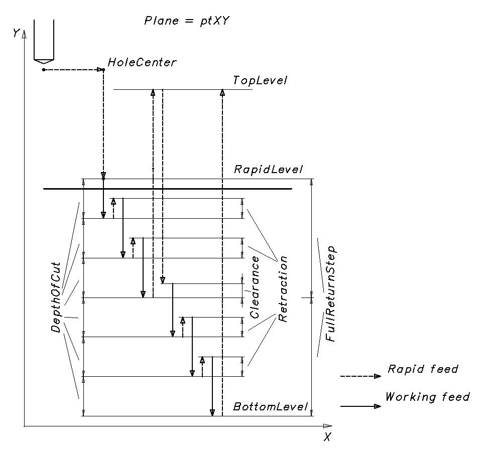

# Drilling cycle with chip breaking

**INCT_PeckDrillingCycleFormer** - a CAM system interface that simplifies forming the movements of drilling cycles with chip breaking. When the function **[INCT_CLData.CreateDrillingCycleFormer](../../basic-interfaces/forming-of-the-toolpath-in-machine-axes/forming-of-the-toolpath-in-machine-axes.md), [INCT_GeomCLData.CreateDrillingCycleFormer](../../basic-interfaces/forming-of-the-toolpath-in-geometric-axes/forming-of-the-toolpath-in-geometric-axes.md)** is called with the **dctPeck** parameter, it returns an object that implements two interfaces: **INCT_DrillingCycleFormer**, **INCT_PeckDrillingCycleFormer**.

The **INCT_DrillingCycleFormer** interface sets the basic parameters of the drilling cycle with chip breaking. Its use is described in the article [Drilling cycle](../drilling-cycle/drilling-cycle.md).

The **INCT_PeckDrillingCycleFormer** interface adds to the generator the ability to control the parameters of forming the tool path with chip breaking.

**Purpose:**

The movements in the various drilling cycles with chip breaking generally follow the same tool path on different controllers:

1. Positioning the tool above the center of the hole or of the next hole at rapid traverse.
2. Moving the tool to the rapid level at rapid traverse.
3. Moving the tool to the hole bottom level at working feed.
4. Returning to the rapid level at rapid traverse.
5. Returning to the retract level at rapid traverse.
6. If the number of repetitions is not reached, returning to step 1.

In such cycles the hole is drilled (the stage of moving to the hole bottom level) not in one pass but in several iterations. Examples of such cycles: Fanuc: G73, G83; Sinumerik: CYCLE83; Heidenhain: CYCL DEF 200, 203, 205, etc.

**Using the generator:**

We recommend creating a new drilling cycle generator for each new cycle in a block of the NC program, except when the cycle is repeated in a new block (like CYCL CALL for Heidenhain). Therefore, the interface of the old generator must be released when a new one is created or when the interpreter finishes its work.

The **INCT_DrillingCycleFormer** interface allows forming the tool path from the specified parameters: initial position, rapid level, hole bottom level, number of repetitions, etc. It also allows adding to any section of the tool path the features required by a particular cycle (dwell, oriented spindle stop, tapping, etc.), changing the feed type or value, or skipping a tool movement prepared by the generator.

The **INCT_PeckDrillingCycleFormer** interface allows setting the parameters that control the number of iterations, the depth of cut per iteration, the type of tool retraction, etc.

To form the tool movement commands along the cycle path, do the following:

1. Get the generator interfaces (**[INCT_CLData.CreateDrillingCycleFormer](../../basic-interfaces/forming-of-the-toolpath-in-machine-axes/forming-of-the-toolpath-in-machine-axes.md), [INCT_GeomCLData.CreateDrillingCycleFormer](../../basic-interfaces/forming-of-the-toolpath-in-geometric-axes/forming-of-the-toolpath-in-geometric-axes.md)** with the **dctPeck** parameter).
2. Set the indexes of the X, Y, Z axes along which the movements are made (**Set_AxisIndexes**).
3. Set the current plane (**Set_Plane**).
4. Set the hole center point (**Set_HoleCenter**).
5. Set the center point mode (**Set_HoleCenterMode**).
6. Set the rapid level (**Set_RapidLevel**).
7. Set the hole bottom level (**Set_BottomLevel**).
8. Set the retract level (**Set_TopLevel**).
9. Set the feed (**Set_Feedrate**) and the feed units (**Set_MPM**).
10. Set the number of cycle repetitions (**Set_Count**).
11. Assign a cycle event handler (**Set_Events**) if the cycle path needs to be changed.
12. Set the chip breaking iteration parameters (**Set_StartLevel**, **Set_DepthOfCut**, **Set_DegressionType**, **Set_Degression**, **Set_FullReturn**, etc., see the description below).
13. Form the tool movement commands along the cycle path (**MakeWorkpath**).

For the cycle with chip breaking, the **INCT_DrillingCycleFormer.Set_Events** method takes as input an object that implements two interfaces: **INCT_DrillingCycleEvents** and **INCT_PeckDrillingCycleEvents**. The **INCT_DrillingCycleEvents** events **BeforeMove**, **OnMove**, **AfterMove** receive as the movement type, besides the values described in the article [Drilling cycle](../drilling-cycle/drilling-cycle.md), the following values:

**mtPeckMoveToNextDepthLevel** - movement to the next depth of cut (next iteration);\
**mtPeckReturnToRapidLevel** - return to the rapid level at the current iteration (chip removal);\
**mtPeckMoveToClearanceLevel** - movement to the current cut level minus the clearance after the return from the rapid level;\
**mtPeckMoveToRetractionLevel** - retraction and return to the current cut level (chip breaking).

**Description of the INCT_PeckDrillingCycleFormer interface methods:**

| Method | Method description |
| --- | --- |
| **Set_DepthOfCut** | The method sets the depth of cut per iteration. The depth of cut is the distance the tool moves at each iteration when drilling the hole. Input parameter: **Value** (real number) - depth of cut. No output parameters. |
| **Get_DepthOfCut** | The function returns the depth of cut (real number). No input parameters. |
| **Set_StartLevelType** | The method sets the type of the 'Start level' value. Input parameter: **Value** (**TNCStartLevelType**) - value type: **slFromLevel** - the first depth of cut is counted from the value set in **Set_StartLevel**. **slFirstLevel** - the value set in **Set_StartLevel** is the first depth of cut. No output parameters. |
| **Get_StartLevelType** | The function returns the type of the 'Start level' value (**TNCStartLevelType**). No input parameters. |
| **Set_StartLevel** | The method sets the level from which the first depth of cut is counted, or the first depth of cut itself, depending on the value set in **Set_StartLevelType**. Input parameter: **Value** (real number) - the value. No output parameters. |
| **Get_StartLevel** | The function returns the level from which the first depth of cut is counted, or the first depth of cut itself, depending on the value set in **Set_StartLevelType** (real number). No input parameters. |
| **Set_Degression** | The method sets the degression - the change of the depth of cut at each iteration. Input parameter: **Value** (real number) - degression value. The calculated degression depends on the degression type set in **Set_DegressionType**. No output parameters. |
| **Get_Degression** | The function returns the current degression value (real number). No input parameters. |
| **Set_DegressionType** | The method sets the degression type. Input parameter: **Value** (**TNCDegressionType**) - degression type. **dtNone** - no degression, the depth of cut does not change; **dtValue** - the depth of cut decreases by a constant value at each iteration (the value is set in **Set_Degression**); **dtCoef** - the depth of cut is multiplied by a factor at each iteration (the factor is set in **Set_Degression**). No output parameters. |
| **Get_DegressionType** | The function returns the current degression type (**TNCDegressionType**). No input parameters. |
| **Set_MinDepthOfCut** | The method sets the minimum depth of cut. As a rule, it is used for cycles with degression. Input parameter: **Value** (real number) - minimum depth of cut. No output parameters. |
| **Get_MinDepthOfCut** | The function returns the current minimum depth of cut (real number). No input parameters. |
| **Set_Retraction** | The method sets the current retraction value. The retraction is the distance the tool rises to break the chip after reaching the current depth of cut at an iteration, if at this iteration there is no return to the rapid level (that is, the return flag in **Set_FullReturn** is False). Input parameter: **Value** (real number) - retraction value. The calculated retraction depends on the retraction type set in **Set_RetractionType**. No output parameters. |
| **Get_Retraction** | The function returns the current retraction value (real number). No input parameters. |
| **Set_RetractionType** | The method sets the retraction type. Input parameter: **Value** (**TNCRetractionType**) - retraction type. **rtNone** - no retraction; **rtValue** - retraction value (set in **Set_Retraction**). No output parameters. |
| **Get_RetractionType** | The function returns the current retraction type (**TNCRetractionType**). No input parameters. |
| **Set_RetractionCount** | The method sets the number of retractions for chip breaking. Input parameter: **Value** (integer) - number of retractions for chip breaking. No output parameters. |
| **Get_RetractionCount** | The function returns the number of retractions for chip breaking (integer). No input parameters. |
| **Set_ClearanceType** | The method sets the clearance type. The clearance is the distance by which the tool stops short of the depth of cut of the current iteration after the return from the rapid level (that is, the return flag in **Set_FullReturn** is True). Input parameter: **Value** (**TNCClearanceType**) - clearance type. **ctNone** - no clearance; **ctValue** - value (set in **Set_Clearance**). No output parameters. |
| **Get_ClearanceType** | The function returns the current clearance type (**TNCClearanceType**). No input parameters. |
| **Set_Clearance** | The method sets the clearance value. Input parameter: **Value** (real number) - clearance value. The calculated clearance depends on the clearance type set in **Set_ClearanceType**. No output parameters. |
| **Get_Clearance** | The function returns the current clearance value (real number). No input parameters. |
| **Set_FullReturn** | The method sets the flag of return to the rapid level. If the flag is set, then after reaching the depth of cut at the current iteration the tool returns to the rapid level and then moves to the cut level of the iteration taking the clearance into account (see **Set_ClearanceType**). Input parameter: **Value** (boolean) - return flag. True - with return to the rapid level; False - without return. No output parameters. |
| **Get_FullReturn** | The function returns the flag of return to the rapid level (boolean). No input parameters. |
| **Set_FullReturnStep** | The method sets the step of cut iterations at which the return to the rapid level is made. Example. The step of cut iterations is set to 3. In this case the return to the rapid level is made at every third iteration (iterations 3, 6, 9, etc.). At the other iterations there is no return (iterations 1, 2, 4, 5, 7, 8, etc.). Input parameter: **Value** (integer) - step of cut iterations. Only if **Set_FullReturn** is set to True (with return). No output parameters. |
| **Get_FullReturnStep** | The function returns the step of cut iterations at which the return to the rapid level is made (integer). No input parameters. |
| **Set_SameLastSteps** | The method sets the number of last equal cut steps. If the value is other than 0 or 1, the specified number of last iterations is made with the same depth of cut. Input parameter: **Value** (integer) - number of last equal cut steps. No output parameters. |
| **Get_SameLastSteps** | The function returns the current number of last equal cut steps (integer). No input parameters. |

**INCT_PeckDrillingCycleEvents** - an interface implemented in the interpreter that allows getting and controlling the values calculated inside the drilling cycle with chip breaking. The interface is a set of event methods executed when particular values are calculated inside the cycle path generator. With these methods, the cut levels of the iterations, the flag of return to the rapid level at an iteration, and the clearance and retraction values can be obtained and changed while the cycle path is formed.

If events are assigned to the cycle path generator, the corresponding method is called for each calculated value:

1. The **INCT_PeckDrillingCycleEvents.OnCalcNextDepth** method is executed when the next calculated cut level is added to the internal list of the generator. The number of cut levels (the list size) is the number of iterations in which the tool reaches the hole bottom. The method receives the calculated cut level.
2. The **INCT_PeckDrillingCycleEvents.OnGetNextFullReturn** method is executed after the flag of return to the rapid level is calculated from the cycle parameters. The method receives the iteration number and the calculated flag.
3. The **INCT_PeckDrillingCycleEvents.OnGetNextClearance** method is executed after the clearance value is calculated. The method receives the iteration number and the calculated clearance.
4. The **INCT_PeckDrillingCycleEvents.OnGetNextRetraction** method is executed after the retraction value is calculated. The method receives the iteration number and the calculated retraction.

**Description of the interface methods:**

<table>
<thead>
<tr><th>Method</th><th>Method description</th><th>Description of use</th></tr>
</thead>
<tbody>
<tr><td><strong>OnCalcNextDepth</strong></td><td>
The method is executed each time the next calculated cut level is added to the internal list of the generator.

The size of the formed list (the number of elements) is the number of iterations in which the tool reaches the hole bottom.

Input and output parameter: <strong>Depth</strong> (real number) - cut level for the iteration (absolute value).
</td><td><ol><li>To get the total number of iterations for recalculating the clearance, retraction or return to the rapid level when implementing calculation algorithms that the cycle does not provide.</li><li>To change the cut levels when implementing calculation algorithms that the cycle does not provide.</li></ol></td></tr>
<tr><td><strong>OnGetNextFullReturn</strong></td><td>
The method is executed after the flag of return to the rapid level is calculated from the cycle parameters for the current iteration.

Input parameters: <strong>Iteration</strong> (integer) - iteration number.

Input and output parameter: <strong>FullReturn</strong> (boolean) - flag of return to the rapid level at the given iteration.
</td><td>To change the flag of return to the rapid level for the current iteration when implementing calculation algorithms that the cycle does not provide.</td></tr>
<tr><td><strong>OnGetNextClearance</strong></td><td>
The method is executed after the clearance value is calculated from the cycle parameters for the current iteration. It is called only if the flag of return to the rapid level is set for the iteration (<strong>FullReturn</strong> = True).

Input parameters: <strong>Iteration</strong> (integer) - iteration number.

Input and output parameter: <strong>Clearance</strong> (real number) - clearance value at the given iteration.
</td><td>To change the clearance value for the current iteration when implementing calculation algorithms that the cycle does not provide.</td></tr>
<tr><td><strong>OnGetNextRetraction</strong></td><td>
The method is executed after the retraction value is calculated from the cycle parameters for the current iteration. It is called only if the flag of return to the rapid level is not set for the iteration (<strong>FullReturn</strong> = False).

Input parameters: <strong>Iteration</strong> (integer) - iteration number.

Input and output parameter: <strong>Retraction</strong> (real number) - retraction value at the given iteration.
</td><td>To change the retraction value for the current iteration when implementing calculation algorithms that the cycle does not provide.</td></tr>
</tbody>
</table>
