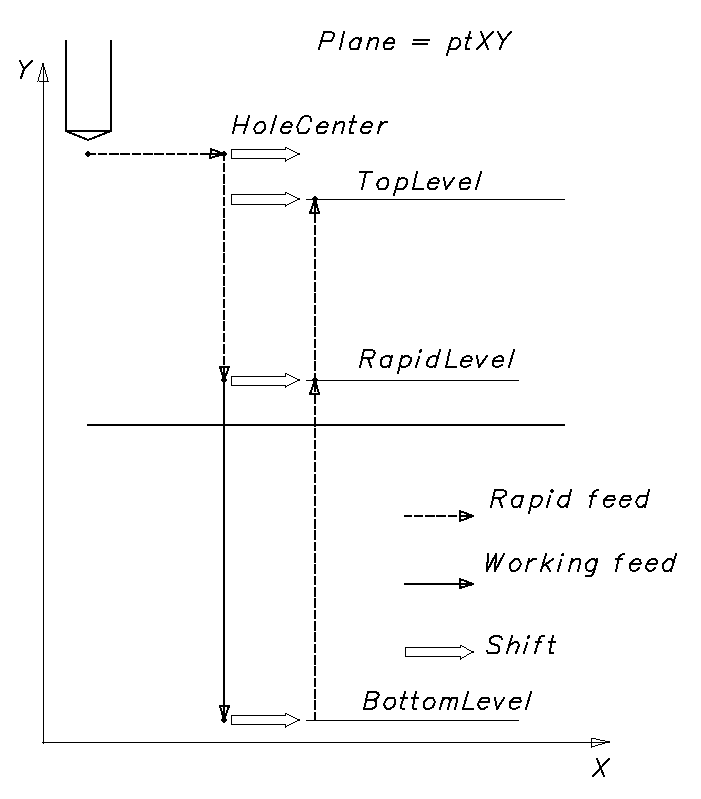

# Drilling cycle with shift

**INCT_DrillingCycleWithShiftFormer** - a CAM system interface that simplifies forming the movements of drilling cycles with shift. When the function **[INCT_CLData.CreateDrillingCycleFormer](../../basic-interfaces/forming-of-the-toolpath-in-machine-axes/forming-of-the-toolpath-in-machine-axes.md), [INCT_GeomCLData.CreateDrillingCycleFormer](../../basic-interfaces/forming-of-the-toolpath-in-geometric-axes/forming-of-the-toolpath-in-geometric-axes.md)** is called with the **dctWithShift** parameter, it returns an object that implements two interfaces: **INCT_DrillingCycleFormer**, **INCT_DrillingCycleWithShiftFormer**.

The **INCT_DrillingCycleFormer** interface sets the basic parameters of the drilling cycle with shift. Its use is described in the article [Drilling cycle](../drilling-cycle/drilling-cycle.md).

The **INCT_DrillingCycleWithShiftFormer** interface adds to the generator the ability to control the parameters of forming the tool path with shift.

**Purpose:**

The movements in the various drilling cycles with shift generally follow the same tool path on different controllers:

1. Positioning the tool above the center of the hole or of the next hole at rapid traverse.
2. Moving the tool to the rapid level at rapid traverse.
3. Moving the tool to the hole bottom level at working feed.
4. Returning to the rapid level at rapid traverse.
5. Returning to the retract level at rapid traverse.
6. If the number of repetitions is not reached, returning to step 1.

On one or several sections of such cycles the tool path is shifted along one or several axes. Examples of such cycles: Fanuc: G76, G87; Sinumerik: CYCLE86; Heidenhain: CYCL DEF 202, etc.

**Using the generator:**

We recommend creating a new drilling cycle generator for each new cycle in a block of the NC program, except when the cycle is repeated in a new block (like CYCL CALL for Heidenhain). Therefore, the interface of the old generator must be released when a new one is created or when the interpreter finishes its work.

The **INCT_DrillingCycleFormer** interface allows forming the tool path from the specified parameters: initial position, rapid level, hole bottom, number of repetitions, etc. It also allows adding to any section of the tool path the features required by a particular cycle (dwell, oriented spindle stop, tapping, etc.), changing the feed type or value, or skipping a tool movement prepared by the generator.

The **INCT_DrillingCycleWithShiftFormer** interface allows setting a shift of the coordinates of the tool movement points at any stage of the cycle except the first one. At each of these stages the tool moves from the current point to the new point as follows:

- from the current point to the shifted current point;
- from the shifted current point to the shifted new point;
- from the shifted new point to the new point.

To form the tool movement commands along the cycle path, do the following:

1. Get the generator interfaces (**[INCT_CLData.CreateDrillingCycleFormer](../../basic-interfaces/forming-of-the-toolpath-in-machine-axes/forming-of-the-toolpath-in-machine-axes.md), [INCT_GeomCLData.CreateDrillingCycleFormer](../../basic-interfaces/forming-of-the-toolpath-in-geometric-axes/forming-of-the-toolpath-in-geometric-axes.md)** with the **dctWithShift** parameter).
2. Set the indexes of the X, Y, Z axes along which the movements are made (**Set_AxisIndexes**).
3. Set the current plane (**Set_Plane**).
4. Set the hole center point (**Set_HoleCenter**).
5. Set the hole center point mode (**Set_HoleCenterMode**).
6. Set the rapid level (**Set_RapidLevel**).
7. Set the hole bottom level (**Set_BottomLevel**).
8. Set the retract level (**Set_TopLevel**).
9. Set the feed (**Set_Feedrate**) and the feed units (**Set_MPM**).
10. Set the number of cycle repetitions (**Set_Count**).
11. Assign a cycle event handler (**Set_Events**) if the cycle path needs to be changed.
12. Set the shift type of the tool movement points (**SetShiftByOneAxis** or **SetShiftBySomeAxis**).
13. Set the tool path sections where the shift is applied (**Set_ShiftPathSet**).
14. Form the tool movement commands along the cycle path (**MakeWorkpath**).

**Description of the INCT_DrillingCycleWithShiftFormer interface methods:**

| Method | Method description |
| --- | --- |
| **SetShiftByOneAxis** | The method switches the shift calculation to “**Calculation along one axis**” and sets the shift value. In this case the shift is made at all stages along one axis depending on the plane set by **Set_Plane**: for ptXY along the X axis, for ptYZ along the Y axis, for ptZX along the Z axis. Input parameter: **Value** (real number) - shift value. No output parameters. |
| **SetShiftBySomeAxis** | The method switches the shift calculation to “**Calculation along the selected axes**” and sets the shift value for each axis. In this case the point at the hole bottom level is shifted along the selected axes by the specified values. The points of the other levels are shifted along the selected axes by the specified values too, except along the drilling axis. Input parameters: **Axis** (**TNCShiftAxis.X, Y, Z** - boolean) - axes along which the shift is made; **Values** (**TNCShiftValues.X, Y, Z** - real number) - shift values along the axes. No output parameters. |
| **Set_ShiftPathSet** | The method sets the stages of the tool path at which the generator makes the shift. Input parameter: **Value** (**TNCShiftPathSet**) - set of tool path stages at which the generator makes the shift. Several stages can be selected. **spMoveToRapidLevel** - when moving to the rapid level; **spMoveToBottomLevel** - when moving to the hole bottom level; **spReturnToRapidLevel** - when returning to the rapid level; **spReturnToTopLevel** - when returning to the retract level. In the type library the type is called **SetOfTNCShiftPath** and is a byte; **TNCShiftPathSet** is its name in Delphi (set of **TNCShiftPath**). Each selected stage sets the bit with the number of its **TNCShiftPath** value: **spMoveToRapidLevel** = 1, **spMoveToBottomLevel** = 2, **spReturnToRapidLevel** = 4, **spReturnToTopLevel** = 8. No output parameters. |
| **Get_ShiftPathSet** | The function returns the set stages of the tool path at which the generator makes the shift (**TNCShiftPathSet**). No input parameters. |
| **Get_ShiftNextHole** | The function returns the coordinates of the shifted point of the current hole calculated for the current iteration (**TNC3DPoint**). The value can be used only inside the events (**Set_Events**). No input parameters. |
| **Get_ShiftRapidPoint** | The function returns the coordinates of the shifted point at the rapid level calculated for the current iteration (**TNC3DPoint**). The value can be used only inside the events (**Set_Events**). No input parameters. |
| **Get_ShiftTopPoint** | The function returns the coordinates of the shifted point at the retract level calculated for the current iteration (**TNC3DPoint**). The value can be used only inside the events (**Set_Events**). No input parameters. |
| **Get_ShiftBottomPoint** | The function returns the coordinates of the shifted point at the hole bottom level calculated for the current iteration (**TNC3DPoint**). The value can be used only inside the events (**Set_Events**). No input parameters. |
