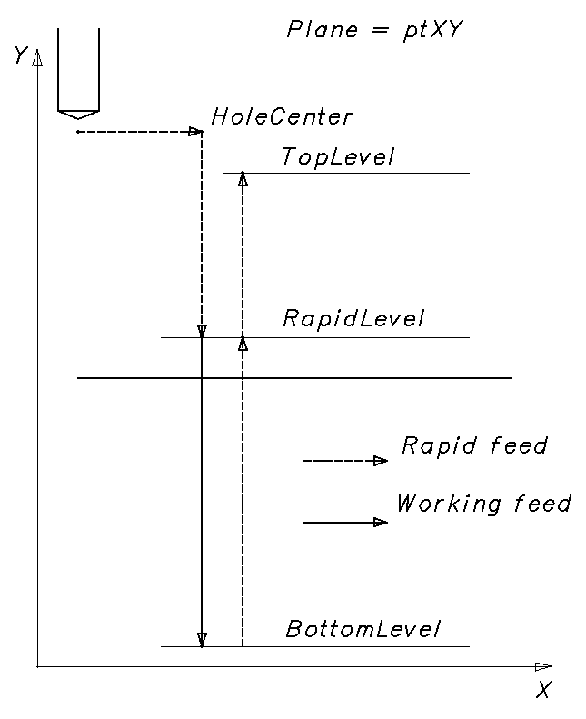

# Bohrzyklus

**INCT_DrillingCycleFormer** - Schnittstelle des CAM-Systems, die die Bildung der Bewegungen in Bohrzyklen vereinfacht. Das Objekt, das diese Schnittstelle implementiert, gibt die Funktion **[INCT_CLData.CreateDrillingCycleFormer](../../basic-interfaces/forming-of-the-toolpath-in-machine-axes/forming-of-the-toolpath-in-machine-axes.md), [INCT_GeomCLData.CreateDrillingCycleFormer](../../basic-interfaces/forming-of-the-toolpath-in-geometric-axes/forming-of-the-toolpath-in-geometric-axes.md)** zurück, wenn sie mit einem der Parameter **dctSimple**, **dctWithShift**, **dctPeck** aufgerufen wird.

**Zweck:**

Die Bewegungen in den verschiedenen Bohrzyklen folgen bei den unterschiedlichen Steuerungen im Allgemeinen demselben Ablauf (Fanuc: G74, G81, G82, G84, G85, G86, G88, G89; Sinumerik: CYCLE81, CYCLE82, CYCLE85, CYCLE87, CYCLE88, CYCLE89; Heidenhain: CYCL DEF 201, CYCL DEF 206, CYCL DEF 207 u. a.):

1. Positionieren des Werkzeugs über dem Mittelpunkt der Bohrung bzw. der nächsten Bohrung im Eilgang.
2. Fahren des Werkzeugs auf die Ebene der Eilgangbewegung im Eilgang.
3. Fahren des Werkzeugs auf die Ebene des Bohrungsgrunds im Arbeitsvorschub.
4. Rückkehr auf die Ebene der Eilgangbewegung im Eilgang.
5. Rückkehr auf die Rückzugsebene im Eilgang.
6. Ist die Anzahl der Wiederholungen noch nicht erreicht, Rückkehr zu Schritt 1.

Mit dem Generator lässt sich der Werkzeugweg aus vorgegebenen Parametern bilden: Ausgangsposition, Ebene der Eilgangbewegung, Bohrungsgrund, Anzahl der Wiederholungen usw. Außerdem können auf jedem Abschnitt die für einen bestimmten Zyklus nötigen Besonderheiten ergänzt (Verweilzeit, orientierter Spindelhalt, Gewindeschneiden usw.), Art oder Wert des Vorschubs geändert oder vom Generator vorbereitete Werkzeugbewegungen übersprungen werden.

**Verwendung des Generators:**

Wir empfehlen, für jeden neuen Zyklus in einem Satz des NC-Programms einen neuen Generator des Bohrzyklus zu erstellen, außer wenn ein Zyklus in einem neuen Satz wiederholt wird (entspricht CYCL CALL bei Heidenhain). Die Schnittstelle des alten Generators muss daher beim Erstellen eines neuen Generators oder beim Beenden des Interpreters freigegeben werden.

Um die Befehle für den Werkzeugweg entlang des Zyklus zu bilden, sind folgende Schritte nötig:

1. Die Schnittstelle des Generators abfragen (**[INCT_CLData.CreateDrillingCycleFormer](../../basic-interfaces/forming-of-the-toolpath-in-machine-axes/forming-of-the-toolpath-in-machine-axes.md), [INCT_GeomCLData.CreateDrillingCycleFormer](../../basic-interfaces/forming-of-the-toolpath-in-geometric-axes/forming-of-the-toolpath-in-geometric-axes.md)**).
2. Die Indizes der Achsen X, Y, Z festlegen, entlang derer die Bewegungen ausgeführt werden (**Set_AxisIndexes**).
3. Die aktuelle Ebene festlegen (**Set_Plane**).
4. Den Mittelpunkt der Bohrung festlegen (**Set_HoleCenter**).
5. Den Modus des Bohrungsmittelpunkts festlegen (**Set_HoleCenterMode**).
6. Die Ebene der Eilgangbewegung festlegen (**Set_RapidLevel**).
7. Die Ebene des Bohrungsgrunds festlegen (**Set_BottomLevel**).
8. Die Rückzugsebene festlegen (**Set_TopLevel**).
9. Den Vorschub (**Set_Feedrate**) und die Maßeinheit des Vorschubs (**Set_MPM**) festlegen.
10. Die Anzahl der Wiederholungen des Zyklus festlegen (**Set_Count**).
11. Einen Ereignishandler des Zyklus zuweisen (**Set_Events**), wenn der Werkzeugweg des Zyklus geändert werden soll.
12. Die Befehle für den Werkzeugweg entlang des Zyklus bilden (**MakeWorkpath**).

**Beschreibung der Schnittstellenmethoden:**

<table>
<thead>
<tr><th>Methode</th><th>Beschreibung der Methode</th></tr>
</thead>
<tbody>
<tr><td><strong>Set_AxisIndexes</strong></td><td>
Die Methode legt die Indizes der Achsen X, Y, Z fest, entlang derer die Bewegungen bei der Bildung des Werkzeugwegs des Zyklus ausgeführt werden.

Eingabeparameter: <strong>Value</strong> (<strong>TNCDCAxisIndexes</strong>) - <strong>X</strong> (Ganzzahl) - Index der X-Achse, <strong>Y</strong> (Ganzzahl) - Index der Y-Achse, <strong>Z</strong> (Ganzzahl) - Index der Z-Achse.

Keine Ausgabeparameter.
</td></tr>
<tr><td><strong>Get_AxisIndexes</strong></td><td>
Die Funktion gibt die Indizes der Achsen X, Y, Z zurück, entlang derer die Bewegungen bei der Bildung des Werkzeugwegs des Zyklus ausgeführt werden (<strong>TNCDCAxisIndexes</strong>).

Keine Eingabeparameter.
</td></tr>
<tr><td><strong>Set_HoleCenter</strong></td><td>
Die Methode legt die Koordinaten des Mittelpunkts der Bohrung fest.

Eingabeparameter: <strong>Value</strong> (<strong>TNC3DPoint</strong>), X, Y, Z - Koordinaten entlang der jeweiligen Achsen.

Keine Ausgabeparameter.
</td></tr>
<tr><td><strong>Get_HoleCenter</strong></td><td>
Die Funktion gibt die Koordinaten des Mittelpunkts der Bohrung zurück (<strong>TNC3DPoint</strong>).

Keine Eingabeparameter.
</td></tr>
<tr><td><strong>Set_HoleCenterMode</strong></td><td>
Die Methode legt den Modus des Bohrungsmittelpunkts fest.

Eingabeparameter: <strong>Value</strong> (boolesch) - Modus des Bohrungsmittelpunkts. True - die Koordinaten des Bohrungsmittelpunkts (<strong>Set_HoleCenter</strong>) sind absolut angegeben. False - die Koordinaten des Bohrungsmittelpunkts sind relativ zur aktuellen Position des Werkzeugs angegeben.

Keine Ausgabeparameter.
</td></tr>
<tr><td><strong>Get_HoleCenterMode</strong></td><td>
Die Funktion gibt den Modus des Bohrungsmittelpunkts zurück (boolesch).

Keine Eingabeparameter.
</td></tr>
<tr><td><strong>Set_Plane</strong></td><td>
Die Methode legt die aktuelle Ebene fest.

Eingabeparameter: <strong>Value</strong> (<strong>TNCPlaneType</strong>) - aktuelle Ebene.

<strong>ptXY</strong> - Ebene XY, die Bohrung wird entlang der Z-Achse gebohrt. <strong>ptYZ</strong> - Ebene YZ, die Bohrung wird entlang der X-Achse gebohrt. <strong>ptZX</strong> - Ebene ZX, die Bohrung wird entlang der Y-Achse gebohrt.

Keine Ausgabeparameter.
</td></tr>
<tr><td><strong>Get_Plane</strong></td><td>
Die Funktion gibt die aktuelle Ebene zurück (<strong>TNCPlaneType</strong>).

Keine Eingabeparameter.
</td></tr>
<tr><td><strong>Set_RapidLevel</strong></td><td>
Die Methode legt die Ebene der Eilgangbewegung entlang der Bohrachse fest.

Eingabeparameter: <strong>Value</strong> (Gleitkommazahl) - Ebene der Eilgangbewegung.

Keine Ausgabeparameter.
</td></tr>
<tr><td><strong>Get_RapidLevel</strong></td><td>
Die Funktion gibt die Ebene der Eilgangbewegung entlang der Bohrachse zurück (Gleitkommazahl).

Keine Eingabeparameter.
</td></tr>
<tr><td><strong>Set_BottomLevel</strong></td><td>
Die Methode legt die Ebene des Bohrungsgrunds entlang der Bohrachse fest.

Eingabeparameter: <strong>Value</strong> (Gleitkommazahl) - Ebene des Bohrungsgrunds.

Keine Ausgabeparameter.
</td></tr>
<tr><td><strong>Get_BottomLevel</strong></td><td>
Die Funktion gibt die Ebene des Bohrungsgrunds entlang der Bohrachse zurück (Gleitkommazahl).

Keine Eingabeparameter.
</td></tr>
<tr><td><strong>Set_TopLevel</strong></td><td>
Die Methode legt die Rückzugsebene entlang der Bohrachse fest.

Eingabeparameter: <strong>Value</strong> (Gleitkommazahl) - Rückzugsebene.

Keine Ausgabeparameter.
</td></tr>
<tr><td><strong>Get_TopLevel</strong></td><td>
Die Funktion gibt die Rückzugsebene entlang der Bohrachse zurück (Gleitkommazahl).

Keine Eingabeparameter.
</td></tr>
<tr><td><strong>Set_Feedrate</strong></td><td>
Die Methode legt den Arbeitsvorschub fest.

Eingabeparameter: <strong>Value</strong> (Gleitkommazahl) - Vorschub.

Keine Ausgabeparameter.
</td></tr>
<tr><td><strong>Get_Feedrate</strong></td><td>
Die Funktion gibt den Arbeitsvorschub zurück (Gleitkommazahl).

Keine Eingabeparameter.
</td></tr>
<tr><td><strong>Set_MPM</strong></td><td>
Die Methode legt die Maßeinheit des Vorschubs fest.

Eingabeparameter: <strong>Value</strong> (boolesch) - Maßeinheit des Vorschubs. True - mm/min, False - mm/U.

Keine Ausgabeparameter.
</td></tr>
<tr><td><strong>Get_MPM</strong></td><td>
Die Funktion gibt die Maßeinheit des Vorschubs zurück (boolesch).

Keine Eingabeparameter.
</td></tr>
<tr><td><strong>Set_Count</strong></td><td>
Die Methode legt die Anzahl der Wiederholungen des Zyklus fest.

Eingabeparameter: <strong>Value</strong> (Ganzzahl) - Anzahl der Wiederholungen des Zyklus.

Keine Ausgabeparameter.

Der Ablauf des Zyklus hängt vom Modus des Bohrungsmittelpunkts ab (<strong>Set_HoleCenterMode</strong>):
<ul><li>bei 0 Wiederholungen wird das Werkzeug nur über dem Mittelpunkt der Bohrung positioniert;</li><li>bei 1 Wiederholung wird eine Iteration des Zyklus ausgeführt;</li><li>bei mehr als 1 Wiederholung wird der Zyklus so oft wie angegeben wiederholt: sind die Koordinaten des Bohrungsmittelpunkts absolut angegeben, an derselben Stelle; sind sie relativ angegeben, wird bei jeder Iteration um den in <strong>Set_HoleCenter</strong> angegebenen Wert gegenüber dem Punkt verschoben, an dem die vorherige Iteration endete.</li></ul></td></tr>
<tr><td><strong>Get_Count</strong></td><td>
Die Funktion gibt die Anzahl der Wiederholungen des Zyklus zurück (Ganzzahl).

Keine Eingabeparameter.
</td></tr>
<tr><td><strong>Set_Events</strong></td><td>
Die Methode weist Ereignisse zur Steuerung des Zyklus zu. Mit Ereignissen lassen sich auf jedem gebildeten Abschnitt des Werkzeugwegs die für einen bestimmten Zyklus nötigen Besonderheiten ergänzen (Verweilzeit, orientierter Spindelhalt, Gewindeschneiden usw.), Art oder Wert des Vorschubs ändern oder vom Generator vorbereitete Werkzeugbewegungen überspringen.

Eingabeparameter: <strong>Value</strong> (<strong>INCT_DrillingCycleEvents</strong>) - Objekt, das die Ereignisse implementiert. Ausführliche Beschreibung unten.

Keine Ausgabeparameter.
</td></tr>
<tr><td><strong>Get_Events</strong></td><td>
Die Funktion gibt das mit dem Generator verbundene Objekt zurück, das die Ereignisse implementiert (<strong>INCT_DrillingCycleEvents</strong>).

Keine Eingabeparameter.
</td></tr>
<tr><td><strong>MakeWorkpath</strong></td><td>Die Methode bildet den Werkzeugweg des Zyklus nach den angegebenen Parametern.</td></tr>
<tr><td><strong>Get_NextHole</strong></td><td>Die Funktion gibt die für die aktuelle Iteration berechneten Koordinaten des Punkts der aktuellen Bohrung zurück (<strong>TNC3DPoint</strong>). Der Wert kann nur innerhalb der Ereignisse (<strong>Set_Events</strong>) verwendet werden.</td></tr>
<tr><td><strong>Get_RapidPoint</strong></td><td>Die Funktion gibt die für die aktuelle Iteration berechneten Koordinaten des Punkts auf der Ebene der Eilgangbewegung zurück (<strong>TNC3DPoint</strong>). Der Wert kann nur innerhalb der Ereignisse (<strong>Set_Events</strong>) verwendet werden.</td></tr>
<tr><td><strong>Get_TopPoint</strong></td><td>Die Funktion gibt die für die aktuelle Iteration berechneten Koordinaten des Punkts auf der Rückzugsebene zurück (<strong>TNC3DPoint</strong>). Der Wert kann nur innerhalb der Ereignisse (<strong>Set_Events</strong>) verwendet werden.</td></tr>
<tr><td><strong>Get_BottomPoint</strong></td><td>Die Funktion gibt die für die aktuelle Iteration berechneten Koordinaten des Punkts auf der Ebene des Bohrungsgrunds zurück (<strong>TNC3DPoint</strong>). Der Wert kann nur innerhalb der Ereignisse (<strong>Set_Events</strong>) verwendet werden.</td></tr>
</tbody>
</table>

**INCT_DrillingCycleEvents** - Schnittstelle, die im Interpreter implementiert wird und mit der sich das Verhalten des Bohrzyklus steuern lässt. Die Schnittstelle besteht aus einer Reihe von Ereignismethoden, die bei den Bewegungen des Werkzeugs innerhalb des Generators ausgeführt werden. Mit ihnen lassen sich auf jedem gebildeten Abschnitt die für einen bestimmten Zyklus nötigen Besonderheiten ergänzen (Verweilzeit, orientierter Spindelhalt, Gewindeschneiden usw.), Art oder Wert des Vorschubs ändern oder vom Generator vorbereitete Werkzeugbewegungen überspringen.

Sind dem Generator Ereignisse zugewiesen, besteht jede Bewegung des Werkzeugs innerhalb des Generators aus 3 Schritten:

1. Die Methode **INCT_DrillingCycleEvents.BeforeMove** wird ausgeführt. Ihr werden die vom Zyklus festgelegten Werte übergeben: Bewegungsart, Koordinaten des Zielpunkts, Vorschubart.
2. Die Methode **INCT_DrillingCycleEvents.OnMove** wird ausgeführt. Ihr werden übergeben: Bewegungsart, Koordinaten des Zielpunkts, Vorschubart und das Kennzeichen, ob die Bewegung ausgeführt wurde. Alle Parameter außer der Bewegungsart können in der Implementierung geändert werden. Je nach dem in **OnMove** gesetzten Kennzeichen fährt das Werkzeug mit dem angegebenen Vorschub zum angegebenen Punkt oder die Bewegung entfällt.
3. Die Methode **INCT_DrillingCycleEvents.AfterMove** wird ausgeführt. Ihr werden die von **OnMove** zurückgegebenen Werte übergeben: Bewegungsart, Koordinaten des Zielpunkts, Vorschubart.

**Beschreibung der Schnittstellenmethoden:**

| Methode | Beschreibung der Methode | Verwendung |
| --- | --- | --- |
| **BeforeMove** | Die Methode wird vor jeder Bewegung des Werkzeugs bei der Bildung des Werkzeugwegs des Zyklus ausgeführt. Eingabeparameter: **MoveType** (**TNCDrillingCycleMoveType**) - Bewegungsart, Beschreibung siehe unten; **Point** (**TNC3DPoint**) - Koordinaten des Zielpunkts; **Feed** (**TNCFeedType**) - Vorschubart. **mtMoveToNextHole** - Fahren zur ersten oder nächsten Bohrung; **mtMoveToRapidLevel** - Fahren auf die Ebene der Eilgangbewegung; **mtMoveToBottomLevel** - Fahren auf den Bohrungsgrund; **mtReturnToRapidLevel** - Rückkehr auf die Ebene der Eilgangbewegung; **mtReturnToTopLevel** - Rückkehr auf die Rückzugsebene; **mtPeck**\* - werden beim Bilden des Zyklus mit Spanbruch verwendet (siehe [Bohrzyklus mit Spanbruch](../drilling-cycle-with-chip-breaking/drilling-cycle-with-chip-breaking.md)). Keine Ausgabeparameter. | Sollen vor einer Bewegung bestimmte Befehle ausgeführt werden, werden sie in der Implementierung der Methode hinzugefügt. Soll zum Beispiel vor dem Bohren die Spindeldrehrichtung im Uhrzeigersinn eingestellt werden, wird in der Implementierung von **BeforeMove** bei **MoveType** = **mtMoveToBottomLevel** **INCT_CLData.AddSpindleSpeedOnRPM** mit den passenden Parametern aufgerufen. |
| **OnMove** | Die Methode wird vor jeder Bewegung des Werkzeugs bei der Bildung des Werkzeugwegs des Zyklus ausgeführt. Eingabeparameter: **MoveType** (**TNCDrillingCycleMoveType**) - Bewegungsart, Beschreibung siehe oben; Ein- und Ausgabeparameter: **Point** (**TNC3DPoint**) - Koordinaten des Zielpunkts; **Feed** (**TNCFeedType**) - Vorschubart; **Handled** (boolesch) - Kennzeichen, ob die Bewegung in der Implementierung ausgeführt wurde (True - ausgeführt, False - nicht ausgeführt). Hat **Handled** nach dem Aufruf von **OnMove** den Wert True, wurde die Bewegung in der Implementierung von **OnMove** ausgeführt, und der Generator fügt dem Werkzeugweg keinen Bewegungsbefehl hinzu. Hat **Handled** nach dem Aufruf von **OnMove** den Wert False, geht der Generator davon aus, dass die Bewegung nicht ausgeführt wurde, und fügt dem Werkzeugweg einen Befehl für die Bewegung zum Punkt **Point** mit der Vorschubart **Feed** hinzu. | Zum Überschreiben des Zielpunkts oder des Vorschubs oder zum Überspringen der Bewegung. Soll zum Beispiel bei der Rückkehr nach dem Bohren vom Eilgang auf den Arbeitsvorschub umgeschaltet werden, muss in der Implementierung von **OnMove** bei **MoveType** = **mtReturnToRapidLevel** der zurückgegebene Parameter **Feed** auf **ffWorking** gesetzt werden (Vorschubart siehe **[OutStandardFeed](../../basic-interfaces/forming-of-the-toolpath-in-machine-axes/forming-of-the-toolpath-in-machine-axes.md)**). Soll das Werkzeug zu einem anderen Punkt als dem vom Zyklus berechneten fahren, muss der zurückgegebene Parameter **Point** von **OnMove** geändert werden. Soll die Bewegung zum berechneten Punkt nicht ausgeführt werden, muss in der Implementierung von **OnMove** der Parameter **Handled** auf True gesetzt werden. |
| **AfterMove** | Die Methode wird nach jeder Bewegung des Werkzeugs bei der Bildung des Werkzeugwegs des Zyklus ausgeführt, auch wenn die Bewegung in **OnMove** abgebrochen wurde. Eingabeparameter: **MoveType** (**TNCDrillingCycleMoveType**) - Bewegungsart, Beschreibung siehe oben; **Point** (**TNC3DPoint**) - Koordinaten des Zielpunkts; **Feed** (**TNCFeedType**) - Vorschubart. Keine Ausgabeparameter. | Sollen nach einer Bewegung bestimmte Befehle ausgeführt werden, werden sie in der Implementierung der Methode hinzugefügt. Soll zum Beispiel nach dem Bohren eine Verweilzeit eingefügt werden, wird in der Implementierung von **AfterMove** bei **MoveType** = **mtMoveToBottomLevel** **INCT_CLData.AddDelay** mit den passenden Parametern aufgerufen. |
