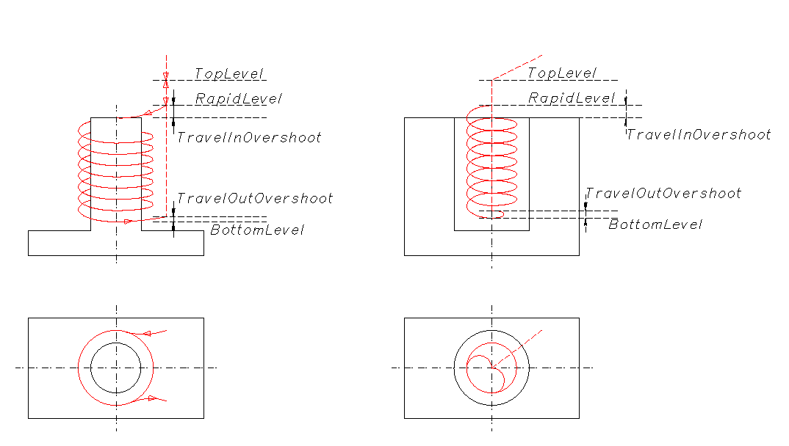

# Gewindefräszyklus

**INCT_ThreadMillingCycleFormer** - Schnittstelle des CAM-Systems, die die Bildung der Bewegungen eines Zyklus zum Gewindefräsen vereinfacht. Das Objekt, das diese Schnittstelle implementiert, gibt die Funktion **[INCT_CLData.CreateMillingCycleFormer](../../basic-interfaces/forming-of-the-toolpath-in-machine-axes/forming-of-the-toolpath-in-machine-axes.md)** zurück, wenn sie mit dem Parameter **mctThreadMilling** aufgerufen wird.

**Zweck:**

Die Bewegungen in den verschiedenen Arten von Zyklen zum Gewindefräsen folgen bei den unterschiedlichen Steuerungen im Allgemeinen demselben Ablauf:

1. Anfahren des Werkzeugs auf die Ausgangsebene im Eilgang.
2. Anfahren des Werkzeugs auf die Ebene des Überlaufs beim Anfahren im Eilgang.
3. Anfahren des Startpunkts des Fräsens auf einem Bogen oder einer Helix im Arbeitsvorschub (Überlauf).
4. Fräsen des Gewindes mit den angegebenen Parametern (Mittelpunkt, Durchmesser, Steigung) bis zur Endebene des Fräsens.
5. Abfahren auf einem Bogen oder einer Helix im Arbeitsvorschub auf der Ebene des Überlaufs beim Abfahren (Überlauf).
6. Rückkehr auf die Ausgangsebene im Eilgang.

Beispiel eines solchen Zyklus für Sinumerik: CYCLE90.

Mit dem Generator lässt sich der Werkzeugweg aus vorgegebenen Parametern bilden. Außerdem können auf jedem Abschnitt die für einen bestimmten Zyklus nötigen Besonderheiten ergänzt, Art oder Wert des Vorschubs geändert oder vom Generator vorbereitete Werkzeugbewegungen übersprungen werden.

**Verwendung des Generators:**

Wir empfehlen, für jeden neuen Zyklus in einem Satz des NC-Programms einen neuen Generator zu erstellen. Die Schnittstelle des alten Generators muss daher beim Erstellen eines neuen Generators oder beim Beenden des Interpreters freigegeben werden.

Um die Befehle für den Werkzeugweg entlang des Zyklus zu bilden, sind folgende Schritte nötig:

1. Die Schnittstelle des Generators abfragen (**[INCT_CLData.CreateMillingCycleFormer](../../basic-interfaces/forming-of-the-toolpath-in-machine-axes/forming-of-the-toolpath-in-machine-axes.md)**).
2. Die Indizes der Achsen festlegen, entlang derer die Bewegungen ausgeführt werden (**Set_AxisIndexes**).
3. Die aktuelle Ebene festlegen (**Set_Plane**).
4. Den Arbeitsvorschub festlegen (**Set_Feedrate**).
5. Die Gewindeart festlegen (**Set_ThreadType**).
6. Die Gewinderichtung festlegen (**Set_ThreadDirection**).
7. Die Gewindesteigung festlegen (**Set_ThreadStep**).
8. Den Gewindedurchmesser festlegen (**Set_Diameter**).
9. Den Mittelpunkt des Gewindes festlegen (**Set_CenterPoint**).
10. Die Anfahrebene festlegen (**Set_TopLevel**).
11. Die Lage der Sicherheitsebene festlegen (**Set_RapidLevel**).
12. Die Endebene des Fräsens festlegen (**Set_BottomLevel**).
13. Den Überlauf beim Anfahren festlegen (**Set_TravelInOvershoot**).
14. Den Überlauf beim Abfahren festlegen (**Set_TravelOutOvershoot**).
15. Einen Ereignishandler des Zyklus zuweisen (**Set_Events**), wenn der Werkzeugweg des Zyklus geändert werden soll.
16. Die Befehle für den Werkzeugweg entlang des Zyklus bilden (**MakeWorkpath**).

**Beschreibung der Schnittstellenmethoden:**

| Methode | Beschreibung der Methode |
| --- | --- |
| **Set_AxisIndexes** | Die Methode legt die Indizes der Achsen X, Y, Z fest, entlang derer die Bewegungen bei der Bildung des Werkzeugwegs des Zyklus ausgeführt werden. Eingabeparameter: **Value** (**TNCDCAxisIndexes**) - **X** (Ganzzahl) - Index der X-Achse, **Y** (Ganzzahl) - Index der Y-Achse, **Z** (Ganzzahl) - Index der Z-Achse. Keine Ausgabeparameter. |
| **Get_AxisIndexes** | Die Funktion gibt die Indizes der Achsen X, Y, Z zurück, entlang derer die Bewegungen bei der Bildung des Werkzeugwegs des Zyklus ausgeführt werden (**TNCDCAxisIndexes**). Keine Eingabeparameter. |
| **Set_Plane** | Die Methode legt die aktuelle Ebene fest. Eingabeparameter: **Value** (**TNCPlaneType**) - aktuelle Ebene. **ptXY** - Ebene XY, das Gewinde wird entlang der Z-Achse gefräst; **ptYZ** - Ebene YZ, das Gewinde wird entlang der X-Achse gefräst; **ptZX** - Ebene ZX, das Gewinde wird entlang der Y-Achse gefräst. Keine Ausgabeparameter. |
| **Get_Plane** | Die Funktion gibt die aktuelle Ebene zurück (**TNCPlaneType**). Keine Eingabeparameter. |
| **Set_ThreadType** | Die Methode legt die Gewindeart fest. Eingabeparameter: **Value** (**TNCMillingThreadType**) - Gewindeart. **mttInternal** - Innengewinde; **mttExternal** - Außengewinde. Keine Ausgabeparameter. |
| **Get_ThreadType** | Die Funktion gibt die Gewindeart zurück (**TNCMillingThreadType**). Keine Eingabeparameter. |
| **Set_ThreadDirection** | Die Methode legt die Gewinderichtung fest. Eingabeparameter: **Value** (**TNCCircularMode**) - Gewinderichtung. **cmCW** - im Uhrzeigersinn; **cmCCW** - gegen den Uhrzeigersinn. Keine Ausgabeparameter. |
| **Get_ThreadDirection** | Die Funktion gibt die Gewinderichtung zurück (**TNCCircularMode**). Keine Eingabeparameter. |
| **Set_ThreadStep** | Die Methode legt die Gewindesteigung fest. Eingabeparameter: **Value** (Gleitkommazahl) - Gewindesteigung. Keine Ausgabeparameter. |
| **Get_ThreadStep** | Die Funktion gibt die Gewindesteigung zurück (Gleitkommazahl). Keine Eingabeparameter. |
| **Set_Diameter** | Die Methode legt den Gewindedurchmesser fest. Eingabeparameter: **Value** (Gleitkommazahl) - Gewindedurchmesser. Keine Ausgabeparameter. |
| **Get_Diameter** | Die Funktion gibt den Gewindedurchmesser zurück (Gleitkommazahl). Keine Eingabeparameter. |
| **Set_CenterPoint** | Die Methode legt den Mittelpunkt des Gewindes fest. Eingabeparameter: **Value** (**TNC2DPoint**) - Mittelpunkt des Gewindes. Keine Ausgabeparameter. |
| **Get_CenterPoint** | Die Funktion gibt den Mittelpunkt des Gewindes zurück (**TNC2DPoint**). Keine Eingabeparameter. |
| **Set_TopLevel** | Die Methode legt die Anfahrebene fest. Eingabeparameter: **Value** (Gleitkommazahl) - Lage der Anfahrebene. Keine Ausgabeparameter. |
| **Get_TopLevel** | Die Funktion gibt die Lage der Anfahrebene zurück (Gleitkommazahl). Keine Eingabeparameter. |
| **Set_RapidLevel** | Die Methode legt die Lage der Sicherheitsebene fest. Eingabeparameter: **Value** (Gleitkommazahl) - Lage der Sicherheitsebene. Keine Ausgabeparameter. |
| **Get_RapidLevel** | Die Funktion gibt die Lage der Sicherheitsebene zurück (Gleitkommazahl). Keine Eingabeparameter. |
| **Set_BottomLevel** | Die Methode legt die Endebene des Fräsens fest. Eingabeparameter: **Value** (Gleitkommazahl) - Lage der Endebene des Fräsens. Keine Ausgabeparameter. |
| **Get_BottomLevel** | Die Funktion gibt die Lage der Endebene des Fräsens zurück (Gleitkommazahl). Keine Eingabeparameter. |
| **Set_TravelInOvershoot** | Die Methode legt den Überlauf beim Anfahren fest. Eingabeparameter: **Value** (Gleitkommazahl) - Überlauf beim Anfahren. Keine Ausgabeparameter. |
| **Get_TravelInOvershoot** | Die Funktion gibt den Überlauf beim Anfahren zurück (Gleitkommazahl). Keine Eingabeparameter. |
| **Set_TravelOutOvershoot** | Die Methode legt den Überlauf beim Abfahren fest. Eingabeparameter: **Value** (Gleitkommazahl) - Überlauf beim Abfahren. Keine Ausgabeparameter. |
| **Get_TravelOutOvershoot** | Die Funktion gibt den Überlauf beim Abfahren zurück (Gleitkommazahl). Keine Eingabeparameter. |
| **Set_Feedrate** | Die Methode legt den Arbeitsvorschub fest. Eingabeparameter: **Value** (Gleitkommazahl) - Arbeitsvorschub. Keine Ausgabeparameter. |
| **Get_Feedrate** | Die Funktion gibt den Arbeitsvorschub zurück. Keine Eingabeparameter. |
| **Set_MPM** | Die Methode legt die Maßeinheit des Arbeitsvorschubs fest. Eingabeparameter: **Value** (boolesch) - Maßeinheit des Arbeitsvorschubs. True - mm/min, False - mm/U. Keine Ausgabeparameter. |
| **Get_MPM** | Die Funktion gibt die Maßeinheit des Arbeitsvorschubs zurück. Keine Eingabeparameter. |
| **Set_Events** | Die Methode weist Ereignisse zur Steuerung des Zyklus zu. Mit Ereignissen lassen sich auf jedem gebildeten Abschnitt des Werkzeugwegs die für einen bestimmten Zyklus nötigen Besonderheiten ergänzen, Art oder Wert des Vorschubs ändern oder vom Generator vorbereitete Werkzeugbewegungen überspringen. Eingabeparameter: **Value** (**INCT_MillingCycleEvents**) - Objekt, das die Ereignisse implementiert. Ausführliche Beschreibung unten. Keine Ausgabeparameter. |
| **Get_Events** | Die Funktion gibt das mit dem Generator verbundene Objekt zurück, das die Ereignisse implementiert (**INCT_MillingCycleEvents**). Keine Eingabeparameter. |
| **MakeWorkpath** | Die Methode bildet den Werkzeugweg des Zyklus nach den angegebenen Parametern. |

**INCT_MillingCycleEvents** - Schnittstelle, die im Interpreter implementiert wird und mit der sich das Verhalten des Zyklus zum Gewindefräsen steuern lässt. Die Schnittstelle besteht aus einer Reihe von Ereignismethoden, die bei den Bewegungen des Werkzeugs innerhalb des Generators ausgeführt werden. Mit ihnen lassen sich auf jedem gebildeten Abschnitt die für einen bestimmten Zyklus nötigen Besonderheiten ergänzen (Verweilzeit, orientierter Spindelhalt usw.), die Vorschubart ändern oder vom Generator vorbereitete Werkzeugbewegungen überspringen.

Sind dem Generator Ereignisse zugewiesen, besteht jede Bewegung des Werkzeugs innerhalb des Generators aus 3 Schritten:

1. Die Methode **INCT_MillingCycleEvents.BeforeMove** wird ausgeführt. Ihr werden die vom Zyklus festgelegten Werte übergeben: Bewegungsart, Koordinaten des Zielpunkts, Vorschubart.
2. Je nach Art der Bewegung - geradlinig oder auf einem Bogen - wird die Methode **INCT_MillingCycleEvents.OnMove** oder **INCT_MillingCycleEvents.OnArc** ausgeführt.\
   **OnMove** werden übergeben: Bewegungsart, Koordinaten des Zielpunkts, Vorschubart und das Kennzeichen, ob die Bewegung ausgeführt wurde. Alle Parameter außer der Bewegungsart können in der Implementierung geändert werden. Je nach dem in **OnMove** gesetzten Kennzeichen fährt das Werkzeug mit dem angegebenen Vorschub zum angegebenen Punkt oder die Bewegung entfällt.\
   **OnArc** werden übergeben: Bewegungsart, Koordinaten des Bogenmittelpunkts und des Zielpunkts, Radius, Vorschubart und das Kennzeichen, ob die Bewegung ausgeführt wurde. Alle Parameter außer der Bewegungsart können in der Implementierung geändert werden. Je nach dem in **OnArc** gesetzten Kennzeichen fährt das Werkzeug mit dem angegebenen Vorschub zum angegebenen Punkt oder die Bewegung entfällt.
3. Die Methode **INCT_MillingCycleEvents.AfterMove** wird ausgeführt. Ihr werden die von **OnMove** bzw. **OnArc** zurückgegebenen Werte übergeben: Bewegungsart, Koordinaten des Zielpunkts, Vorschubart.

**Beschreibung der Schnittstellenmethoden:**

| Methode | Beschreibung der Methode | Verwendung |
| --- | --- | --- |
| **BeforeMove** | Die Methode wird vor jeder Bewegung des Werkzeugs bei der Bildung des Werkzeugwegs des Zyklus ausgeführt. Eingabeparameter: **MoveType** (**TNCMillingCycleMoveType**) - Bewegungsart, Beschreibung siehe unten; **Point** (**TNC3DPoint**) - Koordinaten des Zielpunkts; **Feed** (**TNCFeedType**) - Vorschubart. **mmMoveToTopLevel** - Fahren zum Startpunkt auf der Ebene **TopLevel**; **mmMoveToRapidLevel** - Fahren auf die Ebene, auf der das Anfahren beginnt; **mmTravelInMovement** - Anfahren an das Gewinde auf einem Bogen; **mmThreadMilling** - Fräsen des Gewindes; **mmTravelOutMovement** - Abfahren vom Gewinde zur Mitte auf einem Bogen; **mmReturnToTopLevel** - Rückkehr auf die Ebene **TopLevel**. Keine Ausgabeparameter. | Sollen vor einer Bewegung bestimmte Befehle ausgeführt werden, werden sie in der Implementierung der Methode hinzugefügt. Soll zum Beispiel vor dem Gewindefräsen die Kühlung der Maschine eingeschaltet werden, wird in der Implementierung von **BeforeMove** bei **MoveType** = **mmMoveToTopLevel** **INCT_CLData.AddCoolant** mit den passenden Parametern aufgerufen. |
| **OnMove** | Die Methode wird unmittelbar vor jeder geradlinigen Bewegung des Werkzeugs bei der Bildung des Werkzeugwegs des Zyklus ausgeführt. Eingabeparameter: **MoveType** (**TNCMillingCycleMoveType**) - Bewegungsart, Beschreibung siehe oben; Ein- und Ausgabeparameter: **Point** (**TNC3DPoint**) - Koordinaten des Zielpunkts; **Feed** (**TNCFeedType**) - Vorschubart; **Handled** (boolesch) - Kennzeichen, ob die Bewegung in der Implementierung ausgeführt wurde (True - ausgeführt, False - nicht ausgeführt). Hat **Handled** nach dem Aufruf von **OnMove** den Wert True, wurde die Bewegung in der Implementierung von **OnMove** ausgeführt, und der Generator fügt dem Werkzeugweg keinen Bewegungsbefehl hinzu. Hat **Handled** nach dem Aufruf von **OnMove** den Wert False, geht der Generator davon aus, dass die Bewegung nicht ausgeführt wurde, und fügt dem Werkzeugweg einen Befehl für die Bewegung zum Punkt **Point** mit der Vorschubart **Feed** hinzu. | Zum Überschreiben des Zielpunkts oder des Vorschubs oder zum Überspringen der Bewegung. Soll zum Beispiel bei der Rückkehr auf die Ausgangsebene nach dem Fräsen auf Eilgang umgeschaltet werden, muss in der Implementierung von **OnMove** bei **MoveType** = **mmReturnToTopLevel** der zurückgegebene Parameter **Feed** auf **ffRapid** gesetzt werden (Vorschubart siehe **[OutStandardFeed](../../basic-interfaces/forming-of-the-toolpath-in-machine-axes/forming-of-the-toolpath-in-machine-axes.md)**). Soll das Werkzeug zu einem anderen Punkt als dem vom Zyklus berechneten fahren, muss der zurückgegebene Parameter **Point** von **OnMove** geändert werden. Soll die Bewegung zum berechneten Punkt nicht ausgeführt werden, muss in der Implementierung von **OnMove** der Parameter **Handled** auf True gesetzt werden. |
| **OnArc** | Die Methode wird unmittelbar vor jeder Bewegung des Werkzeugs auf einem Bogen bei der Bildung des Werkzeugwegs des Zyklus ausgeführt. Eingabeparameter: **MoveType** (**TNCMillingCycleMoveType**) - Bewegungsart, Beschreibung siehe oben; Ein- und Ausgabeparameter: **Center**, **Point** (**TNC3DPoint**) - Koordinaten des Bogenmittelpunkts und des Zielpunkts; **Radius** (Gleitkommazahl) - Radius des Bogens; **Feed** (**TNCFeedType**) - Vorschubart; **Handled** (boolesch) - Kennzeichen, ob die Bewegung in der Implementierung ausgeführt wurde (True - ausgeführt, False - nicht ausgeführt). Hat **Handled** nach dem Aufruf von **OnArc** den Wert True, wurde die Bewegung in der Implementierung von **OnArc** ausgeführt, und der Generator fügt dem Werkzeugweg keinen Bewegungsbefehl hinzu. Hat **Handled** nach dem Aufruf von **OnArc** den Wert False, geht der Generator davon aus, dass die Bewegung nicht ausgeführt wurde, und fügt dem Werkzeugweg einen Befehl für die Bewegung auf einem Bogen zum Punkt **Point** mit der Vorschubart **Feed** hinzu. | Zum Überschreiben des Zielpunkts oder des Vorschubs oder zum Überspringen der Bewegung. |
| **AfterMove** | Die Methode wird nach jeder Bewegung des Werkzeugs bei der Bildung des Werkzeugwegs des Zyklus ausgeführt, auch wenn die Bewegung in **OnMove** bzw. **OnArc** abgebrochen wurde. Eingabeparameter: **MoveType** (**TNCMillingCycleMoveType**) - Bewegungsart, Beschreibung siehe oben; **Point** (**TNC3DPoint**) - Koordinaten des Zielpunkts; **Feed** (**TNCFeedType**) - Vorschubart. Keine Ausgabeparameter. | Sollen nach einer Bewegung bestimmte Befehle ausgeführt werden, werden sie in der Implementierung der Methode hinzugefügt. |
