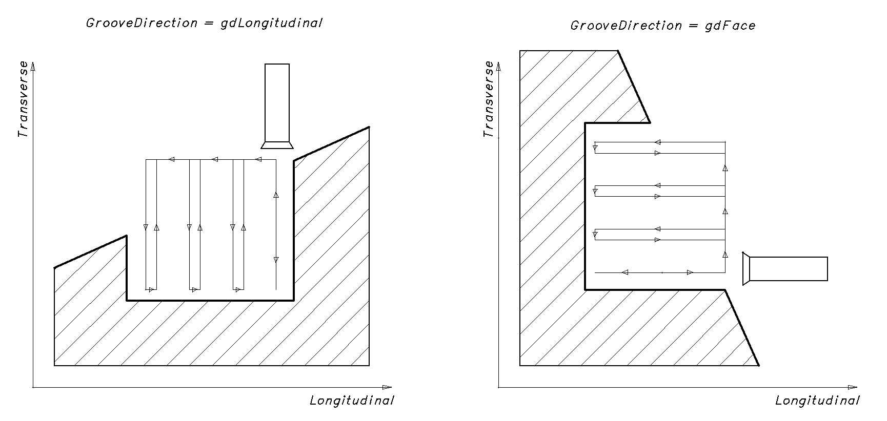
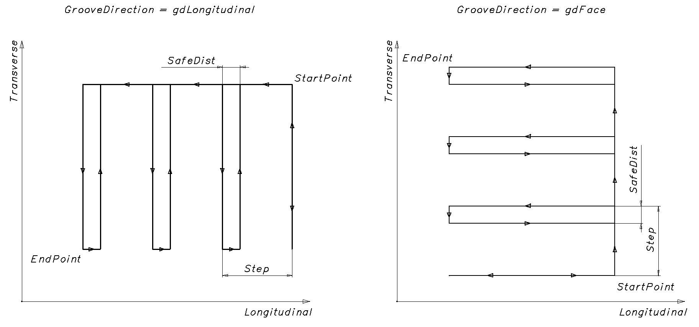
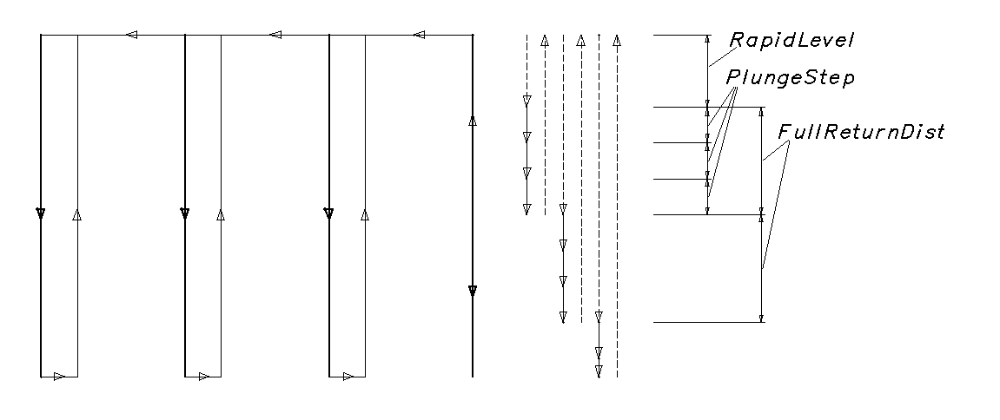
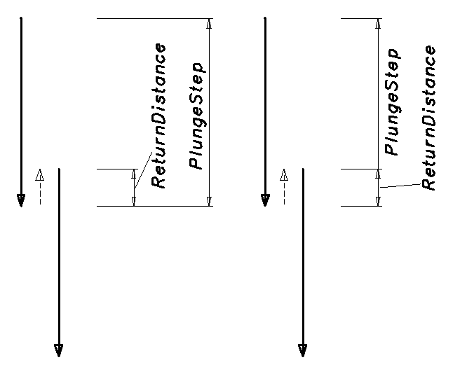

# Drehzyklus Einstechen

**INCT_LatheGroovingCycleFormer** - Schnittstelle des CAM-Systems, die die Bildung der Bewegungen eines Drehzyklus zum Einstechen vereinfacht. Das Objekt, das diese Schnittstelle implementiert, gibt die Funktion **[INCT_CLData.CreateLatheCycleFormer](../../basic-interfaces/forming-of-the-toolpath-in-machine-axes/forming-of-the-toolpath-in-machine-axes.md), [INCT_GeomCLData.CreateLatheCycleFormer](../../basic-interfaces/forming-of-the-toolpath-in-geometric-axes/forming-of-the-toolpath-in-geometric-axes.md)** zurück, wenn sie mit dem Parameter **lctGrooving** aufgerufen wird.

**Zweck:**

Die Bewegungen in den verschiedenen Arten von Einstechzyklen folgen bei den unterschiedlichen Steuerungen im Allgemeinen demselben Ablauf:

1. Anfahren des Startpunkts oder des nächsten Eintauchpunkts im Eilgang.
2. Eintauchen auf die Einstichtiefe in einem Durchgang oder in mehreren Schritten um die Schnitttiefe im Arbeitsvorschub, mit Abheben zum Spanbrechen.
3. Rückkehr zur Startposition mit oder ohne Abheben im Übergangsvorschub.
4. Ist die Einstichbreite noch nicht erreicht, Rückkehr zu Schritt 1.

Beispiel eines solchen Zyklus für Sinumerik: CYCLE93.

Mit dem Generator lässt sich der Werkzeugweg aus vorgegebenen Parametern bilden: Anfangs- und Endpunkt des Einstichs, Schritt in der Einstichbreite, Schnitttiefe, Abhebebetrag usw. Außerdem können auf jedem Abschnitt die für einen bestimmten Zyklus nötigen Besonderheiten ergänzt, Art oder Wert des Vorschubs geändert oder vom Generator vorbereitete Werkzeugbewegungen übersprungen werden.

**Verwendung des Generators:**

Wir empfehlen, für jeden neuen Zyklus in einem Satz des NC-Programms einen neuen Generator zu erstellen, außer wenn ein Zyklus in einem neuen Satz wiederholt wird. Die Schnittstelle des alten Generators muss daher beim Erstellen eines neuen Generators oder beim Beenden des Interpreters freigegeben werden.

Um die Befehle für den Werkzeugweg entlang des Zyklus zu bilden, sind folgende Schritte nötig:

1. Die Schnittstelle des Generators abfragen (**[INCT_CLData.CreateLatheCycleFormer](../../basic-interfaces/forming-of-the-toolpath-in-machine-axes/forming-of-the-toolpath-in-machine-axes.md), [INCT_GeomCLData.CreateLatheCycleFormer](../../basic-interfaces/forming-of-the-toolpath-in-geometric-axes/forming-of-the-toolpath-in-geometric-axes.md)**).
2. Die Indizes der Längs- und Querachse festlegen, entlang derer die Bewegungen ausgeführt werden (**Set_AxisIndexes**).
3. Den Anfangspunkt des Einstichs festlegen (**Set_StartPoint**).
4. Den Endpunkt des Einstichs festlegen (**Set_EndPoint**).
5. Die Richtung des Einstichs festlegen (**Set_GrooveDirection**).
6. Den Schritt in der Einstichbreite festlegen (**Set_Step**).
7. Den Abhebebetrag für die Rückkehr festlegen (**Set_SafeDist**).
8. Die Schnitttiefe in axialer Richtung festlegen (**Set_PlungeStep**).
9. Den Abhebebetrag zum Spanbrechen festlegen (**Set_ReturnDistance**).
10. Einen Ereignishandler des Zyklus zuweisen (**Set_Events**), wenn der Werkzeugweg des Zyklus geändert werden soll.
11. Die Befehle für den Werkzeugweg entlang des Zyklus bilden (**MakeWorkpath**).

**Beschreibung der Schnittstellenmethoden:**

| Methode | Beschreibung der Methode |
| --- | --- |
| **Set_AxisIndexes** | Die Methode legt die Indizes der Längs- und Querachse fest, entlang derer die Bewegungen bei der Bildung des Werkzeugwegs des Zyklus ausgeführt werden. Eingabeparameter: **Value** (**TNCLCAxisIndexes**) - **Transverse** (Ganzzahl) - Index der Querachse, **Longitudinal** (Ganzzahl) - Index der Längsachse. Keine Ausgabeparameter. |
| **Get_AxisIndexes** | Die Funktion gibt die Indizes der Längs- und Querachse zurück, entlang derer die Bewegungen bei der Bildung des Werkzeugwegs des Zyklus ausgeführt werden (**TNCLCAxisIndexes**). Keine Eingabeparameter. |
| **Set_StartPoint** | Die Methode legt die Koordinaten des Anfangspunkts des Einstichs fest. Eingabeparameter: **Value** (**TNC2DPoint**) - Koordinaten des Anfangspunkts (**Transverse** - quer, **Longitudinal** - längs). Keine Ausgabeparameter. |
| **Get_StartPoint** | Die Funktion gibt die Koordinaten des Anfangspunkts des Einstichs zurück (**TNC2DPoint**). Keine Eingabeparameter. |
| **Set_EndPoint** | Die Methode legt die Koordinaten des Endpunkts des Einstichs fest. Eingabeparameter: **Value** (**TNC2DPoint**) - Koordinaten des Endpunkts. Keine Ausgabeparameter. |
| **Get_EndPoint** | Die Funktion gibt die Koordinaten des Endpunkts des Einstichs zurück (**TNC2DPoint**). Keine Eingabeparameter. |
| **Set_GrooveDirection** | Die Methode legt die Richtung des Einstichs fest. Eingabeparameter: **Value** (**TNCGrooveDirection**) - Richtung des Einstichs. **gdLongitudinal** - Längseinstich; **gdFace** - Planeinstich. Keine Ausgabeparameter. |
| **Get_GrooveDirection** | Die Funktion gibt die Richtung des Einstichs zurück (**TNCGrooveDirection**). Keine Eingabeparameter. |
| **Set_Step** | Die Methode legt den Schritt in der Einstichbreite in radialer Richtung fest. Eingabeparameter: **Value** (Gleitkommazahl) - Schritt. Keine Ausgabeparameter. |
| **Get_Step** | Die Funktion gibt den Schritt in der Einstichbreite in radialer Richtung zurück (Gleitkommazahl). Keine Eingabeparameter. |
| **Set_SafeDist** | Die Methode legt den seitlichen Abhebebetrag vor dem Herausfahren des Werkzeugs fest. Eingabeparameter: **Value** (Gleitkommazahl) - seitlicher Abhebebetrag. Keine Ausgabeparameter. |
| **Get_SafeDist** | Die Funktion gibt den seitlichen Abhebebetrag vor dem Herausfahren des Werkzeugs zurück (Gleitkommazahl). Keine Eingabeparameter. |
| **Set_PlungeStep** | Die Methode legt die Schrittweite beim Eintauchen auf die Einstichtiefe fest. Eingabeparameter: **Value** (Gleitkommazahl) - Schrittweite. Keine Ausgabeparameter. |
| **Get_PlungeStep** | Die Funktion gibt die Schrittweite beim Eintauchen auf die Einstichtiefe zurück (Gleitkommazahl). Keine Eingabeparameter. |
| **Set_ReturnDistance** | Die Methode legt den Abhebebetrag nach oben zum Spanbrechen fest. Eingabeparameter: **Value** (Gleitkommazahl) - Abhebebetrag nach oben. Keine Ausgabeparameter. |
| **Get_ReturnDistance** | Die Funktion gibt den Abhebebetrag nach oben zum Spanbrechen zurück (Gleitkommazahl). Keine Eingabeparameter. |
| **Set_ReturnDistanceInsidePlungeStep** | Die Methode legt das Kennzeichen „Abheben innerhalb des Eintauchschritts“ fest. **True** - das Abheben ist im Eintauchschritt enthalten, **False** - das Abheben wird zum Eintauchschritt addiert. Eingabeparameter: **Value** (boolesch) - Wert des Kennzeichens. Keine Ausgabeparameter.  |
| **Get_ReturnDistanceInsidePlungeStep** | Die Funktion gibt das Kennzeichen „Abheben innerhalb des Eintauchschritts“ zurück. Keine Eingabeparameter. |
| **Set_RapidLevel** | Die Methode legt die Ebene der Eilgangbewegung fest. Eingabeparameter: **Value** (Gleitkommazahl) - Ebene der Eilgangbewegung. Keine Ausgabeparameter. |
| **Get_RapidLevel** | Die Funktion gibt die Ebene der Eilgangbewegung zurück. Keine Eingabeparameter. |
| **Set_FullReturnDist** | Die Methode legt den Rückzugsweg bis zur Ebene der Eilgangbewegung fest. Eingabeparameter: **Value** (Gleitkommazahl) - Rückzugsweg bis zur Ebene der Eilgangbewegung. Keine Ausgabeparameter. |
| **Get_FullReturnDist** | Die Funktion gibt den Rückzugsweg bis zur Ebene der Eilgangbewegung zurück. Keine Eingabeparameter. |
| **Set_Feedrate** | Die Methode legt den Arbeitsvorschub fest. Eingabeparameter: **Value** (Gleitkommazahl) - Arbeitsvorschub. Keine Ausgabeparameter. |
| **Get_Feedrate** | Die Funktion gibt den Arbeitsvorschub zurück. Keine Eingabeparameter. |
| **Set_MPM** | Die Methode legt die Maßeinheit des Arbeitsvorschubs fest. Eingabeparameter: **Value** (boolesch) - Maßeinheit des Arbeitsvorschubs. True - mm/min, False - mm/U. Keine Ausgabeparameter. |
| **Get_MPM** | Die Funktion gibt die Maßeinheit des Arbeitsvorschubs zurück. Keine Eingabeparameter. |
| **Set_Events** | Die Methode weist Ereignisse zur Steuerung des Zyklus zu. Mit Ereignissen lassen sich auf jedem gebildeten Abschnitt des Werkzeugwegs die für einen bestimmten Zyklus nötigen Besonderheiten ergänzen, Art oder Wert des Vorschubs ändern oder vom Generator vorbereitete Werkzeugbewegungen überspringen. Eingabeparameter: **Value** (**INCT_LatheCycleEvents**) - Objekt, das die Ereignisse implementiert. Ausführliche Beschreibung unten. Keine Ausgabeparameter. |
| **Get_Events** | Die Funktion gibt das mit dem Generator verbundene Objekt zurück, das die Ereignisse implementiert (**INCT_LatheCycleEvents**). Keine Eingabeparameter. |
| **MakeWorkpath** | Die Methode bildet den Werkzeugweg des Zyklus nach den angegebenen Parametern. |

**INCT_LatheCycleEvents** - Schnittstelle, die im Interpreter implementiert wird und mit der sich das Verhalten eines Drehzyklus steuern lässt. Die Schnittstelle besteht aus einer Reihe von Ereignismethoden, die bei den Bewegungen des Werkzeugs innerhalb des Generators ausgeführt werden. Mit ihnen lassen sich auf jedem gebildeten Abschnitt die für einen bestimmten Zyklus nötigen Besonderheiten ergänzen (Verweilzeit, orientierter Spindelhalt usw.), die Vorschubart ändern oder vom Generator vorbereitete Werkzeugbewegungen überspringen.

Sind dem Generator Ereignisse zugewiesen, besteht jede Bewegung des Werkzeugs innerhalb des Generators aus 3 Schritten:

1. Die Methode **INCT_LatheCycleEvents.BeforeMove** wird ausgeführt. Ihr werden die vom Zyklus festgelegten Werte übergeben: Bewegungsart, Koordinaten des Zielpunkts, Vorschubart.
2. Die Methode **INCT_LatheCycleEvents.OnMove** wird ausgeführt. Ihr werden übergeben: Bewegungsart, Koordinaten des Zielpunkts, Vorschubart und das Kennzeichen, ob die Bewegung ausgeführt wurde. Alle Parameter außer der Bewegungsart können in der Implementierung geändert werden. Je nach dem in **OnMove** gesetzten Kennzeichen fährt das Werkzeug mit dem angegebenen Vorschub zum angegebenen Punkt oder die Bewegung entfällt.
3. Die Methode **INCT_LatheCycleEvents.AfterMove** wird ausgeführt. Ihr werden die von **OnMove** zurückgegebenen Werte übergeben: Bewegungsart, Koordinaten des Zielpunkts, Vorschubart.

**Beschreibung der Schnittstellenmethoden:**

| Methode | Beschreibung der Methode | Verwendung |
| --- | --- | --- |
| **BeforeMove** | Die Methode wird vor jeder Bewegung des Werkzeugs bei der Bildung des Werkzeugwegs des Zyklus ausgeführt. Eingabeparameter: **MoveType** (**TNCLatheCycleMoveType**) - Bewegungsart, Beschreibung siehe unten; **Point** (**TNC2DPoint**) - Koordinaten des Zielpunkts (**Transverse** - quer, **Longitudinal** - längs); **Feed** (**TNCFeedType**) - Vorschubart. **lmMoveToStartPoint** - Fahren zum Startpunkt des Einstichs; **lmMoveToNextGroove** - Fahren zum nächsten Schritt des Einstichs; **lmMoveToNextLevel** - Fahren auf die nächste Eintauchtiefe; **lmMoveToBottomLevel** - Fahren auf den Grund des Einstichs; **lmChipBreaking** - Spanbrechen; **lmRetractSideways** - seitliches Abheben vor dem Herausfahren des Werkzeugs; **lmReturnToTopLevel** - Rückkehr auf die Ausgangsebene; **lmReturnToStartPoint** - Rückkehr zum Startpunkt; **lmCutTheThread** - Gewindeschneiden (für den Zyklus [Gewindeschneiden mit Drehzyklus](../turning-cycle-threading/turning-cycle-threading.md)); **lmApproach** - Anfahren (für den Zyklus [Bearbeitungszyklus beim Drehen](../turning-machining-cycle/turning-machining-cycle.md)); **lmRetract** - Abfahren (für den Bearbeitungszyklus beim Drehen); **lmWorkingMove** - Arbeitsbewegung (für den Bearbeitungszyklus beim Drehen); **lmOverlapContour** - Durchgang entlang der Kontur (für den Bearbeitungszyklus beim Drehen); **lmReturnToSafeDistance** - Rückkehr auf den Sicherheitsabstand (für den Bearbeitungszyklus beim Drehen); **lmTtransition** - Übergang (für den Bearbeitungszyklus beim Drehen); **lmMoveToRapidLevel** - Rückkehr auf die Ebene der Eilgangbewegung (Herausfahren des Werkzeugs). Keine Ausgabeparameter. | Sollen vor einer Bewegung bestimmte Befehle ausgeführt werden, werden sie in der Implementierung der Methode hinzugefügt. Soll zum Beispiel vor dem Einstechen die Kühlung der Maschine eingeschaltet werden, wird in der Implementierung von **BeforeMove** bei **MoveType** = **lmMoveToStartPoint** **INCT_CLData.AddCoolant** mit den passenden Parametern aufgerufen. |
| **OnMove** | Die Methode wird unmittelbar vor jeder Bewegung des Werkzeugs bei der Bildung des Werkzeugwegs des Zyklus ausgeführt. Eingabeparameter: **MoveType** (**TNCLatheCycleMoveType**) - Bewegungsart, Beschreibung siehe oben; Ein- und Ausgabeparameter: **Point** (**TNC2DPoint**) - Koordinaten des Zielpunkts; **Feed** (**TNCFeedType**) - Vorschubart; **Handled** (boolesch) - Kennzeichen, ob die Bewegung in der Implementierung ausgeführt wurde (True - ausgeführt, False - nicht ausgeführt). Hat **Handled** nach dem Aufruf von **OnMove** den Wert True, wurde die Bewegung in der Implementierung von **OnMove** ausgeführt, und der Generator fügt dem Werkzeugweg keinen Bewegungsbefehl hinzu. Hat **Handled** nach dem Aufruf von **OnMove** den Wert False, geht der Generator davon aus, dass die Bewegung nicht ausgeführt wurde, und fügt dem Werkzeugweg einen Befehl für die Bewegung zum Punkt **Point** mit der Vorschubart **Feed** hinzu. | Zum Überschreiben des Zielpunkts oder des Vorschubs oder zum Überspringen der Bewegung. Soll zum Beispiel beim Rückzug auf die Ausgangsebene nach dem Einstechen auf Eilgang umgeschaltet werden, muss in der Implementierung von **OnMove** bei **MoveType** = **lmReturnToTopLevel** der zurückgegebene Parameter **Feed** auf **ffRapid** gesetzt werden (Vorschubart siehe **[OutStandardFeed](../../basic-interfaces/forming-of-the-toolpath-in-machine-axes/forming-of-the-toolpath-in-machine-axes.md)**). Soll das Werkzeug zu einem anderen Punkt als dem vom Zyklus berechneten fahren, muss der zurückgegebene Parameter **Point** von **OnMove** geändert werden. Soll die Bewegung zum berechneten Punkt nicht ausgeführt werden, muss in der Implementierung von **OnMove** der Parameter **Handled** auf True gesetzt werden. |
| **AfterMove** | Die Methode wird nach jeder Bewegung des Werkzeugs bei der Bildung des Werkzeugwegs des Zyklus ausgeführt, auch wenn die Bewegung in **OnMove** abgebrochen wurde. Eingabeparameter: **MoveType** (**TNCLatheCycleMoveType**) - Bewegungsart, Beschreibung siehe oben; **Point** (**TNC2DPoint**) - Koordinaten des Zielpunkts; **Feed** (**TNCFeedType**) - Vorschubart. Keine Ausgabeparameter. | Sollen nach einer Bewegung bestimmte Befehle ausgeführt werden, werden sie in der Implementierung der Methode hinzugefügt. Soll zum Beispiel am Grund des Einstichs eine Verweilzeit eingefügt werden, wird in der Implementierung von **AfterMove** bei **MoveType** = **lmMoveToBottomLevel** **INCT_CLData.AddDelay** mit den passenden Parametern aufgerufen. |
