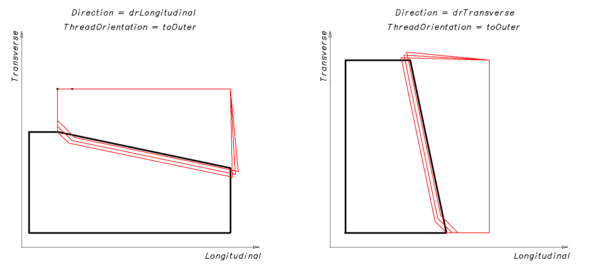
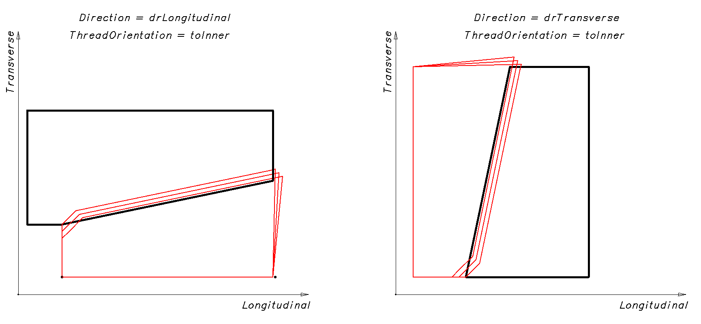
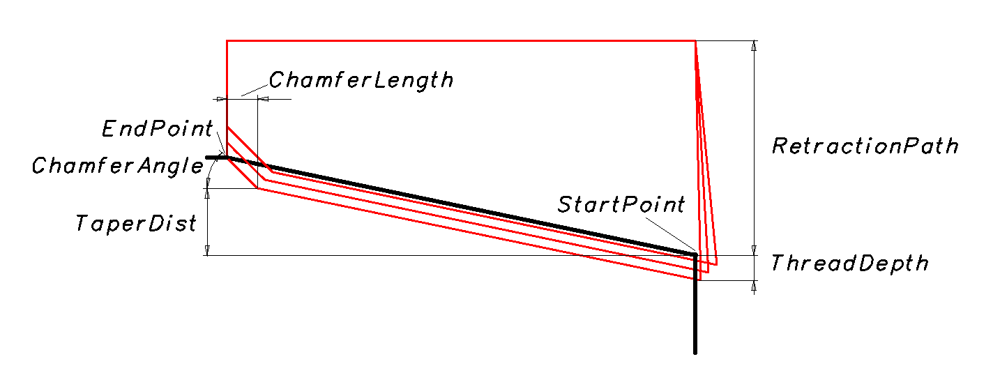

# Turning cycle threading

**INCT_LatheThreadCuttingCycleFormer** - a CAM system interface that simplifies forming the movements of a turning thread cutting cycle. The object implementing this interface is returned by the function **[INCT_CLData.CreateLatheCycleFormer](../../basic-interfaces/forming-of-the-toolpath-in-machine-axes/forming-of-the-toolpath-in-machine-axes.md), [INCT_GeomCLData.CreateLatheCycleFormer](../../basic-interfaces/forming-of-the-toolpath-in-geometric-axes/forming-of-the-toolpath-in-geometric-axes.md)** when it is called with the **lctThreadCutting** parameter.

**Purpose:**

The movements in the various types of turning thread cutting cycles generally follow the same tool path on different controllers:

1. Approach of the tool to the start point or to the point of the next start in the retraction plane at rapid traverse.
2. Movement to the thread start point at working feed.
3. Thread cutting to the end point at working feed.
4. Return to the retraction plane at rapid traverse.
5. If the number of passes (roughing and finishing) is not reached, returning to step 1.

Example of such a cycle: Sinumerik: CYCLE97.

The generator forms the tool path from the specified parameters: thread start and end points, retraction plane, number of thread starts, infeed method, infeed angle, etc. It also allows adding to any section of the tool path the features required by a particular cycle, changing the feed type or value, or skipping a tool movement prepared by the generator.

**Using the generator:**

We recommend creating a new turning cycle generator for each new cycle in a block of the NC program, except when the cycle is repeated in a new block. Therefore, the interface of the old generator must be released when a new one is created or when the interpreter finishes its work.

To form the tool movement commands along the cycle path, do the following:

1. Get the generator interface (**[INCT_CLData.CreateLatheCycleFormer](../../basic-interfaces/forming-of-the-toolpath-in-machine-axes/forming-of-the-toolpath-in-machine-axes.md), [INCT_GeomCLData.CreateLatheCycleFormer](../../basic-interfaces/forming-of-the-toolpath-in-geometric-axes/forming-of-the-toolpath-in-geometric-axes.md)**).
2. Set the indexes of the longitudinal and transverse axes along which the movements are made (**Set_AxisIndexes**).
3. Set the cycle parameters (**Set_ThreadOrientation**, **Set_ThreadDepth**, **Set_ThreadStep**, **Set_ThreadStartAngle**, **Set_StartPoint**, etc., see the description below).
4. Assign a cycle event handler (**Set_Events**) if the cycle path needs to be changed.
5. Form the tool movement commands along the cycle path (**MakeWorkpath**).

**Description of the interface methods:**

| Method | Method description |
| --- | --- |
| **Set_AxisIndexes** | The method sets the indexes of the longitudinal and transverse axes along which the movements are made when the cycle path is formed. Input parameters: **Value** (**TNCLCAxisIndexes**) - **Transverse** (integer) - index of the transverse axis, **Longitudinal** (integer) - index of the longitudinal axis. No output parameters. |
| **Get_AxisIndexes** | The function returns the indexes of the longitudinal and transverse axes along which the movements are made when the cycle path is formed (**TNCLCAxisIndexes**). No input parameters. |
| **Set_Direction** | The method sets the direction of the thread cutting cycle. Input parameter: **Value** (**TNCThreadCuttingDirection**) - cycle direction: **drLongitudinal** - longitudinal, **drTransverse** - transverse. No output parameters. |
| **Get_Direction** | The function returns the cycle direction (**TNCThreadCuttingDirection**). No input parameters. |
| **Set_ThreadOrientation** | The method sets the thread orientation type. Input parameter: **Value** (**TNCThreadOrientation**, see **[INCT_CLData.AddSinglePassThread](../../basic-interfaces/forming-of-the-toolpath-in-machine-axes/forming-of-the-toolpath-in-machine-axes.md)**) - thread orientation type. No output parameters. |
| **Get_ThreadOrientation** | The function returns the thread orientation type (**TNCThreadOrientation**). No input parameters. |
| **Set_ThreadDepth** | The method sets the thread depth. Input parameter: **Value** (real number) - thread depth. No output parameters. |
| **Get_ThreadDepth** | The function returns the thread depth (real number). No input parameters. |
| **Set_ThreadStep** | The method sets the thread pitch. Input parameter: **Value** (real number) - thread pitch. No output parameters. |
| **Get_ThreadStep** | The function returns the thread pitch (real number). No input parameters. |
| **Set_ThreadStartAngle** | The method sets the thread start angle. Input parameter: **Value** (real number) - thread start angle. No output parameters. |
| **Get_ThreadStartAngle** | The function returns the thread start angle (real number). No input parameters. |
| **Set_ThreadStartCount** | The method sets the number of thread starts. Input parameter: **Value** (integer) - number of thread starts. No output parameters. |
| **Get_ThreadStartCount** | The function returns the number of thread starts (integer). No input parameters. |
| **Set_StartPoint** | The method sets the coordinates of the thread start point. Input parameter: **Value** (**TNC2DPoint**) - coordinates of the thread start point. No output parameters. |
| **Get_StartPoint** | The function returns the coordinates of the thread start point (**TNC2DPoint**). No input parameters. |
| **Set_EndPoint** | The method sets the coordinates of the thread end point. Input parameter: **Value** (**TNC2DPoint**) - coordinates of the thread end point. No output parameters. |
| **Get_EndPoint** | The function returns the coordinates of the thread end point (**TNC2DPoint**). No input parameters. |
| **Set_TaperDist** | The method sets the taper between the thread start and end points. Input parameter: **Value** (real number) - taper between the thread start and end points. No output parameters. |
| **Get_TaperDist** | The function returns the taper between the thread start and end points (real number). No input parameters. |
| **Set_ChamferLength** | The method sets the length of the chamfer for the tool runout at the thread end. Input parameter: **Value** (real number) - length of the chamfer for the tool runout at the thread end. No output parameters. |
| **Get_ChamferLength** | The function returns the length of the chamfer for the tool runout at the thread end (real number). No input parameters. |
| **Set_ChamferAngle** | The method sets the chamfer angle in degrees. Input parameter: **Value** (real number) - chamfer angle in degrees. No output parameters. |
| **Get_ChamferAngle** | The function returns the chamfer angle in degrees (real number). No input parameters. |
| **Set_RetractionPath** | The method sets the level of the retraction plane. Input parameter: **Value** (real number) - level of the retraction plane. No output parameters. |
| **Get_RetractionPath** | The function returns the set level of the retraction plane (real number). No input parameters. |
| **Set_RunInPath** | The method sets the run-in path. Input parameter: **Value** (real number) - run-in path. No output parameters. |
| **Get_RunInPath** | The function returns the run-in path (real number). No input parameters. |
| **Set_RunOutPath** | The method sets the run-out path. Input parameter: **Value** (real number) - run-out path. No output parameters. |
| **Get_RunOutPath** | The function returns the run-out path (real number). No input parameters. |
| **Set_ThreadAngle** | The method sets the thread profile angle. Input parameter: **Value** (real number) - thread profile angle. No output parameters. |
| **Get_ThreadAngle** | The function returns the thread profile angle (real number). No input parameters. |
| **Set_InclinationAngle** | The method sets the angle of one of the thread profile flanks relative to the vertical. Input parameter: **Value** (real number) - angle value. No output parameters. |
| **Get_InclinationAngle** | The function returns the angle of one of the thread profile flanks relative to the vertical (real number). No input parameters. |
| **Set_SequenceType** | The method sets the infeed method for roughing passes. Input parameter: **Value** (**TNCThreadSequenceType**) - infeed method for roughing passes. **stRadial** - radial; **stFlank** - flank; **stModifiedFlank** - modified flank (at an angle); **stAlternateFlank** - alternate flank. No output parameters. |
| **Get_SequenceType** | The function returns the infeed method for roughing passes (**TNCThreadSequenceType**). No input parameters. |
| **Set_PlungeAngle** | The method sets the infeed angle for the **stModifiedFlank** strategy. Input parameter: **Value** (real number) - infeed angle in degrees. No output parameters. |
| **Get_PlungeAngle** | The function returns the infeed angle for the **stModifiedFlank** strategy (real number). No input parameters. |
| **Set_DepthIsEqual** | The method sets the way the depth of cut is determined. Input parameter: **Value** (boolean) - way of determining the depth of cut. True - constant depth, False - constant cutting area. No output parameters. |
| **Get_DepthIsEqual** | The function returns the way the depth of cut is determined (boolean). No input parameters. |
| **Set_IsPassCountDefined** | The method sets the method of determining the depth of cut. Input parameter: **Value** (boolean) - method of determining the depth of cut. True - by the number of passes, False - by the initial depth. No output parameters. |
| **Get_IsPassCountDefined** | The function returns the method of determining the depth of cut (boolean). No input parameters. |
| **Set_MinCutDepth** | The method sets the minimum possible depth of a roughing pass. Input parameter: **Value** (real number) - minimum possible depth of a roughing pass. No output parameters. |
| **Get_MinCutDepth** | The function returns the minimum possible depth of a roughing pass (real number). No input parameters. |
| **Set_FirstCutDepth** | The method sets the depth of the first roughing pass. Input parameter: **Value** (real number) - depth of the first roughing pass. No output parameters. |
| **Get_FirstCutDepth** | The function returns the depth of the first roughing pass (real number). No input parameters. |
| **Set_RoughPassCount** | The method sets the number of roughing passes. Input parameter: **Value** (integer) - number of roughing passes. No output parameters. |
| **Get_RoughPassCount** | The function returns the number of roughing passes (integer). No input parameters. |
| **Set_FinishPassCount** | The method sets the number of finishing passes. Input parameter: **Value** (integer) - number of finishing passes. No output parameters. |
| **Get_FinishPassCount** | The function returns the number of finishing passes (integer). No input parameters. |
| **Set_FinishPassDepth** | The method sets the depth of the finishing passes. Input parameter: **Value** (real number) - depth of the finishing passes. No output parameters. |
| **Get_FinishPassDepth** | The function returns the depth of the finishing passes (real number). No input parameters. |
| **Set_Feedrate** | The method sets the working feed. Input parameter: **Value** (real number) - working feed. No output parameters. |
| **Get_Feedrate** | The function returns the working feed (real number). No input parameters. |
| **Set_MPM** | The method sets the working feed units. Input parameter: **Value** (boolean) - working feed units. True - mm/min, False - mm/rev. No output parameters. |
| **Get_MPM** | The function returns the working feed units (boolean). No input parameters. |
| **Set_Events** | The method assigns events that control the cycle behavior. Events allow adding to any section of the tool path the features required by a particular cycle (dwell, oriented spindle stop, etc.), changing the feed type or value, or skipping a tool movement prepared by the generator. Input parameter: **Value** (interface) - object implementing the interfaces **INCT_LatheCycleEvents**, **INCT_LatheThreadCuttingCycleEvents**. See the detailed description below. No output parameters. |
| **Get_Events** | The function returns the object implementing the events that is linked to the cycle generator (**INCT_LatheCycleEvents**, **INCT_LatheThreadCuttingCycleEvents**). No input parameters. |
| **MakeWorkpath** | The method forms the cycle path from the specified parameters. |

**INCT_LatheThreadCuttingCycleFormer2** - a CAM system interface that simplifies forming the movements of a turning thread cutting cycle.

**Description of the interface methods:**

| Method | Method description |
| --- | --- |
| **Set_Approach** | The method sets the approach type. Input parameter: **Value** (**TNCThreadApproach**) - approach type. **taOutside** - from outside (default); **taIndise** - from inside. No output parameters. |
| **Get_Approach** | The function returns the approach type (**TNCThreadApproach**). No input parameters. |
| **Get_SignLongitudinal** | The function returns the sign of the movement along the longitudinal axis (integer). |
| **Get_SignTransverse** | The function returns the sign of the movement along the transverse axis (integer). |

**INCT_LatheCycleEvents** - an interface implemented in the interpreter that allows controlling the behavior of a turning cycle. It is described in detail in the article [Turning cycle grooving](../turning-cycle-grooving/turning-cycle-grooving.md).

**INCT_LatheThreadCuttingCycleEvents** - an interface implemented in the interpreter that allows controlling thread cutting. It contains the event method **OnThread**, executed when a thread is cut inside the generator, and the events of calculating the passes **OnCalcBaseDepth**, **OnCalcCount**, **OnCalcNextDepth**, **OnCalcPoint**.

**Description of the interface methods:**

<table>
<thead>
<tr><th>Method</th><th>Method description</th><th>Description of use</th></tr>
</thead>
<tbody>
<tr><td><strong>OnThread</strong></td><td>
The method is executed before each thread cut when the cycle path is formed. Its implementation allows changing the thread parameters for the selected iteration.

Input parameters: <strong>Orient</strong> (<strong>TNCThreadOrientation</strong>) - thread orientation; <strong>LeadType</strong> (<strong>TNCThreadLeadType</strong>) - way of setting the thread pitch; <strong>Step</strong> (real number) - thread pitch; <strong>StartAngle</strong> (real number) - initial angular position of the spindle in degrees (used for multi-start threads). See <strong><a href="../../basic-interfaces/forming-of-the-toolpath-in-machine-axes/forming-of-the-toolpath-in-machine-axes.md">INCT_CLData.AddSinglePassThread</a></strong>.

Input and output parameters: <strong>Handled</strong> (boolean) - flag of whether the movement has been made inside the implementation (True - the movement has been made, False - it has not).

If <strong>Handled</strong> is True after the <strong>OnThread</strong> call, the thread has been cut inside the <strong>OnThread</strong> implementation, and the cycle generator does not add a thread cutting command to the tool path.

If <strong>Handled</strong> is False after the <strong>OnThread</strong> call, the generator considers that the thread has not been cut inside the <strong>OnThread</strong> implementation and adds a thread cutting command to the tool path.
</td><td rowspan="5">To replace the thread cutting parameters, or to set an algorithm of changing the thread at different passes that the generator does not implement.</td></tr>
<tr><td><strong>OnCalcBaseDepth</strong></td><td>
The method is executed in the <strong>IsPassCountDefined = True</strong> mode after the base (first) depth is calculated. Its implementation allows changing the base depth.

Input and output parameter: <strong>BaseDepth</strong> (real number) - base depth.
</td></tr>
<tr><td><strong>OnCalcCount</strong></td><td>
The method is executed in the <strong>IsPassCountDefined = False</strong> mode after the number of passes is calculated. Its implementation allows changing the number of passes.

Input and output parameter: <strong>Count</strong> (integer) - number of passes.
</td></tr>
<tr><td><strong>OnCalcNextDepth</strong></td><td>
The method is executed when the next depth is calculated (if the number of passes is one or more). Its implementation allows changing the depth for the iteration.

Input parameter: <strong>Iteration</strong> (integer) - iteration (pass) number;

Input and output parameter: <strong>Depth</strong> (real number) - depth at the iteration.
</td></tr>
<tr><td><strong>OnCalcPoint</strong></td><td>
The method is executed when the coordinates of the tool position for the next movement are calculated. Its implementation allows changing the coordinates for the iteration.

Input parameter: <strong>Iteration</strong> (integer) - iteration (pass) number;

Input and output parameter: <strong>Point</strong> (<strong>TNC2DPoint</strong>) - coordinates of the tool position at the iteration.
</td></tr>
</tbody>
</table>
