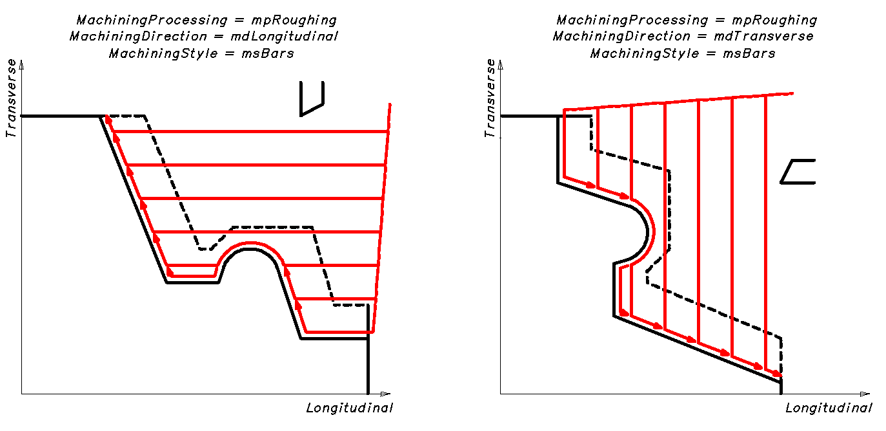
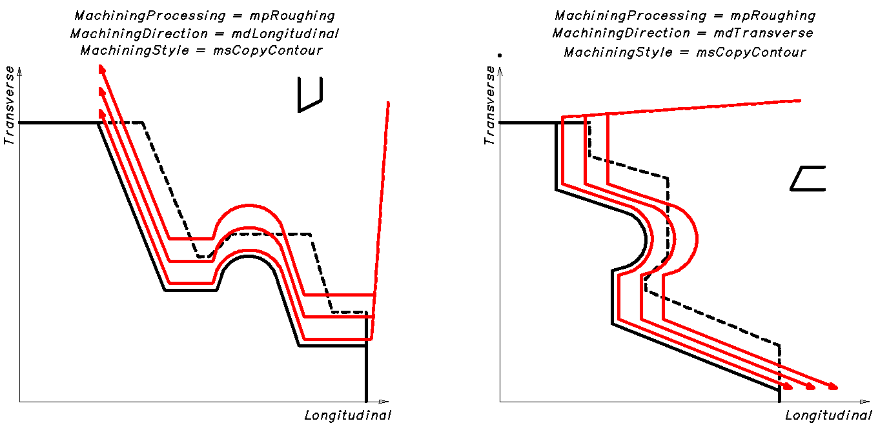
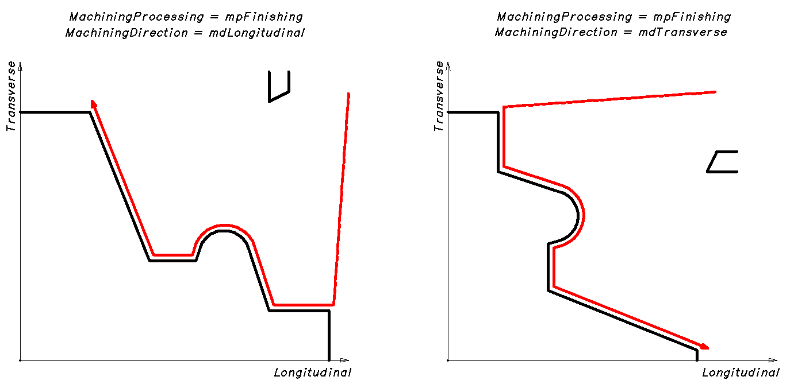
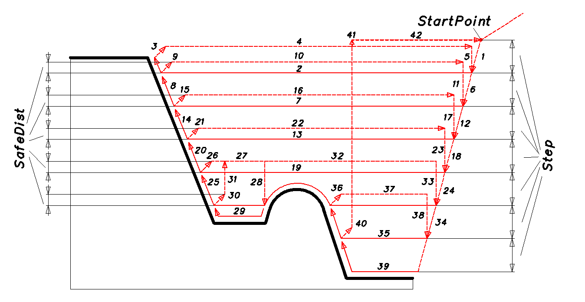

# Bearbeitungszyklus beim Drehen

**INCT_LatheStockRemovalCycleFormer** - Schnittstelle des CAM-Systems, die die Bildung der Bewegungen eines Drehzyklus entlang einer vorgegebenen Kontur vereinfacht. Das Objekt, das diese Schnittstelle implementiert, gibt die Funktion **[INCT_CLData.CreateLatheCycleFormer](../../basic-interfaces/forming-of-the-toolpath-in-machine-axes/forming-of-the-toolpath-in-machine-axes.md), [INCT_GeomCLData.CreateLatheCycleFormer](../../basic-interfaces/forming-of-the-toolpath-in-geometric-axes/forming-of-the-toolpath-in-geometric-axes.md)** zurück, wenn sie mit dem Parameter **lctStockRemoval** aufgerufen wird.

Die Schnittstelle **INCT_LatheStockRemovalCycleFormer2** erweitert die Möglichkeiten des Generators für Drehzyklen entlang einer vorgegebenen Kontur. Die neuen Eigenschaften und Methoden sind unten beschrieben. Das Objekt, das diese Schnittstelle implementiert, gibt die Funktion **[CreateLatheCycleFormer](../../basic-interfaces/forming-of-the-toolpath-in-geometric-axes/forming-of-the-toolpath-in-geometric-axes.md)** zurück (wie bei **INCT_LatheStockRemovalCycleFormer**).

**Zweck:**

Die Bewegungen in den verschiedenen Arten von Drehzyklen entlang einer vorgegebenen Kontur folgen bei den unterschiedlichen Steuerungen im Allgemeinen demselben Ablauf:

1. Anfahren des Startpunkts oder des Punkts des nächsten Zustellschritts im Eilgang.
2. Anfahren der Ebene des Schruppdurchgangs im Eilgang.
3. Fahren zum Punkt des Schruppdurchgangs parallel zur Längsachse im Arbeitsvorschub (Schruppdurchgang).
4. Rückkehr parallel zur Kontur unter Berücksichtigung des Schlichtaufmaßes bis zum letzten Punkt des Schruppdurchgangs im Arbeitsvorschub (Abschluss des Schruppdurchgangs).
5. Rückkehr zur Rückzugsebene im Eilgang.
6. Rückkehr zu Schritt 1, wenn die Bearbeitungstiefe noch nicht erreicht ist.
7. Schlichten der Kontur (Anfahren des Startpunkts im Eilgang, Schlichten entlang der Kontur im Arbeitsvorschub, Abfahren im Eilgang).

Beispiel eines solchen Zyklus für Sinumerik: CYCLE95.

Mit dem Generator lässt sich der Werkzeugweg aus vorgegebenen Parametern bilden: Konturverlauf, Rückzugsebene, Zustellung, Art und Richtung der Bearbeitung usw. Außerdem können auf jedem Abschnitt die für einen bestimmten Zyklus nötigen Besonderheiten ergänzt, Art oder Wert des Vorschubs geändert oder vom Generator vorbereitete Werkzeugbewegungen übersprungen werden.

**Verwendung des Generators:**

Wir empfehlen, für jeden neuen Zyklus in einem Satz des NC-Programms einen neuen Generator zu erstellen, außer wenn ein Zyklus in einem neuen Satz wiederholt wird. Die Schnittstelle des alten Generators muss daher beim Erstellen eines neuen Generators oder beim Beenden des Interpreters freigegeben werden.

Um die Befehle für den Werkzeugweg entlang des Zyklus zu bilden, sind folgende Schritte nötig:

1. Die Schnittstelle des Generators abfragen (**[INCT_CLData.CreateLatheCycleFormer](../../basic-interfaces/forming-of-the-toolpath-in-machine-axes/forming-of-the-toolpath-in-machine-axes.md), [INCT_GeomCLData.CreateLatheCycleFormer](../../basic-interfaces/forming-of-the-toolpath-in-geometric-axes/forming-of-the-toolpath-in-geometric-axes.md)**).
2. Die Indizes der Längs- und Querachse festlegen, entlang derer die Bewegungen ausgeführt werden (**Set_AxisIndexes**).
3. Die Parameter des Zyklus festlegen (**Set_NCProgram**, **Set_MachiningType**, **Set_MachiningDirection**, **Set_Overlap** usw., siehe unten).
4. Einen Ereignishandler des Zyklus zuweisen (**Set_Events**), wenn der Werkzeugweg des Zyklus geändert werden soll.
5. Die Befehle für den Werkzeugweg entlang des Zyklus bilden (**MakeWorkpath**).

**Beschreibung der Schnittstellenmethoden:**

<table>
<thead>
<tr><th>Methode</th><th>Beschreibung der Methode</th></tr>
</thead>
<tbody>
<tr><td><strong>Set_AxisIndexes</strong></td><td>
Die Methode legt die Indizes der Längs- und Querachse fest, entlang derer die Bewegungen bei der Bildung des Werkzeugwegs des Zyklus ausgeführt werden.

Eingabeparameter: <strong>Value</strong> (<strong>TNCLCAxisIndexes</strong>) - <strong>Transverse</strong> (Ganzzahl) - Index der Querachse, <strong>Longitudinal</strong> (Ganzzahl) - Index der Längsachse.

Keine Ausgabeparameter.
</td></tr>
<tr><td><strong>Get_AxisIndexes</strong></td><td>
Die Funktion gibt die Indizes der Längs- und Querachse zurück, entlang derer die Bewegungen bei der Bildung des Werkzeugwegs des Zyklus ausgeführt werden (<strong>TNCLCAxisIndexes</strong>).

Keine Eingabeparameter.
</td></tr>
<tr><td><strong>Set_Plane</strong></td><td>
Die Methode legt die aktuelle Ebene für das NC-Programm der Kontur fest. Ist keine Ebene angegeben, wird die Ebene verwendet, die beim Ermitteln der Konturgeometrie aktuell ist.

Eingabeparameter: <strong>Value</strong> (<strong>TNCPlaneType</strong>) - aktuelle Ebene für das NC-Programm der Kontur.

Keine Ausgabeparameter.
</td></tr>
<tr><td><strong>Get_Plane</strong></td><td>
Die Funktion gibt die aktuelle Ebene für das NC-Programm der Kontur zurück.

Keine Eingabeparameter.
</td></tr>
<tr><td><strong>Set_NCProgram</strong></td><td>
Die Methode übergibt dem Generator die Schnittstelle mit dem Text des NC-Programms der Kontur.

Eingabeparameter: <strong>Value</strong> (<strong>INCT_Program</strong>) - Schnittstelle mit dem Text des NC-Programms der Kontur.

Der Text der Kontur kann mit den Methoden <strong><a href="../../basic-interfaces/nc-program-management/nc-program-management.md">INCT_ProgramManager.GetPartByIndex, INCT_ProgramManager.GetPartByLabels</a></strong> abgefragt werden.

Keine Ausgabeparameter.
</td></tr>
<tr><td><strong>Get_NCProgram</strong></td><td>
Die Funktion gibt die Schnittstelle mit dem Text des NC-Programms der Kontur zurück (<strong>INCT_Program</strong>).

Keine Eingabeparameter.
</td></tr>
<tr><td><strong>Set_RecalcContourGeometry</strong></td><td>
Die Methode legt fest, ob das NC-Programm der Kontur interpretiert werden muss.

Eingabeparameter: <strong>Value</strong> (boolesch) - False - das NC-Programm der Kontur nicht erneut interpretieren, wenn es bereits interpretiert wurde, True - das NC-Programm der Kontur in jedem Fall interpretieren.
</td></tr>
<tr><td><strong>Get_RecalcContourGeometry</strong></td><td>
Die Funktion gibt zurück, ob das NC-Programm der Kontur interpretiert werden muss.

Keine Eingabeparameter.
</td></tr>
<tr><td><strong>Set_MachiningProcessing</strong></td><td>
Die Methode legt die Bearbeitungsart fest.

Eingabeparameter: <strong>Value</strong> (<strong>TNCMachiningProcessing</strong>) - Bearbeitungsart.

<strong>mpRoughing</strong> - Schruppen (mehrere Durchgänge unter Berücksichtigung von Aufmaß, Zustellung usw.); <strong>mpFinishing</strong> - Schlichten (nur ein Durchgang entlang der Kontur ohne Aufmaß).

Keine Ausgabeparameter.
</td></tr>
<tr><td><strong>Get_MachiningProcessing</strong></td><td>
Die Funktion gibt die Bearbeitungsart zurück.

Keine Eingabeparameter.
</td></tr>
<tr><td><strong>Set_MachiningType</strong></td><td>
Die Methode legt fest, ob innen oder außen bearbeitet wird.

Eingabeparameter: <strong>Value</strong> (<strong>TNCLatheMachiningType</strong>) - Art der Bearbeitung.

<strong>mtInside</strong> - innen; <strong>mtOutside</strong> - außen.

Keine Ausgabeparameter.
</td></tr>
<tr><td><strong>Get_MachiningType</strong></td><td>
Die Funktion gibt zurück, ob innen oder außen bearbeitet wird (<strong>TNCLatheMachiningType</strong>).

Keine Eingabeparameter.
</td></tr>
<tr><td><strong>Set_MachiningDirection</strong></td><td>
Die Methode legt die Bearbeitungsrichtung fest.

Eingabeparameter: <strong>Value</strong> (<strong>TNCLatheMachiningDirection</strong>) - Bearbeitungsrichtung.

<strong>mdLongitudinal</strong> - längs; <strong>mdTransverse</strong> - quer.

Keine Ausgabeparameter.
</td></tr>
<tr><td><strong>Get_MachiningDirection</strong></td><td>
Die Funktion gibt die Bearbeitungsrichtung zurück (<strong>TNCLatheMachiningDirection</strong>).

Keine Eingabeparameter.
</td></tr>
<tr><td><strong>Set_MachiningStyle</strong></td><td>
Die Methode legt die Bearbeitungsstrategie der Kontur beim Schruppen fest.

Eingabeparameter: <strong>Value</strong> (<strong>TNCLatheMachiningStyle</strong>) - Bearbeitungsstrategie. <strong>msBars</strong> - in jeder Iteration Bearbeitung parallel zur Achse (Längs- oder Querachse, je nach <strong>MachiningDirection</strong>); <strong>msCopyContour</strong> - in jeder Iteration Bearbeitung parallel zur Kontur (Konturwiederholung).

Keine Ausgabeparameter.
</td></tr>
<tr><td><strong>Get_MachiningStyle</strong></td><td>
Die Funktion gibt die Bearbeitungsstrategie der Kontur beim Schruppen zurück.

Keine Eingabeparameter.
</td></tr>
<tr><td><strong>Set_Overlap</strong></td><td>
Die Methode legt die Art des Überlaufs fest.

Eingabeparameter: <strong>Value</strong> (boolesch) - Art des Überlaufs. True - mit Rückkehr entlang der Kontur, False - mit direkter Rückkehr.

Keine Ausgabeparameter.
</td></tr>
<tr><td><strong>Get_Overlap</strong></td><td>
Die Funktion gibt die Art des Überlaufs zurück (boolesch).

Keine Eingabeparameter.
</td></tr>
<tr><td><strong>Set_AxialStock</strong></td><td>
Die Methode legt das axiale Aufmaß auf die Kontur fest.

Eingabeparameter: <strong>Value</strong> (Gleitkommazahl) - axiales Aufmaß auf die Kontur.

Keine Ausgabeparameter.
</td></tr>
<tr><td><strong>Get_AxialStock</strong></td><td>
Die Funktion gibt das axiale Aufmaß auf die Kontur zurück (Gleitkommazahl).

Keine Eingabeparameter.
</td></tr>
<tr><td><strong>Set_RadialStock</strong></td><td>
Die Methode legt das radiale Aufmaß auf die Kontur fest.

Eingabeparameter: <strong>Value</strong> (Gleitkommazahl) - radiales Aufmaß auf die Kontur.

Keine Ausgabeparameter.
</td></tr>
<tr><td><strong>Get_RadialStock</strong></td><td>
Die Funktion gibt das radiale Aufmaß auf die Kontur zurück (Gleitkommazahl).

Keine Eingabeparameter.
</td></tr>
<tr><td><strong>Set_ProfileStock</strong></td><td>
Die Methode legt das äquidistante Aufmaß auf die Kontur fest.

Eingabeparameter: <strong>Value</strong> (Gleitkommazahl) - äquidistantes Aufmaß auf die Kontur.

Keine Ausgabeparameter.
</td></tr>
<tr><td><strong>Get_ProfileStock</strong></td><td>
Die Funktion gibt das äquidistante Aufmaß auf die Kontur zurück (Gleitkommazahl).

Keine Eingabeparameter.
</td></tr>
<tr><td><strong>Set_StartPointMode</strong></td><td>
Die Methode legt fest, wie der Startpunkt der Kontur bestimmt wird.

Eingabeparameter: <strong>Value</strong> (<strong>TNCLatheStartPointMode</strong>) - Art der Festlegung des Startpunkts. <strong>spmCalcPoint</strong> - der Startpunkt wird vom Zyklus berechnet; <strong>spmSetPoint</strong> - der Startpunkt wird vorgegeben (siehe <strong>StartPoint</strong>).

Keine Ausgabeparameter.
</td></tr>
<tr><td><strong>Get_StartPointMode</strong></td><td>
Die Funktion gibt zurück, wie der Startpunkt der Kontur bestimmt wird.

Keine Eingabeparameter.
</td></tr>
<tr><td><strong>Set_StartPoint</strong></td><td>
Die Methode legt den Startpunkt des Zyklus fest (für <strong>StartPointMode = spmSetPoint</strong>).

Eingabeparameter: <strong>Value</strong> (TNC2DPoint) - Startpunkt des Zyklus.

Keine Ausgabeparameter.
</td></tr>
<tr><td><strong>Get_StartPoint</strong></td><td>
Die Funktion gibt den Startpunkt des Zyklus zurück.

Keine Eingabeparameter.
</td></tr>
<tr><td><strong>Set_EachReliefcutSeparately</strong></td><td>
Die Methode legt fest, wie Hinterschneidungen bearbeitet werden.

Eingabeparameter: <strong>Value</strong> (boolesch) - True - jede Hinterschneidung wird einzeln bearbeitet, False - alle Hinterschneidungen werden in einem Durchgang bearbeitet.

Keine Ausgabeparameter.
</td></tr>
<tr><td><strong>Get_EachReliefcutSeparately</strong></td><td>
Die Funktion gibt zurück, wie Hinterschneidungen bearbeitet werden.

Keine Eingabeparameter.
</td></tr>
<tr><td><strong>Set_DoReliefcutsInReverseOrder</strong></td><td>
Die Methode legt die Reihenfolge der Bearbeitung der Hinterschneidungen fest.

Eingabeparameter: <strong>Value</strong> (boolesch) - Reihenfolge der Bearbeitung der Hinterschneidungen. <strong>True</strong> - in umgekehrter Reihenfolge, <strong>False</strong> - in direkter Reihenfolge.

Keine Ausgabeparameter.
</td></tr>
<tr><td><strong>Get_DoReliefcutsInReverseOrder</strong></td><td>
Die Funktion gibt die Reihenfolge der Bearbeitung der Hinterschneidungen zurück.

Keine Eingabeparameter.
</td></tr>
<tr><td><strong>Set_StepType</strong></td><td>
Die Methode legt fest, wie die Zustellung beim Schruppen berechnet wird.

Eingabeparameter: <strong>Value</strong> (<strong>TNCLatheStepType</strong>) - Art der Berechnung der Zustellung beim Schruppen.

<strong>stConst</strong> - bei jedem Durchgang entspricht die Schnitttiefe der Zustellung (<strong>Set_Step</strong>); <strong>stCalcEvenly</strong> - der Generator berechnet für jeden Abschnitt (jede Hinterschneidung) aus der Zustellung (<strong>Set_Step</strong>) die Anzahl der Schritte und bearbeitet in gleichen Schritten (Schnitttiefe / Anzahl der Schritte).

Keine Ausgabeparameter.
</td></tr>
<tr><td><strong>Get_StepType</strong></td><td>
Die Funktion gibt die Art der Berechnung der Zustellung beim Schruppen zurück (<strong>TNCLatheStepType</strong>).

Keine Eingabeparameter.
</td></tr>
<tr><td><strong>Set_Step</strong></td><td>
Die Methode legt die Zustellung fest.

Eingabeparameter: <strong>Value</strong> (Gleitkommazahl) - Zustellung.

Keine Ausgabeparameter.
</td></tr>
<tr><td><strong>Get_Step</strong></td><td>
Die Funktion gibt die Zustellung zurück (Gleitkommazahl).

Keine Eingabeparameter.
</td></tr>
<tr><td><strong>Set_SafeDist</strong></td><td>
Die Methode legt den Abhebebetrag für die Rückkehr fest (seitliches Abheben vor dem Herausfahren des Werkzeugs).

Eingabeparameter: <strong>Value</strong> (Gleitkommazahl) - Abhebebetrag.

Keine Ausgabeparameter.
</td></tr>
<tr><td><strong>Get_SafeDist</strong></td><td>
Die Funktion gibt den Abhebebetrag für die Rückkehr zurück (Gleitkommazahl).

Keine Eingabeparameter.
</td></tr>
<tr><td><strong>Set_LengthChipBreaking</strong></td><td>
Die Methode legt die Weglänge für den Spanbruch fest.

Eingabeparameter: <strong>Value</strong> (Gleitkommazahl) - Weglänge für den Spanbruch.

Keine Ausgabeparameter.
</td></tr>
<tr><td><strong>Get_LengthChipBreaking</strong></td><td>
Die Funktion gibt die Weglänge für den Spanbruch zurück (Gleitkommazahl).

Keine Eingabeparameter.
</td></tr>
<tr><td><strong>Set_Feedrate</strong></td><td>
Die Methode legt den Arbeitsvorschub fest.

Eingabeparameter: <strong>Value</strong> (Gleitkommazahl) - Arbeitsvorschub.

Keine Ausgabeparameter.
</td></tr>
<tr><td><strong>Get_Feedrate</strong></td><td>
Die Funktion gibt den Arbeitsvorschub zurück.

Keine Eingabeparameter.
</td></tr>
<tr><td><strong>Set_MPM</strong></td><td>
Die Methode legt die Maßeinheit des Arbeitsvorschubs fest.

Eingabeparameter: <strong>Value</strong> (boolesch) - Maßeinheit des Arbeitsvorschubs. True - mm/min, False - mm/U.

Keine Ausgabeparameter.
</td></tr>
<tr><td><strong>Get_MPM</strong></td><td>
Die Funktion gibt die Maßeinheit des Arbeitsvorschubs zurück.

Keine Eingabeparameter.
</td></tr>
<tr><td><strong>Set_UseContourFeedrate</strong></td><td>
Die Methode legt fest, ob der im NC-Programm der Kontur angegebene Vorschub verwendet wird.

Eingabeparameter: <strong>Value</strong> (boolesch) - True - der im NC-Programm der Kontur angegebene Vorschub wird bei der Bearbeitung derselben Konturabschnitte verwendet, False - der in der Kontur angegebene Vorschub wird ignoriert.

Keine Ausgabeparameter.
</td></tr>
<tr><td><strong>Get_UseContourFeedrate</strong></td><td>
Die Funktion gibt zurück, ob der im NC-Programm der Kontur angegebene Vorschub verwendet wird.

Keine Eingabeparameter.
</td></tr>
<tr><td><strong>Set_Events</strong></td><td>
Die Methode weist Ereignisse zur Steuerung des Zyklus zu. Mit Ereignissen lassen sich auf jedem gebildeten Abschnitt des Werkzeugwegs die für einen bestimmten Zyklus nötigen Besonderheiten ergänzen (Verweilzeit, orientierter Spindelhalt usw.), Art oder Wert des Vorschubs ändern oder vom Generator vorbereitete Werkzeugbewegungen überspringen.

Eingabeparameter: <strong>Value</strong> (Schnittstelle) - Objekt, das die Schnittstellen <strong>INCT_LatheCycleEvents</strong> (ausführlich beschrieben im Artikel <a href="../turning-cycle-grooving/turning-cycle-grooving.md">Drehzyklus Einstechen</a>) und <strong>INCT_LatheCycleArcEvents</strong> (unten beschrieben) implementiert.

Keine Ausgabeparameter.
</td></tr>
<tr><td><strong>Get_Events</strong></td><td>
Die Funktion gibt das mit dem Generator verbundene Objekt zurück, das die Ereignisse implementiert (<strong>INCT_LatheCycleEvents</strong>, <strong>INCT_LatheCycleArcEvents</strong>).

Keine Eingabeparameter.
</td></tr>
<tr><td><strong>Get_SignLongitudinal</strong></td><td>
Die Funktion gibt das Vorzeichen der Längsbearbeitung zurück (Ganzzahl). 1 - die Richtung stimmt mit der Längsachse überein, 0 - Richtung nicht bestimmt, -1 - die Richtung ist der Längsachse entgegengesetzt.

Keine Eingabeparameter.
</td></tr>
<tr><td><strong>Get_SignTransverse</strong></td><td>
Die Funktion gibt das Vorzeichen der Querbearbeitung zurück (Ganzzahl). 1 - die Richtung stimmt mit der Querachse überein, 0 - Richtung nicht bestimmt, -1 - die Richtung ist der Querachse entgegengesetzt.

Keine Eingabeparameter.
</td></tr>
<tr><td><strong>MakeWorkpath</strong></td><td>
Die Methode bildet den Werkzeugweg des Zyklus nach den angegebenen Parametern. Ablauf:
<ol><li>Abfragen des aktuellen Zustands des Interpreters (Methode <strong>INCT_InterpreterState.Save</strong>), wenn der Interpreter die Schnittstelle <strong>INCT_InterpreterState</strong> unterstützt (unten beschrieben).</li><li>Erstellen und Initialisieren einer neuen Instanz des Interpreters.</li><li>Wiederherstellen des aktuellen Zustands in der neuen Instanz (<strong>INCT_InterpreterState.Load</strong>).</li><li>Start des neuen Interpreters mit dem NC-Programm der Kontur des Zyklus, um den Konturverlauf zu bilden.</li><li>Nach Abschluss des neuen Interpreters wird der Werkzeugweg aus den angegebenen Parametern und dem ermittelten Konturverlauf gebildet.</li></ol></td></tr>
</tbody>
</table>

**INCT_LatheStockRemovalCycleFormer2** erweitert die Möglichkeiten des Generators für Drehzyklen entlang einer vorgegebenen Kontur.

| Methode | Beschreibung der Methode |
| --- | --- |
| **Set_PassReturnMethod** | Die Methode legt fest, wie zum Punkt der nächsten Zustellung zurückgefahren wird. Eingabeparameter: **Value** (**TNCPassReturnMethod**) - Art der Rückkehr. **prmStepwise** - in jeder Iteration erfolgt die Rückkehr zuerst senkrecht zur Vorschubachse und dann senkrecht zur Bearbeitungsachse; **prmDirect** - in jeder Iteration erfolgt die Rückkehr direkt zum Punkt der nächsten Zustellung. Keine Ausgabeparameter. |
| **Get_PassReturnMethod** | Die Funktion gibt die Art der Rückkehr zum Punkt der nächsten Zustellung zurück (**TNCPassReturnMethod**). Keine Eingabeparameter. |
| **Set_CutDepthCalcMethod** | Die Methode legt fest, wie die Schnitttiefe bestimmt wird. Eingabeparameter: **Value** (**TNCCutDepthCalcMethod**) - Art der Bestimmung der Schnitttiefe. **cdcByStep** - die Tiefe jedes Schnitts ist gleich der Zustellung oder (in der letzten Iteration) kleiner; **cdcByCount** - die Tiefe jedes Schnitts wird aus der angegebenen Anzahl der Wiederholungen berechnet. Keine Ausgabeparameter. |
| **Get_CutDepthCalcMethod** | Die Funktion gibt die Art der Bestimmung der Schnitttiefe zurück (**TNCCutDepthCalcMethod**). Keine Eingabeparameter. |
| **Set_Count** | Die Methode legt die Anzahl der Wiederholungen des Zyklus fest (bei der Bestimmung der Schnitttiefe über die Anzahl der Wiederholungen **cdcByCount**). Eingabeparameter: **Value** (Ganzzahl) - Anzahl der Wiederholungen. Keine Ausgabeparameter. |
| **Get_Count** | Die Funktion gibt die Anzahl der Wiederholungen des Zyklus zurück (bei der Bestimmung der Schnitttiefe über die Anzahl der Wiederholungen **cdcByCount**). Keine Eingabeparameter. |
| **Set_Offset** | Die Methode legt die Verschiebung des Startpunkts der Konturbearbeitung in jedem Durchgang fest. Eingabeparameter: **Value** (Gleitkommazahl) - Verschiebung des Startpunkts der Kontur. Keine Ausgabeparameter. |
| **Get_Offset** | Die Funktion gibt die Verschiebung des Startpunkts der Konturbearbeitung in jedem Durchgang zurück. Keine Eingabeparameter. |
| **Get_ContourStartPoint** | Die Funktion gibt die Koordinaten des Startpunkts der Kontur unter Berücksichtigung des im Generator angegebenen Aufmaßes zurück (**TNC2DPoint**). Keine Eingabeparameter. |
| **Get_ContourEndPoint** | Die Funktion gibt die Koordinaten des Endpunkts der Kontur unter Berücksichtigung des im Generator angegebenen Aufmaßes zurück (**TNC2DPoint**). Keine Eingabeparameter. |
| **Set_AxialStockDependsOnContour** | Die Methode legt fest, wie das axiale und das radiale Aufmaß (**Set_AxialStock**, **Set_RadialStock**) berücksichtigt werden. Eingabeparameter: **Value** (boolesch). True (Standard) - die Aufmaße werden als Beträge genommen, die Richtung der Verschiebung ergibt sich aus der Kontur und der Bearbeitungsrichtung; False - die Aufmaße gelten als Verschiebungen entlang der Achsen mit dem angegebenen Vorzeichen. Keine Ausgabeparameter. |
| **Get_AxialStockDependsOnContour** | Die Funktion gibt zurück, wie das axiale und das radiale Aufmaß berücksichtigt werden (boolesch). Keine Eingabeparameter. |
| **Set_StartPointContainsSafeDist** | Die Methode legt fest, ob der Abhebebetrag (**Set_SafeDist**) bei der Berechnung des Startpunkts des Zyklus berücksichtigt wird (für **StartPointMode = spmCalcPoint**). Eingabeparameter: **Value** (boolesch). True (Standard) - der Startpunkt wird um die Aufmaße und den Abhebebetrag von der Kontur entfernt; False - nur um die Aufmaße. Keine Ausgabeparameter. |
| **Get_StartPointContainsSafeDist** | Die Funktion gibt zurück, ob der Abhebebetrag bei der Berechnung des Startpunkts des Zyklus berücksichtigt wird (boolesch). Keine Eingabeparameter. |

**INCT_LatheCycleArcEvents** - Schnittstelle, die im Interpreter implementiert wird und mit der sich das Verhalten des Drehzyklus beim Bilden von Bögen steuern lässt. Die Schnittstelle besteht aus einer Ereignismethode, die bei jeder Bewegung des Werkzeugs auf einem Bogen innerhalb des Generators ausgeführt wird. Mit ihr lassen sich auf jedem gebildeten Abschnitt die für einen bestimmten Zyklus nötigen Besonderheiten ergänzen (Verweilzeit, orientierter Spindelhalt usw.), die Vorschubart ändern oder vom Generator vorbereitete Werkzeugbewegungen überspringen.

**Beschreibung der Schnittstellenmethode:**

| Methode | Beschreibung der Methode | Verwendung |
| --- | --- | --- |
| **OnArc** | Die Methode wird vor jeder Bewegung des Werkzeugs auf einem Bogen bei der Bildung des Werkzeugwegs des Zyklus ausgeführt. Eingabeparameter: **MoveType** (**TNCLatheCycleMoveType**) - Bewegungsart, Beschreibung siehe [Drehzyklus Einstechen](../turning-cycle-grooving/turning-cycle-grooving.md); Ein- und Ausgabeparameter: **Center** (**TNC2DPoint**) - Koordinaten des Bogenmittelpunkts; **Point** (**TNC2DPoint**) - Koordinaten des Bogenendpunkts; **Radius** (Gleitkommazahl) - Bogenradius; **Feed** (**TNCFeedType**) - Vorschubart; **Handled** (boolesch) - Kennzeichen, ob die Bewegung in der Implementierung ausgeführt wurde (True - ausgeführt, False - nicht ausgeführt). Hat **Handled** nach dem Aufruf von **OnArc** den Wert True, wurde die Bewegung in der Implementierung von **OnArc** ausgeführt, und der Generator fügt dem Werkzeugweg keinen Befehl für die Bogenbewegung hinzu. Hat **Handled** nach dem Aufruf von **OnArc** den Wert False, geht der Generator davon aus, dass die Bewegung nicht ausgeführt wurde, und fügt dem Werkzeugweg einen Befehl für die Bogenbewegung zum Punkt **Point** mit der Vorschubart **Feed** hinzu. | Zum Überschreiben der Bogenbewegung oder des Vorschubs oder zum Überspringen der Bewegung. Soll zum Beispiel beim Rückzug auf die Ausgangsebene nach dem Einstechen auf Eilgang umgeschaltet werden, muss in der Implementierung von **OnArc** bei **MoveType** = **lmReturnToTopLevel** der zurückgegebene Parameter **Feed** auf **ffRapid** gesetzt werden (Vorschubart siehe **[OutStandardFeed](../../basic-interfaces/forming-of-the-toolpath-in-machine-axes/forming-of-the-toolpath-in-machine-axes.md)**). Soll das Werkzeug zu einem anderen Punkt als dem vom Zyklus berechneten fahren, müssen die zurückgegebenen Parameter **Center**, **Point**, **Radius** von **OnArc** geändert werden. Soll die Bewegung zum berechneten Punkt nicht ausgeführt werden, muss in der Implementierung von **OnArc** der Parameter **Handled** auf True gesetzt werden. |

**INCT_LatheStockRemovalCycleEvents** - Schnittstelle, die im Interpreter implementiert wird und mit der sich das Verhalten des Bearbeitungszyklus beim Drehen steuern lässt. Die Schnittstelle besteht aus einer Ereignismethode, die nach dem Ermitteln der Konturgeometrie und vor der Berechnung des Werkzeugwegs ausgeführt wird. Mit ihr und der Schnittstelle **INCT_InterpreterState** lassen sich Parameter der Kontur aus dem NC-Programm ermitteln und an den Generator übergeben (zum Beispiel die Bearbeitungsrichtung, wenn sie durch einen Befehl im Konturverlauf festgelegt wird).

**Beschreibung der Schnittstellenmethoden:**

| Methode | Beschreibung der Methode | Verwendung |
| --- | --- | --- |
| **OnCalcContourGeometry** | Die Methode wird nach dem Ermitteln der Konturgeometrie und vor der Berechnung des Werkzeugwegs durch den Generator ausgeführt. Keine Parameter. | Mit dieser Methode und der Schnittstelle **INCT_InterpreterState** lassen sich Parameter der Kontur aus dem NC-Programm ermitteln und an den Generator übergeben (zum Beispiel die Bearbeitungsrichtung, wenn sie durch einen Befehl im Konturverlauf festgelegt wird). |

**INCT_LatheStockRemovalCycleEvents2** - Schnittstelle, die im Interpreter implementiert wird und mit der sich das Verhalten des Bearbeitungszyklus beim Drehen steuern lässt. Sie erweitert die Schnittstelle **INCT_LatheStockRemovalCycleEvents**.

**Beschreibung der Schnittstellenmethoden:**

| Methode | Beschreibung der Methode | Verwendung |
| --- | --- | --- |
| **OnCalcNextStep** | Die Methode wird bei der Berechnung des Werkzeugwegs für jeden Durchgang ausgeführt. Sie dient dazu, Zustellung und Verschiebung zu ändern, mit denen der nächste Startpunkt des Durchgangs entlang der Kontur und der Rückkehrpunkt nach dem Durchgang für die aktuelle Iteration berechnet werden. Eingabeparameter: **Iteration** (Ganzzahl) - Nummer des Durchgangs, beginnend bei 1; **PointType** (**TNCLSRPointType**) - Art des Konturpunkts: **ptProfilePoint** - Startpunkt des Durchgangs entlang der Kontur; **ptReturnPoint** - Rückkehrpunkt nach dem Durchgang entlang der Kontur. Ein- und Ausgabeparameter: **Step** (Gleitkommazahl) - Zustellung für den aktuellen Durchgang (Zustellachse); **Offset** (Gleitkommazahl) - Verschiebung für den aktuellen Durchgang (die der Zustellachse gegenüberliegende Achse). | Mit dieser Methode lässt sich ein eigener Algorithmus zur Berechnung der Startpunkte und Rückkehrpunkte jedes Durchgangs entlang der Kontur über Zustellung und Verschiebung der aktuellen Iteration umsetzen. |
| **OnCalcNextPoint** | Die Methode wird bei der Berechnung des Werkzeugwegs für jeden Durchgang ausgeführt. Sie dient dazu, die für die aktuelle Iteration berechneten Koordinaten des Startpunkts des Durchgangs entlang der Kontur und des Rückkehrpunkts nach dem Durchgang zu ändern. Eingabeparameter: **Iteration** (Ganzzahl) - Nummer des Durchgangs, beginnend bei 1; **PointType** (**TNCLSRPointType**) - Art des Konturpunkts: **ptProfilePoint** - Startpunkt des Durchgangs entlang der Kontur; **ptReturnPoint** - Rückkehrpunkt nach dem Durchgang entlang der Kontur. Ein- und Ausgabeparameter: **Point** (**TNC2DPoint**) - Koordinaten des Punkts. | Mit dieser Methode lässt sich ein eigener Algorithmus zur Berechnung der Startpunkte und Rückkehrpunkte jedes Durchgangs entlang der Kontur über die Koordinaten der Punkte der aktuellen Iteration umsetzen. |

**INCT_LatheStockRemovalCycleEvents3** - Schnittstelle, die im Interpreter implementiert wird und mit der sich das Verhalten des Drehzyklus steuern lässt. Sie erweitert die Schnittstelle **INCT_LatheStockRemovalCycleEvents**.

**Beschreibung der Schnittstellenmethoden:**

| Methode | Beschreibung der Methode | Verwendung |
| --- | --- | --- |
| **OnCalcSafeCut** | Die Methode wird bei der Berechnung des Werkzeugwegs ausgeführt. Sie dient dazu, die im Zyklus berechneten Abhebebeträge für die Rückkehr zu ändern (seitliches Abheben vor dem Herausfahren des Werkzeugs). Ein- und Ausgabeparameter: **Point** (**TNC2DPoint**) - Koordinaten des Punkts (relativ). | Mit dieser Methode lässt sich ein eigener Algorithmus zur Berechnung des seitlichen Abhebens vor dem Herausfahren des Werkzeugs umsetzen. |

**INCT_InterpreterState** - Schnittstelle, die vom Interpreter implementiert wird (von demselben Objekt, das die Schnittstelle **INCT_Interpreter** implementiert). Sie ermöglicht es, den aktuellen Zustand des Interpreters zu speichern und in eine neu erstellte Instanz des Interpreters zu laden, damit der Konturverlauf korrekt gebildet wird.

Für die Bildung des Konturverlaufs muss zum Beispiel die aktuelle Ebene bekannt sein. Dazu erstellt der Interpreter ein Objekt, speichert darin die aktuelle Ebene (Methode **Save**) und stellt sie in der neuen Instanz des Interpreters aus dem übergebenen Objekt wieder her (Methode **Load**).

**Beschreibung der Schnittstellenmethoden:**

<table>
<thead>
<tr><th>Methode</th><th>Beschreibung der Methode</th><th>Verwendung</th></tr>
</thead>
<tbody>
<tr><td><strong>Save</strong></td><td>
Die Methode muss ein Objekt mit einer eigenen Schnittstelle erstellen, darin die Daten des aktuellen Zustands speichern und die Schnittstelle des Objekts im Ausgabeparameter übergeben.

Keine Eingabeparameter.

Ausgabeparameter: <strong>State</strong> - Schnittstelle <strong>IUnknown</strong>.
</td><td rowspan="2">Für die Bildung des Konturverlaufs muss die im NC-Programm angegebene aktuelle Ebene bekannt sein. In der Implementierung von <strong>Save</strong> wird die aktuelle Ebene in einem in der Methode erstellten Objekt gespeichert. Der Kern des CAM-Systems übergibt die Referenz auf dieses Objekt an die neue Instanz des Interpreters, indem er dort die Methode <strong>Load</strong> aufruft. In deren Implementierung wird die aktuelle Ebene aus dem übergebenen Objekt gelesen.</td></tr>
<tr><td><strong>Load</strong></td><td>
Die Methode muss vom übergebenen Objekt die eigene Schnittstelle abfragen und daraus den aktuellen Zustand des Interpreters lesen, der für die Bildung des Konturverlaufs nötig ist.

Eingabeparameter: <strong>State</strong> - Schnittstelle <strong>IUnknown</strong>.

Keine Ausgabeparameter.
</td></tr>
</tbody>
</table>
