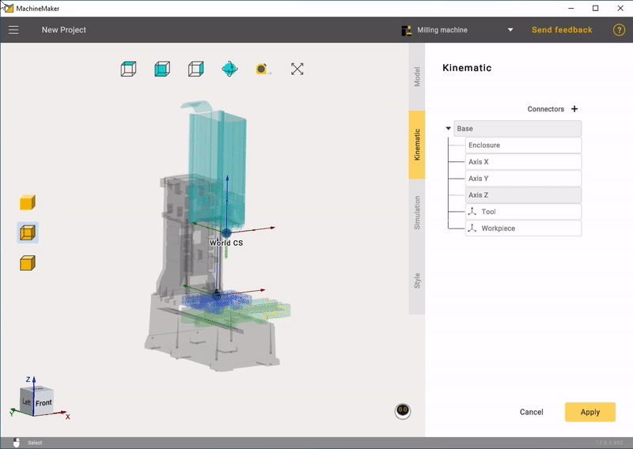
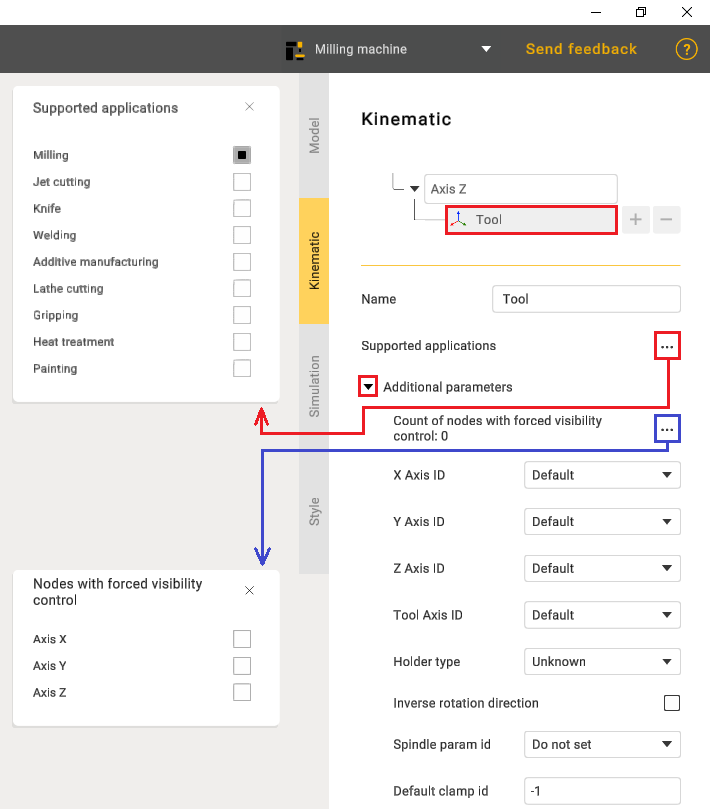
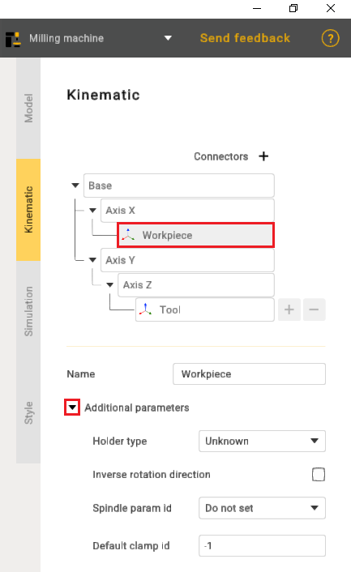
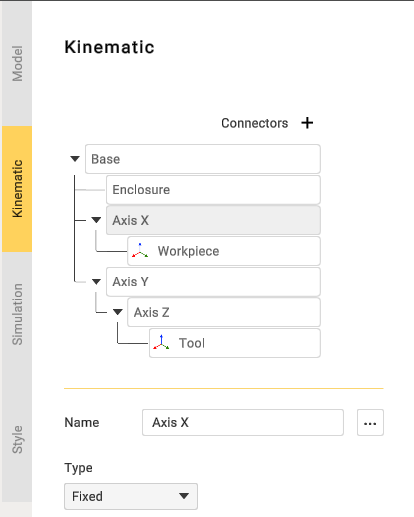
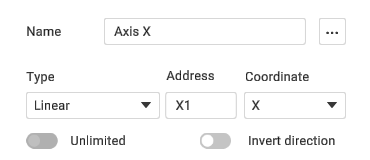
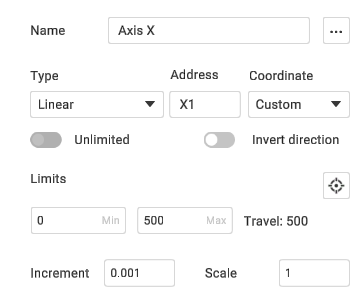
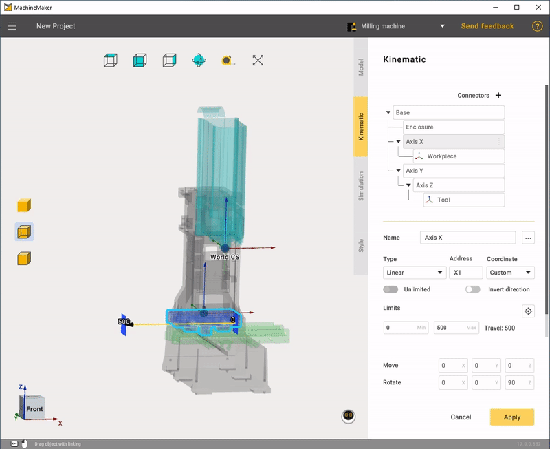
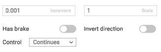
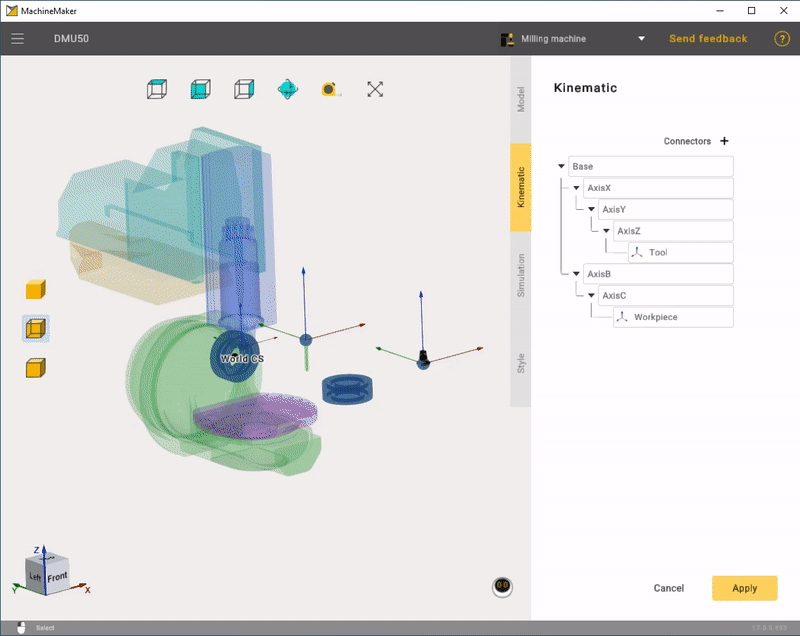
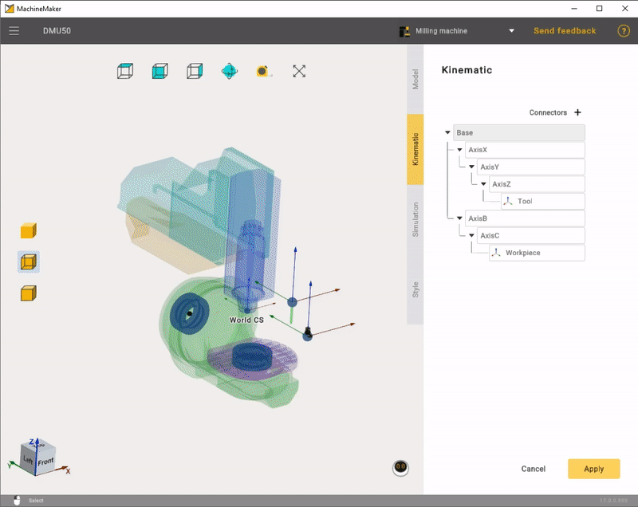

---
title: "운동학 구조 만들기"
---

# 운동학 구조 만들기

운동학 파라미터 패널을 열려면 **Kinematic**(운동학) 탭을 클릭합니다.

먼저 끌어서 놓기를 사용하여 메커니즘의 올바른 운동학 트리를 만들어야 합니다. MachineMaker는 Tool(공구) 노드를 샘플 공구로, Workpiece(공작물) 노드를 샘플 부품으로 표시합니다.

**Tool** 설정에는 **Supported applications**(지원 응용 프로그램) 항목을 선택하는 기능과 추가 옵션이 있습니다.

**Workpiece**에도 자체 추가 파라미터가 있습니다.

다음으로 각 노드의 파라미터를 지정해야 합니다.

노드 이름과 유형을 설정합니다.

다음으로 선형 노드와 회전 노드에 노드 **Address**(주소)를 지정해야 합니다. 이 주소는 포스트프로세서에서 사용됩니다.

선형 축 방향을 선택합니다. X Y Z 또는 사용자 정의 방향을 선택할 수 있습니다. **Custom**(사용자 정의) 방향 벡터를 정의하려면 **Orientation**(방향) 필드를 사용합니다.

다음으로 **Has Brake, Increment**(브레이크 포함, 증가) 및 **Scale**(배율) 파라미터를 정의합니다. 축이 Indexed(인덱스) 또는 Manual(수동)인 경우 **Control**(제어) 파라미터를 변경합니다. 축의 방향을 반전하는 **Invert Direction**(방향 반전)도 사용할 수 있습니다.

회전축의 경우 회전 중심점을 지정해야 합니다. **마우스 왼쪽 버튼**을 누른 채로 베어링을 끌어 스냅 포인트에 놓습니다. 위치와 회전을 수동으로 설정하려면 **Transformation Panel**(변환 패널)을 사용합니다.

마지막으로 **Tool Type**(공구 유형)을 설정하고 Tool과 Workpiece의 위치를 지정해야 합니다. **Kinematic tree**(운동학 트리)에서 Tool과 Workpiece를 올바른 위치에 배치합니다. 그런 다음 **마우스 왼쪽 버튼**을 누른 채로 베어링을 끌어 스냅 포인트에 놓습니다. 위치와 회전을 수동으로 설정하려면 **Transformation Panel**을 사용합니다.

