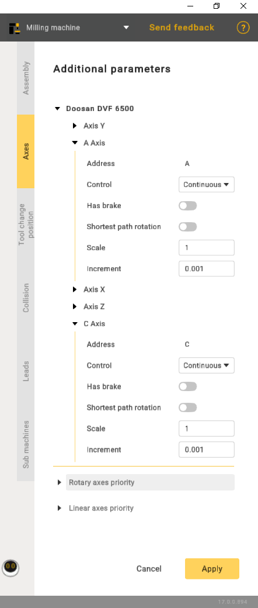

---
title: "추가 옵션"
---

# 추가 옵션

버튼을 클릭하여 **Machine parameters panel**(기계 파라미터 패널)을 엽니다. 그런 다음 **Axes**(축) 탭으로 이동합니다. 다음 항목을 지정할 수 있습니다.

- Address(주소) - 축 지정.
- Control(제어):

1. Continuous(연속).
2. Indexed(인덱스) - 회전이 증분 방식으로 수행됨을 나타냅니다.
3. Manual(수동) - 작업이 전적으로 수동으로 수행됨을 의미합니다.

- Shortest path rotation(최단 경로 회전) - 3차원 공간에서 초기 위치와 최종 위치 사이의 가장 직접적인 경로를 따라 축 또는 점을 중심으로 회전하는 것을 의미합니다.
- Scale(배율)은 네 가지 위치가 있는 설정입니다. 각 위치는 특정 각도 증분에 해당합니다. 위치 1은 90도, 위치 2는 180도에 해당하며, 나머지도 같은 방식입니다.
