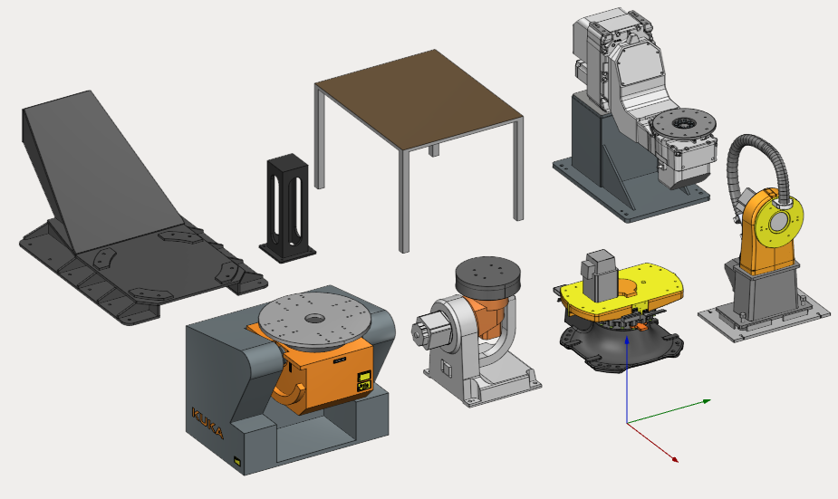
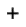
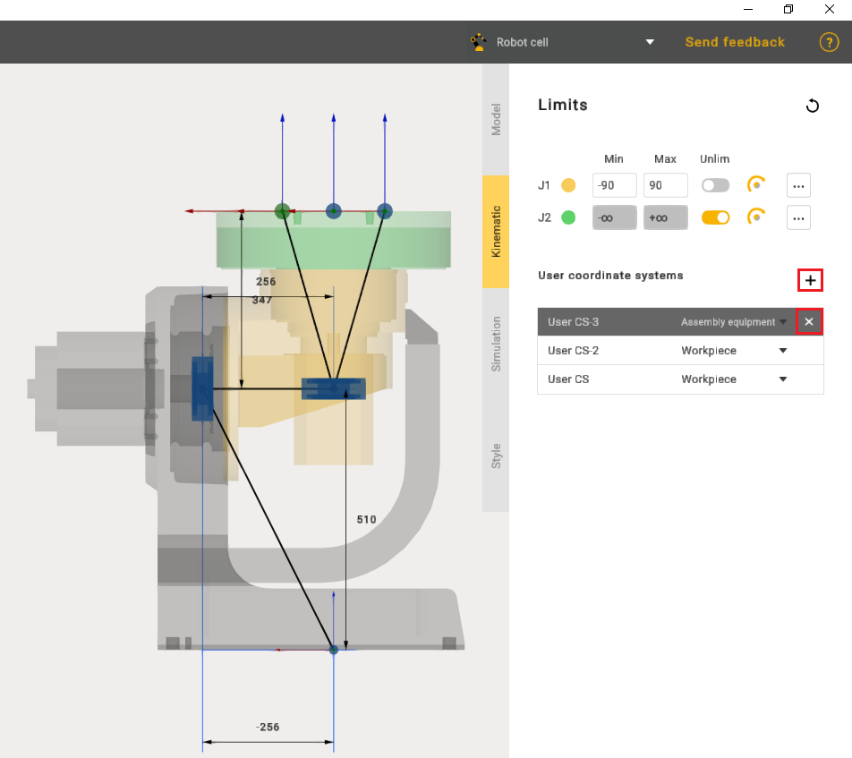
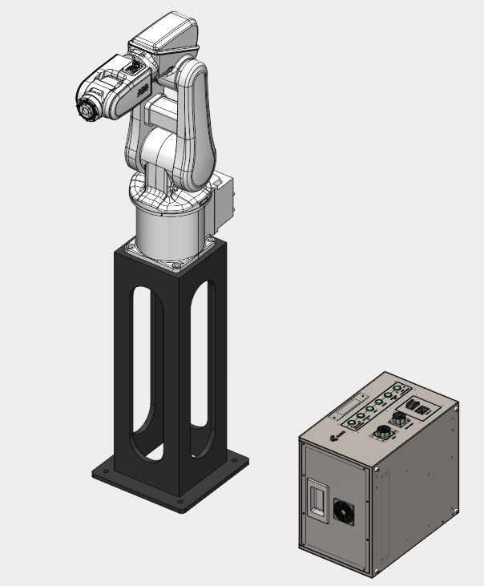
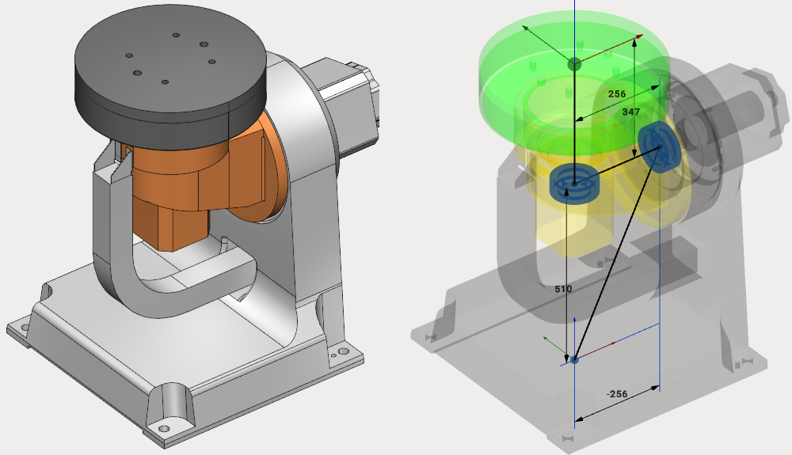

---
title: "테이블 및 포지셔너"
---

# 테이블 및 포지셔너

MachineMaker에서는 정적 테이블, 1축 포지셔너, 2축 포지셔너를 만들 수 있습니다.

## 테이블

테이블은 공작물이나 다른 객체(로봇 또는 다른 테이블 포함)를 올려놓을 수 있는 고정(정적) 객체입니다.

**User Coordinate Systems**(사용자 좌표계) 패널의  버튼을 사용하여 테이블에 커넥터를 원하는 개수만큼 추가할 수 있습니다. 커넥터를 삭제하려면  버튼을 사용합니다. 좌표계 이름을 바꾸려면 이름을 두 번 클릭합니다.

**왼쪽 Ctrl** 키를 누른 상태에서 끌어서 놓기로 커넥터를 올바른 위치에 배치합니다. 치수 또는 변환 패널의 데이터를 변경하여 커넥터 위치를 지정할 수도 있습니다. 자세한 내용은 "변환 패널"에서 확인할 수 있습니다. 추가한 커넥터의 유형(어셈블리 장비 또는 공작물)도 선택할 수 있습니다.

MachineMaker는 **Assemblies**(어셈블리)를 구성할 때 커넥터를 사용하여 메커니즘을 서로 연결합니다. 비어 있는 모든 커넥터는 CAM 시스템용 공작물 홀더로 변환됩니다.

고정 테이블과 고정 객체는 크게 다릅니다. 고정 객체는 독립된 정적 객체이므로 고정 객체 위에는 로봇을 배치할 수 없습니다. 따라서 고정 객체에는 커넥터가 없습니다. 로봇 컨트롤러, 로봇 셀 안에 있는 독립된 상자, 펜스 등에는 고정 객체 옵션을 사용합니다. 로봇과 공작물을 올려놓는 테이블, 바닥 등에는 고정 테이블을 사용합니다.

## 1축 포지셔너

1축 포지셔너에는 회전 조인트 하나와 개수 제한이 없는 커넥터가 있습니다. **User Coordinate Systems** 패널의  버튼을 사용하여 새 커넥터를 추가할 수 있습니다.

## 2축 포지셔너

2축 포지셔너에는 회전 조인트 2개와 개수 제한이 없는 커넥터가 있습니다. **User Coordinate Systems** 패널의  버튼을 사용하여 새 커넥터를 추가할 수 있습니다.

