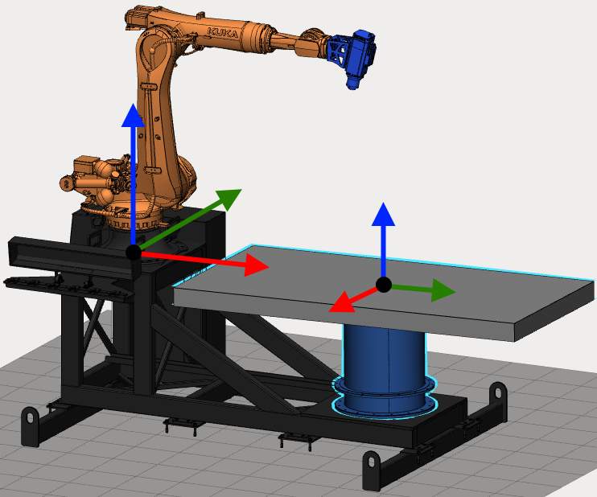
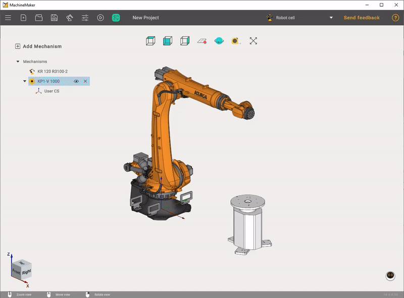
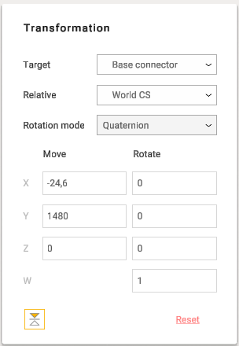

---
title: "Table calibration"
---

# Table calibration

Table calibration function is available from the [assembly view](../common/150674458.md). Finish editing mechanism by clicking **Apply** or **Cancel** buttons to see the entire mechanisms assembly.

Robot has a Base and TCP coordinate systems. It is necessary to specify User Coordinate System position relative to the Robot Base Coordinate System.

Hold down **Left Ctrl** key to show all Coordinate Systems.

## How to calibrate a table

Select a table using the left mouse button in the Transformation panel on the right. Select the desired User CS as **Target** and select Robot Base CS in the **Relative** field. Now you can see User Coordinate System position relatively to the Robot Base Coordinate System in the Move and Rotate fields. Enter correct values to finish calibration.

Use Robot's User CS calibration function to obtain accurate values

## Quaternions, Radians and Euler angles

Some robots (such as ABB) use quaternions instead of euler angles. For this kind of robots MachineMaker can show quaternions fields. You can switch to Euler angles if you prefer to use human-friendly Euler angles.

MachineMaker will automatically detect that you are doing table calibration and will switch rotation mode to the correct values system. You can switch it back to the Euler angles without loosing your data.

MachineMaker will suggest using quaternions only for robots which support it (like ABB).
