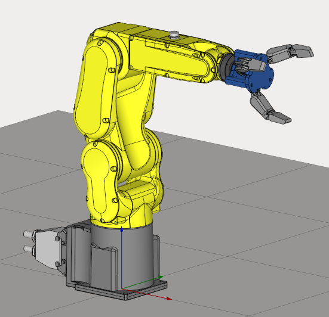

---
title: "복합 엔드 이펙터"
---

# 복합 엔드 이펙터

프로젝트 다운로드: **[CompositeEndEffector.zip](../assets/b5830ce681e00fa5cbb0f33e17859e6cbe893db21c175c7f52e0da9c63163dde.zip) / [CompositeEndEffectorLinear.zip](../assets/341a345875f95e69e72da27f700a8a6ba44ca8a1d249a73ae7f932092b0b8a6c.zip)**

복합 엔드 이펙터에는 두 가지 유형이 있습니다.

1. Rotary(회전)
2. Linear(선형)

"Rotary"의 경우 메커니즘의 유연한 가동부에 특수한 구성이 사용됩니다.
"Linear"의 경우 그리퍼 죠가 이동하는 선형 축만 사용됩니다.

이 기능에 대해 자세히 알아보려면 **[회전형](https://www.youtube.com/watch?v=zHQKJ3JOpGE&list=PLnaHZJpWJMKPN2hSDvR1DnxmAuFH4tP42&index=7)** 및 **[선형](https://www.youtube.com/watch?v=sVA2ds63cKg&list=PLnaHZJpWJMKPN2hSDvR1DnxmAuFH4tP42&index=8)** 복합 엔드 이펙터 튜토리얼을 시청하는 것을 권장합니다.
