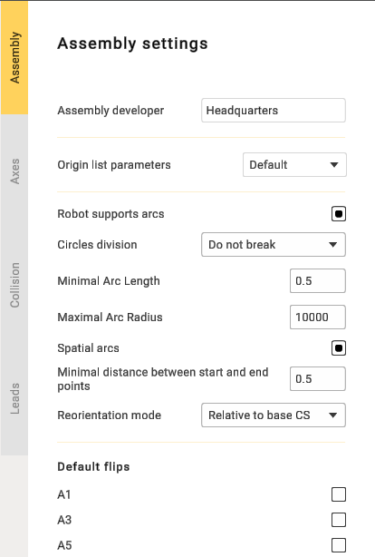

---
title: "어셈블리 옵션"
---

# 어셈블리 옵션

 버튼을 클릭하여 어셈블리 파라미터 패널을 엽니다.

- **Snap base to rotary positioner**(베이스를 회전 포지셔너에 스냅): 이 옵션을 활성화하면 좌표계가 회전 포지셔너에 연결되어 포지셔너와 함께 움직입니다. 비활성화하면 포지셔너의 좌표계는 고정된 상태로 유지됩니다.
- **Snap base to linear axis**(베이스를 선형 축에 스냅): "Snap Base to Rotary Positioner"와 비슷하게 작동하지만 선형 축에 사용됩니다.
- **Fix WCS on axis**(축에 작업 좌표계 고정): 좌표계의 축을 선택하는 데 사용하는 옵션입니다. 예를 들어 메커니즘이 여러 개 있고 그중 특정 메커니즘을 선택해야 하는 경우에 사용합니다.
- **Assembly developer**(어셈블리 개발자): 회사 이름입니다.
- **Robot supports arcs**(로봇의 호 지원): 제어 프로그램에 호를 출력하는 데 필요합니다.
- **Circles division**(원 분할): 호를 2등분 또는 4등분하는 데 사용합니다.
- **Minimal Arc Length**(최소 호 길이): 지정한 길이보다 짧은 호가 출력되지 않도록 합니다. 대신 세그먼트가 표시됩니다.
- **Maximal Arc Radius**(최대 호 반지름): 반지름이 지정한 값보다 큰 호가 출력되지 않도록 합니다. 대신 세그먼트가 표시됩니다.
- **Spatial arcs**(공간 호): 임의의 공간 호입니다. 로봇 작동에 필요한 기능입니다.
- **Minimal distance between start and end points**(시작점-끝점 사이 최소 거리): 점 사이 거리가 짧은 세그먼트를 표시할 수 있게 하는 제한입니다.
- **Reorientation mode**(방향 전환 모드): 중간점을 계산하는 방법입니다. 기능은 제조업체에 따라 다를 수 있습니다.
- **Default flips**(기본 플립): 로봇의 위치를 설정하는 데 필요합니다.
