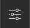
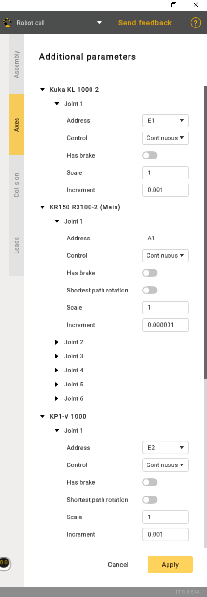

---
title: "추가 옵션"
---

# 추가 옵션

로봇 컨트롤러는 외부 축을 사용할 수 있으며, 어셈블리에서 이러한 축에 올바른 위치(인덱스)를 지정해야 합니다. 기본 CAM 시스템 포스트프로세서는 인덱스 기반 축 식별자(첫 번째 축은 **ExtAxis1Pos**, 그다음은 **ExtAxis2Pos** 등)를 사용합니다. 일부 사용자 지정 포스트프로세서는 인덱스 대신 축 주소(**E1, E2, E3, J4** 등)를 사용할 수 있습니다.

 버튼을 클릭하여 어셈블리 파라미터 패널을 엽니다. 그런 다음 **Axes**(축) 탭으로 이동합니다.

- Address(주소) - 축 명칭입니다.
- Control(제어):

1. Continuous(연속).
2. Indexed(인덱스) - 회전이 단계적으로 수행됨을 나타냅니다.
3. Manual(수동) - 작업이 전적으로 수동으로 수행됨을 의미합니다.

- Shortest path rotation(최단 경로 회전) - 3차원 공간에서 초기 위치와 최종 위치 사이의 가장 직접적인 경로를 사용하여 축 또는 점을 중심으로 회전하는 것을 의미합니다.
- Scale(배율)은 네 가지 위치가 있는 설정입니다. 각 위치는 특정 각도 증분에 해당합니다. 위치 1은 90도, 위치 2는 180도에 해당하며 나머지도 같은 방식입니다.

여기에서 **Address**와 **External axis position (index)**(외부 축 위치(인덱스))를 정의합니다. MachineMaker는 툴팁에 축 식별자(예: ExtAxis3Pos)를 표시합니다. 이 식별자는 포스트프로세서에서 사용할 수 있습니다.

축 주소와 축 인덱스는 어셈블리 내에서 고유해야 합니다. 이미 사용 중인 값을 설정하려고 하면 MachineMaker가 기존 값을 대체하도록 제안합니다.

로봇 축의 주소와 인덱스는 변경할 수 없습니다. 외부 축의 주소만 변경할 수 있습니다.

여기에서 축의 추가 파라미터인 **Control type (Continuous, Indexed, Manual)**(제어 유형(연속, 인덱스, 수동)), **Brakes**(브레이크), **Shortest path rotation mode**(최단 경로 회전 모드)도 정의할 수 있습니다.
