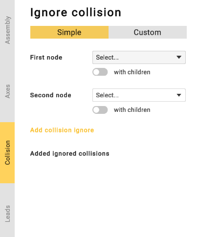
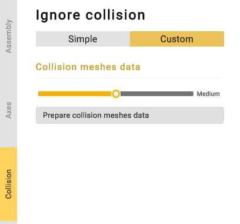
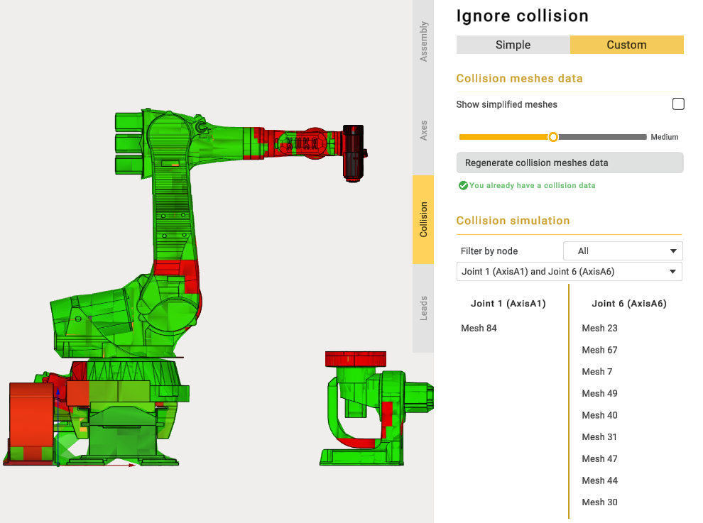

---
title: "충돌"
---

# 충돌

부정확한 3D 모델을 사용하는 경우 CAM 시스템이 노드 간의 오탐 충돌을 감지할 수 있습니다. 이러한 노드를 무시 목록에 추가하면 CAM 시스템이 오탐 충돌을 감지하지 않도록 할 수 있습니다.

 버튼을 클릭하여 파라미터 패널을 엽니다. 그런 다음 **Collisions**(충돌) 탭으로 이동합니다.

첫 번째 노드와 두 번째 노드를 선택하고 **Add collisions**(충돌 추가) 버튼을 클릭합니다. 노드의 하위 노드도 무시 목록에 추가하려면 **with children**(하위 노드 포함) 토글을 사용합니다. 이전에 추가한 충돌을 무시 목록에서 삭제하려면  버튼을 사용합니다.

사용자 정의 충돌 탭에서는 사용자가 정의한 파라미터를 사용하여 충돌을 직접 계산할 수 있습니다.
이 섹션에서는 충돌 감지 알고리즘이 사용하는 각 메커니즘 노드의 메쉬 해상도를 지정할 수 있습니다.

**“Prepare collision meshes data”**(충돌 메쉬 데이터 준비)를 클릭하면 애플리케이션이 충돌 감지에 필요한 메커니즘 위치의 수를 계산합니다.

메커니즘 위치의 수가 계산되면 위치를 노드별로 정렬하고 메커니즘의 충돌을 시각적으로 검사할 수 있습니다.

CAM 시스템은 형제 노드 간의 충돌을 항상 무시합니다. 따라서 형제 노드를 무시 목록에 추가할 필요는 없습니다.
