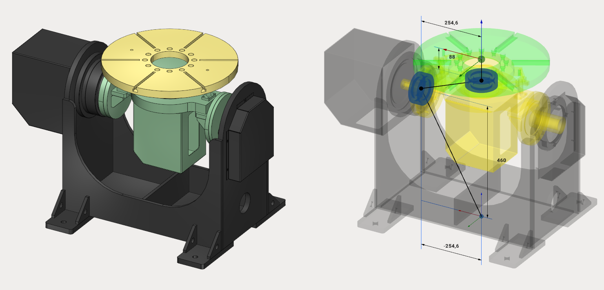
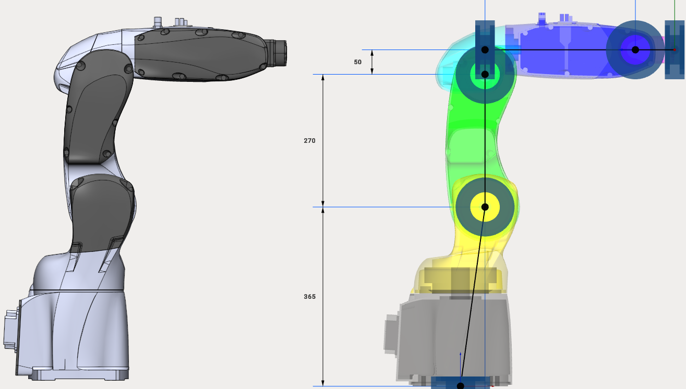
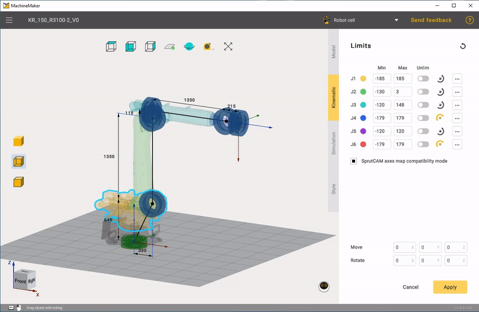
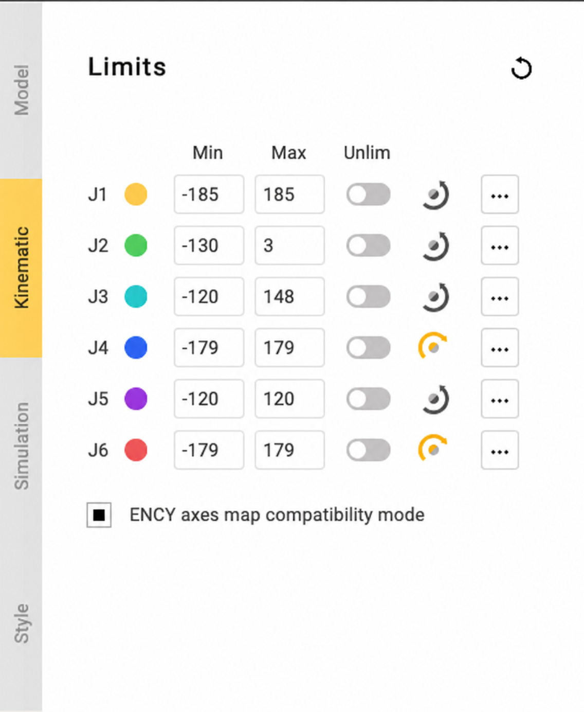
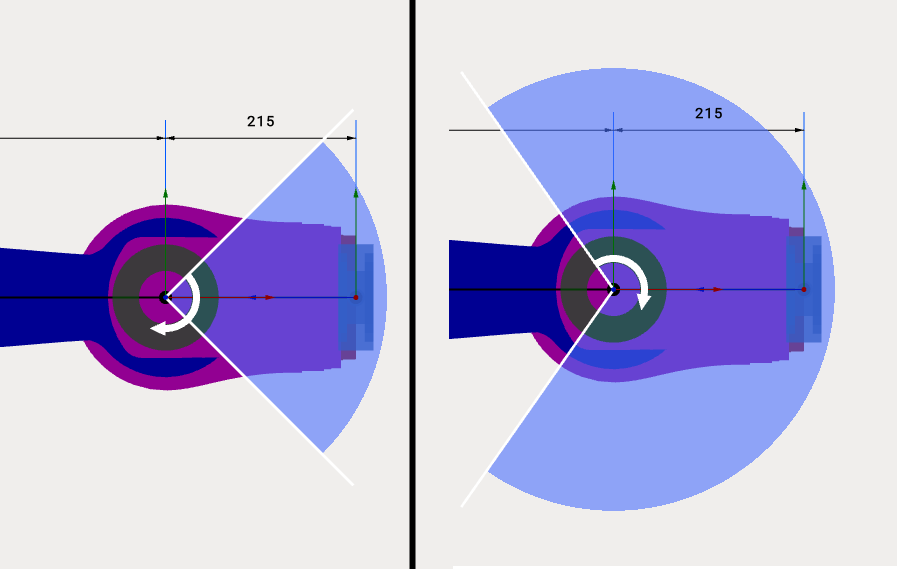
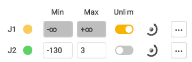
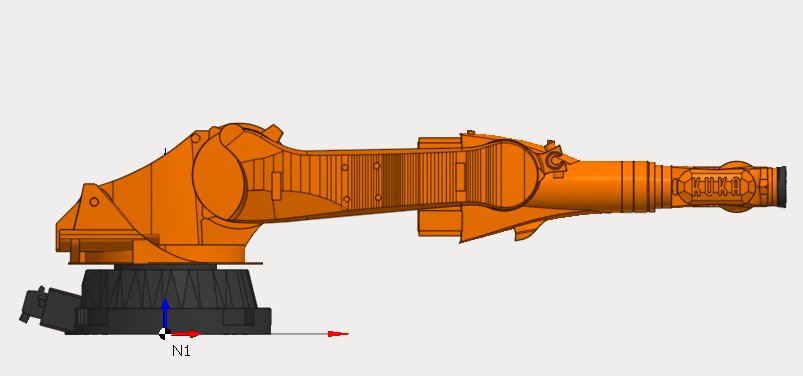
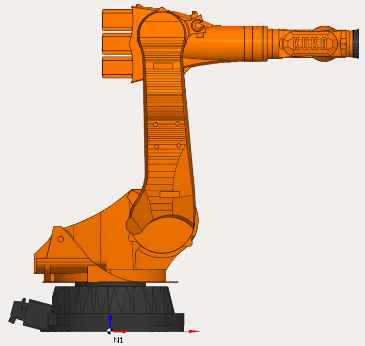

---
title: "운동학 구조 구성"
---

# 운동학 구조 구성

**Kinematic**(운동학) 탭을 클릭하여 운동학 파라미터 패널을 엽니다.

## 운동학

MachineMaker는 현재 메커니즘의 3D 모델과 운동학 구조를 표시합니다. 커넥터 위치를 지정하여 올바른 운동학적 연결을 구성해야 합니다.

커넥터 위치를 지정하는 방법은 세 가지입니다.

- 치수
- 변환 패널
- 끌어서 놓기 및 스냅 포인트

### 치수

치수를 클릭하고 새 값을 입력합니다.

### 변환 패널

어떤 커넥터든 위치를 수동으로 설정할 수도 있습니다. 커넥터(회전 조인트는 파란색 베어링, "어셈블리"는 파란색 점)를 선택하고 오른쪽 하단의 **Transformation Panel**(변환 패널)에 이동 및 회전 값을 입력합니다.

**마우스 휠 스크롤**을 사용하여 입력 상자나 콤보 상자의 값을 변경할 수 있습니다. 스크롤하는 동안 **Shift** 또는 **Ctrl** 키를 누르고 있으면 값이 더 빠르게 또는 더 느리게 변경됩니다.

### 끌어서 놓기 및 스냅 포인트

**왼쪽 Ctrl** 키를 누르고 있으면 끌어서 놓기 모드로 전환됩니다. 원하는 커넥터(회전 조인트는 파란색 베어링, "어셈블리"는 파란색 점)를 끕니다. MachineMaker가 근처에 작은 빨간색 스냅 포인트를 표시합니다. 마우스 버튼을 놓으면 객체가 놓입니다.

## 이동 한계

각 노드의 이동 한계를 입력할 수 있습니다. 이 정보는 데이터시트에서 확인할 수 있습니다.

MachineMaker는 조인트의 최솟값과 최댓값을 표시합니다.

 또는  버튼을 사용하여 회전 방향 또는 이동 방향을 변경합니다.

포지셔너의 무제한 회전을 허용하려면 **Unlim**(무제한) 스위치를 사용합니다.

## 모델 위치

가져온 3D 모델의 현재 위치에 해당하는 조인트 값을 설정하려면 **Model Position**(모델 위치)을 사용합니다. 이 필드를 사용하면 0이 아닌 위치에서 저장된 메커니즘의 CAD 파일을 사용할 수 있습니다.

예를 들어 Kuka 로봇의 0 위치는 다음과 같습니다.

그러나 [Kuka 다운로드 센터](https://www.kuka.com/en-de/services/downloads)는 0이 아닌 로봇 위치의 3D 모델만 제공합니다.

따라서 **Model Position** 값만 지정하면 Kuka에서 제공하는 3D 모델을 그대로 사용할 수 있습니다. CAD 시스템에서 모델을 변경할 필요가 없습니다.

**Model Position** 기능은 선형 축이 있는 메커니즘에도 유용합니다. 예를 들어 레일의 이동 한계를 편집할 때 유용합니다.

