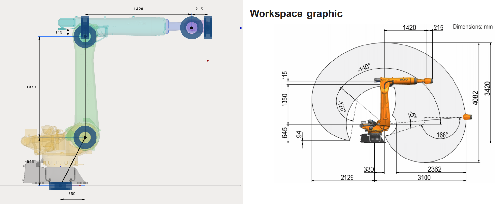

---
title: "산업용 로봇"
---

# 산업용 로봇

6축 산업용 로봇의 운동학을 설정하는 가장 쉬운 방법은 로봇의 데이터시트를 참고하여 MachineMaker에서 6개의 치수를 지정하는 것입니다.

로봇 운동학에서는 운동학 구조가 손상되지 않도록 끌어서 놓기 모드가 제한됩니다.

## 특수한 경우

Staubli와 같은 일부 로봇 제조업체는 로봇이 0 위치에 있는 상태의 3D 모델과 데이터시트를 제공합니다. MachineMaker는 선택한 로봇 유형의 운동학적 링크 구조를 자동으로 적용합니다.

