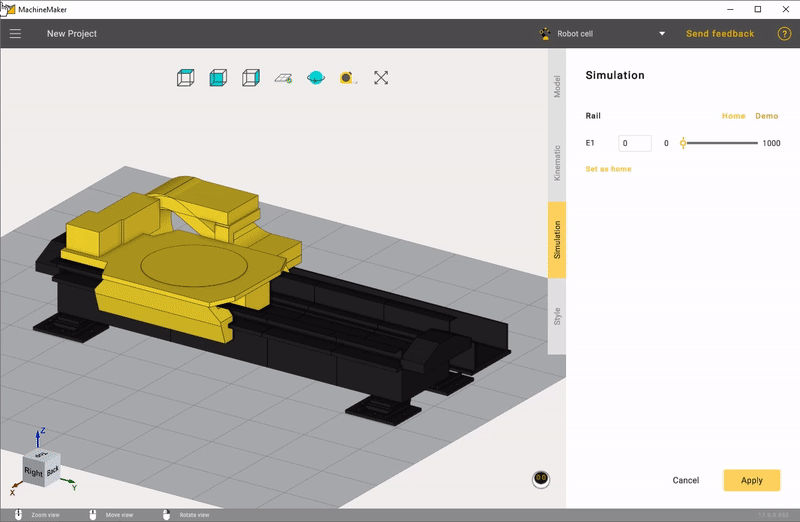

---
title: "레일 및 포털"
---

# 레일 및 포털

MachineMaker에서는 선형 레일, 2축 포털, 3축 포털을 추가할 수 있습니다.

**User Coordinate Systems**(사용자 좌표계) 패널의  버튼을 사용하여 테이블에 커넥터를 원하는 수만큼 추가할 수 있습니다. 커넥터를 삭제하려면  버튼을 사용합니다. 좌표계 이름을 변경하려면 두 번 클릭합니다.

MachineMaker는 "어셈블리"를 구성할 때 커넥터를 사용하여 메커니즘을 서로 연결합니다.

**Limits**(이동 한계)를 클릭하여 최솟값과 최댓값을 지정합니다. MachineMaker는 3D 모델의 최소 위치와 최대 위치를 표시합니다.

오른쪽 하단의 변환 패널을 사용하여 선형 축 방향을 변경할 수 있습니다.

