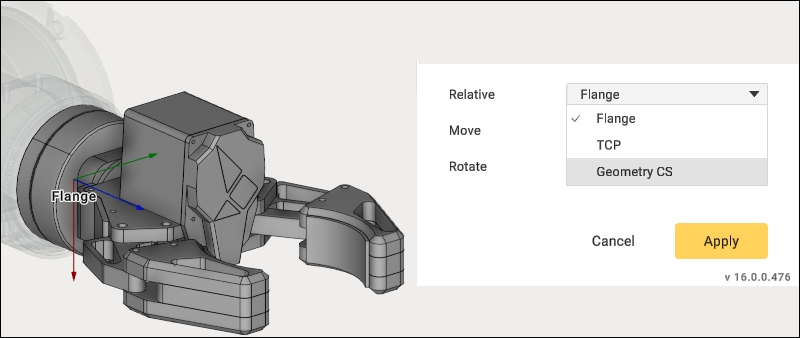
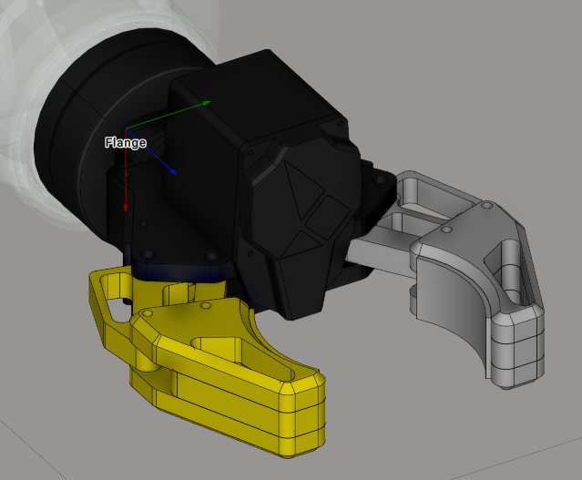
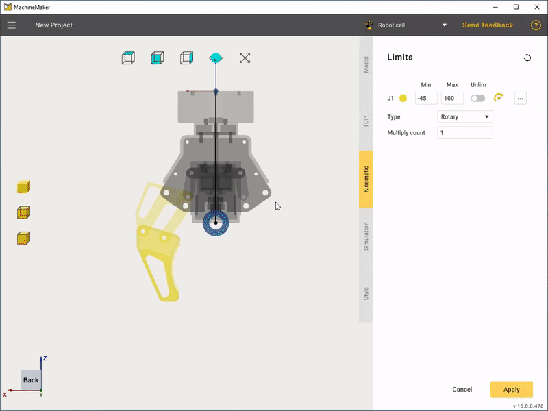
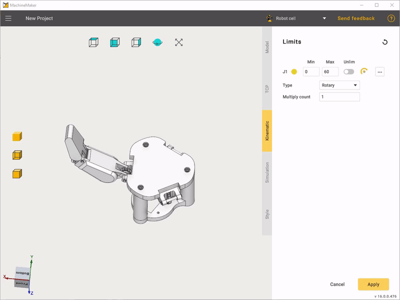

---
title: "복합 엔드 이펙터"
---

# 복합 엔드 이펙터

복합 엔드 이펙터에는 일반적으로 핑거와 같은 움직이는 부품이 포함됩니다.

먼저 엔드 이펙터를 로봇 플랜지에 연결해야 합니다. 가장 쉬운 방법은 **Base CS transform editing mode**(기준 좌표계 변환 편집 모드)를 사용하는 것입니다.

**Relative**(상대 기준) 선택기를 사용하면 변환 패널의 좌표계를 변경할 수 있습니다. 형상 좌표계에는 **Default**(기본), 로봇 플랜지 좌표계에는 **Base CS**(기준 좌표계), 공구 중심점에는 **TCP**를 사용합니다.

이 작업을 마치면 "요소 그룹화"를 수행해야 합니다.

이 단계에서는 움직이는 조인트를 하나만 선택하면 됩니다. 필요한 모든 조인트는 나중에 MachineMaker가 자동으로 추가합니다.

다음으로 **Kinematic**(운동학) 탭으로 이동하여 커넥터의 위치를 정의합니다. 먼저 커넥터 유형을 선택해야 하며, 유형은 **Linear**(선형) 또는 **Rotary**(회전)일 수 있습니다. 끌어서 놓기와 변환 패널을 사용하여 커넥터의 위치와 방향을 설정합니다. **Limits**(이동 한계) 패널에서 최소 위치와 최대 위치를 설정합니다.

움직이는 조인트의 복사본을 만들려면 **Multiply count**(복제 수) 편집 필드를 사용합니다.

마지막으로 일반 "End Effector"(엔드 이펙터)와 같은 방식으로 TCP와 스타일을 설정합니다.

경우에 따라 복합 엔드 이펙터는 선형일 수 있습니다. "Gripping"(파지) 유형이 선택되어 있는지 확인합니다.

운동학에서 "Linear" 유형을 선택하고 죠에 필요한 이동 한계를 설정합니다. 또한 "Multiply count edit" 기능을 사용하여 죠의 복사본을 만듭니다.
  
  

"Rotary"와 마찬가지로 죠의 이동 한계를 편집합니다.

