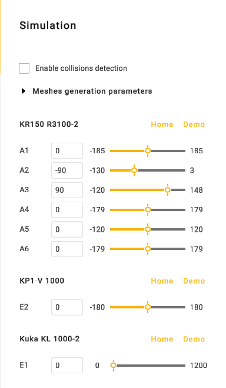
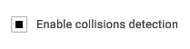

---
title: "어셈블리 시뮬레이션 및 검증"
---

# 어셈블리 시뮬레이션 및 검증

메커니즘의 움직임을 시뮬레이션하여 전체 어셈블리를 검증하는 것이 좋습니다.  버튼을 클릭하여 어셈블리 시뮬레이션 패널을 엽니다.

이 탭에는 "Enable collisions detection"(충돌 감지 사용) 옵션이 있습니다.

이 패널은 [메커니즘 시뮬레이션 및 검증](../common/129940423.md)에 설명된 패널과 비슷하지만, 어셈블리의 모든 메커니즘을 시뮬레이션할 수 있습니다.
