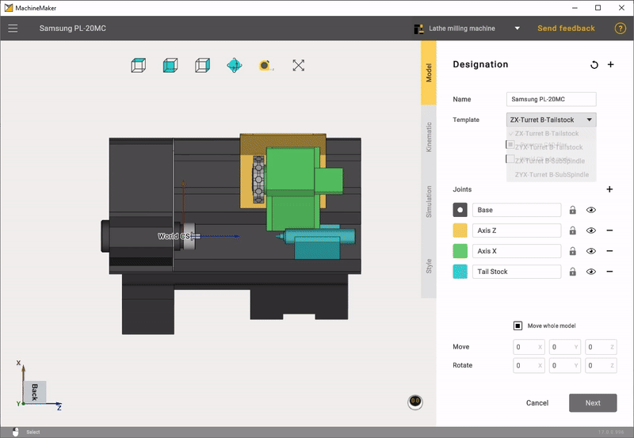
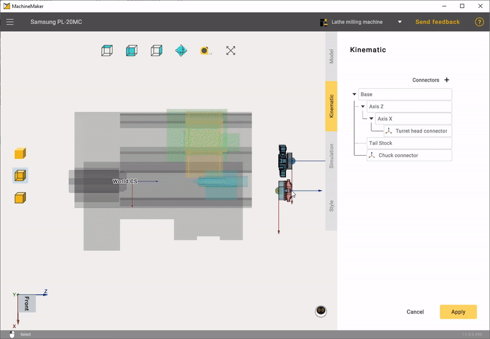

---
title: "Building a kinematic scheme"
---

# Building a kinematic scheme

Click ***Kinematic***tab to open kinematic parameters panel.

## Kinematics

MachineMaker shows the current mechanism's 3D model and kinematic scheme. It is necessary to build correct kinematic linkage by specifying connector's positions.

The kinematic tree of mechanisms will be automatically built because of the pre-selected template on the "Model" tab. In cases if it will be necessary to make any changes in the mechanism tree the name of the template will change to "Custom".

Since the appropriate template was originally selected, the only thing left to do is to position the Turret head connector and Chuck connector in the correct positions. Also set the limits for each node.

Hold down the **Left Ctrl** key and drag the **Turret head connector** and **Chuck connector** to the desired position.

Node limits on lathe milling machine can vary. We recommend that you set the original values for each node.\

