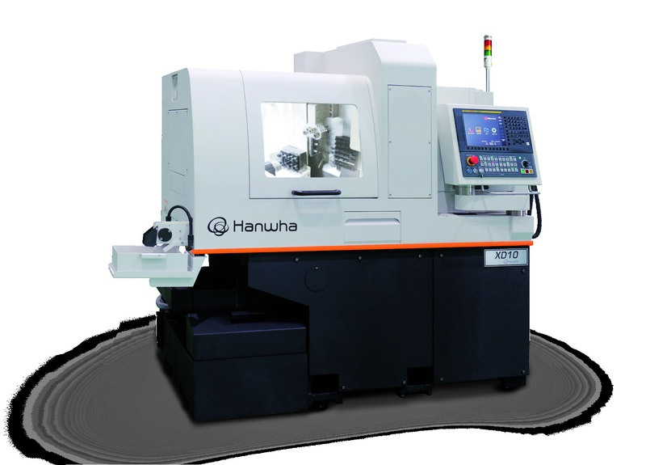
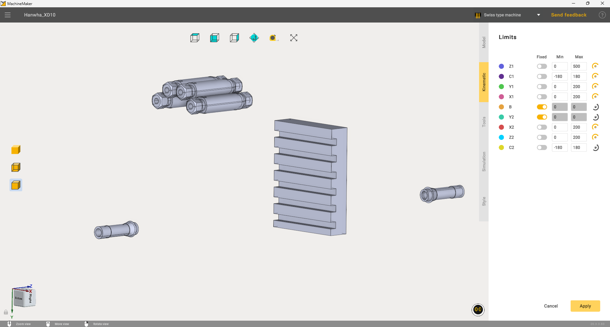
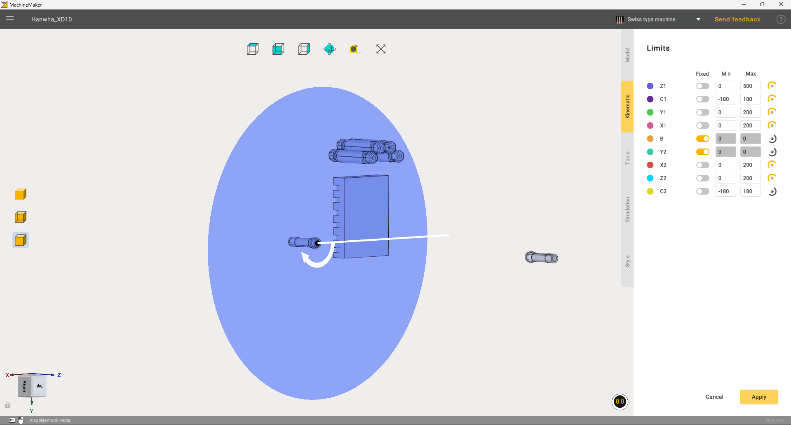
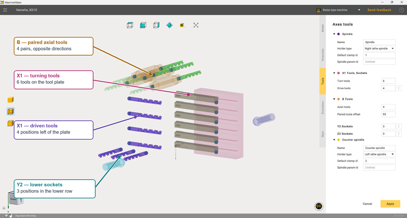
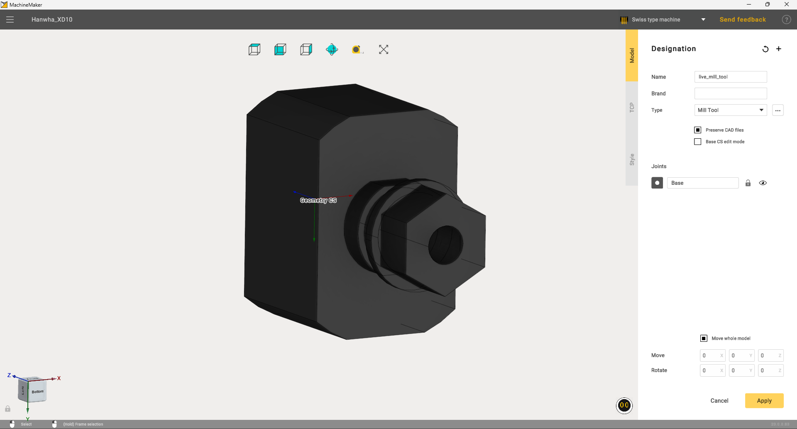
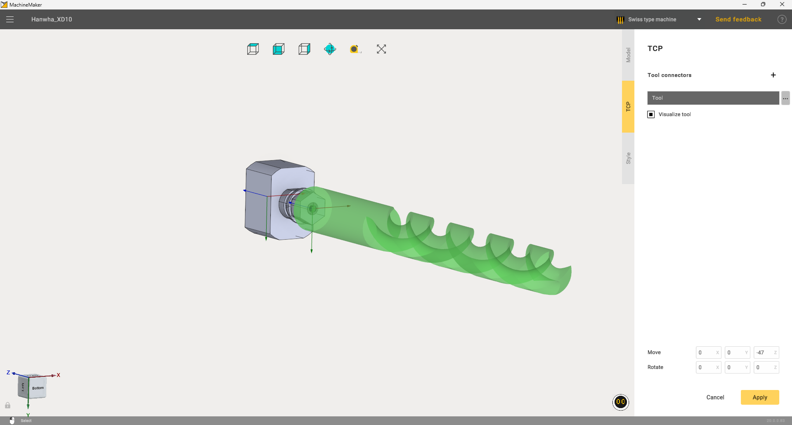
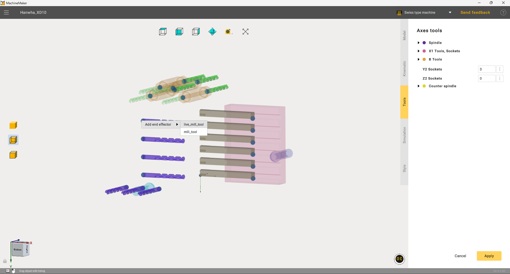
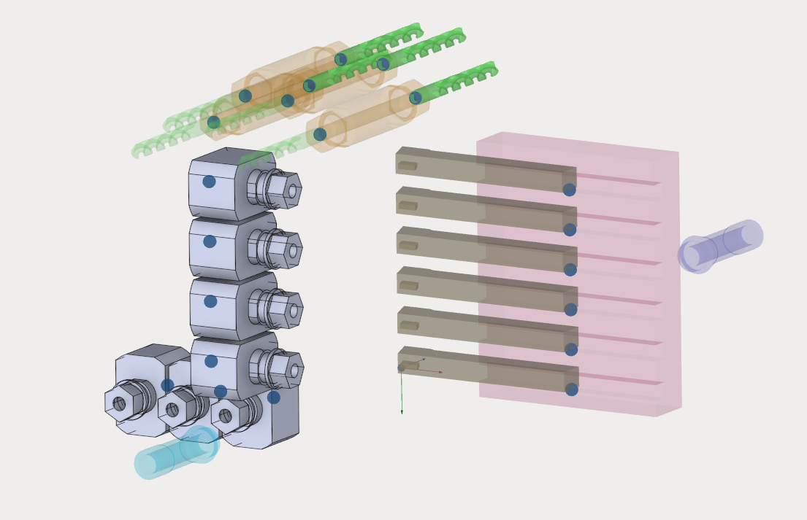

---
title: "스위스형 기계"
---

# 스위스형 기계

이 장에서는 **Hanwha XD10**을 예로 들어 MachineMaker에서 스위스형 기계를 만드는 방법을 설명합니다. 기계 모델을 가져오고, 노드에 형상을 할당하고, 운동학과 공구 위치를 구성하고, 홀더가 있는 공구를 추가한 다음, 시뮬레이션에서 기계 구성 요소의 움직임을 확인합니다.

이 예제에서 사용하는 기계인 Hanwha XD10. 이미지 출처: XD\_10.pdf 문서.

`Hanwha_XD10.SLDASM` 어셈블리와 `live_mill_tool.SLDPRT`, `mill_tool.SLDPRT` 홀더 모델이 필요합니다. 아래 값은 MachineMaker의 이 교육용 구성에 적용됩니다. 다른 기계의 경우 해당 기계의 운동학 구조와 기술 문서를 바탕으로 설정을 결정합니다.

**예제 파일.** [Hanwha XD10 3D 모델 다운로드(ZIP, 1.13 MB)](../assets/442fcff663927f6b32249c6a0bfad0b11cc5714d5b459ad30944453afad71e81.zip) — 이 튜토리얼에서 사용하는 `Hanwha_XD10.SLDASM` 어셈블리, 기계 부품 및 홀더 모델입니다.

[Hanwha XD10 기계 구성 다운로드(ZIP, 0.56 MB)](../assets/b0d2a4c49e6f8461543dd781d2139584dba84f8c42ee0aba2be900f92dae0135.zip) — 기계 구성, CAD 파일 및 노드 형상이 들어 있는 `MachineSchema` 폴더입니다.

3D 모델을 가져오기 전에 아카이브 전체를 하나의 폴더에 압축 해제하고 파일 이름은 그대로 유지합니다. 어셈블리가 참조하는 부품을 찾을 수 있도록 해당 폴더에서 `Hanwha_XD10.SLDASM`을 엽니다.

## 1. 프로젝트 만들기 및 모델 가져오기

1. MachineMaker를 열고 새 프로젝트를 만듭니다.
2. 상단 도구 모음의 Application Mode Selector(애플리케이션 모드 선택기)에서 **Swiss type machine**(스위스형 기계)을 선택합니다.
3. **Add Mechanism**(메커니즘 추가)을 클릭하고 `Hanwha_XD10.SLDASM` 어셈블리를 선택합니다. 가져오기가 끝날 때까지 기다립니다.
4. **Model**(모델) 탭에서 이름으로 `Hanwha_XD10`을 입력하고 **Type A (X2 along Y)**(유형 A, Y 방향 X2) 템플릿을 선택합니다.
5. 이후 편집에 원본 형상을 계속 사용할 수 있도록 **Preserve CAD files**(CAD 파일 보존) 옵션을 활성화합니다.
6. 좌표계에 대한 어셈블리의 방향을 확인합니다. 동영상 예제의 원본 어셈블리에서는 **Move whole model**(전체 모델 이동) 옵션을 활성화한 상태에서 이동 값이 X = 0, Y = 0, Z = 0이고 회전 값이 X = 0°, Y = −90°, Z = 90°입니다. 모델의 방향이 이미 올바르면 추가로 회전할 필요가 없습니다.

## 2. 모델 탭에서 부품 할당

**Designation**(지정) 패널에서 노드를 선택한 다음 뷰포트에서 해당 부품을 선택합니다. 부품에 그 노드의 색상을 할당합니다. 색상이 같은 부품은 같은 그룹에 속합니다.

공구 플레이트는 **X1**에, 위쪽의 원통형 공구 하우징 4개는 **B**에 할당합니다. 스핀들 구성 요소는 선택한 템플릿의 다이어그램을 참고하여 템플릿의 해당 노드에 할당합니다. 스크린샷에서는 X1과 B에 다음 색상을 사용합니다.

| 노드 | 형상 | 색상 |
| --- | --- | --- |
| X1 | 슬롯 6개가 있는 공구 플레이트 | 분홍색 |
| B | 위쪽 공구 그룹의 원통형 하우징 4개 | 주황색 |

모든 부품이 올바른 그룹에 속하는지 확인합니다. 나중에 별도로 추가할 홀더는 고정된 기계 형상에 포함하지 않습니다. 부품 할당이 끝나면 **Kinematic**(운동학) 탭을 엽니다.

## 3. 운동학 탭에서 축 이동 한계 설정

**Limits**(이동 한계) 패널에 스크린샷에 표시된 값을 입력합니다. **Min**(최소) 및 **Max**(최대) 필드는 선형 축의 이동 한계와 회전축의 회전 한계(단위: 도)를 정의합니다. **B**와 **Y2**의 움직임을 잠그려면 두 축의 **Fixed**(고정됨) 옵션을 활성화합니다.

교육용 구성의 축 이동 한계. B 축과 Y2 축은 고정되어 있습니다.

각 축을 차례로 선택하고 뷰포트에서 이동 방향을 확인합니다. 평면은 선형 축의 이동 한계를 나타내고, 원형 표시기는 회전축의 회전을 나타냅니다.

## 4. C2 축 위치 지정

**C2**를 선택하고 아래 그림과 같이 회전축을 원통형 카운터 스핀들 구성 요소의 중심선에 맞춥니다. 표시기의 중심은 끝면에 있는 구멍의 중심과 일치해야 합니다. 화살표로 회전 방향을 확인하고, 필요하면 C2 행 오른쪽에 있는 방향 아이콘으로 방향을 반대로 바꿉니다.

C2 위치 지정: 회전 중심이 구멍의 중심과 일치하고 축이 카운터 스핀들을 따라 놓입니다.

이 이미지는 C2의 위치를 보여 줍니다. 모든 축의 이동 한계 수치는 이전 단계의 스크린샷을 참고합니다.

## 5. 공구 및 소켓 위치 지정

**Tools**(공구) 탭을 엽니다. **Axes tools**(축별 공구) 패널에서 해당 그룹을 펼치고 다음과 같이 위치 개수를 설정합니다.

| 그룹 | 설정 | 값 |
| --- | --- | --- |
| X1 tools and sockets(X1 공구 및 소켓) | Turn tools(선삭 공구) | 6 |
| X1 tools and sockets | Drive tools(라이브 공구) | 4 |
| B tools(B 공구) | Axial tools(축 공구) | 4 |
| B tools | Paired tools offset(쌍 공구 오프셋) | 93 |
| Y2 sockets(Y2 소켓) | Count(개수) | 3 |
| Z2 sockets(Z2 소켓) | Count | 0 |

이미지와 같이 공구와 소켓을 배치합니다. 뷰포트에서 각 위치를 선택하고 **Move**(이동) 및 **Rotate**(회전) 필드와 형상 스냅을 사용하여 위치와 방향을 조정합니다.

공구 그룹 배치: X1 선삭 공구, X1 라이브 공구 위치, B 쌍 축 공구, 아래쪽 Y2 소켓.

**X1 선삭 공구.** 오른쪽 공구 플레이트의 슬롯에 선삭 공구 6개를 배치합니다. 공구 생크는 서로 평행해야 하며 슬롯마다 하나씩 있어야 합니다.

**X1 라이브 공구 위치.** 보라색 공구 기호 4개가 선삭 공구 바로 왼쪽에 세로 행을 이룹니다. 나중에 이 위치에 홀더를 장착합니다.

**B 쌍 공구.** 위쪽 그룹에는 축 방향 위치가 4개 있습니다. 이 위치를 원통형 하우징의 구멍에 맞춥니다. 쌍을 이루는 공구는 서로 반대 방향을 향하며, 공구 사이의 거리는 **Paired tools offset = 93**으로 설정합니다.

**Y2 소켓.** 아래쪽 위치 3개는 별도의 행을 이룹니다. 이미지와 같이 아래쪽 스핀들 구성 요소를 기준으로 배치합니다.

스핀들 그룹에는 스크린샷에 표시된 다음 설정을 사용합니다.

| 설정 | 메인 스핀들 | 카운터 스핀들 |
| --- | --- | --- |
| Name(이름) | Spindle | Counter spindle |
| Holder type(홀더 유형) | Right lathe spindle(우측 선반 스핀들) | Left lathe spindle(좌측 선반 스핀들) |
| Default clamp ID(기본 클램프 ID) | 1 | 2 |

여러 시야 각도에서 그룹 위치를 확인하고 **Apply**(적용)를 클릭합니다.

## 6. 홀더가 있는 첫 번째 공구 추가

7. 기본 창에서 **Add Mechanism**을 클릭하고 `live_mill_tool.SLDPRT`를 공구로 추가합니다.
8. **Model** 탭에서 이름으로 **live\_mill\_tool**을 입력하고 **Mill Tool**(밀링 공구) 유형을 선택합니다. 홀더 형상을 **Base**(베이스) 노드에 할당합니다. **Preserve CAD files** 옵션은 활성화된 상태로 둡니다.
9. 모델과 모델 좌표계의 방향을 확인합니다. 스크린샷에서는 모델의 이동 값과 회전 값이 모두 0입니다.

첫 번째 공구 추가: 밀링 공구 유형을 선택하고 홀더 형상을 Base에 할당합니다.

10. **TCP**(공구 중심점) 탭을 열고 **Tool**(공구) 커넥터를 선택합니다.
11. 커넥터를 홀더 클램핑 구멍의 중심에 배치합니다. 이 모델에서는 이동을 **X = 0, Y = 0, Z = −47** 값으로, 회전을 **X = 0°, Y = 0°, Z = 0°** 값으로 설정합니다.
12. **Visualize tool**(공구 시각화) 옵션을 활성화합니다. 이미지와 같이 공구 기호가 구멍에서 클램핑 축을 따라 뻗어 나와야 합니다.
13. **Apply**를 클릭합니다. 이제 새 공구를 기계 소켓에 장착할 수 있습니다.

첫 번째 공구의 TCP: 이동 Z = −47, 모든 축에 대한 회전 0, 공구 가시성 활성화.

## 7. 두 번째 공구 추가

같은 방법으로 **Add Mechanism**을 사용하여 `mill_tool.SLDPRT`를 가져옵니다. 이름으로 **mill\_tool**을 입력하고 **Mill Tool** 유형을 선택한 다음 형상을 **Base** 노드에 할당합니다.

**TCP** 탭에서 커넥터를 구멍의 중심에 배치합니다. 원본 동영상의 두 번째 모델에서는 이동 **X = 0, Y = 0, Z = −34** 값과 모든 축에 대한 회전 0을 사용합니다. 공구 가시성을 활성화하고 공구 방향을 확인한 다음 **Apply**를 클릭합니다.

## 8. 기계 소켓에 공구 장착

14. `Hanwha_XD10` 메커니즘의 설정을 열고 **Tools** 탭을 선택합니다.
15. 필요한 공구 위치나 그 부착 포인트를 **마우스 오른쪽 버튼으로 클릭**합니다.
16. 컨텍스트 메뉴에서 **Add end effector**(엔드 이펙터 추가)를 선택한 다음 **live\_mill\_tool** 또는 **mill\_tool**을 선택합니다.

컨텍스트 메뉴의 Add end effector를 사용한 소켓 공구 장착.

17. 나머지 위치에서도 같은 작업을 반복합니다. 세로 그룹의 위치 4개와 아래쪽 소켓 3개를 알맞은 공구와 홀더로 채웁니다.
18. 모든 홀더의 장착 상태와 방향을 확인합니다. 모든 위치를 채우면 구성이 아래 이미지와 같아야 합니다. **Apply**를 클릭합니다.

완료된 소켓 설정: 세로 그룹에 홀더 4개, 아래쪽 행에 홀더 3개.

## 9. 시뮬레이션 확인 및 프로젝트 저장

MachineMaker 시뮬레이션 모드로 전환하고 모든 기계 구성 요소의 움직임을 확인합니다. 사용 가능한 축 **Z1, Y1, X1, X2, Z2**의 위치를 차례로 변경한 다음 **C1** 및 **C2**의 회전을 확인합니다.

구성 요소가 올바른 방향으로 움직이고 설정된 이동 한계 안에 머무르는지, 홀더와 공구가 할당된 노드와 함께 움직이는지 확인합니다. 카운터 스핀들은 설정된 C2 축을 중심으로 회전해야 합니다. 이 구성에서 **B** 축과 **Y2** 축은 움직이지 않아야 합니다.

움직임이 올바르지 않으면 부품 할당, 축 설정 또는 공구 위치로 돌아가 해당 파라미터를 수정합니다. 변경한 후에는 다시 확인합니다.

시뮬레이션 모드를 종료하고 상단 도구 모음의 저장 명령을 사용하여 **기계 프로젝트를 저장**합니다. 이제 Hanwha XD10 구성을 CAM 시스템에서 사용할 준비가 되었습니다.
