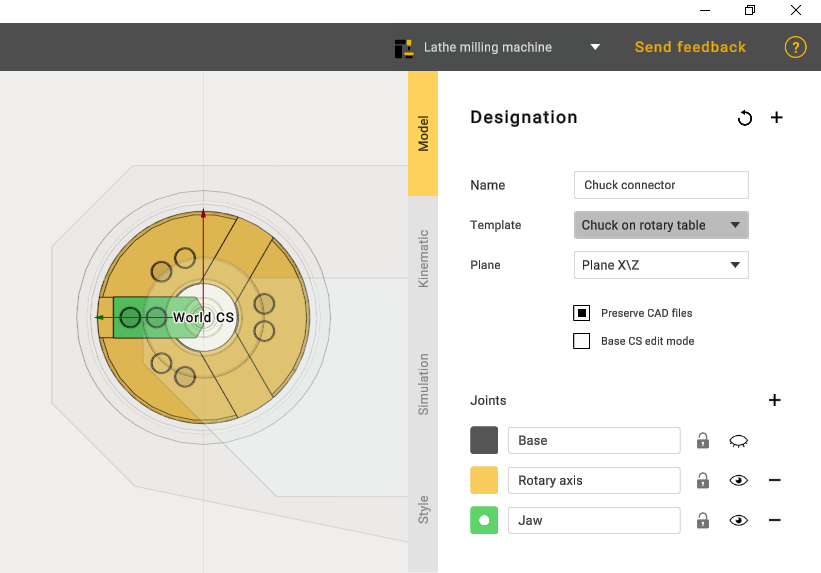
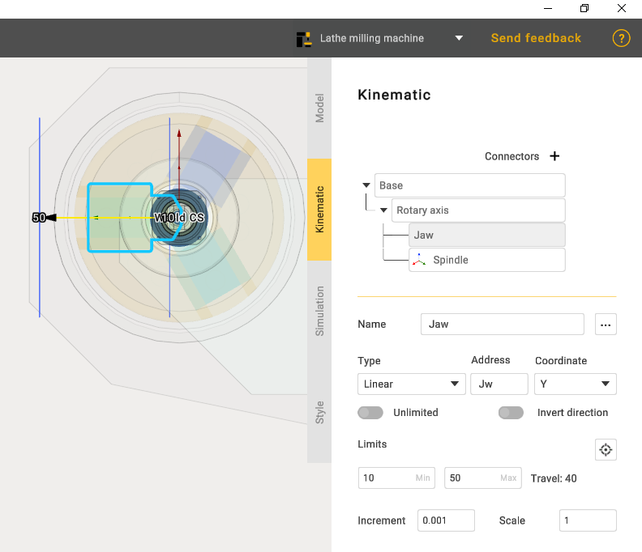
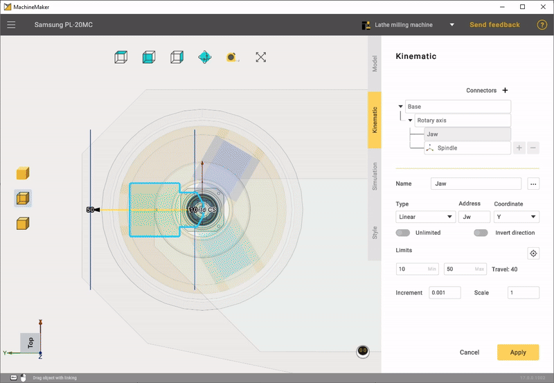

---
title: "척 커넥터"
---

# 척 커넥터

기계를 만든 후 다음 단계는 Chuck connector(척 커넥터)를 추가하는 것입니다.

모델을 편집할 때는 회전축과 죠 조인트만 사용합니다.

회전축은 처음부터 올바르게 설정되어 있으므로 죠의 이동 한계와 죠가 이동할 좌표만 편집하면 됩니다.

다음 단계로 죠의 홈 위치를 설정하고, 시뮬레이션에서 메커니즘이 올바르게 작동하는지 테스트한 다음 적용합니다.

