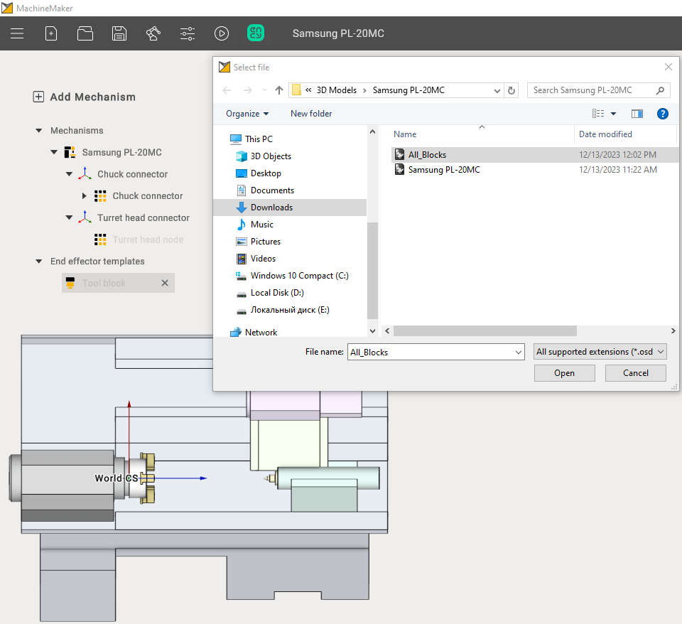
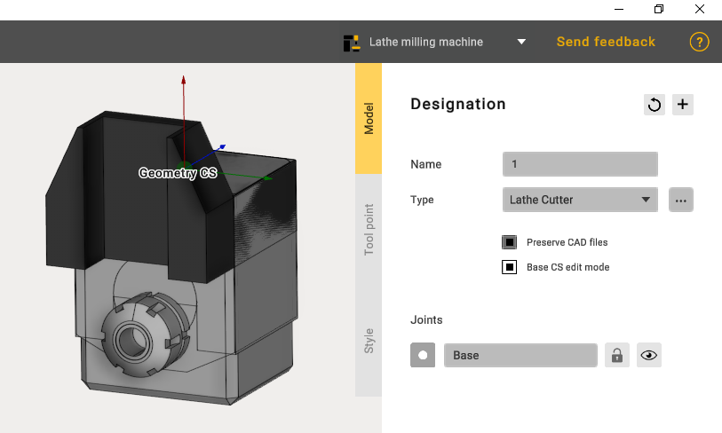
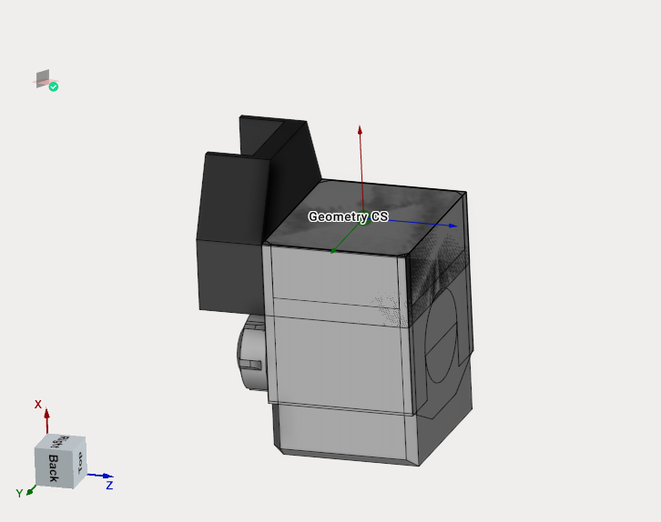
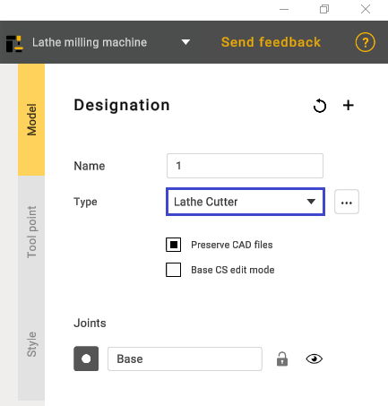
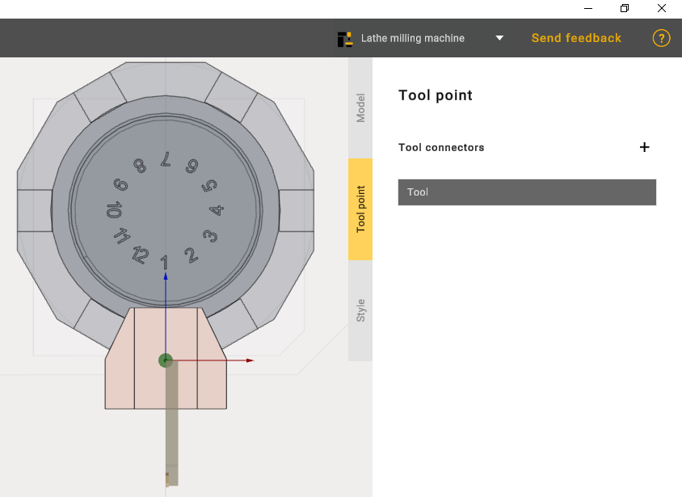
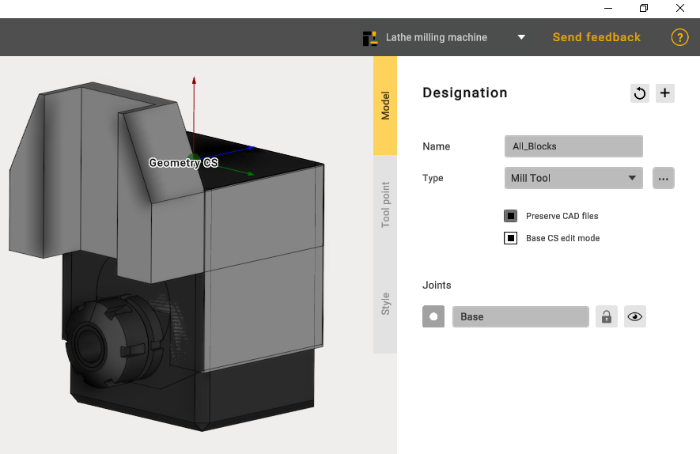
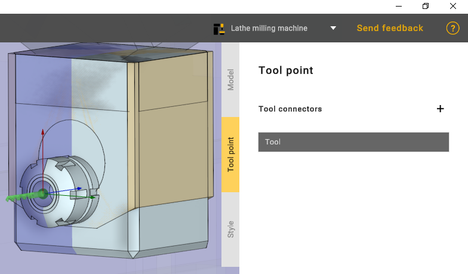

---
title: "공구 블록"
---

# 공구 블록

다음 단계는 공구 블록 두 개를 추가하는 것입니다.

먼저 선삭 공구를 추가합니다. 이를 위해 추가한 모델의 위쪽 영역을 색칠해야 합니다.

**Geometry CS**(형상 좌표계)가 공통 좌표계와 일치하는 것이 중요합니다.

원하는 공구 유형을 선택합니다.

Tool point(공구 포인트) 탭에서 그림과 같이 공구를 배치합니다.

두 번째 공구 블록을 추가하고 모델의 아래쪽 부분을 색칠합니다. 공구 유형은 Mill tool(밀링 공구)로 선택합니다.

Tool point 탭에서 그림과 같이 공구를 배치합니다.

그런 다음 Apply(적용) 버튼을 클릭하면 공구 블록 두 개의 추가가 완료됩니다.
